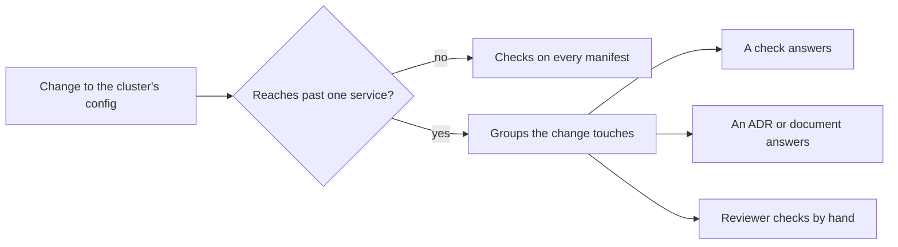

## Before you start

- [[k8s.l4.moving-to-a-new-cluster]] — you know production moves to a managed cluster built from Git, and what differs per cluster changes in the config repository first.
- [[backend.l4.backend-review-checklist]] — you know a review checklist points each question at the document, ADR or automated check that holds the answer, and a change is reviewed only against the groups it touches.
- [[k8s.l4.when-a-mesh-pays-off]] — you know ADR `0021` skips a service mesh and names what would reopen that choice.
- [[devops.l4.golden-path]] — you know `new-service.sh` fills in a template whose files pass kubeconform and `require-image-digest`.

## The situation

Production is moving to the managed cluster of ADR `0022`. A teammate proposes letting an HPA set the number of `api` Pods there, instead of the fixed `replicas: 3` in `envs/production/api.yaml`. The pull request adds one HPA object, and CI is green. A second teammate asks for a review before merging; a third says CI already checked the manifest, and nobody can read the whole cluster's setup again for every edit. Both worries are real: some questions no check can see, and reviewing everything every time never ends. Which changes deserve a review at the cluster level, and how does a reviewer answer each question without relying on memory?

## Core concepts

- Cluster-level change (a plain phrase, used in this sense here) — a change that reaches past one service. The checklist lists five: a new CRD or operator, a namespace for a new team, a new cluster or environment, an upgrade of Kubernetes or an add-on (a component installed into the cluster beside Kubernetes itself, such as Argo CD or an Ingress controller), or a new way for changes to reach the cluster.
- `cluster-review-checklist.md` — Đơn Hàng's questions for such a change, in six groups; service code uses `backend-review-checklist.md` instead.
- What answers a question (a plain phrase, used in this sense here) — the check that runs, the ADR or document that holds the decision, or, where neither exists, the reviewer's own look.
- Worked example (a plain phrase) — the checklist's last section, which runs its questions on one proposal: letting an HPA scale `api` on production.

## How it works



An edit inside one service's overlay skips the review: the checks on every manifest cover it. The HPA proposal matches none of the five, since it edits only `api`'s production manifests. Yet the worked example reviews it: the number of `api` Pods meets a limit other services share, PostgreSQL's connections. The list does not say it is complete; one reading treats a change to a shared limit as reaching past one service too.

When the checklist applies, the reviewer opens only the groups the change touches, of six: workloads, isolation, data and backups, upgrades and add-ons, cost, and delivery.

Each question names what answers it, of three kinds:

- A check. `require-image-digest` rejects Pods in `donhang` whose image from Đơn Hàng's registry has no digest. kubeconform in CI rejects manifests that break the schema. Pod Security Admission enforces the labels the OpenTofu module sets when it creates `donhang`; a namespace added through the config repository gets none.
- A decision. ADR `0021` covers encryption inside the cluster, ADR `0020` defines RTO and RPO as what the DR drill measures, ADR `0022` lists ties to the provider.
- The reviewer by hand, where neither exists, as for requests on every container.

The questions also carry common cluster mistakes. Pods with no requests make the scheduler count free room wrongly. A `kubectl` step outside the config repository is reverted by self-heal, or worse, if the object is not in Git at all, stays, since no Application tracks it. An operator nobody owns, in the checklist's words, blocks the next Kubernetes upgrade, since nobody checks whether it runs on the next version. A backup never restored is not yet a backup.

## In the Đơn Hàng system

The checklist opens with when it applies, then its first group:

```markdown file=docs/design/cluster-review-checklist.md tag=stage-4 lines=10-32
### Khi nào cần review

Khi thay đổi vượt quá một service:

- thêm một CRD hay một operator;
- thêm namespace cho một nhóm mới;
- thêm một cluster hay một môi trường;
- nâng phiên bản Kubernetes hay một add-on của cluster;
- đổi cách thay đổi tới cluster (Argo CD, repo cấu hình, CI).

Sửa manifest của một service trong overlay của nó không cần review này: các
phép kiểm bên dưới đã chạy trên mọi manifest.

### Workload và tài nguyên

- Mỗi container đã đặt request CPU và bộ nhớ chưa? Pod không request làm
  scheduler tính sai chỗ trống (`cluster-cost.md`). Người review tự kiểm.
- Deployment mới có probe `/health/live`, `/health/ready` và security context
  như `api` chưa? Template của golden path (`golden-path.md`) cho sẵn.
- Image có ghi bằng digest không? Admission policy `require-image-digest` từ
  chối Pod không có digest.
- Manifest có hợp lệ với schema của Kubernetes không? Kubeconform trong job
  `manifests` của CI.
```

The block lists five triggers, then says why an edit in one service's overlay skips the review: the checks below run on every manifest. The workload group shows all three kinds of answer. Requests point at `cluster-cost.md` and end with "the reviewer checks". Probes and security context point at the golden path's template, a document that gives the default. Digests and schema point at two checks.

A check answers only where it runs. In `require-image-digest.yaml`, the expression rejects only images from `ghcr.io/duyan11110/` without `@sha256:`. A second object, the binding, says where the policy applies and what happens on failure: here, reject (`Deny`) Pods in namespace `donhang` only. The Application `policies-staging` puts both on staging; no Application applies them to production at this tag. A Pod elsewhere, or with an image from another registry, is not covered.

The worked example closes the document:

```markdown file=docs/design/cluster-review-checklist.md tag=stage-4 lines=82-97
### Ví dụ: cho HPA scale `api` ở production

Đề xuất đã qua review, chưa đổi manifest:

- `replicas` được bỏ khỏi Deployment `api` trong Git; nếu không, Argo CD trả
  số replica về giá trị trong Git mỗi lần đồng bộ, đè lên số HPA đặt.
- `maxReplicas` được giới hạn sao cho số Pod api nhân số kết nối mỗi Pod vẫn
  dưới `max_connections` của PostgreSQL, như `capacity-plan.md` tính. Thêm
  node không nâng giới hạn này.
- `minReplicas` không dưới 2, để một Pod hỏng không làm api ngừng phục vụ.
- Một PodDisruptionBudget cho `api` giữ ít nhất một Pod khi node được nâng
  cấp hay rút khỏi cluster.
- Request CPU của `api` giữ như hiện tại: HPA tính mức dùng theo phần trăm của
  request, nên đổi request là đổi điểm scale.
- Cluster production cần nguồn số đo CPU cho HPA; lab không có, nên ví dụ này
  chỉ được kiểm trên cluster managed.
```

The proposal from the situation fails the first line: with `replicas: 3` still in Git, Argo CD puts that number back on each sync, over the HPA's. The ceiling comes from `capacity-plan.md`: each `api` Pod keeps its own set of open connections to PostgreSQL, up to a fixed maximum per Pod. Pods times connections, over every service, must stay below `max_connections`, the most connections PostgreSQL accepts at once, read with `SHOW max_connections`, not guessed. More nodes give room for Pods, not connections. The request stays because the HPA's target is a percentage of it. The last line admits the lab clusters you run yourself have no metrics-server, so the example is checked only on the managed cluster.

## Trade-offs

| | Checklist for changes past one service (the document) | Full cluster review on every manifest change | CI and admission policies alone |
|---|---|---|---|
| Cost per change | Only cluster-level changes, only the groups touched | Every edit waits for a reviewer | Nothing beyond the pipeline |
| What it sees | Questions a check answers, plus those only a person can see | The same questions, read less carefully when every edit arrives | Only what a check tests, where it runs |
| What slips through | A cluster-level change nobody recognises as one | What a reviewer skims past in the hundredth small review | Missing requests, an operator with no owner, a backup never restored, a namespace no binding selects |
| When it goes stale | When the cluster gains a kind of component no question covers | The same | When a check's scope stops matching the cluster |

## What would you choose if…

- …a teammate raises the memory limit of `api` in the staging overlay: no cluster review, because it is an edit inside one service's overlay that the checks on every manifest cover; the usual code review is enough.
- …a new team asks for its own namespace: review it, starting with isolation and access (Pod Security labels, NetworkPolicies for connections into and out of its Pods, whether Pods that never call the API server still get a ServiceAccount token mounted), then the workload group by hand, since `require-image-digest` binds only to `donhang`.
- …the provider offers the next Kubernetes version for the managed cluster: review the upgrades group, so every add-on and operator has an owner in `self-run-components.md` and runs on both versions, and every workload with several replicas has a PodDisruptionBudget.

## Seniors often assume…

- **"A cluster that passed the checklist once stays reviewed for good."** → Actually a review covers one change, and each later trigger runs it again, because the cluster keeps changing after it. You notice this when a Kubernetes upgrade stalls on an operator added after the last review, with no owner in `self-run-components.md`.
- **"Every manifest change needs a full cluster review."** → Actually an edit inside one service's overlay skips it, because the checks the questions point at already run on every manifest. You notice this when small pull requests wait days for a reviewer and the reviews turn into skimming.
- **"If CI and the admission policy pass, a cluster change needs no review."** → Actually a check answers only the question it tests, and only where it runs. kubeconform accepts a container with no requests, since the schema does not require them, and `require-image-digest` checks only Pods in `donhang` on staging. You notice this when the HPA pull request from the situation passes CI while `replicas: 3` is still in Git.

## Try it (3 minutes)

A new team proposes installing a PostgreSQL operator, from a public image named by tag, in its own new namespace `db-operator`, through the config repository. For each question, name what answers it: a check, an ADR or document, or the reviewer by hand.

1. Does this change need a cluster review at all?
2. Is the operator's image named by digest?
3. Who upgrades the operator, and does it run on the next Kubernetes version?
4. Its databases keep data: are they in Đơn Hàng's backups, and has a restore been tried?
5. Does the namespace have Pod Security labels?

Expected result: one source of answer per question, and for question 2 the reason the check does not cover it.

<details><summary>Suggested answer</summary>

1. Yes. It adds an operator, with its CRDs, and a namespace for a new team: two of the five triggers.
2. The reviewer by hand. `require-image-digest` rejects only images from `ghcr.io/duyan11110/` without a digest, and only in `donhang` on staging; a public image in `db-operator` passes it either way.
3. A document: an owner written in `self-run-components.md`, who then confirms the versions the operator supports. Without an owner, nobody checks the next version, and the operator can block the upgrade.
4. The reviewer, with ADR `0020` for how RTO and RPO are measured. The checklist counts a backup never restored as no backup.
5. A check only for `donhang`, whose labels the OpenTofu module sets when it creates the namespace. A namespace created from the config repository gets none from it, so the reviewer checks.

</details>

## Connections

- [[k8s.l3.admission-policies]] — the check behind the digest question, and the binding that limits where it runs.
- [[k8s.l3.pod-security-admission]] — the labels the isolation group asks about.
- [[design.l4.mapping-fitness-functions]] — the system-wide list of automated checks that the checklist's questions point at.
- [[k8s.l4.horizontal-pod-autoscaler]] — the object in the worked example, and why `replicas` leaves Git.
- [[k8s.l4.sharing-a-cluster]] — a namespace for a new team, one of the triggers for this review.
- [[backend.l4.backend-review-checklist]] — the same idea for a service's code and data, where this one covers the cluster.

## Five-line summary

1. A cluster review checklist points each question at the check, ADR or document that answers it, so reviewers compare with decisions, not memory.
2. Changes past one service get the review: an operator, a team namespace, a new cluster, an upgrade, a new delivery path, a shared limit.
3. Six groups cover workloads, isolation, data and backups, upgrades and add-ons, cost, and how changes reach the cluster.
4. Questions without a check say the reviewer checks by hand; a check answers only where it runs, as `require-image-digest` in `donhang`.
5. Letting an HPA scale `api` means `replicas` leaves Git, `maxReplicas` respects `max_connections`, and a PodDisruptionBudget covers node upgrades.
