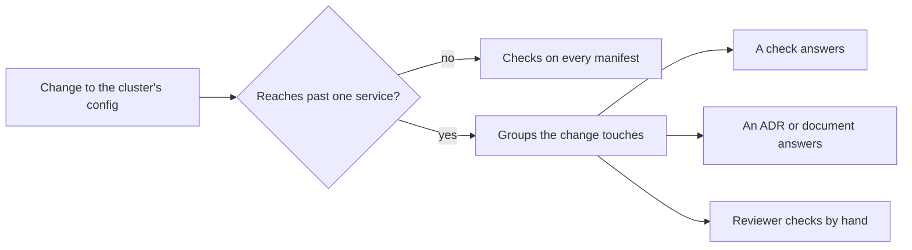

## Bạn cần biết trước

- [[k8s.l4.moving-to-a-new-cluster]] — bạn biết production chuyển sang một cluster managed dựng từ Git, và thứ khác nhau theo cluster được sửa trong repo cấu hình trước.
- [[backend.l4.backend-review-checklist]] — bạn biết một checklist review trỏ mỗi câu hỏi tới tài liệu, ADR hay phép kiểm tự động giữ câu trả lời, và một thay đổi chỉ được review theo những nhóm nó chạm tới.
- [[k8s.l4.when-a-mesh-pays-off]] — bạn biết ADR `0021` không dùng service mesh và nêu rõ điều gì sẽ mở lại lựa chọn đó.
- [[devops.l4.golden-path]] — bạn biết `new-service.sh` điền vào một template có các file qua được kubeconform và `require-image-digest`.

## Tình huống

Production đang chuyển sang cluster managed của ADR `0022`. Một đồng nghiệp đề xuất để HPA đặt số Pod `api` ở đó, thay cho `replicas: 3` cố định trong `envs/production/api.yaml`. Pull request thêm một object HPA, và CI xanh. Người thứ hai muốn review trước khi merge. Người thứ ba bảo CI đã kiểm manifest rồi, và không ai đọc lại được toàn bộ thiết lập của cluster cho mỗi lần sửa. Cả hai lo lắng đều có lý: có những câu hỏi không phép kiểm nào thấy được, còn review mọi thứ mỗi lần thì không bao giờ xong. Vậy thay đổi nào đáng một đợt review ở mức cluster, và người review trả lời từng câu hỏi thế nào mà không dựa vào trí nhớ?

## Khái niệm cốt lõi

- Thay đổi ở mức cluster (cụm từ thường, dùng theo nghĩa này trong bài) — thay đổi vượt quá một service. Checklist liệt kê năm loại: thêm CRD hay operator, thêm namespace cho một nhóm mới, thêm cluster hay môi trường, nâng phiên bản Kubernetes hay một add-on (thành phần cài vào cluster bên cạnh chính Kubernetes, như Argo CD hay một Ingress controller), hoặc đổi cách thay đổi tới cluster.
- `cluster-review-checklist.md` — bộ câu hỏi của Đơn Hàng cho những thay đổi như vậy, chia thành sáu nhóm. Code của service thì dùng `backend-review-checklist.md`.
- Thứ trả lời câu hỏi (cụm từ thường, dùng theo nghĩa này trong bài) — phép kiểm đang chạy, ADR hay tài liệu giữ quyết định, hoặc, khi không có cả hai, chính người review tự xem.
- Ví dụ mẫu (cụm từ thường) — phần cuối của checklist, chạy các câu hỏi trên một đề xuất cụ thể: để HPA scale `api` ở production.

## Cơ chế hoạt động



Một lần sửa trong overlay của một service thì bỏ qua review này: các phép kiểm chạy trên mọi manifest đã lo phần đó. Đề xuất HPA không khớp loại nào trong năm loại, vì nó chỉ sửa manifest production của `api`. Vậy mà ví dụ mẫu vẫn review nó: số Pod `api` chạm tới một giới hạn mà các service khác dùng chung, đó là số kết nối của PostgreSQL. Danh sách không tự nhận là đầy đủ. Một cách đọc coi thay đổi chạm tới giới hạn dùng chung cũng là vượt quá một service.

Khi checklist áp dụng, người review chỉ mở những nhóm thay đổi chạm tới, trong sáu nhóm: workload, cô lập, dữ liệu và backup, nâng cấp và add-on, chi phí, và đường đưa thay đổi.

Mỗi câu hỏi nêu thứ trả lời nó, thuộc một trong ba loại:

- Một phép kiểm. `require-image-digest` từ chối Pod trong `donhang` có image từ registry của Đơn Hàng mà không có digest. kubeconform trong CI từ chối manifest sai schema. Pod Security Admission áp các label mà module OpenTofu đặt khi tạo `donhang`. Namespace thêm qua repo cấu hình thì không có label nào.
- Một quyết định. ADR `0021` lo phần mã hóa bên trong cluster, ADR `0020` định nghĩa RTO và RPO là thứ buổi diễn tập DR đo, ADR `0022` liệt kê những chỗ gắn với nhà cung cấp.
- Người review tự xem, khi không có cả hai, như với request trên mọi container.

Các câu hỏi cũng mang theo những lỗi cluster hay gặp. Pod không có request làm scheduler tính sai chỗ trống. Một bước `kubectl` ngoài repo cấu hình sẽ bị self-heal trả lại, hoặc tệ hơn, nếu object hoàn toàn không có trong Git, nó ở lại luôn, vì không Application nào theo dõi nó. Một operator không ai sở hữu, theo lời checklist, sẽ chặn lần nâng phiên bản Kubernetes tiếp theo, vì không ai kiểm xem nó có chạy trên phiên bản mới không. Một bản backup chưa từng được khôi phục thì chưa phải là backup.

## Trong hệ thống Đơn Hàng

Checklist mở đầu bằng điều kiện áp dụng, rồi tới nhóm đầu tiên:

```markdown file=docs/design/cluster-review-checklist.md tag=stage-4 lines=10-32
### Khi nào cần review

Khi thay đổi vượt quá một service:

- thêm một CRD hay một operator;
- thêm namespace cho một nhóm mới;
- thêm một cluster hay một môi trường;
- nâng phiên bản Kubernetes hay một add-on của cluster;
- đổi cách thay đổi tới cluster (Argo CD, repo cấu hình, CI).

Sửa manifest của một service trong overlay của nó không cần review này: các
phép kiểm bên dưới đã chạy trên mọi manifest.

### Workload và tài nguyên

- Mỗi container đã đặt request CPU và bộ nhớ chưa? Pod không request làm
  scheduler tính sai chỗ trống (`cluster-cost.md`). Người review tự kiểm.
- Deployment mới có probe `/health/live`, `/health/ready` và security context
  như `api` chưa? Template của golden path (`golden-path.md`) cho sẵn.
- Image có ghi bằng digest không? Admission policy `require-image-digest` từ
  chối Pod không có digest.
- Manifest có hợp lệ với schema của Kubernetes không? Kubeconform trong job
  `manifests` của CI.
```

Đoạn trích liệt kê năm điều kiện kích hoạt, rồi giải thích vì sao sửa trong overlay của một service thì bỏ qua review: các phép kiểm bên dưới chạy trên mọi manifest. Nhóm workload cho thấy đủ ba loại câu trả lời. Request trỏ tới `cluster-cost.md` và kết thúc bằng "người review tự kiểm". Probe và security context trỏ tới template của golden path, một tài liệu cho sẵn giá trị mặc định. Digest và schema trỏ tới hai phép kiểm.

Một phép kiểm chỉ trả lời ở nơi nó chạy. Trong `require-image-digest.yaml`, biểu thức chỉ từ chối image từ `ghcr.io/duyan11110/` mà không có `@sha256:`. Object thứ hai, binding, nói policy áp ở đâu và làm gì khi không đạt: ở đây là từ chối (`Deny`) Pod chỉ trong namespace `donhang`. Application `policies-staging` đưa cả hai lên staging. Ở tag này chưa Application nào áp chúng cho production. Pod ở nơi khác, hay có image từ registry khác, đều không được kiểm.

Ví dụ mẫu khép lại tài liệu:

```markdown file=docs/design/cluster-review-checklist.md tag=stage-4 lines=82-97
### Ví dụ: cho HPA scale `api` ở production

Đề xuất đã qua review, chưa đổi manifest:

- `replicas` được bỏ khỏi Deployment `api` trong Git; nếu không, Argo CD trả
  số replica về giá trị trong Git mỗi lần đồng bộ, đè lên số HPA đặt.
- `maxReplicas` được giới hạn sao cho số Pod api nhân số kết nối mỗi Pod vẫn
  dưới `max_connections` của PostgreSQL, như `capacity-plan.md` tính. Thêm
  node không nâng giới hạn này.
- `minReplicas` không dưới 2, để một Pod hỏng không làm api ngừng phục vụ.
- Một PodDisruptionBudget cho `api` giữ ít nhất một Pod khi node được nâng
  cấp hay rút khỏi cluster.
- Request CPU của `api` giữ như hiện tại: HPA tính mức dùng theo phần trăm của
  request, nên đổi request là đổi điểm scale.
- Cluster production cần nguồn số đo CPU cho HPA; lab không có, nên ví dụ này
  chỉ được kiểm trên cluster managed.
```

Đề xuất trong tình huống trượt ngay dòng đầu: khi `replicas: 3` vẫn nằm trong Git, Argo CD đặt lại con số đó mỗi lần đồng bộ, đè lên số của HPA. Mức trần lấy từ `capacity-plan.md`: mỗi Pod `api` giữ một nhóm kết nối mở riêng tới PostgreSQL, tối đa một con số cố định cho mỗi Pod. Số Pod nhân số kết nối, cộng qua mọi service, phải dưới `max_connections`, tức số kết nối tối đa PostgreSQL nhận cùng lúc, đọc bằng `SHOW max_connections` chứ không đoán. Thêm node cho thêm chỗ chạy Pod, không cho thêm kết nối. Request giữ nguyên vì mục tiêu của HPA là phần trăm của request. Dòng cuối thừa nhận các cluster lab bạn tự chạy không có metrics-server, nên ví dụ chỉ được kiểm trên cluster managed.

## Đánh đổi

| | Checklist cho thay đổi vượt quá một service (tài liệu) | Review toàn cluster cho mọi thay đổi manifest | Chỉ CI và admission policy |
|---|---|---|---|
| Chi phí mỗi thay đổi | Chỉ thay đổi ở mức cluster, chỉ những nhóm bị chạm tới | Mọi lần sửa đều chờ người review | Không gì ngoài pipeline |
| Thứ nó thấy | Câu hỏi có phép kiểm trả lời, cộng những câu chỉ người mới thấy được | Cùng những câu hỏi đó, nhưng đọc lơ là hơn khi lần sửa nào cũng tới | Chỉ thứ một phép kiểm test, ở nơi nó chạy |
| Thứ lọt qua | Thay đổi ở mức cluster mà không ai nhận ra | Thứ người review đọc lướt qua ở lần review nhỏ thứ một trăm | Thiếu request, operator không người sở hữu, backup chưa từng khôi phục, namespace không binding nào chọn |
| Khi nào lỗi thời | Khi cluster có thêm một loại thành phần chưa câu hỏi nào bao | Như trên | Khi phạm vi của một phép kiểm không còn khớp với cluster |

## Bạn sẽ chọn gì nếu…

- …một đồng nghiệp tăng memory limit của `api` trong overlay staging: không review cluster, vì đây là lần sửa trong overlay của một service, đã có các phép kiểm chạy trên mọi manifest lo. Code review thông thường là đủ.
- …một nhóm mới xin namespace riêng: review, bắt đầu từ nhóm cô lập và quyền truy cập (label Pod Security, NetworkPolicy cho kết nối vào và ra khỏi Pod của nhóm, Pod không bao giờ gọi API server có còn được mount token ServiceAccount không), rồi tự kiểm nhóm workload, vì `require-image-digest` chỉ bind vào `donhang`.
- …nhà cung cấp mở phiên bản Kubernetes tiếp theo cho cluster managed: review nhóm nâng cấp, để mọi add-on và operator có người sở hữu trong `self-run-components.md` và chạy được trên cả hai phiên bản, và mọi workload có nhiều replica đều có PodDisruptionBudget.

## Senior hay nhầm rằng…

- **"Cluster đã qua checklist một lần thì coi như được review mãi mãi."** → Thực ra một đợt review chỉ bao một thay đổi, và mỗi lần kích hoạt sau lại chạy nó lần nữa, vì cluster vẫn tiếp tục thay đổi. Bạn sẽ nhận ra khi một lần nâng phiên bản Kubernetes bị kẹt vì một operator thêm vào sau đợt review trước, không có người sở hữu trong `self-run-components.md`.
- **"Mọi thay đổi manifest đều cần review toàn cluster."** → Thực ra lần sửa trong overlay của một service thì bỏ qua, vì các phép kiểm mà câu hỏi trỏ tới đã chạy trên mọi manifest. Bạn sẽ nhận ra khi những pull request nhỏ phải chờ người review nhiều ngày và các đợt review thành đọc lướt.
- **"CI và admission policy đều qua thì thay đổi cluster không cần review."** → Thực ra một phép kiểm chỉ trả lời câu hỏi nó test, và chỉ ở nơi nó chạy. kubeconform chấp nhận container không có request, vì schema không bắt buộc, còn `require-image-digest` chỉ kiểm Pod trong `donhang` trên staging. Bạn sẽ nhận ra khi pull request HPA trong tình huống qua CI trong khi `replicas: 3` vẫn nằm trong Git.

## Thử ngay (3 phút)

Một nhóm mới đề xuất cài một operator PostgreSQL, từ một image công khai ghi bằng tag, vào namespace mới `db-operator` của riêng nhóm, qua repo cấu hình. Với mỗi câu hỏi, nêu thứ trả lời nó: một phép kiểm, một ADR hay tài liệu, hoặc người review tự kiểm.

1. Thay đổi này có cần review cluster không?
2. Image của operator có ghi bằng digest không?
3. Ai nâng cấp operator, và nó có chạy trên phiên bản Kubernetes tiếp theo không?
4. Các database của nó giữ dữ liệu: chúng có nằm trong backup của Đơn Hàng không, và đã thử khôi phục chưa?
5. Namespace có label Pod Security không?

Kết quả mong đợi: mỗi câu hỏi một nguồn trả lời, và với câu 2 là lý do phép kiểm không bao được.

<details><summary>Gợi ý đáp án</summary>

1. Có. Nó thêm một operator, kèm các CRD, và một namespace cho nhóm mới: hai trong năm điều kiện kích hoạt.
2. Người review tự kiểm. `require-image-digest` chỉ từ chối image từ `ghcr.io/duyan11110/` không có digest, và chỉ trong `donhang` trên staging. Image công khai trong `db-operator` đằng nào cũng qua.
3. Một tài liệu: người sở hữu ghi trong `self-run-components.md`, người này sau đó xác nhận các phiên bản operator hỗ trợ. Không có người sở hữu thì không ai kiểm phiên bản tiếp theo, và operator có thể chặn lần nâng cấp.
4. Người review, cùng ADR `0020` cho cách đo RTO và RPO. Checklist coi backup chưa từng khôi phục là chưa có backup.
5. Một phép kiểm, nhưng chỉ cho `donhang`, vì label của nó do module OpenTofu đặt khi tạo namespace. Namespace tạo từ repo cấu hình không nhận label nào từ module đó, nên người review tự kiểm.

</details>

## Liên hệ

- [[k8s.l3.admission-policies]] — phép kiểm đứng sau câu hỏi về digest, và binding giới hạn nơi nó chạy.
- [[k8s.l3.pod-security-admission]] — các label mà nhóm cô lập hỏi tới.
- [[design.l4.mapping-fitness-functions]] — danh sách phép kiểm tự động của cả hệ thống, nơi các câu hỏi của checklist trỏ tới.
- [[k8s.l4.horizontal-pod-autoscaler]] — object trong ví dụ mẫu, và vì sao `replicas` phải rời khỏi Git.
- [[k8s.l4.sharing-a-cluster]] — namespace cho nhóm mới, một trong những điều kiện kích hoạt review này.
- [[backend.l4.backend-review-checklist]] — cùng ý tưởng cho code và dữ liệu của một service, còn checklist này lo phần cluster.

## Tóm tắt 5 dòng

1. Checklist review cluster trỏ mỗi câu hỏi tới phép kiểm, ADR hay tài liệu trả lời nó, để người review đối chiếu với quyết định chứ không với trí nhớ.
2. Thay đổi vượt quá một service thì cần review: một operator, namespace cho một nhóm, cluster mới, nâng phiên bản, đường đưa thay đổi mới, một giới hạn dùng chung.
3. Sáu nhóm bao workload, cô lập, dữ liệu và backup, nâng cấp và add-on, chi phí, và cách thay đổi tới cluster.
4. Câu hỏi không có phép kiểm thì ghi người review tự kiểm. Một phép kiểm chỉ trả lời ở nơi nó chạy, như `require-image-digest` trong `donhang`.
5. Để HPA scale `api` nghĩa là `replicas` rời khỏi Git, `maxReplicas` tôn trọng `max_connections`, và một PodDisruptionBudget lo lúc nâng cấp node.
