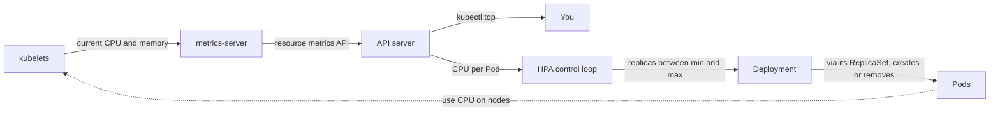

## Before you start

- [[k8s.l1.requests-and-limits]] — you know a request is what kube-scheduler reserves on a node, and a container may use more or less than it.
- [[k8s.l1.deployments]] — you know changing a Deployment's `replicas` scales its ReplicaSet while running Pods keep running.
- [[devops.l3.self-heal]] — you know Argo CD puts a hand-made change to `replicas` back to the value in Git.
- [[backend.l4.load-testing]] — you know a load test shows the point where more load only adds waiting.

## The situation

The load test showed where more product reads in flight only add waiting. The shop's evening peak needs more `api` Pods than the quiet night does, yet staging runs a fixed count of 2 from Git. When you raised it by hand with `kubectl scale`, self-heal put it back to 2, and nobody is awake at night to lower it again. The team wants the count to rise with the load and fall after it, inside limits the nodes can afford. You run `kubectl top pods` to see how busy the Pods are, and it fails with an error. What could set the number of Pods for you, and what does it need to measure?

## Core concepts

- **metrics-server** — a component that collects each Pod's current CPU and memory use from the kubelets and serves it through the API server, for `kubectl top` and for autoscaling; it keeps the values only short-term in memory, not a history you can query later.
- **HorizontalPodAutoscaler (HPA)** — a Kubernetes object whose control loop keeps setting a Deployment's replica count between `minReplicas` and `maxReplicas` from metrics such as CPU use.
- Target utilization (not a new term) — for CPU, the use the HPA aims at, written as a percentage of each Pod's CPU request.
- Scale-down window (not a new term) — how long the HPA waits after the load drops before it lowers the count.

## How it works



In the situation above, nothing sits between the kubelets and the API server: `donhang` runs no metrics-server, so `kubectl top` has nothing to read. Where metrics-server runs, it asks each kubelet for the current use of its Pods. It serves the values through an extra API it registers with the API server, the metrics API; `kubectl get apiservice v1beta1.metrics.k8s.io` shows whether that registration exists. It keeps no history, so it answers "how busy now", never "how busy yesterday".

The HPA's control loop reads the same values. For CPU it divides each Pod's measured use by its CPU request and averages the result over the Pods, then compares that average with the target utilization.

The new count is the current count times measured over target, rounded up; when measured is only a little away from the target, the HPA leaves the count as it is. Take one Pod with a request of `50m` and a target of 50%. If it uses `100m`, measured utilization is 200%, so the HPA wants 1 × 200 / 50 = 4 replicas. The result is kept between `minReplicas` and `maxReplicas`. At `maxReplicas` the HPA still reads and shows the use; it only stops raising the count.

The HPA writes that count into the Deployment, and its ReplicaSet creates or removes Pods. More Pods share the load and the loop starts again. When the load drops, the HPA waits for the scale-down window before it lowers the count.

The HPA needs two numbers for every Pod: a use and a request. If either is missing, CPU utilization is undefined and the HPA takes no action: the count stays as it is. With no metrics at all, as on `donhang`, `kubectl get hpa` shows the target as `<unknown>`.

## In the Đơn Hàng system

The lab stands `cpu-echo` in for `api`: a small Deployment in the namespace `autoscale-lessons` whose Pods answer every request, so their CPU use grows with the requests sent to them. `cpu-echo.yaml` gives it a CPU request of `50m` and no `replicas`. Its HPA:

```yaml file=deploy/k8s/lessons/cpu-echo-hpa.yaml tag=stage-4 lines=6-27
apiVersion: autoscaling/v2
kind: HorizontalPodAutoscaler
metadata:
  name: cpu-echo
  namespace: autoscale-lessons
spec:
  scaleTargetRef:
    apiVersion: apps/v1
    kind: Deployment
    name: cpu-echo
  minReplicas: 1
  maxReplicas: 5
  metrics:
    - type: Resource
      resource:
        name: cpu
        target:
          type: Utilization
          averageUtilization: 50
  behavior:
    scaleDown:
      stabilizationWindowSeconds: 30
```

`scaleTargetRef` names the Deployment whose count the HPA owns. `minReplicas` and `maxReplicas` are the limits, and `averageUtilization: 50` is the target: half of each Pod's `50m` CPU request. `stabilizationWindowSeconds: 30` is the scale-down window; left out, it would be 300 seconds.

The missing `replicas` in `cpu-echo.yaml` matters with Argo CD. If the manifest in Git kept `replicas: 2`, the HPA would raise the count at the peak and Argo CD would set it back to 2: at once with self-heal on, or at the next sync. So a Deployment that an HPA scales leaves `replicas` out of Git.

`autoscale.sh` then reads what the HPA sees on `donhang`:

```bash file=scripts/k8s/autoscale.sh tag=stage-4 lines=24-40
# lesson: k8s.l4.horizontal-pod-autoscaler
# No metrics-server in this cluster: nothing serves the resource metrics
# API, so kubectl top has nothing to read, and neither has the HPA.
echo "\$ kubectl top pods -n autoscale-lessons"
kubectl top pods -n autoscale-lessons 2>&1 || true
echo "\$ kubectl get apiservice v1beta1.metrics.k8s.io"
kubectl get apiservice v1beta1.metrics.k8s.io 2>&1 || true
echo

# lesson: k8s.l4.horizontal-pod-autoscaler
# The HPA cannot compute the CPU use as a percentage of the request: its
# target is <unknown>, ScalingActive is False, and the count stays at 1.
hpa
echo "\$ kubectl get hpa cpu-echo -n autoscale-lessons -o jsonpath=<conditions>"
kubectl get hpa cpu-echo -n autoscale-lessons \
  -o jsonpath='{range .status.conditions[*]}{.type}={.status} ({.reason}){"\n"}{end}'
echo
```

```text output=true
...
$ kubectl top pods -n autoscale-lessons
error: Metrics API not available
$ kubectl get apiservice v1beta1.metrics.k8s.io
Error from server (NotFound): apiservices.apiregistration.k8s.io "v1beta1.metrics.k8s.io" not found

$ kubectl get hpa cpu-echo -n autoscale-lessons
NAME       REFERENCE             TARGETS              MINPODS   MAXPODS   REPLICAS   AGE
cpu-echo   Deployment/cpu-echo   cpu: <unknown>/50%   1         5         1          ...
$ kubectl get hpa cpu-echo -n autoscale-lessons -o jsonpath=<conditions>
AbleToScale=True (SucceededGetScale)
ScalingActive=False (FailedGetResourceMetric)
...
```

`hpa` is a helper defined earlier in the script that prints and runs `kubectl get hpa cpu-echo`. `kubectl top` fails, and `kubectl get apiservice` finds no registration for the metrics API. The HPA shows `cpu: <unknown>/50%`: it knows the target, not the use. Its status lists conditions as name=`True` or `False` with a reason, and the `jsonpath` option prints only those lines. `AbleToScale=True` means it can read and change the Deployment's count; `ScalingActive=False` with `FailedGetResourceMetric` means it has no metric to compute from, so the count stays at 1.

Later in the script, outside this excerpt, a Pod sends requests to `cpu-echo` without pause for a minute; the output still shows `<unknown>` and the Deployment at `1/1`. For this HPA to act on `donhang`, metrics-server would have to run there.

## Trade-offs

| | Fixed `replicas` in Git | Changed by hand | HPA on CPU |
|---|---|---|---|
| Who sets the count | A commit | A person with `kubectl scale` | The HPA's control loop |
| Reacts to | Nothing | Whoever is watching | Measured CPU over the request |
| Needs | Nothing extra | Someone awake, and Argo CD not undoing it | metrics-server, CPU requests, `replicas` left out of Git |
| Quiet hours | Pays for the peak count all night | Depends on someone lowering it | Falls towards `minReplicas` after the window |
| Blind to | Every change in load | Nothing the person checks | Limits that are not this Pod's CPU, such as the database |

## What would you choose if…

- …the load is steady through the day and the fixed count already has headroom: fixed `replicas` in Git, because an HPA adds a component to run and a moving count to explain, for no gain.
- …the load test shows `api` running out of CPU at the evening peak, and the rest of the night is quiet: an HPA on CPU, with `minReplicas` covering the quiet load and `maxReplicas` no higher than the nodes and the database can carry.
- …the load test shows waiting grows because the database or a shared limit is full while `api` CPU stays low: not an HPA on CPU. It would not see the problem, and more `api` Pods would only queue more requests at the same place.

## Seniors often assume…

- **"The HPA adds Pods when a Pod's CPU reaches its limit."** → Actually the target is a percentage of the request, averaged over the Pods; the limit plays no part in the calculation. You notice this when an HPA with a 50% target scales a Deployment whose Pods are nowhere near their CPU limit.
- **"Once the load drops, the extra Pods are removed straight away."** → Actually the HPA waits for the scale-down window before it lowers the count, 300 seconds by default and 30 in `cpu-echo-hpa.yaml`. You notice this when `REPLICAS` stays high for minutes after a load test ends.
- **"`kubectl top` shows how a Pod's CPU use changed over the last day."** → Actually metrics-server keeps no history, so `kubectl top` shows now. You notice this when you try to explain last night's scaling and find no past values; history needs a tool that keeps time series, such as Prometheus.

## Try it (3 minutes)

From the root of the Đơn Hàng repository, with Docker Desktop (the program that runs Docker containers on your machine) running, and `kubectl` and kind (the tool that runs the `donhang` cluster as Docker containers) installed:

1. Run `scripts/k8s/autoscale.sh`. It creates `donhang` if it is not running, waits up to three minutes each for `cpu-echo`, the HPA's status and the load Pod, then sends load for one minute: allow up to ten minutes when `donhang` already runs. Read the next step while it runs.
2. Suppose metrics-server did run, one `cpu-echo` Pod used `75m`, and the target stayed at 50% of the `50m` request. How many replicas would the HPA want?

Expected result: `error: Metrics API not available` from `kubectl top`, the HPA at `cpu: <unknown>/50%` with 1 replica, `ScalingActive=False (FailedGetResourceMetric)`, and the Deployment still at `1/1` after the load.

<details><summary>Suggested answer</summary>

`75m` over a `50m` request is 150%. The new count is 1 × 150 / 50 = 3 replicas, which is inside the limits of 1 and 5. On `donhang` the HPA never gets that far: with no use to divide, it shows `<unknown>` and keeps the count at 1.

</details>

## Connections

- [[k8s.l1.requests-and-limits]] — the request the HPA's target is a percentage of; without it the HPA takes no action.
- [[devops.l3.self-heal]] — why `replicas` leaves Git once an HPA owns the count.
- [[backend.l4.load-testing]] — tells you whether CPU is the limit an HPA on CPU can see.
- [[k8s.l1.control-plane-components]] — the control plane runs the HPA's control loop.
- [[backend.l4.capacity-planning]] — where `maxReplicas` comes from: what the nodes and the database can carry.
- [[k8s.l4.sharing-a-cluster]] — a namespace's quota still counts each Pod the HPA adds.
- [[k8s.l4.node-autoscaling]] — next: the extra Pods still need nodes with room.

## Five-line summary

1. An HPA keeps setting a Deployment's replica count between `minReplicas` and `maxReplicas` from measured CPU as a percentage of the request.
2. metrics-server serves each Pod's current CPU and memory through the API server; it keeps no history, and `donhang` has none.
3. The new count is the current one times measured over target, rounded up, unless measured is close to the target.
4. Without metrics or without a CPU request the HPA takes no action; with no metrics, as on `donhang`, it shows `<unknown>`.
5. Scale-down waits a window, 300 seconds by default; with Argo CD, the Deployment in Git leaves out `replicas`.
