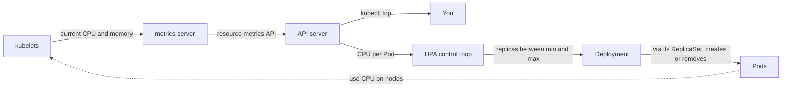

## Bạn cần biết trước

- [[k8s.l1.requests-and-limits]] — bạn biết request là phần kube-scheduler giữ chỗ trên node, và container có thể dùng nhiều hơn hoặc ít hơn mức đó.
- [[k8s.l1.deployments]] — bạn biết đổi `replicas` của một Deployment sẽ scale ReplicaSet của nó, trong khi các Pod đang chạy vẫn chạy tiếp.
- [[devops.l3.self-heal]] — bạn biết Argo CD đưa `replicas` bị sửa tay về lại giá trị trong Git.
- [[backend.l4.load-testing]] — bạn biết load test chỉ ra điểm mà từ đó tải thêm chỉ làm tăng thời gian chờ.

## Tình huống

Load test đã chỉ ra điểm mà từ đó có thêm request đọc sản phẩm cùng lúc chỉ làm tăng thời gian chờ. Giờ cao điểm buổi tối của cửa hàng cần nhiều Pod `api` hơn ban đêm vắng khách, thế mà staging chạy cố định 2 Pod theo Git. Khi bạn tăng số Pod bằng tay với `kubectl scale`, self-heal đưa nó về lại 2, và ban đêm chẳng ai thức để hạ xuống. Đội muốn số Pod tăng theo tải và giảm khi tải qua đi, trong giới hạn mà các node gánh được. Bạn chạy `kubectl top pods` để xem các Pod bận tới đâu, và lệnh báo lỗi. Thứ gì có thể đặt số Pod thay bạn, và nó cần đo cái gì?

## Khái niệm cốt lõi

- **metrics-server** (Thành phần lấy mức CPU, memory hiện tại của Pod từ kubelet và phục vụ qua API server, không giữ lịch sử) — thành phần thu mức CPU và memory hiện tại của từng Pod từ các kubelet và phục vụ qua API server, cho `kubectl top` và cho tự động scale. Nó chỉ giữ các giá trị trong bộ nhớ một thời gian ngắn, không phải lịch sử để bạn tra lại sau.
- **HorizontalPodAutoscaler (HPA)** (Object Kubernetes tự đặt số replica của Deployment trong khoảng min–max theo số đo như CPU so với request) — object Kubernetes có control loop liên tục đặt số replica của một Deployment trong khoảng `minReplicas` tới `maxReplicas`, dựa trên số đo như mức dùng CPU.
- Target utilization (không phải term mới) — với CPU, đây là mức dùng mà HPA nhắm tới, viết dưới dạng phần trăm của CPU request mỗi Pod.
- Scale-down window (không phải term mới) — khoảng thời gian HPA chờ sau khi tải giảm rồi mới hạ số replica.

## Cơ chế hoạt động



Trong tình huống trên, giữa các kubelet và API server không có gì cả: `donhang` không chạy metrics-server, nên `kubectl top` chẳng có gì để đọc. Ở cluster có metrics-server, nó hỏi từng kubelet mức dùng hiện tại của các Pod trên đó. Nó phục vụ các giá trị này qua một API phụ mà nó đăng ký với API server, gọi là metrics API. Lệnh `kubectl get apiservice v1beta1.metrics.k8s.io` cho biết bản đăng ký đó có tồn tại không. Nó không giữ lịch sử, nên chỉ trả lời "bây giờ bận tới đâu", không bao giờ trả lời "hôm qua bận tới đâu".

Control loop của HPA đọc cùng các giá trị đó. Với CPU, nó chia mức dùng đo được của mỗi Pod cho CPU request của Pod, lấy trung bình trên các Pod, rồi so trung bình này với target utilization.

Số replica mới bằng số hiện tại nhân với tỉ lệ đo được trên mục tiêu, làm tròn lên. Khi mức đo được chỉ lệch mục tiêu một chút, HPA giữ nguyên số replica. Lấy một Pod có request `50m` và mục tiêu 50%. Nếu Pod dùng `100m`, mức dùng đo được là 200%, nên HPA muốn 1 × 200 / 50 = 4 replica. Kết quả luôn được giữ trong khoảng `minReplicas` tới `maxReplicas`. Khi đã chạm `maxReplicas`, HPA vẫn đọc và hiện mức dùng, nó chỉ thôi tăng số replica.

HPA ghi con số đó vào Deployment, và ReplicaSet của Deployment tạo thêm hoặc xóa bớt Pod. Nhiều Pod hơn thì chia nhau tải, và vòng lặp bắt đầu lại. Khi tải giảm, HPA chờ hết scale-down window rồi mới hạ số replica.

Với mỗi Pod, HPA cần hai con số: mức dùng và request. Thiếu một trong hai thì không tính được CPU utilization, và HPA không làm gì: số replica giữ nguyên. Khi không có số đo nào, như trên `donhang`, `kubectl get hpa` hiện mục tiêu dưới dạng `<unknown>`.

## Trong hệ thống Đơn Hàng

Bài lab dùng `cpu-echo` thay cho `api`: một Deployment nhỏ trong namespace `autoscale-lessons`, Pod của nó trả lời mọi request, nên mức dùng CPU tăng theo số request gửi tới. `cpu-echo.yaml` cho nó CPU request `50m` và không ghi `replicas`. HPA của nó:

```yaml file=deploy/k8s/lessons/cpu-echo-hpa.yaml tag=stage-4 lines=6-27
apiVersion: autoscaling/v2
kind: HorizontalPodAutoscaler
metadata:
  name: cpu-echo
  namespace: autoscale-lessons
spec:
  scaleTargetRef:
    apiVersion: apps/v1
    kind: Deployment
    name: cpu-echo
  minReplicas: 1
  maxReplicas: 5
  metrics:
    - type: Resource
      resource:
        name: cpu
        target:
          type: Utilization
          averageUtilization: 50
  behavior:
    scaleDown:
      stabilizationWindowSeconds: 30
```

`scaleTargetRef` chỉ ra Deployment mà HPA nắm số replica. `minReplicas` và `maxReplicas` là hai giới hạn, còn `averageUtilization: 50` là mục tiêu: một nửa CPU request `50m` của mỗi Pod. `stabilizationWindowSeconds: 30` là scale-down window. Nếu bỏ dòng này, nó sẽ là 300 giây.

`cpu-echo.yaml` không ghi `replicas` là có lý do, khi dùng Argo CD. Nếu manifest trong Git giữ `replicas: 2`, HPA sẽ tăng số replica lúc cao điểm rồi Argo CD lại đặt về 2: ngay lập tức nếu bật self-heal, hoặc ở lần sync kế tiếp. Vì thế, Deployment do HPA scale thì bỏ `replicas` ra khỏi Git.

Sau đó `autoscale.sh` đọc những gì HPA thấy trên `donhang`:

```bash file=scripts/k8s/autoscale.sh tag=stage-4 lines=24-40
# lesson: k8s.l4.horizontal-pod-autoscaler
# No metrics-server in this cluster: nothing serves the resource metrics
# API, so kubectl top has nothing to read, and neither has the HPA.
echo "\$ kubectl top pods -n autoscale-lessons"
kubectl top pods -n autoscale-lessons 2>&1 || true
echo "\$ kubectl get apiservice v1beta1.metrics.k8s.io"
kubectl get apiservice v1beta1.metrics.k8s.io 2>&1 || true
echo

# lesson: k8s.l4.horizontal-pod-autoscaler
# The HPA cannot compute the CPU use as a percentage of the request: its
# target is <unknown>, ScalingActive is False, and the count stays at 1.
hpa
echo "\$ kubectl get hpa cpu-echo -n autoscale-lessons -o jsonpath=<conditions>"
kubectl get hpa cpu-echo -n autoscale-lessons \
  -o jsonpath='{range .status.conditions[*]}{.type}={.status} ({.reason}){"\n"}{end}'
echo
```

```text output=true
...
$ kubectl top pods -n autoscale-lessons
error: Metrics API not available
$ kubectl get apiservice v1beta1.metrics.k8s.io
Error from server (NotFound): apiservices.apiregistration.k8s.io "v1beta1.metrics.k8s.io" not found

$ kubectl get hpa cpu-echo -n autoscale-lessons
NAME       REFERENCE             TARGETS              MINPODS   MAXPODS   REPLICAS   AGE
cpu-echo   Deployment/cpu-echo   cpu: <unknown>/50%   1         5         1          ...
$ kubectl get hpa cpu-echo -n autoscale-lessons -o jsonpath=<conditions>
AbleToScale=True (SucceededGetScale)
ScalingActive=False (FailedGetResourceMetric)
...
```

`hpa` là helper định nghĩa ở phần trước của script, in ra rồi chạy `kubectl get hpa cpu-echo`. `kubectl top` báo lỗi, và `kubectl get apiservice` không tìm thấy bản đăng ký nào cho metrics API. HPA hiện `cpu: <unknown>/50%`: nó biết mục tiêu, nhưng không biết mức dùng. Status của nó liệt kê các condition dưới dạng tên=`True` hoặc `False` kèm lý do, và tùy chọn `jsonpath` chỉ in ra những dòng đó. `AbleToScale=True` nghĩa là HPA đọc và đổi được số replica của Deployment. `ScalingActive=False` với `FailedGetResourceMetric` nghĩa là nó không có số đo nào để tính, nên số replica vẫn là 1.

Ở phần sau của script, ngoài đoạn trích này, một Pod gửi request liên tục tới `cpu-echo` trong một phút. Output vẫn hiện `<unknown>` và Deployment vẫn ở `1/1`. Muốn HPA này hoạt động trên `donhang`, metrics-server phải chạy ở đó.

## Đánh đổi

| | `replicas` cố định trong Git | Đổi bằng tay | HPA theo CPU |
|---|---|---|---|
| Ai đặt số replica | Một commit | Một người dùng `kubectl scale` | Control loop của HPA |
| Phản ứng với | Không gì cả | Tùy ai đang theo dõi | CPU đo được so với request |
| Cần | Không cần thêm gì | Có người thức, và Argo CD không hoàn tác | metrics-server, CPU request, bỏ `replicas` khỏi Git |
| Giờ vắng khách | Trả tiền cho số Pod cao điểm suốt đêm | Tùy có người hạ xuống không | Giảm dần về `minReplicas` sau window |
| Không thấy được | Mọi thay đổi của tải | Những gì người đó không kiểm tra | Giới hạn không nằm ở CPU của Pod này, ví dụ database |

## Bạn sẽ chọn gì nếu…

- …tải đều suốt ngày và số replica cố định đã có dư địa: `replicas` cố định trong Git, vì HPA thêm một thành phần phải chạy và một con số thay đổi phải giải thích, mà chẳng được gì.
- …load test cho thấy `api` cạn CPU lúc cao điểm buổi tối, còn cả đêm thì vắng: HPA theo CPU, với `minReplicas` đủ cho lúc vắng và `maxReplicas` không vượt quá mức các node và database gánh được.
- …load test cho thấy thời gian chờ tăng vì database hoặc một giới hạn dùng chung đã đầy, trong khi CPU của `api` vẫn thấp: không dùng HPA theo CPU. Nó sẽ không thấy vấn đề, và thêm Pod `api` chỉ khiến nhiều request xếp hàng hơn ở cùng chỗ đó.

## Senior hay nhầm rằng…

- **"HPA thêm Pod khi CPU của một Pod chạm limit."** → Thực ra mục tiêu là phần trăm của request, lấy trung bình trên các Pod, và limit không tham gia vào phép tính. Bạn sẽ nhận ra khi một HPA với mục tiêu 50% scale một Deployment mà các Pod còn cách xa CPU limit.
- **"Tải vừa giảm là các Pod dư bị xóa ngay."** → Thực ra HPA chờ hết scale-down window rồi mới hạ số replica, mặc định 300 giây, còn trong `cpu-echo-hpa.yaml` là 30 giây. Bạn sẽ nhận ra khi cột `REPLICAS` vẫn cao nhiều phút sau khi load test kết thúc.
- **"`kubectl top` cho thấy mức dùng CPU của một Pod thay đổi ra sao trong ngày qua."** → Thực ra metrics-server không giữ lịch sử, nên `kubectl top` chỉ cho thấy lúc này. Bạn sẽ nhận ra khi cố giải thích vì sao đêm qua HPA scale và không tìm thấy giá trị nào trong quá khứ. Muốn có lịch sử, bạn cần một công cụ lưu time series, như Prometheus.

## Thử ngay (3 phút)

Từ thư mục gốc của repo Đơn Hàng, với Docker Desktop (chương trình chạy Docker container trên máy bạn) đang chạy, và đã cài `kubectl` cùng kind (công cụ chạy cluster `donhang` dưới dạng các Docker container):

1. Chạy `scripts/k8s/autoscale.sh`. Script tạo `donhang` nếu chưa chạy, chờ tối đa ba phút cho từng thứ: `cpu-echo`, status của HPA và Pod tạo tải, rồi gửi tải trong một phút. Hãy dành tới mười phút khi `donhang` đã chạy sẵn. Trong lúc chờ, đọc bước tiếp theo.
2. Giả sử metrics-server có chạy, một Pod `cpu-echo` dùng `75m`, và mục tiêu vẫn là 50% của request `50m`. HPA sẽ muốn bao nhiêu replica?

Kết quả mong đợi: `error: Metrics API not available` từ `kubectl top`, HPA ở `cpu: <unknown>/50%` với 1 replica, `ScalingActive=False (FailedGetResourceMetric)`, và Deployment vẫn ở `1/1` sau khi có tải.

<details><summary>Gợi ý đáp án</summary>

`75m` trên request `50m` là 150%. Số replica mới là 1 × 150 / 50 = 3, nằm trong giới hạn 1 và 5. Trên `donhang`, HPA không bao giờ đi tới bước đó: không có mức dùng để chia, nó hiện `<unknown>` và giữ số replica ở 1.

</details>

## Liên hệ

- [[k8s.l1.requests-and-limits]] — request mà mục tiêu của HPA là phần trăm của nó. Không có request, HPA không làm gì.
- [[devops.l3.self-heal]] — lý do `replicas` rời khỏi Git khi HPA nắm số replica.
- [[backend.l4.load-testing]] — cho bạn biết CPU có phải là giới hạn mà HPA theo CPU nhìn thấy được không.
- [[k8s.l1.control-plane-components]] — control plane chạy control loop của HPA.
- [[backend.l4.capacity-planning]] — nơi `maxReplicas` bắt nguồn: mức các node và database gánh được.
- [[k8s.l4.sharing-a-cluster]] — quota của namespace vẫn tính từng Pod mà HPA thêm vào.
- [[k8s.l4.node-autoscaling]] — tiếp theo: các Pod thêm vào vẫn cần node còn chỗ.

## Tóm tắt 5 dòng

1. HPA liên tục đặt số replica của một Deployment trong khoảng `minReplicas` tới `maxReplicas`, theo mức CPU đo được tính bằng phần trăm của request.
2. metrics-server phục vụ mức CPU và memory hiện tại của từng Pod qua API server. Nó không giữ lịch sử, và `donhang` không có nó.
3. Số replica mới bằng số hiện tại nhân với tỉ lệ đo được trên mục tiêu, làm tròn lên, trừ khi mức đo được đã sát mục tiêu.
4. Không có số đo hoặc không có CPU request thì HPA không làm gì. Khi không có số đo, như trên `donhang`, nó hiện `<unknown>`.
5. Scale down chờ hết một window, mặc định 300 giây. Khi dùng Argo CD, Deployment trong Git bỏ `replicas` ra.
