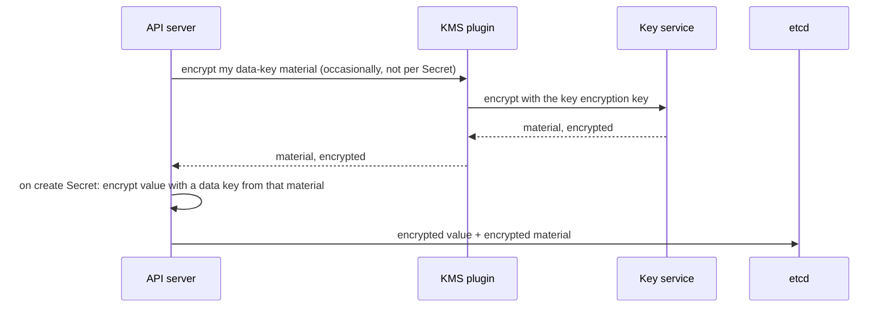

## Before you start

- [[k8s.l4.choosing-managed-kubernetes]] — you know ADR `0022` puts production on one provider's managed Kubernetes and lists the key service as a lock-in point.
- [[k8s.l3.encryption-at-rest]] — you know the API server encrypts Secrets before etcd stores them, and that the lab's `secretbox` key sits in a file on the node.
- [[backend.l4.signing-key-custody]] — you know ADR `0015` keeps the invoice signing key inside an HSM that only Payments may call, and leaves open where that HSM runs.

## The situation

Production is moving to the managed cluster of ADR `0022`, and two keys still have no home. In the lab, the key that encrypts Secrets sits as text in `secrets/encryption-config.yaml`, copied onto the control-plane node next to etcd's data. On a managed cluster the provider usually runs the control plane, so there is no node the team can put the file on. The invoice signing key of ADR `0015` must sit in an HSM, and nobody has said whose. The team lead asks for one answer covering both. How can the API server and Payments use keys that they themselves are never allowed to hold?

## Core concepts

- **key management service (KMS)** — a service that keeps keys, often inside HSMs, and encrypts, decrypts or signs on request for the callers it permits, recording each use.
- **envelope encryption** — encrypting data with a data key, then storing that data key only in encrypted form, encrypted by a key that never leaves a key service.
- Data key (used in this lesson) — a key the API server makes and encrypts a Secret with itself.
- Key encryption key (used in this lesson) — the key inside the key service that encrypts and decrypts what data keys are made from; it never leaves the service.
- KMS plugin (used in this lesson) — a small server on each control-plane node that passes the API server's requests on to the key service.

## How it works



In the situation above, the key that matters is the lab's `secretbox` key, and it sits on the same disk as etcd. With envelope encryption, the key that matters sits somewhere else.

The API server encrypts each Secret's value itself, with a data key; the value never goes to the key service. It makes many data keys from one random secret value, called here the material. The key service, through the KMS plugin, encrypts that material. Only the encrypted material is stored beside the value.

In Kubernetes 1.34 this is the `kms` provider, version v2 (version v1 is off by default), listed in the same `EncryptionConfiguration` as `secretbox`. In v2 the API server asks the key service to encrypt that material only occasionally, not for each Secret.

To read, the API server has the key service decrypt the stored material, then decrypts the value itself. It keeps decrypted data keys in memory, so it does not call the key service on every read. It never holds the key encryption key.

This changes what a copy is worth. A snapshot, or a copy of etcd's files, holds encrypted values and encrypted key material, but not the key encryption key. Reading them needs the key service to agree, and the key service decides who may ask and records each request.

It also changes what the key is worth. If the key encryption key is disabled or deleted, the key service stops decrypting. A running API server keeps reading with the data keys in its memory, but once it restarts, as it does after a snapshot is restored, no Secret encrypted under that key can be read.

## In the Đơn Hàng system

The lab's key comes from `scripts/dev-secrets.sh`:

```bash file=scripts/dev-secrets.sh tag=stage-4 lines=91-106
if [ ! -f secrets/encryption-config.yaml ]; then
  cat > secrets/encryption-config.yaml <<CONFIG
apiVersion: apiserver.config.k8s.io/v1
kind: EncryptionConfiguration
resources:
  - resources:
      - secrets
    providers:
      - secretbox:
          keys:
            - name: key1
              secret: $(openssl rand -base64 32)
      - identity: {}
CONFIG
  echo "created secrets/encryption-config.yaml"
fi
```

Look at the `secret:` line: the script fills it with 32 random bytes from `openssl rand`, written as text. The `identity` entry below it only lets the API server read Secrets written before encryption was on. Whoever reads the file holds the key. A `kms` entry in the same list holds no key: it names the plugin the API server should call. Hosting providers that run the API server usually supply their own KMS plugin for their key service; turning it on follows the hosting provider's instructions, not this file.

ADR `0023` decides where both keys live. The excerpt starts with the options, after its context:

```markdown file=docs/adr/0023-khoa-ky-hoa-don-trong-hsm-cua-nha-cung-cap.md tag=stage-4 lines=18-41
- HSM riêng của Đơn Hàng: toàn quyền với phần cứng. Cần thiết bị ở hai nơi để
  không mất khả năng ký khi một nơi hỏng, và người vận hành, nâng cấp, sao lưu
  chúng: đúng loại việc ADR 0022 đã từ chối cho cluster.
- Dịch vụ HSM của nhà cung cấp: khóa trong HSM do nhà cung cấp chạy, Đơn Hàng
  chỉ gọi qua API. Không phần cứng phải lo, nhưng gắn với nhà cung cấp.
- Khóa phần mềm trong dịch vụ quản lý khóa (không HSM): rẻ nhất, nhưng không
  đáp ứng điều ADR 0015 đòi là khóa nằm trong HSM.

### Quyết định

Chọn dịch vụ HSM của nhà cung cấp. Chỉ ServiceAccount của Payments được quyền
ký bằng khóa này; không service, không người nào khác có quyền đó, kể cả trưởng
nhóm, trừ quyền quản trị khóa (tạo, tắt) được tách riêng.

### Hệ quả

- Khóa không rời được HSM, nên rời nhà cung cấp nghĩa là tạo khóa mới và xin
  chứng chỉ mới ở HSM nơi mới. Hóa đơn đã ký trước đó vẫn kiểm được, vì kiểm
  chữ ký chỉ cần public key và chứng chỉ, không cần khóa riêng.
- Secret của cluster production được mã hóa bằng một khóa của cùng dịch vụ
  quản lý khóa (envelope encryption), thay cho khóa `secretbox` nằm trong file
  trên node control plane như ở lab (`scripts/dev-secrets.sh`). Tắt hoặc xóa
  khóa đó thì mọi Secret trong etcd không đọc được, nên quyền tắt, xóa khóa
  được giữ chặt như chính dữ liệu.
```

Three options for the invoice key. An HSM of Đơn Hàng's own needs devices in two places and people to run them: the work ADR `0022` declined for the cluster. A software key fails ADR `0015`'s demand for an HSM. The ADR picks the provider's HSM service.

The decision splits two rights. Only Payments' ServiceAccount may sign; nobody else, the team lead included. Creating and disabling the key is a separate administrative right.

The first consequence is the price of the choice. The key cannot leave the HSM, so leaving the provider means a new key and a new certificate. Invoices signed before stay checkable, because checking needs only the public key and the certificate.

The second consequence covers the cluster's Secrets: a key in the same service replaces the `secretbox` file. Disabling or deleting that key makes the Secrets unreadable, so that right is guarded like the data.

After the excerpt, the ADR names when to reopen it: a contract that requires the key in an HSM on machines of Đơn Hàng's own, or a customer's, leads to a new ADR for that key only, other keys unchanged.

## Trade-offs

The first column is where the lab keeps the cluster's Secret key; the other three are ADR `0023`'s options for the invoice key.

| | Key in a file on the node (lab) | Own HSM | Provider's HSM service (ADR `0023`) | Software key in the provider's key service |
|---|---|---|---|---|
| Where the key is | Text on the control-plane node's disk | Devices Đơn Hàng runs | Inside the provider's HSM | Inside the provider's key service |
| A copy of the node's disk | Holds the key too | Holds no key | Holds no key | Holds no key |
| Who runs it | The team | The team, in two places | The provider | The provider |
| Meets ADR `0015` | Not applicable: cluster key | Yes | Yes | No |
| Leaving the provider | Nothing to move | Nothing to move | New key and certificate | Not weighed: rejected on ADR `0015` |

## What would you choose if…

- …a customer's contract requires the invoice key in an HSM on machines of Đơn Hàng's own: write a new ADR for that key only, as ADR `0023`'s first reopening condition says, and leave the cluster's key where it is.
- …the lab cluster needs its Secrets encrypted: keep the `secretbox` file, because the lab has no key service, and a local key still protects snapshots taken off the node.
- …a developer asks for the right to sign invoices "for emergencies": refuse, because ADR `0023` gives signing to Payments' ServiceAccount alone; the emergency right that exists is disabling the key, held apart from signing.

## Seniors often assume…

- **"With a key service, every Secret is sent to the key service to be encrypted."** → Actually the API server encrypts each value itself, and only key material ever goes to the key service. You notice this when a short outage of the key service does not stop reads of existing Secrets, because the API server decrypts with data keys already in its memory.
- **"Disabling our key in the key service only stops new Secrets from being encrypted."** → Actually it also stops the key service from decrypting, so the Secrets encrypted under that key become unreadable once the API server must ask again. You notice this when Secrets read fine until the API server restarts, for example during the provider's upgrade of the control plane, and then fail.
- **"With the invoice key in the provider's HSM, we can take a copy of it when we leave."** → Actually the HSM never lets the key out, so leaving means a new key and a new certificate at the new place. You notice this when the exit plan lists creating a key and requesting a certificate as steps, while old invoices still verify with the old certificate.

## Try it (3 minutes)

Think through three copies an attacker might get:

1. A copy of an etcd snapshot, taken off the control-plane node (lab and production).
2. A copy of the whole control-plane node's disk (lab and production).
3. Control of Payments for one hour, after which the flaw is fixed (production under ADR `0023` only).

For each, write what the attacker can read or sign afterwards.

Expected result: a short answer for each case, naming which key decides it.

<details><summary>Suggested answer</summary>

Snapshot: in the lab cluster with encryption at rest, Secrets written after it was turned on are encrypted and the `secretbox` key is not in the snapshot, so those values are not readable; other objects, such as ConfigMaps, are. In production, the snapshot holds encrypted values and encrypted key material; reading them needs the key service, which refuses callers it does not permit.

Node disk: in the lab, the disk holds etcd's data and `encryption-config.yaml`, so every encrypted Secret is readable. In production the disk holds no key encryption key, so turning its data back into Secrets still goes through the key service, which records each request. The team usually cannot reach that node; the provider runs it.

Payments: the attacker can request invoice signatures during that hour, each recorded, and none after the fix, because the key never left the HSM.

</details>

## Connections

- [[k8s.l3.encryption-at-rest]] — the same `EncryptionConfiguration`, with the `kms` provider taking the key off the node.
- [[k8s.l3.etcd-snapshots]] — the copies that envelope encryption makes worthless without the key service.
- [[devops.l3.secret-rotation]] — rotating the values inside Secrets, a separate task from the keys that encrypt them.
- [[management.l3.exit-plan]] — the exit plan that must list a new invoice key and certificate.
- [[backend.l4.pki-and-signing]] — why old invoices stay checkable with only the public key and certificate.
- [[k8s.l4.moving-to-a-new-cluster]] — next: the move to the managed cluster, where these keys are set up.

## Five-line summary

1. A key that must not leak stays inside a key service; the API server and Payments only send requests and get results back.
2. With envelope encryption, the API server encrypts Secrets with data keys and stores them encrypted by a key that never leaves the key service.
3. A copy of etcd or a snapshot is then useless without the key service, which permits callers and records each use.
4. Disabling or deleting that key makes the Secrets unreadable once the API server must ask again, so the right is guarded like the data.
5. ADR `0023` puts the invoice key in the provider's HSM; leaving means a new key and certificate, while old invoices stay checkable.
