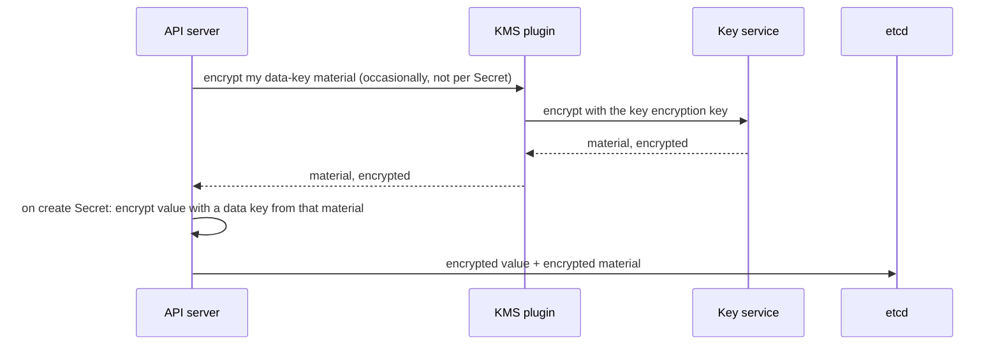

## Bạn cần biết trước

- [[k8s.l4.choosing-managed-kubernetes]] — bạn biết ADR `0022` đưa production lên Kubernetes managed của một nhà cung cấp và liệt kê dịch vụ quản lý khóa là một chỗ gắn với nhà cung cấp.
- [[k8s.l3.encryption-at-rest]] — bạn biết API server mã hóa Secret trước khi etcd lưu, và khóa `secretbox` của lab nằm trong một file trên node.
- [[backend.l4.signing-key-custody]] — bạn biết ADR `0015` giữ khóa ký hóa đơn trong một HSM mà chỉ Payments được gọi, và để ngỏ chuyện HSM đó chạy ở đâu.

## Tình huống

Production đang chuyển sang cluster managed của ADR `0022`, và còn hai khóa chưa có chỗ ở. Ở lab, khóa mã hóa Secret nằm dạng text trong `secrets/encryption-config.yaml`, được chép lên node control plane, ngay cạnh dữ liệu của etcd. Trên cluster managed, nhà cung cấp thường chạy control plane, nên đội không có node nào để đặt file đó. Khóa ký hóa đơn của ADR `0015` phải nằm trong một HSM, mà chưa ai nói là HSM của ai. Trưởng nhóm muốn một câu trả lời cho cả hai. Làm sao để API server và Payments dùng được những khóa mà chính chúng không bao giờ được cầm?

## Khái niệm cốt lõi

- **dịch vụ quản lý khóa (KMS)** (key management service) — dịch vụ giữ khóa, thường nằm trong HSM, và mã hóa, giải mã hay ký theo yêu cầu cho những bên nó cho phép, ghi lại mỗi lần dùng.
- **mã hóa phong bì** (envelope encryption) — mã hóa dữ liệu bằng một khóa dữ liệu, rồi chỉ lưu khóa dữ liệu ấy ở dạng đã mã hóa, bằng một khóa không bao giờ rời dịch vụ quản lý khóa.
- Khóa dữ liệu (dùng trong bài này) — khóa do API server tạo ra và tự dùng để mã hóa một Secret.
- Khóa mã hóa khóa (dùng trong bài này) — khóa nằm trong dịch vụ quản lý khóa, dùng để mã hóa và giải mã thứ mà các khóa dữ liệu được tạo ra từ đó; nó không bao giờ rời dịch vụ.
- KMS plugin (dùng trong bài này) — một server nhỏ trên mỗi node control plane, chuyển yêu cầu của API server tới dịch vụ quản lý khóa.

## Cơ chế hoạt động



Trong tình huống ở trên, khóa quyết định mọi thứ là khóa `secretbox` của lab, và nó nằm chung ổ đĩa với etcd. Với mã hóa phong bì, khóa quyết định mọi thứ nằm ở chỗ khác.

API server tự mã hóa giá trị của từng Secret bằng một khóa dữ liệu. Giá trị không bao giờ được gửi tới dịch vụ quản lý khóa. API server tạo nhiều khóa dữ liệu từ một giá trị bí mật ngẫu nhiên, ở đây gọi là nguyên liệu khóa. Dịch vụ quản lý khóa, thông qua KMS plugin, mã hóa nguyên liệu khóa đó. Chỉ bản nguyên liệu đã mã hóa được lưu cạnh giá trị.

Trong Kubernetes 1.34, đây là provider `kms`, phiên bản v2 (phiên bản v1 mặc định bị tắt), khai báo trong cùng `EncryptionConfiguration` với `secretbox`. Ở v2, API server chỉ thỉnh thoảng nhờ dịch vụ quản lý khóa mã hóa nguyên liệu khóa, không phải với mỗi Secret.

Khi đọc, API server nhờ dịch vụ quản lý khóa giải mã nguyên liệu đã lưu, rồi tự giải mã giá trị. Nó giữ các khóa dữ liệu đã giải mã trong memory, nên không phải gọi dịch vụ quản lý khóa ở mỗi lần đọc. API server không bao giờ cầm khóa mã hóa khóa.

Điều này thay đổi giá trị của một bản sao. Một snapshot, hay một bản sao các file của etcd, chứa giá trị đã mã hóa và nguyên liệu khóa đã mã hóa, nhưng không có khóa mã hóa khóa. Muốn đọc chúng thì dịch vụ quản lý khóa phải đồng ý, và dịch vụ quyết định ai được hỏi, đồng thời ghi lại từng yêu cầu.

Nó cũng thay đổi giá trị của chính khóa. Nếu khóa mã hóa khóa bị tắt hoặc bị xóa, dịch vụ quản lý khóa ngừng giải mã. API server đang chạy vẫn đọc được nhờ các khóa dữ liệu trong memory, nhưng khi khởi động lại, như sau khi khôi phục một snapshot, thì không Secret nào được mã hóa dưới khóa đó còn đọc được.

## Trong hệ thống Đơn Hàng

Khóa của lab đến từ `scripts/dev-secrets.sh`:

```bash file=scripts/dev-secrets.sh tag=stage-4 lines=91-106
if [ ! -f secrets/encryption-config.yaml ]; then
  cat > secrets/encryption-config.yaml <<CONFIG
apiVersion: apiserver.config.k8s.io/v1
kind: EncryptionConfiguration
resources:
  - resources:
      - secrets
    providers:
      - secretbox:
          keys:
            - name: key1
              secret: $(openssl rand -base64 32)
      - identity: {}
CONFIG
  echo "created secrets/encryption-config.yaml"
fi
```

Nhìn dòng `secret:`: script điền vào đó 32 byte ngẫu nhiên từ `openssl rand`, ghi dưới dạng text. Mục `identity` bên dưới chỉ để API server đọc được các Secret ghi trước khi bật mã hóa. Ai đọc được file là cầm được khóa. Một mục `kms` trong cùng danh sách thì không chứa khóa nào: nó chỉ nêu plugin mà API server cần gọi. Các nhà cung cấp chạy hộ API server thường có sẵn KMS plugin cho dịch vụ quản lý khóa của họ. Bật nó lên thì làm theo hướng dẫn của nhà cung cấp, không theo file này.

ADR `0023` quyết định cả hai khóa nằm ở đâu. Đoạn trích bắt đầu từ các phương án, sau phần bối cảnh:

```markdown file=docs/adr/0023-khoa-ky-hoa-don-trong-hsm-cua-nha-cung-cap.md tag=stage-4 lines=18-41
- HSM riêng của Đơn Hàng: toàn quyền với phần cứng. Cần thiết bị ở hai nơi để
  không mất khả năng ký khi một nơi hỏng, và người vận hành, nâng cấp, sao lưu
  chúng: đúng loại việc ADR 0022 đã từ chối cho cluster.
- Dịch vụ HSM của nhà cung cấp: khóa trong HSM do nhà cung cấp chạy, Đơn Hàng
  chỉ gọi qua API. Không phần cứng phải lo, nhưng gắn với nhà cung cấp.
- Khóa phần mềm trong dịch vụ quản lý khóa (không HSM): rẻ nhất, nhưng không
  đáp ứng điều ADR 0015 đòi là khóa nằm trong HSM.

### Quyết định

Chọn dịch vụ HSM của nhà cung cấp. Chỉ ServiceAccount của Payments được quyền
ký bằng khóa này; không service, không người nào khác có quyền đó, kể cả trưởng
nhóm, trừ quyền quản trị khóa (tạo, tắt) được tách riêng.

### Hệ quả

- Khóa không rời được HSM, nên rời nhà cung cấp nghĩa là tạo khóa mới và xin
  chứng chỉ mới ở HSM nơi mới. Hóa đơn đã ký trước đó vẫn kiểm được, vì kiểm
  chữ ký chỉ cần public key và chứng chỉ, không cần khóa riêng.
- Secret của cluster production được mã hóa bằng một khóa của cùng dịch vụ
  quản lý khóa (envelope encryption), thay cho khóa `secretbox` nằm trong file
  trên node control plane như ở lab (`scripts/dev-secrets.sh`). Tắt hoặc xóa
  khóa đó thì mọi Secret trong etcd không đọc được, nên quyền tắt, xóa khóa
  được giữ chặt như chính dữ liệu.
```

Ba phương án cho khóa hóa đơn. Một HSM riêng của Đơn Hàng cần thiết bị ở hai nơi và người vận hành chúng: đúng loại việc ADR `0022` đã từ chối cho cluster. Một khóa phần mềm không đáp ứng yêu cầu HSM của ADR `0015`. ADR chọn dịch vụ HSM của nhà cung cấp.

Quyết định tách hai quyền. Chỉ ServiceAccount của Payments được ký, ngoài ra không ai, kể cả trưởng nhóm. Tạo và tắt khóa là một quyền quản trị riêng.

Hệ quả thứ nhất là cái giá của lựa chọn. Khóa không ra khỏi HSM được, nên rời nhà cung cấp nghĩa là khóa mới và chứng chỉ mới. Các hóa đơn ký trước đó vẫn kiểm được, vì kiểm chỉ cần public key và chứng chỉ.

Hệ quả thứ hai nói về Secret của cluster: một khóa trong cùng dịch vụ thay cho file `secretbox`. Tắt hoặc xóa khóa đó thì các Secret không đọc được nữa, nên quyền này được giữ chặt như chính dữ liệu.

Sau đoạn trích, ADR nêu khi nào mở lại nó: một hợp đồng đòi khóa nằm trong HSM trên máy của chính Đơn Hàng, hoặc của một khách hàng, sẽ dẫn tới một ADR mới chỉ cho khóa đó, các khóa khác giữ nguyên.

## Đánh đổi

Cột đầu là chỗ lab giữ khóa Secret của cluster, ba cột còn lại là các phương án của ADR `0023` cho khóa hóa đơn.

| | Khóa trong file trên node (lab) | HSM riêng | Dịch vụ HSM của nhà cung cấp (ADR `0023`) | Khóa phần mềm trong dịch vụ quản lý khóa của nhà cung cấp |
|---|---|---|---|---|
| Khóa nằm ở đâu | Dạng text trên ổ đĩa của node control plane | Thiết bị do Đơn Hàng vận hành | Trong HSM của nhà cung cấp | Trong dịch vụ quản lý khóa của nhà cung cấp |
| Một bản sao ổ đĩa của node | Chứa luôn cả khóa | Không chứa khóa | Không chứa khóa | Không chứa khóa |
| Ai vận hành | Đội | Đội, ở hai nơi | Nhà cung cấp | Nhà cung cấp |
| Đáp ứng ADR `0015` | Không áp dụng: khóa của cluster | Có | Có | Không |
| Rời nhà cung cấp | Không có gì phải chuyển | Không có gì phải chuyển | Khóa mới và chứng chỉ mới | Không xét: đã bị loại theo ADR `0015` |

## Bạn sẽ chọn gì nếu…

- …hợp đồng của một khách đòi khóa hóa đơn nằm trong HSM trên máy của chính Đơn Hàng: viết một ADR mới chỉ cho khóa đó, như điều kiện mở lại thứ nhất của ADR `0023` nói, và để khóa của cluster ở nguyên chỗ cũ.
- …cluster lab cần mã hóa Secret: giữ file `secretbox`, vì lab không có dịch vụ quản lý khóa, và một khóa cục bộ vẫn bảo vệ được các snapshot mang ra khỏi node.
- …một developer xin quyền ký hóa đơn "để dùng khi khẩn cấp": từ chối, vì ADR `0023` chỉ trao quyền ký cho ServiceAccount của Payments. Quyền khẩn cấp có tồn tại là quyền tắt khóa, và nó được tách khỏi quyền ký.

## Senior hay nhầm rằng…

- **"Có dịch vụ quản lý khóa thì mọi Secret đều được gửi tới đó để mã hóa."** → Thực ra API server tự mã hóa từng giá trị, chỉ nguyên liệu khóa mới đi tới dịch vụ quản lý khóa. Bạn sẽ nhận ra khi dịch vụ quản lý khóa gián đoạn một lúc mà việc đọc các Secret sẵn có vẫn chạy, vì API server giải mã bằng các khóa dữ liệu đã có trong memory.
- **"Tắt khóa của mình trong dịch vụ quản lý khóa chỉ chặn việc mã hóa Secret mới."** → Thực ra nó còn khiến dịch vụ ngừng giải mã, nên các Secret mã hóa dưới khóa đó không đọc được nữa ngay khi API server phải hỏi lại. Bạn sẽ nhận ra khi Secret vẫn đọc bình thường cho tới lúc API server khởi động lại, chẳng hạn trong đợt nhà cung cấp nâng cấp control plane, rồi bắt đầu lỗi.
- **"Khóa hóa đơn nằm trong HSM của nhà cung cấp thì lúc rời đi mình lấy một bản sao ra được."** → Thực ra HSM không bao giờ cho khóa ra ngoài, nên rời đi nghĩa là khóa mới và chứng chỉ mới ở nơi mới. Bạn sẽ nhận ra khi kế hoạch rời đi ghi tạo khóa và xin chứng chỉ thành các bước, trong khi hóa đơn cũ vẫn kiểm được bằng chứng chỉ cũ.

## Thử ngay (3 phút)

Hãy nghĩ về ba bản sao mà kẻ tấn công có thể lấy được:

1. Bản sao một snapshot etcd, mang ra khỏi node control plane (lab và production).
2. Bản sao toàn bộ ổ đĩa của node control plane (lab và production).
3. Quyền điều khiển Payments trong một giờ, sau đó lỗ hổng được vá (chỉ production theo ADR `0023`).

Với mỗi trường hợp, ghi ra kẻ tấn công đọc được hay ký được gì sau đó.

Kết quả mong đợi: một câu trả lời ngắn cho mỗi trường hợp, nêu rõ khóa nào quyết định nó.

<details><summary>Gợi ý đáp án</summary>

Snapshot: ở cluster lab đã bật mã hóa khi lưu, các Secret ghi sau khi bật đều đã mã hóa, còn khóa `secretbox` không nằm trong snapshot, nên không đọc được các giá trị đó. Các object khác, như ConfigMap, thì đọc được. Ở production, snapshot chứa giá trị đã mã hóa và nguyên liệu khóa đã mã hóa. Muốn đọc phải qua dịch vụ quản lý khóa, mà dịch vụ từ chối những bên nó không cho phép.

Ổ đĩa của node: ở lab, ổ đĩa chứa dữ liệu của etcd và `encryption-config.yaml`, nên mọi Secret đã mã hóa đều đọc được. Ở production, ổ đĩa không chứa khóa mã hóa khóa, nên muốn biến dữ liệu trên đó trở lại thành Secret vẫn phải qua dịch vụ quản lý khóa, nơi ghi lại từng yêu cầu. Đội thường không chạm được tới node đó, vì nhà cung cấp chạy nó.

Payments: kẻ tấn công xin được chữ ký hóa đơn trong giờ đó, mỗi lần đều bị ghi lại, và không xin được nữa sau khi vá, vì khóa chưa bao giờ rời HSM.

</details>

## Liên hệ

- [[k8s.l3.encryption-at-rest]] — cùng `EncryptionConfiguration`, với provider `kms` đưa khóa ra khỏi node.
- [[k8s.l3.etcd-snapshots]] — những bản sao mà mã hóa phong bì biến thành vô dụng nếu không có dịch vụ quản lý khóa.
- [[devops.l3.secret-rotation]] — xoay vòng giá trị bên trong Secret, một việc tách khỏi các khóa dùng để mã hóa chúng.
- [[management.l3.exit-plan]] — kế hoạch rời đi phải ghi khóa hóa đơn mới và chứng chỉ mới.
- [[backend.l4.pki-and-signing]] — vì sao hóa đơn cũ vẫn kiểm được chỉ với public key và chứng chỉ.
- [[k8s.l4.moving-to-a-new-cluster]] — tiếp theo: chuyển sang cluster managed, nơi các khóa này được thiết lập.

## Tóm tắt 5 dòng

1. Khóa không được lộ thì nằm yên trong dịch vụ quản lý khóa, API server và Payments chỉ gửi yêu cầu và nhận kết quả.
2. Với mã hóa phong bì, API server mã hóa Secret bằng khóa dữ liệu, và lưu các khóa này ở dạng mã hóa bằng một khóa không bao giờ rời dịch vụ quản lý khóa.
3. Khi đó một bản sao etcd hay một snapshot là vô dụng nếu không có dịch vụ quản lý khóa, nơi cho phép bên gọi và ghi lại mỗi lần dùng.
4. Tắt hoặc xóa khóa đó thì Secret không đọc được nữa ngay khi API server phải hỏi lại, nên quyền này được giữ chặt như chính dữ liệu.
5. ADR `0023` đặt khóa hóa đơn trong HSM của nhà cung cấp: rời đi nghĩa là khóa mới và chứng chỉ mới, còn hóa đơn cũ vẫn kiểm được.
