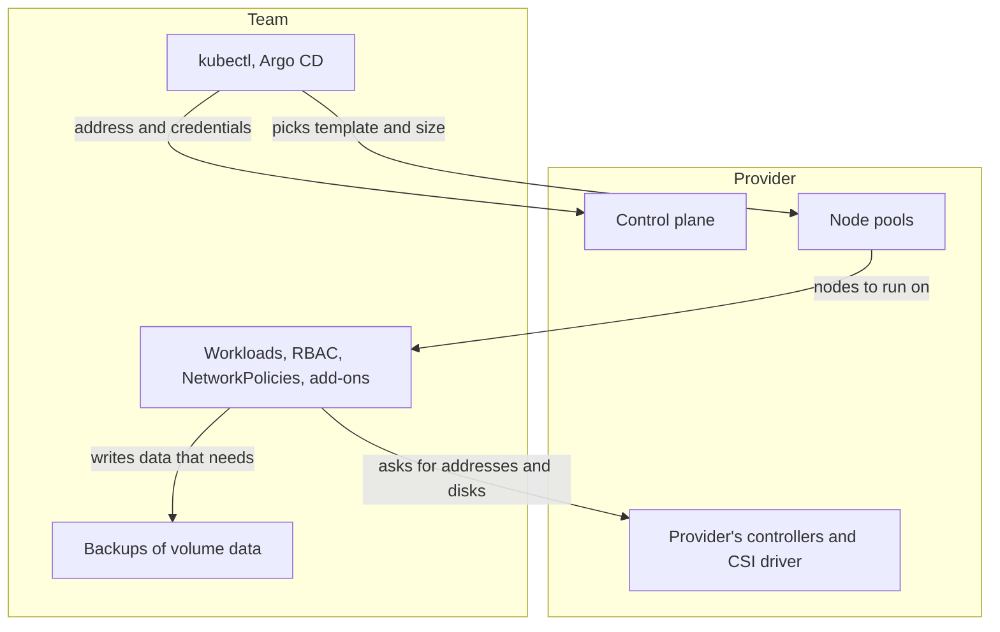

## Before you start

- [[k8s.l3.cluster-upgrades]] — you know a cluster moves one minor version at a time, control plane first, after a check for API versions the target stops serving.
- [[k8s.l3.etcd-snapshots]] — you know a snapshot holds the cluster's objects, not the data on its volumes.
- [[k8s.l3.clusters-without-a-cloud]] — you know a LoadBalancer Service or a claim is only a request until some component fulfils it.
- [[management.l3.self-hosting-costs]] — you know a managed service trades recurring work for a fee, and that some work stays with the team.

## The situation

You have just run `scripts/k8s/kubeadm.sh` on `donhang`: four static Pod manifests on the control-plane node, three certificate authorities, and component certificates that expire a year after signing. The last module added the rest of the list: keeping a majority of etcd members, taking snapshots, upgrading one minor version at a time. Production is next. A teammate proposes renting managed Kubernetes instead, "so the provider runs Kubernetes and we only push manifests." The team lead wants a list before anyone agrees, line by line, from Argo CD to the data on PostgreSQL's volume. What does a managed cluster run for you, and what stays with the team?

## Core concepts

- **managed Kubernetes** — a provider's service that runs a cluster's control plane for you, managing its scale, availability, patches and upgrades; the team works with it through the API server address and credentials the provider gives, and typically has no control-plane node to log in to.
- **node pool** — a group of worker nodes the provider creates from one template, a machine size and a Kubernetes version, and keeps available; a broken node can be replaced by a new one from the template, so treat nodes as replaceable and keep nothing on them that was set by hand.
- **shared responsibility model** — the split, published by a provider, of which parts of a service it runs and which the customer runs; for a managed cluster it usually puts the control plane on the provider's side and what the team applies and runs on the cluster (its workloads: Deployments, Jobs, databases and add-ons) on the team's.
- Support window (not a new term) — the minor versions a provider currently offers for its clusters.

## How it works



Start at the top. In the situation above, the teammate's kubectl would point at the address the provider gives, with credentials the provider issues. That is the whole of the control plane the team sees.

Behind that address the provider runs the control plane: it keeps it available and handles its patches and upgrades. That covers the work of the last module.

Node pools sit across the line. The team picks the template and the pool's size; the provider creates the nodes and keeps them available. A broken node can be replaced from the same template, so do not rely on anything written by hand on a node.

Providers publish which parts they run; for a managed cluster the split usually puts what the team applies on the team's side: workloads, RBAC, NetworkPolicies, add-ons, that is, tools the team installs into the cluster itself, such as Argo CD and cert-manager, and the data on volumes.

Upgrades stay on the team's list. Providers usually offer a set of minor versions and drop old ones on their own schedule. The rules from `cluster-upgrades` still hold: one minor version at a time, and manifests checked first against the API versions the target stops serving.

The provider's controllers are what the kind cluster lacked. A LoadBalancer Service gets an outside address and a claim gets a network disk, through controllers and a CSI driver the provider runs. The provider creates the disk; nothing in the cluster backs up what the database writes on it.

## In the Đơn Hàng system

Most of `kubeadm.sh` reads things a managed cluster takes away:

```bash file=scripts/k8s/kubeadm.sh tag=stage-3 lines=19-36
# lesson: k8s.l3.kubeadm
# Static Pods: the kubelet starts the control plane from these files, with
# no API server to ask. The API server then shows a copy of each, named
# after the node.
node ls /etc/kubernetes/manifests
show kubectl get pods -n kube-system -l tier=control-plane -o custom-columns=POD:.metadata.name,NODE:.spec.nodeName
echo

# lesson: k8s.l3.kubeadm
# The certificate authorities (ca, etcd/ca, front-proxy-ca) kubeadm init
# created, and the certificates it signed with them for the components.
node ls /etc/kubernetes/pki /etc/kubernetes/pki/etcd
echo

# lesson: k8s.l3.kubeadm
# Certificates expire one year after they were signed, the authorities ten
# years after.
node kubeadm certs check-expiration 2>/dev/null | grep -v '^\[check-expiration\]'
```

`node` (defined earlier in the script, not shown) runs a command on `donhang-control-plane` through `docker exec`, which runs a command inside a running container; kind's node is a container. `show`, defined in a helper file the script loads, prints a command and runs it on your own machine. The `node ls` and `node kubeadm` commands need a shell on the machine that runs the control plane. On a managed cluster no such machine is yours to open, so they have nowhere to run. The static Pod files, the certificate authorities and the yearly renewal behind them are the provider's work. The `show kubectl` command asks the API server instead; whether it finds control-plane Pods on a managed cluster depends on how the provider runs them.

What the provider does not take is everything the team installed into a cluster:

```markdown file=docs/team/self-run-components.md tag=stage-3 lines=28-31
Các thành phần tự chạy khác (Redis, Tempo, Alloy, Caddy, và trong cluster là
Argo CD, Git server, bộ điều khiển giải mã secret, bộ điều khiển nhận traffic
vào cluster) có cùng loại việc định kỳ; đội ghi chúng ở đây khi có người lo
riêng.
```

The paragraph names the components that run inside Đơn Hàng's cluster: Argo CD, the Git server, the controller that decrypts secrets and the controller that takes incoming traffic. It says they carry the same recurring work as the components in the table above it: upgrades, backups, watching and an owner. A managed cluster changes none of that. The two controllers here are ones the team installed, not the controllers inside the control plane. They are workloads applied by the team, so they sit on the team's side of the shared responsibility model, next to the services and their databases.

## Trade-offs

| | kubeadm on your own machines | Managed Kubernetes |
|---|---|---|
| Building the control plane, keeping an etcd majority, etcd's data | The team | The provider |
| Control-plane certificates and upgrade steps | The team | The provider |
| When to move to the next minor version | The team, on its own schedule | The team, inside the provider's support window |
| A broken worker node | Repaired or rebuilt by the team | Can be replaced from the node pool's template |
| Outside addresses and disks for claims | Components the team installs and runs | The provider's controllers and CSI driver |
| Workloads, RBAC, NetworkPolicies, add-ons, volume data | The team | The team |
| Control-plane settings | Any flag the team passes through kubeadm's configuration | Usually only those the provider exposes |
| What it costs | Team hours and machines | A fee, and less control |

## What would you choose if…

- …one product, one small team, no one who knows etcd, and the machines can be rented: managed Kubernetes, because the control-plane rows of the table are work nobody on the team would do well. The rest of the list still needs owners.
- …a rule says every machine that holds customer data must stay in your own building: kubeadm on your own machines, with the control-plane rows and the cloud parts, such as MetalLB and Longhorn, budgeted as recurring work.
- …the team needs an API server setting the provider does not offer, or a minor version it has already dropped: a managed cluster cannot give it, so either change the need or run the control plane yourself. The full decision for Đơn Hàng comes in [[k8s.l4.choosing-managed-kubernetes]].

## Seniors often assume…

- **"With managed Kubernetes, the provider keeps our applications running."** → Actually the provider runs the control plane and creates the nodes of the node pool; whether `api` starts, passes its probes, has enough replicas and a PodDisruptionBudget is set by the team's manifests. You notice this when the provider reports the cluster healthy while `kubectl get pods` shows `api` restarting.
- **"A managed cluster upgrades itself, so the team never has to plan an upgrade."** → Actually the provider runs the upgrade steps, but a new minor version can still stop serving API versions the team's manifests, charts and operators ask for, and the support window ends whether the team is ready or not. You notice this when an Argo CD sync that worked before the upgrade fails on an API version the API server no longer serves.
- **"On a managed cluster, nothing that runs inside it needs a backup."** → Actually etcd never held the data on volumes, as `etcd-snapshots` showed, and the provider creates the disk but nothing in the cluster backs up what the database writes on it. You notice this when a claim is deleted and a dynamically provisioned volume with the reclaim policy `Delete` takes the database's disk with it.

## Try it (3 minutes)

From the root of the Đơn Hàng repository, with Docker Desktop running and `kubectl` and kind installed:

1. Run `scripts/k8s/kubeadm.sh`. It creates `donhang` if it is missing, which takes longer than this exercise.
2. For each part of the output, decide: on a managed cluster, would the team still see it, and would the team still have to look after it?

Expected result: four files in `/etc/kubernetes/manifests` (`etcd.yaml`, `kube-apiserver.yaml`, `kube-controller-manager.yaml`, `kube-scheduler.yaml`), four control-plane Pods all on `donhang-control-plane`, and certificates signed by `ca`, `etcd-ca` and `front-proxy-ca`; the CERTIFICATE AUTHORITY column shows `etcd-ca`, the name for the `etcd/ca` files in the comment.

<details><summary>Suggested answer</summary>

None of it. Every part of this output is the control plane: its static Pods, its certificate authorities and the certificates that expire each year. On a managed cluster these are the provider's, and the team has no shell on the machine that holds them. What the team keeps is everything the script does not read: the namespaces, the workloads, Argo CD, cert-manager and the data on volumes.

</details>

## Connections

- [[k8s.l3.kubeadm]] — the work this lesson hands to the provider: static Pods and the certificates kubeadm created.
- [[k8s.l3.control-plane-ha]] — the etcd majority a managed service keeps for you, which you built by hand there.
- [[k8s.l3.cluster-upgrades]] — the rules that still apply on a managed cluster; only who runs the steps changes.
- [[k8s.l3.clusters-without-a-cloud]] — the opposite case: there the team supplied outside addresses and disks; here the provider does.
- [[k8s.l2.database-in-the-cluster]] — data on volumes, which stays the team's to back up whoever runs the cluster.
- [[k8s.l4.why-more-than-one-cluster]] — each extra cluster repeats the team's side of the line, even when the control plane is managed.
- [[k8s.l4.node-autoscaling]] — next: adding nodes to a node pool when Pods do not fit.

## Five-line summary

1. A managed cluster runs the control plane on the provider's machines; workloads, RBAC, NetworkPolicies, add-ons and volume data stay the team's.
2. The provider keeps the control plane available and handles its patches and upgrades; the team gets an address and credentials.
3. Worker nodes come from node pools built from one template, and a broken node can be replaced from it.
4. Providers usually add and drop minor versions on their own schedule, so the team still upgrades one at a time and checks manifests first.
5. LoadBalancer Services get outside addresses and claims get network disks through the provider's controllers and CSI driver, but backing up the data stays the team's.
