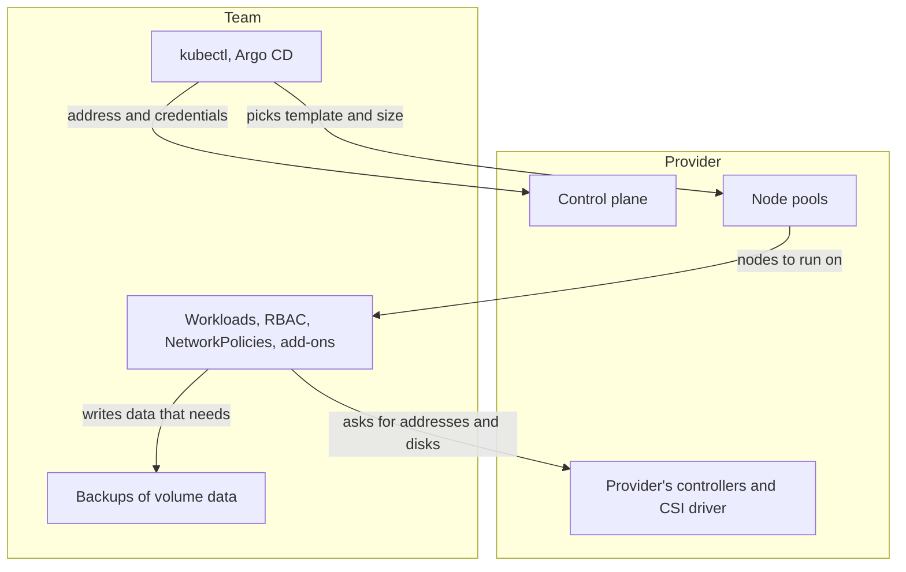

## Bạn cần biết trước

- [[k8s.l3.cluster-upgrades]] — bạn biết cluster lên từng minor version một, control plane đi trước, sau khi đã kiểm tra những API version mà bản đích thôi phục vụ.
- [[k8s.l3.etcd-snapshots]] — bạn biết snapshot giữ các object của cluster, không giữ dữ liệu trên volume.
- [[k8s.l3.clusters-without-a-cloud]] — bạn biết một LoadBalancer Service hay một claim chỉ là lời yêu cầu, cho tới khi có thành phần nào đó đáp ứng nó.
- [[management.l3.self-hosting-costs]] — bạn biết dịch vụ managed đổi phần việc định kỳ lấy một khoản phí, và có những việc vẫn ở lại với đội.

## Tình huống

Bạn vừa chạy `scripts/k8s/kubeadm.sh` trên `donhang`: bốn manifest static Pod trên node control plane, ba certificate authority, và các certificate của từng thành phần hết hạn một năm sau khi ký. Module trước đã thêm phần còn lại vào danh sách: giữ đa số thành viên etcd, chụp snapshot, nâng cấp từng minor version một. Tiếp theo là production. Một đồng đội đề nghị thuê Kubernetes managed thay vào đó, "để nhà cung cấp chạy Kubernetes, mình chỉ việc đẩy manifest lên". Trưởng nhóm muốn có một danh sách trước khi ai đồng ý, từng dòng một, từ Argo CD tới dữ liệu trên volume của PostgreSQL. Một cluster managed chạy hộ bạn những gì, và những gì vẫn ở lại với đội?

## Khái niệm cốt lõi

- **Kubernetes managed (vận hành hộ)** (managed Kubernetes) — dịch vụ của nhà cung cấp chạy hộ control plane của một cluster, lo quy mô, tính sẵn sàng, bản vá và nâng cấp của nó. Đội làm việc với nó qua địa chỉ API server và thông tin xác thực nhà cung cấp đưa, và thường không có node control plane nào để đăng nhập vào.
- **node pool** (Nhóm node nhà cung cấp tạo từ một mẫu chung (cỡ máy, phiên bản Kubernetes); node hỏng được thay mới) — một nhóm worker node mà nhà cung cấp tạo từ một mẫu, gồm cỡ máy và phiên bản Kubernetes, và giữ cho luôn sẵn sàng. Node hỏng có thể được thay bằng node mới từ mẫu, nên hãy coi node là thứ thay được và đừng giữ trên đó thứ gì đặt bằng tay.
- **mô hình chia trách nhiệm** (shared responsibility model) — bản phân định, do nhà cung cấp công bố, phần nào của một dịch vụ họ chạy và phần nào khách hàng chạy. Với cluster managed, nó thường đặt control plane về phía nhà cung cấp, còn những gì đội áp và chạy trên cluster (workload của đội: Deployment, Job, database và add-on) về phía đội.
- Support window (không phải term mới) — các minor version mà nhà cung cấp đang cho dùng với cluster của họ.

## Cơ chế hoạt động



Bắt đầu từ trên xuống. Trong tình huống trên, kubectl của người đồng đội sẽ trỏ vào địa chỉ nhà cung cấp đưa, với thông tin xác thực nhà cung cấp cấp. Đó là toàn bộ phần control plane mà đội nhìn thấy.

Đằng sau địa chỉ đó, nhà cung cấp chạy control plane: giữ cho nó sẵn sàng, lo bản vá và nâng cấp. Phần đó bao trọn khối việc của module trước.

Node pool nằm vắt qua đường ranh giới. Đội chọn mẫu và kích thước pool, nhà cung cấp tạo node và giữ chúng sẵn sàng. Node hỏng có thể được thay từ cùng mẫu, nên đừng trông vào thứ gì ghi bằng tay trên một node.

Nhà cung cấp công bố họ chạy phần nào. Với cluster managed, cách chia thường đặt về phía đội những gì đội áp lên: workload, RBAC, NetworkPolicy, add-on, tức các công cụ đội cài vào chính cluster như Argo CD và cert-manager, và dữ liệu trên volume.

Nâng cấp vẫn nằm trong danh sách của đội. Nhà cung cấp thường cho dùng một nhóm minor version và bỏ bản cũ theo lịch của họ. Các quy tắc từ `cluster-upgrades` vẫn đúng: từng minor version một, và kiểm tra manifest trước với những API version mà bản đích thôi phục vụ.

Các controller của nhà cung cấp chính là thứ cluster kind còn thiếu. Một LoadBalancer Service có địa chỉ bên ngoài, một claim có ổ đĩa mạng, nhờ các controller và CSI driver do nhà cung cấp chạy. Nhà cung cấp tạo ổ đĩa, nhưng không thứ gì trong cluster sao lưu những gì database ghi lên đó.

## Trong hệ thống Đơn Hàng

Phần lớn `kubeadm.sh` đọc những thứ mà cluster managed lấy đi khỏi tay bạn:

```bash file=scripts/k8s/kubeadm.sh tag=stage-3 lines=19-36
# lesson: k8s.l3.kubeadm
# Static Pods: the kubelet starts the control plane from these files, with
# no API server to ask. The API server then shows a copy of each, named
# after the node.
node ls /etc/kubernetes/manifests
show kubectl get pods -n kube-system -l tier=control-plane -o custom-columns=POD:.metadata.name,NODE:.spec.nodeName
echo

# lesson: k8s.l3.kubeadm
# The certificate authorities (ca, etcd/ca, front-proxy-ca) kubeadm init
# created, and the certificates it signed with them for the components.
node ls /etc/kubernetes/pki /etc/kubernetes/pki/etcd
echo

# lesson: k8s.l3.kubeadm
# Certificates expire one year after they were signed, the authorities ten
# years after.
node kubeadm certs check-expiration 2>/dev/null | grep -v '^\[check-expiration\]'
```

`node` (định nghĩa ở phần trước của script, không trích ở đây) chạy một lệnh trên `donhang-control-plane` qua `docker exec`, lệnh chạy một lệnh bên trong container đang chạy. Node của kind là một container. `show`, định nghĩa trong một file helper mà script nạp vào, in ra một lệnh rồi chạy nó trên máy bạn. Các lệnh `node ls` và `node kubeadm` cần một shell trên máy chạy control plane. Trên cluster managed, không có máy nào như thế cho bạn mở, nên chúng không có chỗ để chạy. Các file static Pod, các certificate authority và đợt gia hạn hằng năm đằng sau chúng là phần việc của nhà cung cấp. Lệnh `show kubectl` thì hỏi API server. Nó có tìm thấy Pod control plane trên cluster managed hay không là tùy cách nhà cung cấp chạy chúng.

Thứ nhà cung cấp không nhận là mọi thứ đội đã cài vào cluster:

```markdown file=docs/team/self-run-components.md tag=stage-3 lines=28-31
Các thành phần tự chạy khác (Redis, Tempo, Alloy, Caddy, và trong cluster là
Argo CD, Git server, bộ điều khiển giải mã secret, bộ điều khiển nhận traffic
vào cluster) có cùng loại việc định kỳ; đội ghi chúng ở đây khi có người lo
riêng.
```

Đoạn này kể tên các thành phần chạy bên trong cluster của Đơn Hàng: Argo CD, Git server, controller giải mã secret và controller nhận traffic từ ngoài vào. Nó nói chúng có cùng loại việc định kỳ như các thành phần trong bảng phía trên: nâng cấp, sao lưu, theo dõi và một người phụ trách. Cluster managed không đổi gì ở đó. Hai controller này do đội cài, không phải các controller bên trong control plane. Chúng là workload đội áp lên, nên nằm về phía đội trong mô hình chia trách nhiệm, cạnh các service và database của chúng.

## Đánh đổi

| | kubeadm trên máy của đội | Kubernetes managed |
|---|---|---|
| Dựng control plane, giữ đa số etcd, dữ liệu của etcd | Đội | Nhà cung cấp |
| Certificate của control plane và các bước nâng cấp | Đội | Nhà cung cấp |
| Khi nào lên minor version tiếp theo | Đội, theo lịch của mình | Đội, trong support window của nhà cung cấp |
| Một worker node hỏng | Đội sửa hoặc dựng lại | Có thể thay từ mẫu của node pool |
| Địa chỉ bên ngoài và ổ đĩa cho claim | Các thành phần đội tự cài và chạy | Controller và CSI driver của nhà cung cấp |
| Workload, RBAC, NetworkPolicy, add-on, dữ liệu trên volume | Đội | Đội |
| Thiết lập của control plane | Mọi flag đội truyền qua cấu hình của kubeadm | Thường chỉ những gì nhà cung cấp mở ra |
| Cái giá | Giờ công của đội và máy | Một khoản phí, và ít quyền kiểm soát hơn |

## Bạn sẽ chọn gì nếu…

- …một sản phẩm, một đội nhỏ, không ai rành etcd, và máy thì thuê được: Kubernetes managed, vì các dòng về control plane trong bảng là việc không ai trong đội làm tốt được. Phần còn lại của danh sách vẫn cần người phụ trách.
- …một quy định buộc mọi máy chứa dữ liệu khách hàng phải nằm trong tòa nhà của chính mình: kubeadm trên máy của đội, với các dòng về control plane và các phần cloud như MetalLB và Longhorn được tính vào ngân sách như việc định kỳ.
- …đội cần một thiết lập API server mà nhà cung cấp không cho, hoặc một minor version họ đã bỏ: cluster managed không đáp ứng được, nên hoặc đổi nhu cầu, hoặc tự chạy control plane. Quyết định đầy đủ cho Đơn Hàng nằm ở [[k8s.l4.choosing-managed-kubernetes]].

## Senior hay nhầm rằng…

- **"Dùng Kubernetes managed thì nhà cung cấp giữ cho ứng dụng của mình chạy."** → Thực ra nhà cung cấp chạy control plane và tạo các node của node pool, còn `api` có khởi động không, có qua probe không, có đủ replica và PodDisruptionBudget không là do manifest của đội quyết định. Bạn sẽ nhận ra khi nhà cung cấp báo cluster khỏe trong lúc `kubectl get pods` cho thấy `api` đang khởi động lại liên tục.
- **"Cluster managed tự nâng cấp, nên đội không bao giờ phải lên kế hoạch nâng cấp."** → Thực ra nhà cung cấp chạy các bước nâng cấp, nhưng một minor version mới vẫn có thể thôi phục vụ những API version mà manifest, chart và operator của đội đang dùng, và support window vẫn hết dù đội đã sẵn sàng hay chưa. Bạn sẽ nhận ra khi một lần sync của Argo CD vốn chạy được trước nâng cấp lại hỏng vì một API version mà API server không còn phục vụ.
- **"Trên cluster managed, không thứ gì chạy bên trong cần sao lưu."** → Thực ra etcd chưa bao giờ giữ dữ liệu trên volume, như `etcd-snapshots` đã cho thấy, và nhà cung cấp tạo ổ đĩa nhưng không thứ gì trong cluster sao lưu những gì database ghi lên đó. Bạn sẽ nhận ra khi một claim bị xóa và một volume tạo bằng dynamic provisioning với reclaim policy `Delete` kéo theo cả ổ đĩa của database.

## Thử ngay (3 phút)

Từ thư mục gốc của repo Đơn Hàng, với Docker Desktop đang chạy và đã cài `kubectl` cùng kind:

1. Chạy `scripts/k8s/kubeadm.sh`. Script tạo `donhang` nếu chưa có, bước này lâu hơn cả bài tập.
2. Với từng phần của output, quyết định: trên cluster managed, đội có còn thấy nó không, và đội có còn phải trông nó không?

Kết quả mong đợi: bốn file trong `/etc/kubernetes/manifests` (`etcd.yaml`, `kube-apiserver.yaml`, `kube-controller-manager.yaml`, `kube-scheduler.yaml`), bốn Pod control plane đều nằm trên `donhang-control-plane`, và các certificate ký bởi `ca`, `etcd-ca` và `front-proxy-ca`. Cột CERTIFICATE AUTHORITY hiện `etcd-ca`, tên dành cho các file `etcd/ca` trong comment.

<details><summary>Gợi ý đáp án</summary>

Không phần nào cả. Mọi phần của output này đều là control plane: các static Pod, các certificate authority và những certificate hết hạn mỗi năm. Trên cluster managed, chúng thuộc về nhà cung cấp, và đội không có shell trên máy giữ chúng. Thứ đội giữ lại là mọi thứ script không đọc: các namespace, các workload, Argo CD, cert-manager và dữ liệu trên volume.

</details>

## Liên hệ

- [[k8s.l3.kubeadm]] — phần việc bài này giao cho nhà cung cấp: các static Pod và các certificate kubeadm tạo ra.
- [[k8s.l3.control-plane-ha]] — đa số etcd mà dịch vụ managed giữ hộ bạn, thứ bạn đã dựng bằng tay ở bài đó.
- [[k8s.l3.cluster-upgrades]] — các quy tắc vẫn áp dụng trên cluster managed. Chỉ người chạy các bước là đổi.
- [[k8s.l3.clusters-without-a-cloud]] — trường hợp ngược lại: ở đó đội tự cấp địa chỉ bên ngoài và ổ đĩa, ở đây nhà cung cấp cấp.
- [[k8s.l2.database-in-the-cluster]] — dữ liệu trên volume, thứ đội vẫn phải tự sao lưu dù ai chạy cluster.
- [[k8s.l4.why-more-than-one-cluster]] — mỗi cluster thêm vào lặp lại phần việc phía đội, kể cả khi control plane là managed.
- [[k8s.l4.node-autoscaling]] — tiếp theo: thêm node vào node pool khi Pod không còn chỗ.

## Tóm tắt 5 dòng

1. Cluster managed chạy control plane trên máy của nhà cung cấp, còn workload, RBAC, NetworkPolicy, add-on và dữ liệu trên volume vẫn là của đội.
2. Nhà cung cấp giữ control plane sẵn sàng, lo bản vá và nâng cấp, còn đội nhận một địa chỉ và thông tin xác thực.
3. Worker node đến từ các node pool dựng từ một mẫu, và node hỏng có thể được thay từ mẫu đó.
4. Nhà cung cấp thường thêm và bỏ minor version theo lịch của họ, nên đội vẫn nâng cấp từng bản một và kiểm tra manifest trước.
5. LoadBalancer Service có địa chỉ bên ngoài, claim có ổ đĩa mạng nhờ controller và CSI driver của nhà cung cấp, nhưng sao lưu dữ liệu vẫn là việc của đội.
