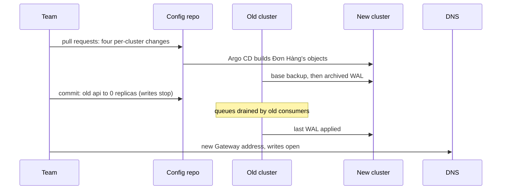

## Before you start

- [[k8s.l4.choosing-managed-kubernetes]] — you know ADR `0022` moves production to one provider's managed Kubernetes and lists StorageClass names and the Gateway's load balancer as lock-in points.
- [[devops.l3.disaster-recovery-drill]] — you know `dr-drill.sh` rebuilds staging from the config repository through Argo CD, and fails without the sealing key.
- [[devops.l3.point-in-time-recovery]] — you know a base backup plus the archived WAL after it rebuilds PostgreSQL, and `pitr.sh` does this.
- [[k8s.l4.why-more-than-one-cluster]] — you know each cluster runs its own platform, and a SealedSecret opens only where its key is.

## The situation

ADR `0022` is accepted, and production must now leave the cluster built by the `kind-cluster` module for the provider's managed cluster. Shops take orders all day, and no order confirmed to a customer may be lost. In the planning meeting a colleague proposes the shortest path: take an etcd snapshot of the old cluster, restore it into the new one, and everything comes along. Another asks whether anything in the config repository must change first. What has to travel from the old cluster to the new one, and what should simply be built again?

## Core concepts

- Building beside (a plain phrase, used in this sense here) — creating the new cluster while the old one keeps serving, then switching traffic, so the old one stays the way back until writes open.
- What differs per cluster (a plain phrase, used in this sense here) — the values in the config repository that name one cluster's keys, storage or addresses, and must change before the new cluster syncs.
- Stopping writes (a plain phrase, used in this sense here) — a short window in which no new order or message is created, so the last data can catch up.
- `cluster-migration-plan.md` — Đơn Hàng's written plan for the move; every duration in it is assumed until a rehearsal measures it.

## How it works



The colleague's snapshot would carry the old cluster's nodes, addresses and Secrets along. A cluster has two kinds of content, each on its own path.

Objects come from Git. Argo CD on the new cluster builds Đơn Hàng's objects from the config repository, as step 4 of the DR drill does for staging. Before that first sync, the team changes what differs per cluster, one pull request each: secrets sealed again for the new cluster's sealing key, the provider's StorageClass names and load balancer for the Gateway, and the OpenTofu module that builds the cluster.

Data takes a separate path. This assumes the cluster's PostgreSQL archives WAL where the new cluster can read it; today only the Compose setup does, so that comes first. The new PostgreSQL starts from the latest base backup and keeps replaying archived WAL as new segments arrive. Unlike `pitr.sh`, it does not stop at the end of the archive.

Once it has caught up and a test through the new Gateway's address passes, writes stop: a commit sets the old `api` to zero replicas. The plan does not say how that commit reaches only the old cluster, or what starts the new `api` when writes open; the rehearsal must settle both. Consumers on the old cluster empty RabbitMQ's queues. The old database closes its current WAL segment, as `pitr.sh` does with `pg_switch_wal()`, so the last WAL is archived at once and reaches the new database. Then DNS points to the new Gateway and writes open there.

Until then, going back means leaving DNS as it is and reverting the commits that stopped writes. After writes open, new orders exist only on the new cluster, and the old one, kept without traffic, is no longer the way back.

## In the Đơn Hàng system

The plan opens with what is rebuilt and what differs per cluster:

```markdown file=docs/design/cluster-migration-plan.md tag=stage-4 lines=12-27
Object Kubernetes không được chép sang: Argo CD trên cluster mới dựng lại
chúng từ repo cấu hình, như `scripts/devops/dr-drill.sh` dựng lại staging.
Không mang etcd snapshot của cluster cũ sang, vì nó mang theo node, địa chỉ và
Secret của cluster cũ. Chỉ dữ liệu là phải chuyển.

### Thứ khác nhau theo cluster

Những thứ này được sửa trong repo cấu hình trước, mỗi thứ một pull request,
trước khi cluster mới đồng bộ:

| Thứ khác nhau | Ở cluster cũ | Ở cluster mới | File phải sửa |
|---|---|---|---|
| Khóa niêm secret | Cặp khóa trong `secrets/`, cài bởi lớp platform | Cặp khóa mới cho cluster mới | Các SealedSecret của overlay, niêm lại bằng `scripts/devops/seal-secrets.sh` với chứng chỉ mới |
| StorageClass | Mặc định của cluster (volume không ghi `storageClassName`) | StorageClass của nhà cung cấp | Overlay của môi trường: ghi rõ `storageClassName` cho `db`, `rabbitmq`, `db-backups` |
| Địa chỉ Gateway | NodePort 30080 và 30443 của Traefik | Load balancer của nhà cung cấp | `apps/traefik.yaml` (kiểu Service), bản ghi DNS của hai tên miền production (cho api và cho đăng nhập) |
| Mã cluster | Module `kind-cluster` | Module cluster managed | `deploy/tofu/envs/production/cluster/main.tf` |
```

The table lists four things that differ, each with the file to change. The sealing key is new, so every SealedSecret of the overlay is sealed again with `seal-secrets.sh` and the new certificate, which carries the public half of that key. The volumes of `db`, `rabbitmq` and `db-backups` name the provider's StorageClass, because today they rely on the cluster's default. Traefik, the controller that serves the Gateway, gets a Service of another type, and the DNS records of the two production names follow it. Last, `main.tf` swaps the `kind-cluster` module for a managed one.

The data section shows how writes stop without losing an order:

```markdown file=docs/design/cluster-migration-plan.md tag=stage-4 lines=31-44
- PostgreSQL: khôi phục base backup mới nhất vào database ở cluster mới rồi
  cho nó đọc tiếp WAL từ bản lưu trữ, cùng cách `pitr.sh` khôi phục. Khi nó đã
  đuổi kịp, dừng ghi một lúc ngắn (15 phút, giả định): một commit đặt số
  replica của `api` ở cluster cũ về 0, nên không đơn và không message mới nào
  được tạo. Đổi bằng commit chứ không bằng `kubectl scale`, vì self-heal của
  Argo CD sẽ trả lại số replica trong Git.
- RabbitMQ: trong lúc dừng ghi, Notifications và Payments ở cluster cũ vẫn
  chạy cho tới khi các queue xả hết, rồi mới về 0 cũng bằng commit. Không
  message nào bị bỏ lại trong queue của cluster cũ; message còn trong
  dead-letter queue được xử lý xong trước bước này.
- Sau đó đợi đoạn WAL cuối được áp vào database mới, rồi mở nó cho ghi.
- Redis chỉ giữ cache, không chuyển; cache ở cluster mới đầy lại dần.

Nhờ vậy không đơn nào đã được xác nhận cho khách bị mất.
```

Writes stop through Git, not `kubectl scale`, because with self-heal on, as in `apps/staging.yaml`, Argo CD would put the replicas from Git back. The 15 minutes are marked as assumed. Notifications and Payments run until the queues are empty, dead-letter queue included. Redis is not moved: it holds only a cache that fills again.

After the excerpt, the plan states its scope: only the cluster changes. PostgreSQL, RabbitMQ and Keycloak move as they run today, and each becomes a managed service later, one per release, so a failure points to one change. Last, the whole plan runs first on a second staging cluster. The measured stop sets the window for the move and how far ahead the shops are told, assumed at five working days.

## Trade-offs

| | Rebuild from Git beside the old cluster (the plan) | Restore the old etcd snapshot into the new cluster | Move the cluster and switch to a managed database at once |
|---|---|---|---|
| What reaches the new cluster | Objects from the config repository; data on its own path | Every object, with the old nodes, addresses and Secrets | Objects from Git; data into a different kind of database |
| Data on volumes | Base backup and WAL | Still needs its own path: a snapshot holds objects, not volume data | Moved into the managed database |
| Per-cluster differences | Four pull requests before the first sync | Still there, now on objects that came from the snapshot instead of Git | The same four, plus the database |
| When something fails afterwards | It points to the cluster | It points to the cluster or to what the snapshot brought | Cluster or database: unclear which |

## What would you choose if…

- …the staging rehearsal measures the write stop at 40 minutes instead of the assumed 15: change the window and the notice to the shops from the measured number, as the plan says the measured stop decides both, or shorten the steps and rehearse again.
- …a check fails after DNS has changed and writes have opened on the new cluster: fix the problem on the new cluster with a new change unless orders are being lost, because going back now means moving data the other way; this is why the plan puts every check before writes open.
- …someone proposes switching to the provider's managed PostgreSQL during the move, since the team is busy with it anyway: keep the move to the cluster only and schedule the database as its own later release, so that a slow query after the move points to one change.

## Seniors often assume…

- **"Moving clusters means copying the old cluster's etcd into the new one."** → Actually the objects are built again from the config repository, because a snapshot brings the old cluster's nodes, addresses and Secrets along. You notice this when the DR drill rebuilds staging to `Healthy` from the mirror clone of the config repository, with no etcd snapshot at all.
- **"Since everything is in Git, the new cluster needs no changes before its first sync."** → Actually what differs per cluster, such as the sealing key, StorageClass names and the Gateway's address, is changed in Git first. You notice this when, as in `dr-drill.sh --without-sealing-key`, the controller cannot open the SealedSecrets and the `db` Pod waits with `CreateContainerConfigError`, because its Secret `db` was never created.
- **"A cluster move is the right moment to also switch the database to a managed one."** → Actually the plan changes only the cluster and moves each self-run component to a managed service in a later release of its own. You notice this when something breaks after a move with two changes, and nobody can say which change caused it.

## Try it (3 minutes)

Sort each item into one of four groups: built from Git unchanged, changed in the config repository first, moved as data, or not moved.

1. The `api` Deployment.
2. The SealedSecret `db` of the overlay.
3. The `storageClassName` of `db`'s volume.
4. The rows of `orders`.
5. The cache in Redis.
6. Messages waiting in RabbitMQ's queues.
7. Traefik's Service in `apps/traefik.yaml`.

Expected result: each of the seven items placed in exactly one group, with the plan's reason.

<details><summary>Suggested answer</summary>

Built from Git unchanged: the `api` Deployment. Argo CD on the new cluster builds it from the config repository.

Changed in the config repository first: the SealedSecret `db`, sealed again for the new cluster's key; the `storageClassName` of `db`'s volume, which now names the provider's StorageClass; Traefik's Service, whose type changes for the provider's load balancer.

Moved as data: the rows of `orders`, through a base backup and the archived WAL, with the last WAL applied after writes stop.

Not moved: the Redis cache, which fills again on the new cluster, and the queued messages, which are not copied but consumed on the old cluster until the queues are empty.

</details>

## Connections

- [[k8s.l3.etcd-snapshots]] — why a snapshot is no way to move: it holds objects, not the data on volumes, and brings the old cluster along.
- [[devops.l3.sealed-secrets]] — the sealing that is done again for the new cluster's key.
- [[k8s.l2.storage-classes]] — the StorageClass names that differ per cluster and are written into the overlay.
- [[k8s.l4.failover-between-clusters]] — two clusters serving for good behind one entry, where this move keeps two only until writes open on the new one.
- [[k8s.l4.keys-stay-in-the-key-service]] — the keys set up on the managed cluster this move leads to.
- [[k8s.l4.cluster-review-checklist]] — next: a new cluster is one of the changes that triggers a cluster review.

## Five-line summary

1. Build the new cluster from Git beside the old one; only data travels, and the old cluster stays the way back until writes open.
2. No etcd snapshot is carried over, since it would bring the old cluster's nodes, addresses and Secrets along.
3. Sealed secrets, StorageClass names, the Gateway's address and the cluster's OpenTofu module differ per cluster and change in Git before the first sync.
4. PostgreSQL follows a base backup and its WAL; a commit stops writes, queues drain, the last WAL lands, then DNS switches.
5. Only the cluster changes in this move, and a staging rehearsal measures how long writes stop before production moves.
