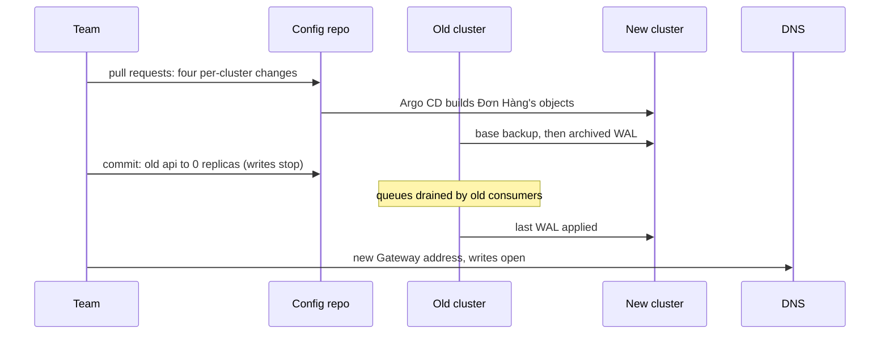

## Bạn cần biết trước

- [[k8s.l4.choosing-managed-kubernetes]] — bạn biết ADR `0022` đưa production lên Kubernetes managed của một nhà cung cấp, và liệt kê tên StorageClass cùng load balancer của Gateway là những chỗ gắn với nhà cung cấp.
- [[devops.l3.disaster-recovery-drill]] — bạn biết `dr-drill.sh` dựng lại staging từ repo cấu hình qua Argo CD, và thất bại nếu thiếu khóa niêm phong.
- [[devops.l3.point-in-time-recovery]] — bạn biết một base backup cộng với WAL được lưu trữ sau nó sẽ dựng lại PostgreSQL, và `pitr.sh` làm đúng điều này.
- [[k8s.l4.why-more-than-one-cluster]] — bạn biết mỗi cluster chạy platform riêng, và một SealedSecret chỉ mở được ở nơi có khóa của nó.

## Tình huống

ADR `0022` đã được chấp nhận, giờ production phải rời cluster do module `kind-cluster` dựng để sang cluster managed của nhà cung cấp. Các cửa hàng nhận đơn cả ngày, và không đơn nào đã xác nhận với khách được phép mất. Trong buổi họp lên kế hoạch, một đồng nghiệp đề xuất đường ngắn nhất: chụp snapshot etcd của cluster cũ, khôi phục vào cluster mới, thế là mọi thứ đi theo. Một người khác hỏi có gì trong repo cấu hình phải sửa trước không. Vậy thứ gì phải mang từ cluster cũ sang cluster mới, và thứ gì chỉ cần dựng lại?

## Khái niệm cốt lõi

- Dựng bên cạnh (cụm từ thường, dùng theo nghĩa này trong bài) — tạo cluster mới trong khi cluster cũ vẫn phục vụ, rồi mới chuyển traffic, nên cluster cũ vẫn là đường lui cho tới khi mở ghi.
- Thứ khác nhau theo cluster (cụm từ thường, dùng theo nghĩa này trong bài) — các giá trị trong repo cấu hình chỉ tới khóa, storage hay địa chỉ của riêng một cluster, và phải sửa trước khi cluster mới đồng bộ.
- Dừng ghi (cụm từ thường, dùng theo nghĩa này trong bài) — một khoảng ngắn trong đó không đơn và không message mới nào được tạo, để phần dữ liệu cuối cùng kịp đuổi theo.
- `cluster-migration-plan.md` — kế hoạch viết sẵn của Đơn Hàng cho đợt chuyển; mọi khoảng thời gian trong đó là giả định cho tới khi một buổi diễn tập đo được.

## Cơ chế hoạt động



Snapshot mà đồng nghiệp đề xuất sẽ kéo theo node, địa chỉ và Secret của cluster cũ. Một cluster chứa hai loại nội dung, mỗi loại đi một đường riêng.

Object đến từ Git. Argo CD trên cluster mới dựng các object của Đơn Hàng từ repo cấu hình, giống bước 4 của buổi diễn tập DR làm với staging. Trước lần đồng bộ đầu tiên, đội sửa những thứ khác nhau theo cluster, mỗi thứ một pull request: secret niêm phong lại cho khóa niêm phong của cluster mới, tên StorageClass và load balancer của nhà cung cấp cho Gateway, và module OpenTofu dựng cluster.

Dữ liệu đi đường khác. Điều này giả định PostgreSQL của cluster lưu trữ WAL ở chỗ cluster mới đọc được. Hiện chỉ bản Compose làm vậy, nên đó là việc đầu tiên. PostgreSQL mới bắt đầu từ base backup gần nhất và liên tục áp WAL đã lưu trữ khi có segment mới. Khác với `pitr.sh`, nó không dừng ở cuối bản lưu trữ.

Khi nó đã đuổi kịp và một phép thử qua địa chỉ Gateway mới chạy đúng, thì dừng ghi: một commit đặt `api` cũ về 0 replica. Kế hoạch chưa nói commit đó tới được riêng cluster cũ bằng cách nào, cũng chưa nói cái gì bật `api` mới lên khi mở ghi. Buổi diễn tập phải chốt cả hai. Consumer trên cluster cũ xả hết các queue của RabbitMQ. Database cũ đóng segment WAL hiện tại, như `pitr.sh` làm với `pg_switch_wal()`, nên đoạn WAL cuối được lưu trữ ngay và tới database mới. Sau đó DNS trỏ sang Gateway mới và mở ghi ở đó.

Cho tới lúc ấy, quay lui nghĩa là giữ nguyên DNS và revert các commit đã dừng ghi. Sau khi mở ghi, đơn mới chỉ có trên cluster mới. Cluster cũ, giữ lại mà không có traffic, không còn là đường lui nữa.

## Trong hệ thống Đơn Hàng

Kế hoạch mở đầu bằng thứ được dựng lại và thứ khác nhau theo cluster:

```markdown file=docs/design/cluster-migration-plan.md tag=stage-4 lines=12-27
Object Kubernetes không được chép sang: Argo CD trên cluster mới dựng lại
chúng từ repo cấu hình, như `scripts/devops/dr-drill.sh` dựng lại staging.
Không mang etcd snapshot của cluster cũ sang, vì nó mang theo node, địa chỉ và
Secret của cluster cũ. Chỉ dữ liệu là phải chuyển.

### Thứ khác nhau theo cluster

Những thứ này được sửa trong repo cấu hình trước, mỗi thứ một pull request,
trước khi cluster mới đồng bộ:

| Thứ khác nhau | Ở cluster cũ | Ở cluster mới | File phải sửa |
|---|---|---|---|
| Khóa niêm secret | Cặp khóa trong `secrets/`, cài bởi lớp platform | Cặp khóa mới cho cluster mới | Các SealedSecret của overlay, niêm lại bằng `scripts/devops/seal-secrets.sh` với chứng chỉ mới |
| StorageClass | Mặc định của cluster (volume không ghi `storageClassName`) | StorageClass của nhà cung cấp | Overlay của môi trường: ghi rõ `storageClassName` cho `db`, `rabbitmq`, `db-backups` |
| Địa chỉ Gateway | NodePort 30080 và 30443 của Traefik | Load balancer của nhà cung cấp | `apps/traefik.yaml` (kiểu Service), bản ghi DNS của hai tên miền production (cho api và cho đăng nhập) |
| Mã cluster | Module `kind-cluster` | Module cluster managed | `deploy/tofu/envs/production/cluster/main.tf` |
```

Bảng liệt kê bốn thứ khác nhau, mỗi thứ kèm file phải sửa. Khóa niêm phong là khóa mới, nên mọi SealedSecret của overlay được niêm phong lại bằng `seal-secrets.sh` với chứng chỉ mới, chứng chỉ này mang nửa công khai của khóa đó. Volume của `db`, `rabbitmq` và `db-backups` ghi tên StorageClass của nhà cung cấp, vì hiện chúng dựa vào mặc định của cluster. Traefik, controller phục vụ Gateway, nhận một Service kiểu khác, và bản ghi DNS của hai tên miền production đổi theo. Cuối cùng, `main.tf` thay module `kind-cluster` bằng một module managed.

Phần dữ liệu cho thấy cách dừng ghi mà không mất đơn nào:

```markdown file=docs/design/cluster-migration-plan.md tag=stage-4 lines=31-44
- PostgreSQL: khôi phục base backup mới nhất vào database ở cluster mới rồi
  cho nó đọc tiếp WAL từ bản lưu trữ, cùng cách `pitr.sh` khôi phục. Khi nó đã
  đuổi kịp, dừng ghi một lúc ngắn (15 phút, giả định): một commit đặt số
  replica của `api` ở cluster cũ về 0, nên không đơn và không message mới nào
  được tạo. Đổi bằng commit chứ không bằng `kubectl scale`, vì self-heal của
  Argo CD sẽ trả lại số replica trong Git.
- RabbitMQ: trong lúc dừng ghi, Notifications và Payments ở cluster cũ vẫn
  chạy cho tới khi các queue xả hết, rồi mới về 0 cũng bằng commit. Không
  message nào bị bỏ lại trong queue của cluster cũ; message còn trong
  dead-letter queue được xử lý xong trước bước này.
- Sau đó đợi đoạn WAL cuối được áp vào database mới, rồi mở nó cho ghi.
- Redis chỉ giữ cache, không chuyển; cache ở cluster mới đầy lại dần.

Nhờ vậy không đơn nào đã được xác nhận cho khách bị mất.
```

Dừng ghi bằng Git chứ không bằng `kubectl scale`, vì khi bật self-heal, như trong `apps/staging.yaml`, Argo CD sẽ trả số replica về như trong Git. 15 phút được ghi rõ là giả định. Notifications và Payments chạy tới khi các queue rỗng, kể cả dead-letter queue. Redis không được chuyển: nó chỉ giữ cache, và cache sẽ đầy lại.

Sau đoạn trích, kế hoạch nêu phạm vi: chỉ cluster thay đổi. PostgreSQL, RabbitMQ và Keycloak chuyển sang đúng như đang chạy, và mỗi cái thành dịch vụ managed sau đó, mỗi bản release một cái, để khi có lỗi thì nó chỉ về một thay đổi. Cuối cùng, toàn bộ kế hoạch chạy trước trên một cluster staging thứ hai. Thời gian dừng đo được quyết định khung giờ chuyển và phải báo trước cho các cửa hàng bao lâu, giả định là năm ngày làm việc.

## Đánh đổi

| | Dựng lại từ Git bên cạnh cluster cũ (kế hoạch) | Khôi phục snapshot etcd cũ vào cluster mới | Chuyển cluster và đổi sang database managed cùng lúc |
|---|---|---|---|
| Thứ tới được cluster mới | Object từ repo cấu hình, dữ liệu đi đường riêng | Mọi object, kèm node, địa chỉ và Secret cũ | Object từ Git, dữ liệu vào một loại database khác |
| Dữ liệu trên volume | Base backup và WAL | Vẫn cần đường riêng: snapshot giữ object, không giữ dữ liệu trên volume | Chuyển vào database managed |
| Thứ khác nhau theo cluster | Bốn pull request trước lần đồng bộ đầu | Vẫn còn đó, giờ nằm trên object đến từ snapshot thay vì từ Git | Vẫn bốn thứ đó, cộng thêm database |
| Khi có lỗi sau đó | Chỉ về cluster | Chỉ về cluster hoặc thứ snapshot mang theo | Cluster hay database: không rõ cái nào |

## Bạn sẽ chọn gì nếu…

- …buổi diễn tập trên staging đo được thời gian dừng ghi là 40 phút thay vì 15 phút giả định: đổi khung giờ và thông báo cho các cửa hàng theo con số đo được, vì kế hoạch nói thời gian dừng đo được quyết định cả hai, hoặc rút ngắn các bước rồi diễn tập lại.
- …một phép kiểm thất bại sau khi DNS đã đổi và đã mở ghi trên cluster mới: sửa lỗi ngay trên cluster mới bằng một thay đổi mới, trừ khi đơn đang bị mất, vì quay lui lúc này nghĩa là chuyển dữ liệu theo chiều ngược lại. Đây là lý do kế hoạch đặt mọi phép kiểm trước khi mở ghi.
- …có người đề xuất chuyển sang PostgreSQL managed của nhà cung cấp ngay trong đợt chuyển, vì đằng nào đội cũng đang bận việc này: giữ đợt chuyển chỉ cho cluster, và xếp database thành một bản release riêng sau đó, để nếu sau đợt chuyển có query chậm thì nó chỉ về một thay đổi.

## Senior hay nhầm rằng…

- **"Chuyển cluster nghĩa là chép etcd của cluster cũ sang cluster mới."** → Thực ra các object được dựng lại từ repo cấu hình, vì snapshot kéo theo node, địa chỉ và Secret của cluster cũ. Bạn sẽ nhận ra khi buổi diễn tập DR dựng lại staging tới `Healthy` từ bản mirror clone của repo cấu hình, không cần snapshot etcd nào.
- **"Mọi thứ đã nằm trong Git thì cluster mới không cần sửa gì trước lần đồng bộ đầu."** → Thực ra những thứ khác nhau theo cluster, như khóa niêm phong, tên StorageClass và địa chỉ Gateway, phải sửa trong Git trước. Bạn sẽ nhận ra khi, như với `dr-drill.sh --without-sealing-key`, controller không mở được các SealedSecret và Pod `db` đứng chờ với `CreateContainerConfigError`, vì Secret `db` của nó chưa bao giờ được tạo.
- **"Chuyển cluster là dịp tốt để đổi luôn database sang managed."** → Thực ra kế hoạch chỉ thay cluster, rồi chuyển từng thành phần tự chạy sang dịch vụ managed trong một bản release riêng sau đó. Bạn sẽ nhận ra khi có gì đó hỏng sau một đợt chuyển gồm hai thay đổi, và không ai nói được thay đổi nào gây ra.

## Thử ngay (3 phút)

Xếp mỗi mục vào một trong bốn nhóm: dựng từ Git không đổi, sửa trong repo cấu hình trước, chuyển như dữ liệu, hoặc không chuyển.

1. Deployment `api`.
2. SealedSecret `db` của overlay.
3. `storageClassName` của volume của `db`.
4. Các dòng của `orders`.
5. Cache trong Redis.
6. Message đang chờ trong các queue của RabbitMQ.
7. Service của Traefik trong `apps/traefik.yaml`.

Kết quả mong đợi: mỗi mục trong bảy mục nằm đúng một nhóm, kèm lý do theo kế hoạch.

<details><summary>Gợi ý đáp án</summary>

Dựng từ Git không đổi: Deployment `api`. Argo CD trên cluster mới dựng nó từ repo cấu hình.

Sửa trong repo cấu hình trước: SealedSecret `db`, niêm phong lại cho khóa của cluster mới. `storageClassName` của volume của `db`, giờ ghi tên StorageClass của nhà cung cấp. Service của Traefik, đổi kiểu để dùng load balancer của nhà cung cấp.

Chuyển như dữ liệu: các dòng của `orders`, qua base backup và WAL đã lưu trữ, với đoạn WAL cuối được áp sau khi dừng ghi.

Không chuyển: cache của Redis, sẽ đầy lại trên cluster mới, và các message trong queue, không được chép mà được tiêu thụ trên cluster cũ cho tới khi queue rỗng.

</details>

## Liên hệ

- [[k8s.l3.etcd-snapshots]] — vì sao snapshot không phải cách để chuyển: nó giữ object chứ không giữ dữ liệu trên volume, và kéo theo cả cluster cũ.
- [[devops.l3.sealed-secrets]] — việc niêm phong được làm lại cho khóa của cluster mới.
- [[k8s.l2.storage-classes]] — tên StorageClass khác nhau theo cluster và được ghi vào overlay.
- [[k8s.l4.failover-between-clusters]] — hai cluster phục vụ lâu dài sau một lối vào chung, còn đợt chuyển này chỉ giữ hai cluster cho tới khi mở ghi trên cluster mới.
- [[k8s.l4.keys-stay-in-the-key-service]] — các khóa được thiết lập trên cluster managed mà đợt chuyển này đưa tới.
- [[k8s.l4.cluster-review-checklist]] — tiếp theo: một cluster mới là một trong những thay đổi kích hoạt một đợt review cluster.

## Tóm tắt 5 dòng

1. Dựng cluster mới từ Git bên cạnh cluster cũ, chỉ dữ liệu phải chuyển, và cluster cũ vẫn là đường lui cho tới khi mở ghi.
2. Không mang snapshot etcd sang, vì nó kéo theo node, địa chỉ và Secret của cluster cũ.
3. Secret niêm phong, tên StorageClass, địa chỉ Gateway và module OpenTofu của cluster khác nhau theo cluster, và được sửa trong Git trước lần đồng bộ đầu.
4. PostgreSQL đi theo base backup và WAL của nó: một commit dừng ghi, các queue xả hết, đoạn WAL cuối tới nơi, rồi DNS mới đổi.
5. Đợt chuyển này chỉ thay cluster, và một buổi diễn tập trên staging đo thời gian dừng ghi trước khi production chuyển.
