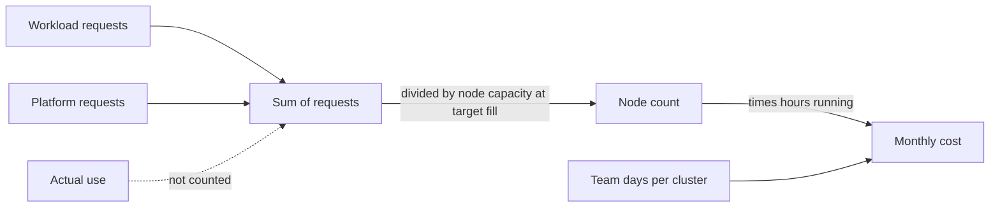

## Before you start

- [[k8s.l4.node-autoscaling]] — you know kube-scheduler places a Pod only where a node's unrequested capacity covers its requests, and a cluster autoscaler adds nodes for Pods that fit nowhere.
- [[management.l3.total-cost-of-ownership]] — you know a cost estimate counts the team's hours as well as fees, and marks every figure as an assumption.
- [[k8s.l4.why-more-than-one-cluster]] — you know each cluster runs and upgrades its own platform.
- [[devops.l4.platform-engineering]] — you know a platform turns the steps every service repeats into shared tools and components each team uses.

## The situation

Production will run on a managed cluster, and you are asked how many nodes to pay for. You start from staging, which runs on one node. You add up the requests in staging's workload manifests under `deploy/gitops/config-repo-kustomize/base/`: `500m` of CPU and `512Mi` of memory, a small slice of one node. A colleague concludes that production can take the smallest node on offer. Yet staging runs PostgreSQL, RabbitMQ, Keycloak, Argo CD and a Git server, and Đơn Hàng's `STAGE.md` says it needs about 4 GB of memory on your machine. If the requests you added up say so little, what does decide how many nodes a cluster needs, and pays for?

## Core concepts

- Unrequested capacity (not a new term) — what a node can allocate to Pods, minus the requests of the Pods already placed on it; kube-scheduler counts this, never what those Pods use.
- Target fill (not a new term) — the share of a node's allocatable capacity the team plans to fill with requests, leaving the rest for rolling updates and peaks; `cluster-cost.md` assumes 70%.
- **rightsizing** — setting each container's requests from its use measured at peak plus headroom, so they are neither too low nor too high.
- Fixed platform share (not a new term) — the requests of the components every cluster runs whatever its traffic, paid again for each extra cluster or environment.

## How it works



In the situation above, kube-scheduler filled staging's node by requests. A Pod that requests `1` CPU and uses a tenth of it still holds the whole CPU against every other Pod. A Pod with no requests, no limits and no namespace default holds nothing in that count, while it uses real CPU and memory; a limit with no request, or a namespace default, becomes its request. So the nodes a cluster needs follow the sum of its Pods' requests, used or not, and so do the nodes you pay for. With a cluster autoscaler this happens on its own: a request that fits nowhere brings a new node, up to the node pool's maximum. On machines you run yourself, it decides when you must buy another one.

Two inputs feed the sum. Workload requests grow with the services and replicas you run. The platform's requests are the same in a quiet cluster and a busy one. A Pod without requests makes the sum too small; a request set far above use makes it too large.

`cluster-cost.md` turns this into a rule. The node count is the sum of requests divided by one node's allocatable capacity at the target fill, rounded up, taking CPU or memory, whichever needs more nodes. One node is assumed to have 4 CPU and 8 GiB allocatable. `1000m` is one CPU and `1024Mi` is 1 GiB, so 70% of a node is `2800m` and about `5734Mi`. The file counts cost in time, not money: node hours, plus the team's working days for each cluster, assumed 2 a month, as two figures with no price.

## In the Đơn Hàng system

The design document compares staging's requests today with proposed ones:

```markdown file=docs/design/cluster-cost.md tag=stage-4 lines=26-46
Bảng so request đang đặt trong `deploy/gitops/config-repo-kustomize/base/`
với request đề xuất. Lab không cài metrics-server nên đội chưa có số đo mức
dùng của từng Pod; request đề xuất là ước lượng (giả định), phải đo lại lúc
cao điểm trước khi sửa manifest.

| Workload | Replica | Request đang đặt (CPU / bộ nhớ) | Request đề xuất (giả định) |
|---|---|---|---|
| `api` | 2 | 250m / 256Mi mỗi Pod | giữ nguyên |
| `db` | 1 | không đặt | 500m / 1Gi |
| `rabbitmq` | 1 | không đặt | 200m / 512Mi |
| `keycloak` | 1 | không đặt | 250m / 768Mi |
| `redis` | 1 | không đặt | 50m / 128Mi |
| `notifications` | 1 | không đặt | 100m / 128Mi |
| `payments` | 1 | không đặt | 100m / 128Mi |
| `mailpit` (chỉ lab) | 1 | không đặt | 10m / 32Mi |
| `fake-gateway` (chỉ lab) | 1 | không đặt | 10m / 32Mi |
| Tổng | | 500m / 512Mi | 1720m / 3264Mi |

Pod không đặt request được scheduler tính là không xin gì: node trông còn
trống trong khi các Pod đó vẫn dùng CPU và bộ nhớ thật. Tổng request đang đặt
vì thế không nói được cluster cần bao nhiêu node.
```

Only `api` sets requests, `250m` and `256Mi` for each of its 2 replicas; that is the `500m` and `512Mi` your colleague added up. Every other workload has none, so kube-scheduler treats it as asking for nothing while it uses real CPU and memory. The proposed column totals `1720m` and `3264Mi`. The opening paragraph says why it is only a guess: staging is a kind cluster on your machine, like every cluster in the repository, and no metrics-server runs in any of them, so nobody has measured each Pod's use, and the manifests stay unchanged until someone measures at peak.

Above the next excerpt, the same file lists the fixed platform share: Argo CD with all its components, the Git server, Traefik, which serves the cluster's Gateway, the Sealed Secrets controller and, in staging only, Prometheus, together `950m` and `1984Mi` (assumed). Below it are the levers:

```markdown file=docs/design/cluster-cost.md tag=stage-4 lines=62-83
Các manifest của những thành phần này cũng chưa đặt request. Với tổng
workload và phần nền (2670m / 5248Mi), staging vừa một node theo cách tính
trên: một node cho 2,8 CPU và 5,6 GiB ở mức lấp đầy 70%.

### Đòn bẩy

- Request: đặt theo mức dùng đo lúc cao điểm cộng một khoảng dư. Thấp quá thì
  Pod bị chậm, bị giết vì thiếu bộ nhớ, hoặc chen lấn Pod bên cạnh; cao quá
  thì node bị giữ chỗ mà không làm gì.
- `minReplicas` của HPA: production hiện chạy `api` với số replica cố định
  trong Git; với HPA, số replica lúc vắng khách giảm về `minReplicas` (xem ví
  dụ trong `cluster-review-checklist.md`).
- Môi trường tắt ngoài giờ: staging không cần chạy ban đêm. Giờ node giảm
  theo số giờ tắt; dựng lại theo các bước của `scripts/devops/dr-drill.sh`, đã
  đo thời gian.
- Thời gian giữ telemetry và tỉ lệ sampling: Tempo của lab giữ trace 24 giờ
  (`deploy/monitoring/tempo.yml`), api giữ trace với tỉ lệ
  `Telemetry:SampleRatio`, 0,1 nếu không cấu hình. Chọn hai số này theo SLO
  là việc của `cost-per-shop.md`.

Các đòn bẩy giảm số node; không đòn bẩy nào giảm phần nền cố định, trừ bớt
một cluster hay một môi trường.
```

The first paragraph adds workloads and platform, `2670m` and `5248Mi`, and finds that they fit one node: at 70% fill, one node offers 2.8 CPU and 5.6 GiB. More than a third of that CPU is the platform, before a single order arrives.

The first lever is rightsizing. Too low, and a Pod is slowed down when the node is busy, is killed for lack of memory, or crowds the Pods next to it, the noisy neighbor problem. The kill comes from the sum: memory requests below real use let kube-scheduler place more Pods on a node than its memory holds, and when it runs short, Pods using more than they requested are stopped first. Too high, and capacity sits reserved on a node, paid for and idle.

The second lever lets the replica count fall to the HPA's `minReplicas` when few customers are shopping, instead of a fixed count in Git. The third stops staging outside working hours: node hours fall with the hours it is off, and it is rebuilt with the timed steps of `dr-drill.sh`. The fourth is how long Tempo keeps traces and what share of traces `api` keeps: fewer traces, kept for less time, are less data on Tempo's disk. Tempo is in neither sum above: it runs in the lab, not in a cluster, so in the repository this lever saves disk, not nodes. Choosing those numbers is left to `cost-per-shop.md`. The last sentence says that the levers lower the node count, and that none reduces the fixed platform share, except removing a cluster or an environment.

## Trade-offs

| | Requests left unset | Generous requests | Rightsized requests |
|---|---|---|---|
| What the sum of requests says | Too little: nodes look emptier than they are | Too much: more nodes than the work needs | Close to what the peak needs, plus headroom |
| Pods at a busy moment | Crowd each other, with no reserved share | Have room, usually more than they use | Have the room they were measured to need |
| Capacity paid for but idle | Little, until the node is overloaded | A lot, every hour | The headroom you chose |
| What it needs first | Nothing | A guess | Use measured at peak |

## What would you choose if…

- …you must cut staging's cost before anyone has measured its Pods: stop staging outside working hours, since that lowers node hours without guessing a request, and keep the proposed requests out of the manifests until they are measured at peak.
- …production keeps `api` at a fixed replica count sized for the evening peak: put it under an HPA so the count falls to `minReplicas` when few customers are shopping, because those quiet hours are when fixed replicas hold capacity for no traffic.
- …a team asks for its own extra environment for demos: count the fixed platform share and the team's days per cluster once more, and prefer a namespace in an existing cluster unless the demo needs a boundary only a separate cluster gives.

## Seniors often assume…

- **"We only pay for the CPU our Pods actually use."** → Actually nodes are filled by requests, so the nodes you run, and pay for, follow the sum of requests, used or not. You notice this when nodes report low CPU use while new Pods stay `Pending` or a cluster autoscaler adds another node.
- **"Generous requests are free insurance against slowdowns."** → Actually every extra request is capacity no other Pod can get, paid for on a node every hour it runs. You notice this when the node count grows with each release that raises requests, while the traffic stays the same.
- **"A cluster with little traffic costs almost nothing to keep running."** → Actually its platform runs whatever the traffic, and the team spends days on each cluster every month. You notice this when a quiet staging cluster needs a whole node and, by the proposed figures in `cluster-cost.md`, over a third of its CPU requests belong to Argo CD, the Git server, Traefik, the Sealed Secrets controller and Prometheus.

## Try it (3 minutes)

From the root of the Đơn Hàng repository:

1. Open `docs/design/cluster-cost.md` and find the node-count rule, the proposed workload requests and the fixed platform share.
2. Suppose someone doubles every proposed workload request "to be safe" and leaves the platform as it is. How many nodes does staging need by the file's rule?
3. Now suppose the requests stay as proposed, and the team adds a second environment like staging. What does the second environment add before it serves a single order?

Expected result: you can name a node count for step 2 and two costs for step 3, each traced to a figure in the file.

<details><summary>Suggested answer</summary>

Doubled workloads ask for `3440m` and `6528Mi`; with the platform's `950m` and `1984Mi` the sum is `4390m` and `8512Mi`. One node at 70% fill offers 2.8 CPU and 5.6 GiB, so CPU needs 2 nodes and memory needs 2 as well: staging goes from 1 node to 2 while its use stays the same. A second environment adds its own node, of which `950m` and `1984Mi` are platform before any order, plus another 2 working days of the team each month, every figure assumed.

</details>

## Connections

- [[k8s.l4.node-autoscaling]] — one step earlier: nodes are added for requests that fit nowhere; this lesson puts a cost on them.
- [[k8s.l1.requests-and-limits]] — the requests and limits whose values this lesson turns into nodes.
- [[management.l3.total-cost-of-ownership]] — the same counting method applied to a cluster: nodes and team days, every figure marked assumed.
- [[k8s.l4.why-more-than-one-cluster]] — why each extra cluster pays the fixed platform share once more.
- [[devops.l4.platform-engineering]] — the platform whose components make up that share.
- [[backend.l4.capacity-planning]] — where the headroom on top of measured peak use comes from.
- [[k8s.l4.horizontal-pod-autoscaler]] — the `minReplicas` lever: replicas that fall when traffic is low.
- [[backend.l3.trace-sampling]] — the sampling ratio, one of the telemetry levers in `cluster-cost.md`.
- [[k8s.l4.choosing-managed-kubernetes]] — next: the hosting decision this cost model feeds.

## Five-line summary

1. Nodes are filled by requests, so the nodes a cluster needs, and pays for, follow the sum of its Pods' requests, used or not.
2. In `cluster-cost.md` only `api` sets requests among staging's workloads, so their total says little; the proposed requests are assumed, not measured.
3. Rightsizing sets requests from use measured at peak plus headroom: too low slows or kills Pods, too high leaves nodes idle.
4. Argo CD, the Git server, Traefik, Sealed Secrets and, in staging, Prometheus are a fixed share each extra cluster or environment pays again.
5. Cost counts nodes and team days with assumed figures; levers are requests, HPA minimums, stopping environments off-hours and telemetry retention.
