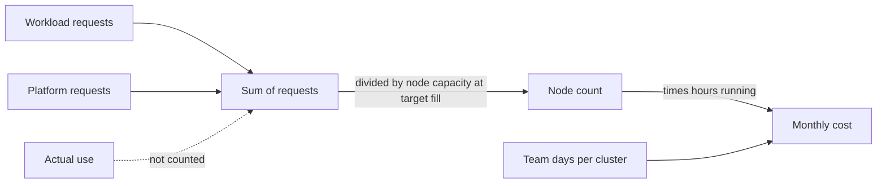

## Bạn cần biết trước

- [[k8s.l4.node-autoscaling]] — bạn biết kube-scheduler chỉ đặt Pod vào node mà phần dung lượng chưa bị xin đủ cho request của Pod, và cluster autoscaler thêm node cho những Pod không vừa chỗ nào.
- [[management.l3.total-cost-of-ownership]] — bạn biết một bản ước tính chi phí đếm cả giờ làm của đội lẫn các khoản phí, và đánh dấu mọi con số là giả định.
- [[k8s.l4.why-more-than-one-cluster]] — bạn biết mỗi cluster tự chạy và tự nâng cấp platform của riêng nó.
- [[devops.l4.platform-engineering]] — bạn biết platform biến các bước mà service nào cũng lặp lại thành công cụ và thành phần dùng chung cho mọi đội.

## Tình huống

Production sẽ chạy trên một cluster managed, và bạn được hỏi phải trả tiền cho bao nhiêu node. Bạn bắt đầu từ staging, nơi chạy trên một node. Bạn cộng các request trong manifest workload của staging dưới `deploy/gitops/config-repo-kustomize/base/`: `500m` CPU và `512Mi` bộ nhớ, một phần nhỏ của một node. Một đồng nghiệp kết luận production chỉ cần node nhỏ nhất đang bán. Thế nhưng staging chạy PostgreSQL, RabbitMQ, Keycloak, Argo CD và một Git server, còn `STAGE.md` của Đơn Hàng nói nó cần khoảng 4 GB bộ nhớ trên máy bạn. Nếu tổng request bạn cộng được nói lên ít đến vậy, thì thứ gì quyết định một cluster cần bao nhiêu node, và trả tiền cho bao nhiêu node?

## Khái niệm cốt lõi

- Phần dung lượng chưa bị xin (không phải term mới) — phần node có thể cấp cho Pod, trừ đi request của các Pod đã đặt lên đó. kube-scheduler đếm phần này, không bao giờ đếm mức các Pod đó dùng.
- Mức lấp đầy mục tiêu (không phải term mới) — tỉ lệ dung lượng allocatable của node mà đội định lấp bằng request, chừa phần còn lại cho rolling update và lúc cao điểm. `cluster-cost.md` giả định 70%.
- **chỉnh request cho vừa** (rightsizing) — đặt request của từng container theo mức dùng đo được lúc cao điểm cộng khoảng dư, để request không quá thấp cũng không quá cao.
- Phần nền cố định của platform (không phải term mới) — request của các thành phần mà cluster nào cũng chạy, bất kể lưu lượng, và phải trả thêm lần nữa cho mỗi cluster hay môi trường thêm vào.

## Cơ chế hoạt động



Trong tình huống trên, kube-scheduler lấp node của staging theo request. Một Pod xin `1` CPU mà chỉ dùng một phần mười vẫn giữ trọn CPU đó, không Pod nào khác lấy được. Một Pod không có request, không có limit và namespace không đặt mặc định thì không giữ gì trong phép đếm đó, dù nó dùng CPU và bộ nhớ thật. Nếu chỉ có limit mà không có request, hoặc namespace có mặc định, thì giá trị đó trở thành request của Pod. Vì thế số node một cluster cần đi theo tổng request của các Pod, dù có dùng hết hay không, và số node bạn trả tiền cũng vậy. Có cluster autoscaler thì chuyện này tự xảy ra: một request không vừa chỗ nào sẽ kéo theo một node mới, tới mức tối đa của node pool. Trên máy đội tự vận hành, nó quyết định lúc nào bạn phải mua thêm máy.

Tổng này có hai nguồn. Request của workload tăng theo số service và số replica bạn chạy. Request của platform thì như nhau, dù cluster vắng hay bận. Pod không có request làm tổng nhỏ hơn thực tế, còn request đặt cao hơn hẳn mức dùng làm tổng lớn hơn thực tế.

`cluster-cost.md` biến điều này thành một quy tắc. Số node bằng tổng request chia cho dung lượng allocatable của một node ở mức lấp đầy mục tiêu, làm tròn lên, lấy theo CPU hoặc bộ nhớ, bên nào cần nhiều node hơn. Mỗi node được giả định có 4 CPU và 8 GiB allocatable. `1000m` là một CPU và `1024Mi` là 1 GiB, nên 70% của một node là `2800m` và khoảng `5734Mi`. File này đếm chi phí bằng thời gian, không bằng tiền: số giờ node, cộng số ngày làm việc của đội cho mỗi cluster, giả định 2 ngày mỗi tháng, ghi thành hai con số không kèm giá.

## Trong hệ thống Đơn Hàng

Tài liệu thiết kế so request hiện đặt của staging với request đề xuất:

```markdown file=docs/design/cluster-cost.md tag=stage-4 lines=26-46
Bảng so request đang đặt trong `deploy/gitops/config-repo-kustomize/base/`
với request đề xuất. Lab không cài metrics-server nên đội chưa có số đo mức
dùng của từng Pod; request đề xuất là ước lượng (giả định), phải đo lại lúc
cao điểm trước khi sửa manifest.

| Workload | Replica | Request đang đặt (CPU / bộ nhớ) | Request đề xuất (giả định) |
|---|---|---|---|
| `api` | 2 | 250m / 256Mi mỗi Pod | giữ nguyên |
| `db` | 1 | không đặt | 500m / 1Gi |
| `rabbitmq` | 1 | không đặt | 200m / 512Mi |
| `keycloak` | 1 | không đặt | 250m / 768Mi |
| `redis` | 1 | không đặt | 50m / 128Mi |
| `notifications` | 1 | không đặt | 100m / 128Mi |
| `payments` | 1 | không đặt | 100m / 128Mi |
| `mailpit` (chỉ lab) | 1 | không đặt | 10m / 32Mi |
| `fake-gateway` (chỉ lab) | 1 | không đặt | 10m / 32Mi |
| Tổng | | 500m / 512Mi | 1720m / 3264Mi |

Pod không đặt request được scheduler tính là không xin gì: node trông còn
trống trong khi các Pod đó vẫn dùng CPU và bộ nhớ thật. Tổng request đang đặt
vì thế không nói được cluster cần bao nhiêu node.
```

Chỉ `api` đặt request, `250m` và `256Mi` cho mỗi replica trong 2 replica. Đó chính là `500m` và `512Mi` mà đồng nghiệp của bạn cộng được. Mọi workload khác đều không đặt, nên kube-scheduler coi chúng như không xin gì, trong khi chúng vẫn dùng CPU và bộ nhớ thật. Cột đề xuất cộng lại được `1720m` và `3264Mi`. Đoạn mở đầu nói vì sao đó chỉ là ước đoán: staging là một cluster kind trên máy bạn, như mọi cluster trong repo, và không cluster nào chạy metrics-server. Vì thế chưa ai đo mức dùng của từng Pod, và manifest giữ nguyên cho tới khi có người đo lúc cao điểm.

Ngay trên đoạn trích tiếp theo, cũng file đó liệt kê phần nền cố định của platform: Argo CD với mọi thành phần của nó, Git server, Traefik (phục vụ Gateway của cluster), controller Sealed Secrets và, chỉ riêng staging, Prometheus, cộng lại `950m` và `1984Mi` (giả định). Bên dưới là các đòn bẩy:

```markdown file=docs/design/cluster-cost.md tag=stage-4 lines=62-83
Các manifest của những thành phần này cũng chưa đặt request. Với tổng
workload và phần nền (2670m / 5248Mi), staging vừa một node theo cách tính
trên: một node cho 2,8 CPU và 5,6 GiB ở mức lấp đầy 70%.

### Đòn bẩy

- Request: đặt theo mức dùng đo lúc cao điểm cộng một khoảng dư. Thấp quá thì
  Pod bị chậm, bị giết vì thiếu bộ nhớ, hoặc chen lấn Pod bên cạnh; cao quá
  thì node bị giữ chỗ mà không làm gì.
- `minReplicas` của HPA: production hiện chạy `api` với số replica cố định
  trong Git; với HPA, số replica lúc vắng khách giảm về `minReplicas` (xem ví
  dụ trong `cluster-review-checklist.md`).
- Môi trường tắt ngoài giờ: staging không cần chạy ban đêm. Giờ node giảm
  theo số giờ tắt; dựng lại theo các bước của `scripts/devops/dr-drill.sh`, đã
  đo thời gian.
- Thời gian giữ telemetry và tỉ lệ sampling: Tempo của lab giữ trace 24 giờ
  (`deploy/monitoring/tempo.yml`), api giữ trace với tỉ lệ
  `Telemetry:SampleRatio`, 0,1 nếu không cấu hình. Chọn hai số này theo SLO
  là việc của `cost-per-shop.md`.

Các đòn bẩy giảm số node; không đòn bẩy nào giảm phần nền cố định, trừ bớt
một cluster hay một môi trường.
```

Đoạn đầu cộng workload với platform, được `2670m` và `5248Mi`, và thấy chúng vừa một node: ở mức lấp đầy 70%, một node cho 2,8 CPU và 5,6 GiB. Hơn một phần ba số CPU đó thuộc về platform, trước khi có đơn hàng nào tới.

Đòn bẩy đầu tiên là chỉnh request cho vừa. Thấp quá thì Pod bị chậm khi node bận, bị giết vì thiếu bộ nhớ, hoặc chen lấn các Pod bên cạnh, tức vấn đề noisy neighbor. Chuyện bị giết đến từ chính phép cộng: request bộ nhớ thấp hơn mức dùng thật khiến kube-scheduler đặt lên một node nhiều Pod hơn số bộ nhớ node đó chứa nổi, và khi bộ nhớ cạn, các Pod dùng vượt phần đã xin bị dừng trước. Cao quá thì dung lượng nằm giữ chỗ trên node, vẫn tốn tiền mà không làm gì.

Đòn bẩy thứ hai cho số replica giảm về `minReplicas` của HPA khi ít khách mua hàng, thay cho một con số cố định trong Git. Đòn bẩy thứ ba tắt staging ngoài giờ làm việc: số giờ node giảm theo số giờ tắt, và staging được dựng lại theo các bước đã đo thời gian của `dr-drill.sh`. Đòn bẩy thứ tư là Tempo giữ trace bao lâu và `api` giữ lại bao nhiêu phần trace: ít trace hơn, giữ ngắn hơn, nghĩa là ít dữ liệu hơn trên đĩa của Tempo. Tempo không nằm trong tổng nào ở trên: nó chạy trong lab, không chạy trong cluster, nên trong repo đòn bẩy này tiết kiệm đĩa, không tiết kiệm node. Chọn các con số đó là phần của `cost-per-shop.md`. Câu cuối nói các đòn bẩy làm giảm số node, nhưng không đòn bẩy nào giảm phần nền cố định của platform, trừ khi bớt một cluster hay một môi trường.

## Đánh đổi

| | Không đặt request | Request rộng tay | Request đã chỉnh cho vừa |
|---|---|---|---|
| Tổng request nói lên điều gì | Quá ít: node trông trống hơn thực tế | Quá nhiều: nhiều node hơn công việc cần | Sát mức cao điểm cần, cộng khoảng dư |
| Pod lúc bận | Chen lấn nhau, không có phần được giữ riêng | Có chỗ, thường nhiều hơn mức dùng | Có đúng phần đã đo là cần |
| Dung lượng trả tiền mà bỏ không | Ít, cho tới khi node quá tải | Nhiều, mỗi giờ | Đúng khoảng dư bạn chọn |
| Cần gì trước | Không cần gì | Một phỏng đoán | Mức dùng đo lúc cao điểm |

## Bạn sẽ chọn gì nếu…

- …bạn phải cắt chi phí staging trước khi có ai đo các Pod của nó: tắt staging ngoài giờ làm việc, vì cách này giảm giờ node mà không phải đoán request nào, và giữ request đề xuất ngoài manifest cho tới khi đo được lúc cao điểm.
- …production giữ `api` ở số replica cố định, tính cho đợt cao điểm buổi tối: đưa nó vào HPA để số replica giảm về `minReplicas` khi ít khách mua hàng, vì chính những giờ vắng đó là lúc replica cố định giữ dung lượng mà không có lưu lượng nào.
- …một đội xin một môi trường riêng để demo: đếm thêm một lần phần nền cố định của platform và số ngày của đội cho mỗi cluster, và ưu tiên một namespace trong cluster đang có, trừ khi buổi demo cần một ranh giới mà chỉ cluster riêng mới cho được.

## Senior hay nhầm rằng…

- **"Mình chỉ trả tiền cho phần CPU mà Pod thật sự dùng."** → Thực ra node được lấp theo request, nên số node bạn chạy, và trả tiền, đi theo tổng request, dù có dùng hay không. Bạn sẽ nhận ra khi các node báo mức dùng CPU thấp trong khi Pod mới vẫn nằm ở `Pending`, hoặc cluster autoscaler thêm một node nữa.
- **"Đặt request rộng tay là bảo hiểm miễn phí chống chậm."** → Thực ra mỗi phần request thêm là dung lượng không Pod nào khác lấy được, và phải trả tiền trên node mỗi giờ node chạy. Bạn sẽ nhận ra khi số node tăng sau mỗi bản release nâng request, trong khi lưu lượng vẫn như cũ.
- **"Cluster ít lưu lượng thì giữ chạy gần như không tốn gì."** → Thực ra platform của nó chạy bất kể lưu lượng, và đội tốn vài ngày cho mỗi cluster mỗi tháng. Bạn sẽ nhận ra khi một cluster staging vắng vẻ vẫn cần trọn một node, và theo các con số đề xuất trong `cluster-cost.md`, hơn một phần ba CPU request của nó thuộc về Argo CD, Git server, Traefik, controller Sealed Secrets và Prometheus.

## Thử ngay (3 phút)

Từ thư mục gốc của repo Đơn Hàng:

1. Mở `docs/design/cluster-cost.md` và tìm quy tắc tính số node, request đề xuất của workload và phần nền cố định của platform.
2. Giả sử có người nhân đôi mọi request đề xuất của workload "cho chắc" và để nguyên platform. Theo quy tắc của file, staging cần bao nhiêu node?
3. Giờ giả sử request giữ như đề xuất, và đội thêm một môi trường thứ hai giống staging. Môi trường thứ hai thêm vào những gì trước khi phục vụ đơn hàng đầu tiên?

Kết quả mong đợi: bạn nêu được một số node cho bước 2 và hai khoản chi phí cho bước 3, mỗi thứ lần ra được từ một con số trong file.

<details><summary>Gợi ý đáp án</summary>

Workload nhân đôi xin `3440m` và `6528Mi`. Cộng với `950m` và `1984Mi` của platform, tổng là `4390m` và `8512Mi`. Một node ở mức lấp đầy 70% cho 2,8 CPU và 5,6 GiB, nên CPU cần 2 node và bộ nhớ cũng cần 2: staging đi từ 1 node lên 2 node trong khi mức dùng vẫn như cũ. Môi trường thứ hai thêm node riêng của nó, trong đó `950m` và `1984Mi` là platform trước khi có đơn hàng nào, cộng thêm 2 ngày làm việc của đội mỗi tháng, mọi con số đều là giả định.

</details>

## Liên hệ

- [[k8s.l4.node-autoscaling]] — bước ngay trước: node được thêm cho những request không vừa chỗ nào. Bài này gắn chi phí cho chúng.
- [[k8s.l1.requests-and-limits]] — request và limit mà bài này quy đổi thành node.
- [[management.l3.total-cost-of-ownership]] — cùng cách đếm, áp cho một cluster: node và ngày làm của đội, con số nào cũng ghi là giả định.
- [[k8s.l4.why-more-than-one-cluster]] — vì sao mỗi cluster thêm vào lại trả phần nền cố định của platform thêm một lần.
- [[devops.l4.platform-engineering]] — platform mà các thành phần của nó tạo nên phần nền đó.
- [[backend.l4.capacity-planning]] — khoảng dư đặt trên mức dùng đo lúc cao điểm đến từ đâu.
- [[k8s.l4.horizontal-pod-autoscaler]] — đòn bẩy `minReplicas`: số replica giảm khi lưu lượng thấp.
- [[backend.l3.trace-sampling]] — tỉ lệ sampling, một trong các đòn bẩy telemetry trong `cluster-cost.md`.
- [[k8s.l4.choosing-managed-kubernetes]] — tiếp theo: quyết định chạy cluster ở đâu, mà mô hình chi phí này là đầu vào.

## Tóm tắt 5 dòng

1. Node được lấp theo request, nên số node một cluster cần, và trả tiền, đi theo tổng request của các Pod, dù có dùng hay không.
2. Trong `cluster-cost.md`, chỉ `api` đặt request trong số workload của staging, nên tổng của chúng nói lên rất ít. Request đề xuất là giả định, chưa đo.
3. Chỉnh request cho vừa nghĩa là đặt request theo mức dùng đo lúc cao điểm cộng khoảng dư: thấp quá làm Pod chậm hoặc bị giết, cao quá để node bỏ không.
4. Argo CD, Git server, Traefik, Sealed Secrets và, ở staging, Prometheus là phần nền cố định mà mỗi cluster hay môi trường thêm vào phải trả lại.
5. Chi phí đếm bằng node và ngày làm của đội, với con số giả định. Đòn bẩy là request, mức tối thiểu của HPA, tắt môi trường ngoài giờ và thời gian giữ telemetry.
