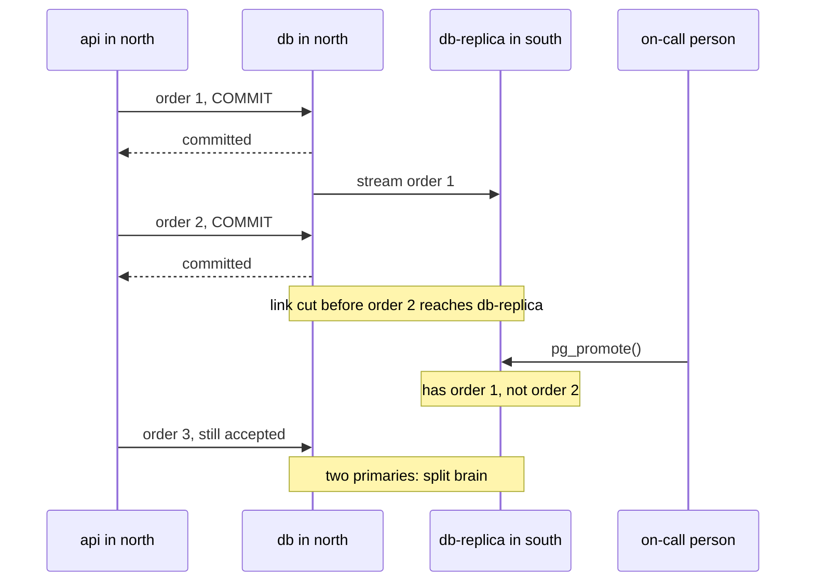

## Before you start

- [[k8s.l4.failover-between-clusters]] — you know an entry in front of two clusters moves calls to the healthy one within seconds, with neither cluster changed.
- [[backend.l3.read-replicas]] — you know `db-replica` streams `db`'s changes and applies each one only after `db` has committed it.
- [[devops.l3.disaster-recovery-drill]] — you know a DR drill rebuilds an environment from Git, keys and backups, and its total is the measured recovery time.
- [[backend.l4.pacelc]] — you know synchronous replication makes each commit wait for a replica, trading a slower write for a current copy.

## The situation

The entry from the last lesson moved calls from north to south in a few seconds. Now picture Đơn Hàng's api behind it instead of `echo-region`: south has the same Pods, built from the same config repository, so it answers. But a customer placed an order in north one second before north went silent, and got `201`. In south, the api reads from the database copy waiting there. Is the order in it? And if north comes back still taking orders, which database holds the truth?

## Core concepts

- **split brain** — two copies of the same data both accept writes, each acting as the primary, so the data splits into two versions that nothing joins back together.
- Standby (not a new term) — a copy of the database server that follows a primary and can be promoted to take writes when the primary is lost; `db-replica` is one. PostgreSQL calls this following state recovery, because the standby keeps replaying the primary's WAL.
- Promotion (here: of a database, not a build between environments) — ending a standby's recovery so it stops following its primary and starts accepting writes; in PostgreSQL the function `pg_promote()` does this.
- RPO, in a failover — the commits a client was told succeeded but that the standby had not yet received when it was promoted.

## How it works



In the situation above, the Pods in south came from the config repository, so nothing about them was lost. Orders are different: they exist only in the database. A failover can serve at most what the copy in the other region already holds.

`db-replica` is fed by asynchronous replication. `db` confirms a commit to the api as soon as it is safe on `db` itself, without waiting for the standby to receive it. The standby therefore runs some distance behind. When the link is cut, as in the diagram, order 2 was confirmed but had not reached the standby. When the on-call person promotes the standby with `pg_promote()`, order 2 is not there: that gap is the RPO of this failover, and it is whatever the lag was at that moment, not a number anyone chose.

Promotion fixes nothing on the old side. In the diagram, north was only cut off from south, not stopped, so its api keeps writing to `db`. Both servers now take writes and neither sends its changes to the other: split brain. That is why a standby is promoted only after the old primary is stopped or cut off from every client. From outside, a region that stopped answering looks the same as a region that is cut off but still taking orders.

Synchronous replication to the other region closes the gap: `db` confirms a commit only after the standby has it, so a confirmed commit is lost only if both servers are lost at once. The cost is that every commit that writes waits at least one round trip between the regions, failure or not. That is PACELC's else branch: lower latency or a current copy.

## In the Đơn Hàng system

`db-replica` runs in Compose under the profile `replica`, next to `db` on one machine; here the two stand in for two regions. `db/replica/start.sh` (not shown) copies `db` by taking a base backup with PostgreSQL's `pg_basebackup` tool and starts it as a standby that streams every later change. Nothing in `db`'s configuration makes it wait for the standby, so the replication is asynchronous. The script that promotes it:

```bash file=scripts/backend/promote-replica.sh tag=stage-4 lines=34-50
echo "== db-replica follows db"
on db-replica --command "SELECT pg_is_in_recovery() AS replica"

# lesson: k8s.l4.data-decides-failover
# pg_promote() ends recovery: db-replica stops following db and accepts
# writes. Nothing stopped db first, so both now take writes, and nothing
# carries a change from one to the other: two primaries, a split brain.
echo "== promote db-replica while db still runs"
on db-replica --command "SELECT pg_promote() AS promoted"
on db-replica --command "SELECT pg_is_in_recovery() AS replica"

echo "== each primary accepts its own price for product 1"
on db --command "UPDATE products SET price_vnd = 1300000 WHERE id = 1"
on db-replica --command "UPDATE products SET price_vnd = 1200000 WHERE id = 1"
echo "== and each answers with its own"
on db --command "SELECT price_vnd FROM products WHERE id = 1"
on db-replica --command "SELECT price_vnd FROM products WHERE id = 1"
```

```text output=true
== db-replica follows db
-- on db-replica
SELECT pg_is_in_recovery() AS replica
 replica
---------
 t

== promote db-replica while db still runs
...
-- on db-replica
SELECT pg_is_in_recovery() AS replica
 replica
---------
 f

== each primary accepts its own price for product 1
-- on db
UPDATE products SET price_vnd = 1300000 WHERE id = 1
UPDATE 1
-- on db-replica
UPDATE products SET price_vnd = 1200000 WHERE id = 1
UPDATE 1
== and each answers with its own
-- on db
SELECT price_vnd FROM products WHERE id = 1
 price_vnd
-----------
   1300000

-- on db-replica
SELECT price_vnd FROM products WHERE id = 1
 price_vnd
-----------
   1200000

(product 1 gets its old price back on db when this script ends)
(db-replica and its volume are removed now)
```

`on`, defined above the excerpt (which starts at line 34), sends one SQL statement to the named server through PostgreSQL's command-line client `psql` and prints it first; the `...` hides `pg_promote()` returning `t`. Line 35 shows `t`: `db-replica` is still in recovery, following `db`; line 42 promotes it while `db` keeps running, and line 43 now shows `f`: it has left recovery and takes writes. Lines 46–47 give product 1 a different price on each server, and both answer `UPDATE 1`. Lines 49–50 read it back: `1300000` on `db`, `1200000` on `db-replica`. Neither is wrong by its own records, and no step will make them agree. Had these been orders, each server would hold orders the other has never seen.

The decision Đơn Hàng made with this in mind, from ADR `0020`:

```markdown file=docs/adr/0020-mot-region-phuc-hoi-tu-ban-sao-luu.md tag=stage-4 lines=45-67
### Quyết định

Chọn A. SLO hiện tại không đòi RTO hay RPO mà A không đạt, và chưa hợp đồng
nào đòi. B tốn một cluster thường trực và gấp đôi việc vận hành để bảo vệ khỏi
một sự cố hiếm hơn nhiều so với những sự cố một region đã chịu được (mất một
node, mất một Pod). C đòi đổi cách chia dữ liệu mà ADR 0013 đã quyết, không
thuộc phạm vi ADR này.

### Hệ quả

- RTO và RPO của Đơn Hàng là số đo của DR drill và tần suất sao WAL sang
  region thứ hai, không phải con số đội mong muốn. Mỗi lần DR drill cập nhật
  hai số này.
- Khoảng trống hiện tại: bản sao lưu và WAL chưa rời khỏi máy đang chạy
  database. Mất máy đó là mất cả bản sao lưu. Sao chúng sang region thứ hai là
  việc cần làm trước khi có khách thật; stage-4 chưa làm.
- Một replica bất đồng bộ không được promote khi primary còn có thể nhận ghi:
  cả hai sẽ nhận đơn và lệch nhau. `promote-replica.sh` cho thấy điều đó.

Điều kiện mở lại:

- Một hợp đồng hoặc SLA đòi RTO hoặc RPO thấp hơn số đo của DR drill.
- Dữ liệu của một số cửa hàng phải nằm ở một vùng xác định.
```

Option A, chosen, keeps Đơn Hàng in one region and, when the region is lost, restores in a second one from a base backup and WAL copied there, by the DR drill's steps. Option B, above the excerpt, is a warm standby: a second cluster with an asynchronous replica and a manual failover. Option C is both regions taking orders; with one PostgreSQL primary only one region can write, so C needs each order to belong to one region, which would change how Đơn Hàng splits its data.

The first consequence ties both targets to measurements: RTO is the drill's time, RPO the WAL not yet copied. The second admits that at `stage-4` the copies have not left the database's machine yet. The third is this lesson's rule. The ADR is reopened when a contract or SLA asks for an RTO or RPO below what the drill measures, or when some shops' data must stay in a given place.

## Trade-offs

| | One region, restore from backups (ADR `0020`, A) | Warm standby, asynchronous replica (B) | Synchronous replica in the other region | Both regions take orders (C) |
|---|---|---|---|---|
| RPO | The WAL not yet copied to the second region | The lag at the moment of promotion | Zero for each commit confirmed | Depends on how orders are split or merged |
| RTO | The drill's time plus restoring the database | Much shorter: the cluster and data are waiting | Like B | Calls already go to both |
| Cost of each write | None added | None added | A round trip between regions on every commit that writes | Depends on the database |
| What runs all the time | One region | Two clusters, both upgraded and drilled | Two clusters, and the primary waits on the other | Two clusters and a way to keep data apart or merged |
| Split brain risk | If the lost region comes back still taking orders: the same rule, stop the old primary before the restored copy takes orders | At every promotion, unless the old primary is stopped or cut off first | The same at promotion | Built in unless each order belongs to one region |

## What would you choose if…

- …no SLO or contract asks for less than the drill measures: one region with backups copied away, as ADR `0020` does, and the copying done before real customers arrive.
- …a contract demands minutes of RTO and accepts losing the last seconds of orders: a warm standby with asynchronous replication, and a written failover step that stops or cuts off the old primary before promotion.
- …no confirmed order may ever be lost and the regions are close enough that a round trip is cheap: synchronous replication, with every write paying that round trip.

## Seniors often assume…

- **"Once traffic moves to the second region, every order made before the failure is there too."** → Actually only what the standby had received is there, because asynchronous replication confirms a commit without waiting for the standby. You notice this when a customer holds a `201` for an order that the promoted database has never seen.
- **"Promoting the standby is safe as soon as the primary stops answering health checks."** → Actually a failed check shows only that the checker cannot reach the primary, while clients on its side may still be writing to it. You notice this when the old region comes back and its database holds orders that the new primary lacks, as `promote-replica.sh` shows with two prices for product 1.
- **"Running both regions active-active only needs an entry in front of them that spreads calls."** → Actually the entry spreads calls, but with one primary database only one region can take writes; both writing needs each order to belong to one region, or a database that accepts writes in several places. You notice this when ADR `0020` rejects option C for exactly that reason.

## Try it (3 minutes)

In the `don-hang` repository folder:

Keep Đơn Hàng's Compose services running. The script itself starts `db-replica` under the `replica` profile, as a fresh copy of `db`, and removes it with its volume at the end.

1. Run `scripts/backend/promote-replica.sh`.
2. Under `== and each answers with its own`, compare the two prices, then decide which one a customer in each region would be charged, and what you would need to merge the two servers back into one.

Expected result: `1300000` on `db` and `1200000` on `db-replica`, and the script ends by putting product 1's old price back on `db` and removing `db-replica`.

<details><summary>Suggested answer</summary>

A customer whose calls reach `db` sees `1300000`; one whose calls reach `db-replica` sees `1200000`. Both servers are primaries, and neither sends its changes to the other. To merge them you would have to find every row changed on each side since the promotion and decide, row by row, which change wins; for orders, both may be real. That is why the rule is to stop or cut off the old primary before promoting, not to merge afterwards.

</details>

## Connections

- [[k8s.l4.failover-between-clusters]] — the traffic half of failover; this lesson is the data half that decides what the moved calls find.
- [[backend.l3.read-replicas]] — the same `db-replica` and its lag; there it served stale reads, here the lag becomes lost orders.
- [[backend.l4.pacelc]] — the trade behind synchronous replication between regions: a current copy for a slower commit.
- [[backend.l4.cap-theorem]] — split brain is what happens when both sides of a network partition keep accepting writes.
- [[devops.l3.rpo-and-rto]] — here RPO stops being a target and becomes the replication lag, or the WAL not yet copied.
- [[devops.l3.disaster-recovery-drill]] — the steps ADR `0020` relies on, and the source of its RTO.
- [[devops.l3.point-in-time-recovery]] — how the base backup and WAL of option A are restored in the second region.
- [[backend.l4.service-level-objectives]] — the SLO that ADR `0020` checks its RTO and RPO against.
- [[management.l3.architecture-decision-record]] — ADR `0020` follows that form, with conditions that reopen it.

## Five-line summary

1. Traffic moves to another region in seconds, but a failover keeps only the data the copy in that region already holds.
2. Asynchronous replication does not wait for the standby, so promoting it loses commits it had not received: the RPO is the lag at that moment.
3. `promote-replica.sh` promotes `db-replica` while `db` runs; both accept a different price for product 1, a split brain.
4. Promote a standby only after the old primary is stopped or cut off; synchronous replication avoids loss by slowing every commit that writes.
5. ADR `0020` keeps one region and restores from copied backups, reopened when a contract needs a lower RTO or RPO.
