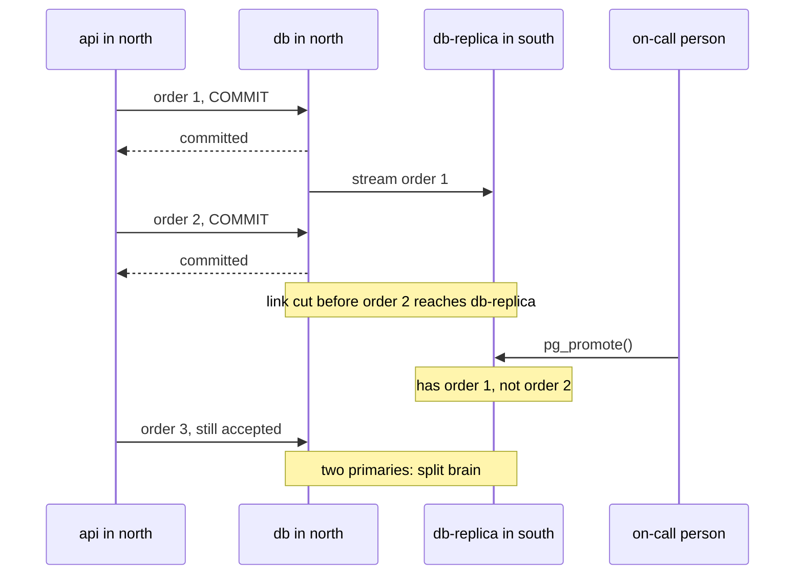

## Bạn cần biết trước

- [[k8s.l4.failover-between-clusters]] — bạn biết một điểm vào đứng trước hai cluster chuyển lời gọi sang cluster khỏe trong vài giây, không cluster nào bị thay đổi.
- [[backend.l3.read-replicas]] — bạn biết `db-replica` nhận dòng thay đổi của `db` và chỉ áp dụng mỗi thay đổi sau khi `db` đã commit nó.
- [[devops.l3.disaster-recovery-drill]] — bạn biết diễn tập DR dựng lại một môi trường từ Git, key và bản sao lưu, và tổng thời gian của nó là thời gian khôi phục đo được.
- [[backend.l4.pacelc]] — bạn biết replication đồng bộ bắt mỗi lần commit chờ một replica, đổi lần ghi chậm hơn lấy một bản sao luôn mới nhất.

## Tình huống

Điểm vào ở bài trước chuyển lời gọi từ north sang south trong vài giây. Giờ hãy hình dung api của Đơn Hàng đứng sau nó thay cho `echo-region`: south có cùng các Pod, dựng từ cùng repo cấu hình, nên nó trả lời. Nhưng một khách hàng đặt đơn ở north một giây trước khi north im lặng, và đã nhận `201`. Ở south, api đọc từ bản sao database chờ sẵn ở đó. Đơn đó có trong bản sao không? Và nếu north quay lại mà vẫn nhận đơn, database nào giữ sự thật?

## Khái niệm cốt lõi

- **split brain** (Hai bản cùng nhận ghi vì mỗi bên tưởng mình là primary, nên dữ liệu rẽ thành hai bản khác nhau) — hai bản sao của cùng một dữ liệu cùng nhận ghi, bản nào cũng hành xử như primary, nên dữ liệu rẽ thành hai phiên bản mà không gì gộp lại được.
- Standby (không phải term mới) — bản sao của server database đi theo một primary và có thể được promote để nhận ghi khi mất primary. `db-replica` là một standby. PostgreSQL gọi trạng thái đi theo này là recovery, vì standby liên tục phát lại WAL của primary.
- Promote (ở đây là promote một database, không phải đưa một bản build qua các môi trường) — kết thúc recovery của standby để nó thôi đi theo primary và bắt đầu nhận ghi. Trong PostgreSQL, hàm `pg_promote()` làm điều này.
- RPO khi failover — những commit mà client đã được báo thành công nhưng standby chưa nhận được lúc nó được promote.

## Cơ chế hoạt động



Trong tình huống trên, các Pod ở south đến từ repo cấu hình, nên không có gì của chúng bị mất. Đơn hàng thì khác: chúng chỉ tồn tại trong database. Một lần failover chỉ phục vụ được tối đa những gì bản sao ở region kia đã có.

`db-replica` được nuôi bằng replication không đồng bộ. `db` xác nhận commit với api ngay khi thay đổi đã an toàn trên chính `db`, không chờ standby nhận. Vì thế standby luôn chạy sau một quãng. Khi đường nối bị cắt, như trong sơ đồ, đơn 2 đã được xác nhận nhưng chưa tới standby. Khi người trực promote standby bằng `pg_promote()`, đơn 2 không có ở đó: khoảng hụt đó là RPO của lần failover này, và nó bằng đúng replication lag lúc đó, không phải con số ai chọn.

Promote không sửa được gì ở phía cũ. Trong sơ đồ, north chỉ bị cắt khỏi south chứ không dừng, nên api của nó vẫn ghi vào `db`. Giờ cả hai server cùng nhận ghi và không bên nào gửi thay đổi của mình cho bên kia: split brain. Vì thế chỉ promote standby sau khi primary cũ đã dừng hoặc bị cắt khỏi mọi client. Nhìn từ bên ngoài, một region ngừng trả lời trông y hệt một region bị cắt mạng nhưng vẫn đang nhận đơn.

Replication đồng bộ sang region kia lấp khoảng hụt này: `db` chỉ xác nhận commit sau khi standby đã có nó, nên một commit đã xác nhận chỉ mất khi mất cả hai server cùng lúc. Cái giá là mỗi lần commit có ghi phải chờ ít nhất một lượt đi về giữa hai region, dù có sự cố hay không. Đó là nhánh else của PACELC: độ trễ thấp hơn hay một bản sao mới nhất.

## Trong hệ thống Đơn Hàng

`db-replica` chạy trong Compose dưới profile `replica`, cạnh `db` trên cùng một máy. Ở đây hai server này đóng vai hai region. `db/replica/start.sh` (không trích ở đây) chép `db` bằng cách lấy base backup với công cụ `pg_basebackup` của PostgreSQL, rồi khởi động nó thành standby nhận mọi thay đổi sau đó. Không gì trong cấu hình của `db` bắt nó chờ standby, nên replication là không đồng bộ. Script promote nó:

```bash file=scripts/backend/promote-replica.sh tag=stage-4 lines=34-50
echo "== db-replica follows db"
on db-replica --command "SELECT pg_is_in_recovery() AS replica"

# lesson: k8s.l4.data-decides-failover
# pg_promote() ends recovery: db-replica stops following db and accepts
# writes. Nothing stopped db first, so both now take writes, and nothing
# carries a change from one to the other: two primaries, a split brain.
echo "== promote db-replica while db still runs"
on db-replica --command "SELECT pg_promote() AS promoted"
on db-replica --command "SELECT pg_is_in_recovery() AS replica"

echo "== each primary accepts its own price for product 1"
on db --command "UPDATE products SET price_vnd = 1300000 WHERE id = 1"
on db-replica --command "UPDATE products SET price_vnd = 1200000 WHERE id = 1"
echo "== and each answers with its own"
on db --command "SELECT price_vnd FROM products WHERE id = 1"
on db-replica --command "SELECT price_vnd FROM products WHERE id = 1"
```

```text output=true
== db-replica follows db
-- on db-replica
SELECT pg_is_in_recovery() AS replica
 replica
---------
 t

== promote db-replica while db still runs
...
-- on db-replica
SELECT pg_is_in_recovery() AS replica
 replica
---------
 f

== each primary accepts its own price for product 1
-- on db
UPDATE products SET price_vnd = 1300000 WHERE id = 1
UPDATE 1
-- on db-replica
UPDATE products SET price_vnd = 1200000 WHERE id = 1
UPDATE 1
== and each answers with its own
-- on db
SELECT price_vnd FROM products WHERE id = 1
 price_vnd
-----------
   1300000

-- on db-replica
SELECT price_vnd FROM products WHERE id = 1
 price_vnd
-----------
   1200000

(product 1 gets its old price back on db when this script ends)
(db-replica and its volume are removed now)
```

`on`, định nghĩa phía trên đoạn trích (đoạn trích bắt đầu ở dòng 34), gửi một câu SQL tới server được chỉ tên qua client dòng lệnh `psql` của PostgreSQL và in câu đó ra trước. `...` giấu kết quả `t` mà `pg_promote()` trả về. Dòng 35 cho thấy `t`: `db-replica` vẫn đang trong recovery, đi theo `db`. Dòng 42 promote nó trong khi `db` vẫn chạy, và dòng 43 giờ cho thấy `f`: nó đã rời recovery và nhận ghi. Dòng 46–47 đặt cho sản phẩm 1 một giá khác nhau trên mỗi server, và cả hai đều trả lời `UPDATE 1`. Dòng 49–50 đọc lại: `1300000` trên `db`, `1200000` trên `db-replica`. Theo sổ sách của chính mình thì không bên nào sai, và không bước nào làm chúng khớp lại. Nếu đây là đơn hàng, mỗi server sẽ giữ những đơn mà server kia chưa từng thấy.

Quyết định Đơn Hàng đưa ra khi đã biết điều này, trích từ ADR `0020`:

```markdown file=docs/adr/0020-mot-region-phuc-hoi-tu-ban-sao-luu.md tag=stage-4 lines=45-67
### Quyết định

Chọn A. SLO hiện tại không đòi RTO hay RPO mà A không đạt, và chưa hợp đồng
nào đòi. B tốn một cluster thường trực và gấp đôi việc vận hành để bảo vệ khỏi
một sự cố hiếm hơn nhiều so với những sự cố một region đã chịu được (mất một
node, mất một Pod). C đòi đổi cách chia dữ liệu mà ADR 0013 đã quyết, không
thuộc phạm vi ADR này.

### Hệ quả

- RTO và RPO của Đơn Hàng là số đo của DR drill và tần suất sao WAL sang
  region thứ hai, không phải con số đội mong muốn. Mỗi lần DR drill cập nhật
  hai số này.
- Khoảng trống hiện tại: bản sao lưu và WAL chưa rời khỏi máy đang chạy
  database. Mất máy đó là mất cả bản sao lưu. Sao chúng sang region thứ hai là
  việc cần làm trước khi có khách thật; stage-4 chưa làm.
- Một replica bất đồng bộ không được promote khi primary còn có thể nhận ghi:
  cả hai sẽ nhận đơn và lệch nhau. `promote-replica.sh` cho thấy điều đó.

Điều kiện mở lại:

- Một hợp đồng hoặc SLA đòi RTO hoặc RPO thấp hơn số đo của DR drill.
- Dữ liệu của một số cửa hàng phải nằm ở một vùng xác định.
```

Phương án A, được chọn, giữ Đơn Hàng ở một region, và khi mất region đó thì khôi phục ở region thứ hai từ base backup và WAL đã chép sang đó, theo các bước của diễn tập DR. Phương án B, nằm phía trên đoạn trích, là một standby chờ sẵn: cluster thứ hai với một replica không đồng bộ và failover bằng tay. Phương án C là cả hai region cùng nhận đơn. Với một primary PostgreSQL duy nhất, chỉ một region ghi được, nên C đòi mỗi đơn thuộc về một region, và điều đó sẽ thay đổi cách Đơn Hàng chia dữ liệu.

Hệ quả đầu tiên gắn cả hai mục tiêu vào số đo: RTO là thời gian của diễn tập, RPO là phần WAL chưa được chép đi. Hệ quả thứ hai thừa nhận rằng ở `stage-4`, các bản sao chưa rời khỏi máy chạy database. Hệ quả thứ ba chính là quy tắc của bài này. ADR được mở lại khi một hợp đồng hoặc SLA đòi RTO hoặc RPO thấp hơn số đo của diễn tập, hoặc khi dữ liệu của một số cửa hàng phải nằm ở một nơi xác định.

## Đánh đổi

| | Một region, khôi phục từ bản sao lưu (ADR `0020`, A) | Standby chờ sẵn, replica không đồng bộ (B) | Replica đồng bộ ở region kia | Cả hai region cùng nhận đơn (C) |
|---|---|---|---|---|
| RPO | Phần WAL chưa chép sang region thứ hai | Replication lag lúc promote | Bằng 0 với mỗi commit đã xác nhận | Tùy cách chia hoặc gộp đơn |
| RTO | Thời gian diễn tập cộng thời gian khôi phục database | Ngắn hơn nhiều: cluster và dữ liệu đã chờ sẵn | Như B | Lời gọi vốn đã đi tới cả hai |
| Chi phí mỗi lần ghi | Không thêm gì | Không thêm gì | Một lượt đi về giữa hai region ở mỗi lần commit có ghi | Tùy database |
| Thứ chạy thường trực | Một region | Hai cluster, cả hai đều phải nâng cấp và diễn tập | Hai cluster, và primary chờ bên kia | Hai cluster và cơ chế giữ dữ liệu tách riêng hoặc gộp lại |
| Rủi ro split brain | Nếu region đã mất quay lại mà vẫn nhận đơn: cùng quy tắc, dừng primary cũ trước khi bản đã khôi phục nhận đơn | Ở mỗi lần promote, trừ khi primary cũ đã dừng hoặc bị cắt trước | Như vậy khi promote | Có sẵn trong thiết kế, trừ khi mỗi đơn thuộc về một region |

## Bạn sẽ chọn gì nếu…

- …không SLO hay hợp đồng nào đòi thấp hơn số đo của diễn tập: một region với bản sao lưu được chép đi nơi khác, như ADR `0020` làm, và chép xong trước khi có khách thật.
- …một hợp đồng đòi RTO tính bằng phút và chấp nhận mất vài giây đơn cuối cùng: standby chờ sẵn với replication không đồng bộ, cùng một bước failover viết sẵn để dừng hoặc cắt primary cũ trước khi promote.
- …không đơn nào đã xác nhận được phép mất và hai region đủ gần để một lượt đi về là rẻ: replication đồng bộ, với mọi lần ghi đều trả lượt đi về đó.

## Senior hay nhầm rằng…

- **"Khi traffic đã sang region thứ hai, mọi đơn đặt trước sự cố cũng có ở đó."** → Thực ra chỉ những gì standby đã nhận mới có ở đó, vì replication không đồng bộ xác nhận commit mà không chờ standby. Bạn sẽ nhận ra khi một khách hàng cầm `201` cho một đơn mà database vừa được promote chưa từng thấy.
- **"Promote standby là an toàn ngay khi primary không còn trả lời health check."** → Thực ra một lần kiểm tra hỏng chỉ cho thấy bên kiểm tra không với tới primary, trong khi client ở phía bên kia vẫn có thể đang ghi vào nó. Bạn sẽ nhận ra khi region cũ quay lại và database của nó giữ những đơn mà primary mới không có, như `promote-replica.sh` cho thấy với hai giá cho sản phẩm 1.
- **"Chạy cả hai region active-active chỉ cần một điểm vào đứng trước để chia lời gọi."** → Thực ra điểm vào chia lời gọi, nhưng với một database primary duy nhất thì chỉ một region nhận ghi được. Muốn cả hai cùng ghi, mỗi đơn phải thuộc về một region, hoặc phải có database nhận ghi ở nhiều nơi. Bạn sẽ nhận ra khi ADR `0020` loại phương án C vì đúng lý do đó.

## Thử ngay (3 phút)

Trong thư mục repo `don-hang`:

Giữ các service Compose của Đơn Hàng đang chạy. Chính script sẽ khởi động `db-replica` dưới profile `replica`, như một bản sao mới của `db`, và xóa nó cùng volume ở cuối.

1. Chạy `scripts/backend/promote-replica.sh`.
2. Dưới dòng `== and each answers with its own`, so hai giá, rồi quyết định khách hàng ở mỗi region sẽ bị tính giá nào, và bạn cần gì để gộp hai server lại thành một.

Kết quả mong đợi: `1300000` trên `db` và `1200000` trên `db-replica`, và script kết thúc bằng cách trả lại giá cũ của sản phẩm 1 trên `db` rồi xóa `db-replica`.

<details><summary>Gợi ý đáp án</summary>

Khách hàng có lời gọi tới `db` thấy `1300000`, khách có lời gọi tới `db-replica` thấy `1200000`. Cả hai server đều là primary, và không bên nào gửi thay đổi của mình cho bên kia. Muốn gộp chúng, bạn phải tìm mọi dòng đã đổi ở mỗi bên kể từ lúc promote rồi quyết định, từng dòng một, thay đổi nào thắng. Với đơn hàng, cả hai có thể đều là thật. Vì thế quy tắc là dừng hoặc cắt primary cũ trước khi promote, chứ không phải gộp lại sau.

</details>

## Liên hệ

- [[k8s.l4.failover-between-clusters]] — nửa traffic của failover. Bài này là nửa dữ liệu, quyết định lời gọi đã chuyển đi sẽ tìm thấy gì.
- [[backend.l3.read-replicas]] — cùng `db-replica` và độ chậm của nó. Ở đó nó trả về dữ liệu đọc cũ, ở đây độ chậm thành đơn bị mất.
- [[backend.l4.pacelc]] — sự đánh đổi đằng sau replication đồng bộ giữa các region: một bản sao mới nhất đổi lấy commit chậm hơn.
- [[backend.l4.cap-theorem]] — split brain là điều xảy ra khi cả hai phía của một phân vùng mạng cùng tiếp tục nhận ghi.
- [[devops.l3.rpo-and-rto]] — ở đây RPO thôi là mục tiêu và trở thành replication lag, hoặc phần WAL chưa được chép đi.
- [[devops.l3.disaster-recovery-drill]] — các bước ADR `0020` dựa vào, và cũng là nguồn của RTO trong đó.
- [[devops.l3.point-in-time-recovery]] — cách base backup và WAL của phương án A được khôi phục ở region thứ hai.
- [[backend.l4.service-level-objectives]] — SLO mà ADR `0020` đem RTO và RPO của mình ra đối chiếu.
- [[management.l3.architecture-decision-record]] — ADR `0020` theo đúng dạng đó, kèm các điều kiện mở lại.

## Tóm tắt 5 dòng

1. Traffic chuyển sang region khác trong vài giây, nhưng failover chỉ giữ được dữ liệu mà bản sao ở region đó đã có.
2. Replication không đồng bộ không chờ standby, nên promote standby sẽ mất những commit nó chưa nhận: RPO là replication lag lúc đó.
3. `promote-replica.sh` promote `db-replica` trong khi `db` vẫn chạy. Cả hai nhận một giá khác nhau cho sản phẩm 1, tức split brain.
4. Chỉ promote standby sau khi primary cũ đã dừng hoặc bị cắt. Replication đồng bộ tránh mất dữ liệu bằng cách làm chậm mọi lần commit có ghi.
5. ADR `0020` giữ một region và khôi phục từ bản sao lưu đã chép đi, mở lại khi một hợp đồng đòi RTO hoặc RPO thấp hơn.
