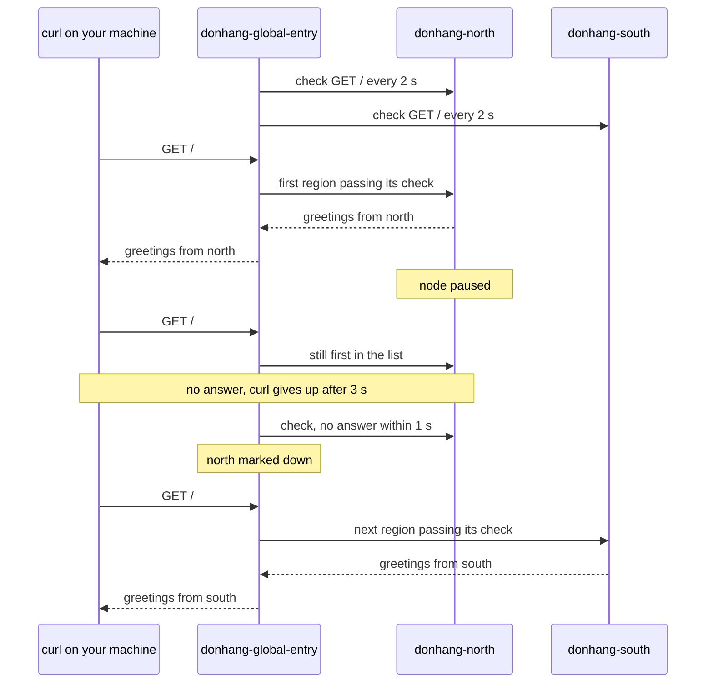

## Before you start

- [[k8s.l4.one-argo-cd-many-clusters]] — you know `donhang-north` and `donhang-south` run the same `echo-region`, which answers with the name of its node.
- [[k8s.l3.highly-available-entry-point]] — you know an entry point survives a failure only when something else can take over behind one address.
- [[k8s.l3.metallb-layer2-mode]] — you know failover moves traffic only after a failure is noticed, so calls in the gap can fail.
- [[k8s.l1.readiness-probes]] — you know a failing check takes a Pod out of traffic without restarting it; here the same happens to a whole cluster.

## The situation

Both regions now run `echo-region`, each answering on node port 30090 with the name of its node. Customers, though, will not keep two addresses and try the one that works; they use one name, and that name leads to one place. Suppose north's node stops answering in the middle of the day. South is still up, with the same Pod ready, yet a client sending its calls to north keeps waiting. Neither cluster knows the other exists. What sends calls to the cluster that works, and what happens to the calls made while it finds out?

## Core concepts

- **active-passive** — one cluster serves all traffic while another waits ready and takes over only when the first fails; in the lab, north serves and south waits.
- **active-active** — every cluster serves traffic at once, and when one is lost the others take its share; in the lab, north and south answer calls in turn.
- Entry (not a new term) — the one address clients call, here `donhang-global-entry`: a Caddy container acting as a reverse proxy in front of both regions. Each address it forwards calls to is an upstream; here there are two, one per region.
- Active health check (not a new term) — a call Caddy itself makes to each upstream on a timer; an upstream that fails it gets no calls until a later check passes.
- Failover — here, the entry sending calls to south because north failed its check, with no change made to either cluster.
- Failing back (not a new term) — sending calls back to the region that failed, once it passes its checks again; with `first` this happens at once.

## How it works



In the situation above, the thing clients call is `donhang-global-entry`: one Caddy container on Docker's network `kind`, where both regions' nodes run as containers too. Your machine reaches it at `127.0.0.1:18090`. It lists north before south, both at node port 30090, where each cluster's NodePort Service passes the call to a ready `echo-region` Pod.

Every 2 seconds Caddy calls `/` on each region. With the policy `first`, each call from a client goes to the first region in the list whose check passes. While north passes, south gets no calls at all, though its Pod is ready: that is active-passive. A fault only south has therefore stays hidden until north fails and south must take everything.

The script then pauses north's node container: `docker pause` suspends every process in it, so nothing in north answers, as if the region were cut off. Caddy does not know yet, and by default it does not retry a call on the other region. Calls sent to north hang or fail; the script's `curl` gives up after 3 seconds. New calls still go to north until a check gets no answer within 1 second. Then Caddy marks north down, and from the next call on, south answers. No Pod moved and no Service changed in either cluster: the failover happened entirely in the entry.

When north is unpaused and passes a check again, `first` sends every call back to north at once. Switch the policy to `round_robin` and calls go to north and south in turn, so both serve at once: active-active.

## In the Đơn Hàng system

The entry's configuration, from `global-entry.Caddyfile`:

```caddyfile file=deploy/k8s/regions/global-entry.Caddyfile tag=stage-4 lines=9-22
:8080 {
	# lesson: k8s.l4.failover-between-clusters
	# first: every call goes to the first region whose health check passes,
	# north while it is up (active-passive); round_robin, set through the
	# environment variable LB_POLICY, sends calls to both in turn
	# (active-active). Every 2 s Caddy calls / on each region and marks it
	# down when no answer comes within 1 s.
	reverse_proxy donhang-north-control-plane:30090 donhang-south-control-plane:30090 {
		lb_policy {$LB_POLICY:first}
		health_uri /
		health_interval 2s
		health_timeout 1s
	}
}
```

Line 16 names both upstreams by their node containers' names; on Docker's network `kind` a container reaches another by its name, so the file holds no IP addresses. The order matters only to `first`: north is listed first, so north is the active region. Line 17 reads the policy from the environment variable `LB_POLICY` when Caddy loads the file, and uses `first` when it is not set. Lines 18–20 turn on the active health check. The fixed port 30090 comes from `echo-region.yaml` (not shown), which sets the same `nodePort` in every region, so one line reaches both. Its Pods keep no state of their own: each answers only with its node name and remembers nothing between calls, so any Pod in either region can answer any call.

The script, from the call helper to the pause:

```bash file=scripts/k8s/failover.sh tag=stage-4 lines=38-62
# call: one call through the entry, at most 3 s; its answer or "failed".
call() { curl -s -m 3 http://127.0.0.1:18090/ || echo "failed"; }

# lesson: k8s.l4.failover-between-clusters
# Active-passive: with lb_policy first, north answers every call.
echo "\$ docker run -d --name $entry --network kind -p 127.0.0.1:18090:8080 -e LB_POLICY=first <caddy 2.10.0> (with global-entry.Caddyfile)"
entry_up first
for _ in 1 2 3; do echo "\$ curl -s -m 3 http://127.0.0.1:18090/"; call; echo; done
echo

# lesson: k8s.l4.failover-between-clusters
# North's node paused, as if its region were cut off. Calls hang (each
# gives up after 3 s) or fail until the health check marks north down;
# then south answers every call. Neither cluster was changed. How many
# calls failed depends on timing, so only whether any did is printed.
show docker pause donhang-north-control-plane
failed=0
for _ in $(seq 30); do
  answer=$(call)
  case "$answer" in *south*) break ;; esac
  failed=$((failed + 1))
done
echo "at least one call hung or failed before south answered: $([ "$failed" -gt 0 ] && echo yes || echo no)"
for _ in 1 2 3; do echo "\$ curl -s -m 3 http://127.0.0.1:18090/"; call; echo; done
echo
```

```text output=true
$ docker run -d --name donhang-global-entry --network kind -p 127.0.0.1:18090:8080 -e LB_POLICY=first <caddy 2.10.0> (with global-entry.Caddyfile)
$ curl -s -m 3 http://127.0.0.1:18090/
greetings from donhang-north-control-plane
...
$ docker pause donhang-north-control-plane
donhang-north-control-plane
at least one call hung or failed before south answered: yes
$ curl -s -m 3 http://127.0.0.1:18090/
greetings from donhang-south-control-plane
...
$ docker unpause donhang-north-control-plane
donhang-north-control-plane
$ curl -s -m 3 http://127.0.0.1:18090/
greetings from donhang-north-control-plane
...
$ for i in 1 2 3 4 5 6; do curl -s -m 3 http://127.0.0.1:18090/; done (answers counted)
3 x greetings from donhang-north-control-plane
3 x greetings from donhang-south-control-plane
...
```

Line 39 is `call`: one `curl` allowed at most 3 seconds, printing `failed` when it gets no answer. Line 44 starts the entry with `first`; `entry_up`, above the excerpt, creates the container, copies in the Caddyfile and waits until it answers. Line 53 pauses north's node container (`show` prints a command, then runs it). Lines 55–59 keep calling until south answers, counting the calls that did not, and line 60 prints only whether any did, since how many depends on timing.

The output reads in four parts. Before the pause, north answers. After it, at least one call hung or failed, then south answers. The last two parts come from below the excerpt. After the unpause, north answers again at once, with nothing changed in either cluster; this Caddyfile cannot hold north back, so failing back by hand needs a step outside it, such as a person restarting the entry with only south listed until north is steady. Last, the entry restarts with `round_robin`: of six calls, each region answered three.

One thing the lab does not hide: `donhang-global-entry` is one container on one machine. If it stops, neither region is reachable, however healthy both are, so it is a single point of failure. A real setup can spread the entry itself over several sites, for example with DNS; this lesson stops at what one entry does.

## Trade-offs

| | Active-passive, failing back at once (`first`, the lab) | Active-passive, failing back by hand | Active-active (`round_robin`) |
|---|---|---|---|
| Normal traffic | All on north; south ready but idle | The same | Shared by both regions |
| When a region fails | Calls hang or fail until a check marks it down, then all go to the other | The same | The same gap for calls sent to the failed region; the other then takes them all |
| Capacity each region needs | The whole load | The same | The whole load, though it normally carries part |
| When the failed region recovers | It takes all traffic back at once, even if it fails again soon | It takes traffic only when a person lets it back | It gets its share back at once |
| What each call must allow | Served by one region at a time | The same | Served by either region, which Pods keeping no state of their own allow |
| A fault only the waiting region has | Found at failover, the worst moment | The same | Found every day |

## What would you choose if…

- …north fails and recovers several times an hour: active-passive with failing back by hand, so customers are not moved back to north with every recovery.
- …the Pods keep no state of their own and paying for a region that only waits is the larger cost: active-active, with each region still sized for the whole load.
- …only one region may take writes at a time: active-passive, since every call then goes to one region; what failover does to that data is the next lesson's question.

## Seniors often assume…

- **"If both clusters run the app, traffic moves to the healthy one automatically."** → Actually each cluster knows only its own nodes and Pods, and clients reach one address, so something in front must choose the cluster. Without it, a client calling north keeps calling north. You notice this when every Pod in south is ready and customers still get timeouts from north.
- **"Failover switches traffic instantly, so no call fails while it happens."** → Actually the entry learns of the failure only from a failed check, so calls sent before that hang or fail; how long the gap lasts depends on the check's interval and timeout. You notice this when `failover.sh` prints `yes` for calls that hung or failed before south answered.
- **"Active-active is always better than active-passive because nothing sits idle."** → Actually each region must still carry the whole load when the other fails, and any call may land in either region, which only Pods without state of their own take without more work. You notice this when a region running at half its capacity in active-active is overloaded the moment the other fails.

## Try it (3 minutes)

In the `don-hang` repository folder:

1. Run `git show stage-4:deploy/k8s/regions/global-entry.Caddyfile | grep -n health`.
2. From the values on lines 19 and 20, estimate roughly how long Caddy can keep sending calls to north after north stops answering, then say what `health_interval 30s` would change.

Expected result: four lines: 11, a comment about the health check, then 18 `health_uri /`, 19 `health_interval 2s` and 20 `health_timeout 1s`.

<details><summary>Suggested answer</summary>

Roughly one interval plus one timeout, about 3 seconds: north may have passed a check just before it stopped, the next check comes up to 2 seconds later, and it fails only after waiting 1 second. Calls sent in that window hang or fail. With `30s` the window grows to about half a minute, so many more calls would hang; a shorter interval notices failure sooner at the cost of more checks.

</details>

## Connections

- [[k8s.l3.highly-available-entry-point]] — the same idea one layer down: there, replicas inside one cluster behind one address; here, whole clusters behind one entry.
- [[k8s.l3.metallb-layer2-mode]] — the same shape of failover with a gap: there an address moves between nodes, here calls move between clusters.
- [[k8s.l1.readiness-probes]] — the check inside each cluster that decides which Pods get calls; the entry's check decides which cluster does.
- [[devops.l1.reverse-proxy-basics]] — the entry is that reverse proxy, with two upstreams and a rule for choosing between them.
- [[k8s.l3.service-types]] — the NodePort Service the entry reaches in each region at port 30090.
- [[devops.l3.rpo-and-rto]] — the gap before south answers is part of what RTO counts.
- [[backend.l4.cap-theorem]] — to the entry, a paused node looks like the far side of a network partition; what each region's data does then is the next question.
- [[k8s.l4.data-decides-failover]] — next: traffic moves in seconds, and the data decides what is lost.

## Five-line summary

1. Two clusters running the same Pods fail over only when an entry in front of both checks them and sends calls to one that works.
2. Active-passive sends all traffic to one cluster while the other waits ready; Caddy's `lb_policy first` does this with north listed first.
3. Calls hang or fail until a health check marks the failed cluster down; only then does the other answer, with neither cluster changed.
4. With `first`, a recovered cluster takes traffic back at once; a team can fail back by hand so a flapping region cannot bounce customers.
5. Active-active serves from every cluster at once, as `round_robin` does here; the lab's one entry container is still a single point of failure.
