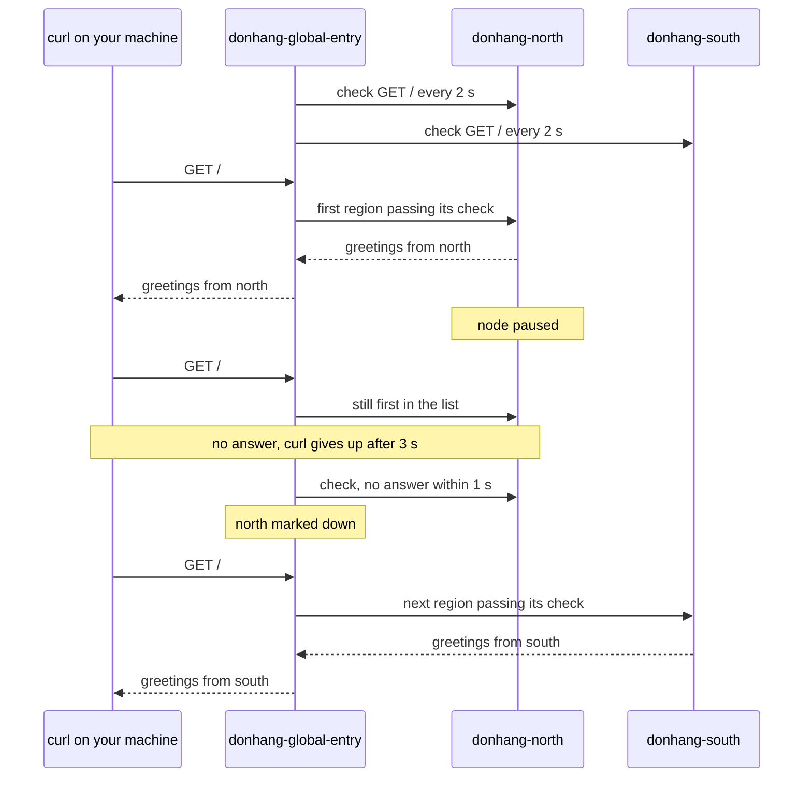

## Bạn cần biết trước

- [[k8s.l4.one-argo-cd-many-clusters]] — bạn biết `donhang-north` và `donhang-south` cùng chạy `echo-region`, app trả lời bằng tên node của nó.
- [[k8s.l3.highly-available-entry-point]] — bạn biết một điểm vào chỉ sống sót qua sự cố khi có thứ khác đứng sau cùng một địa chỉ để thay thế.
- [[k8s.l3.metallb-layer2-mode]] — bạn biết failover chỉ chuyển traffic sau khi sự cố được phát hiện, nên các lời gọi trong khoảng trống đó có thể lỗi.
- [[k8s.l1.readiness-probes]] — bạn biết một phép kiểm tra hỏng sẽ đưa Pod ra khỏi traffic mà không khởi động lại nó. Ở đây điều tương tự xảy ra với cả một cluster.

## Tình huống

Giờ cả hai vùng đều chạy `echo-region`, mỗi vùng trả lời ở node port 30090 bằng tên node của mình. Nhưng khách hàng sẽ không giữ hai địa chỉ rồi thử cái nào chạy. Họ dùng một cái tên, và cái tên đó dẫn tới một chỗ. Giả sử giữa ngày, node của north ngừng trả lời. South vẫn chạy, Pod vẫn ready, vậy mà client gửi lời gọi tới north cứ phải chờ. Không cluster nào biết cluster kia tồn tại. Thứ gì đưa lời gọi tới cluster còn chạy, và các lời gọi gửi đi trong lúc nó chưa phát hiện ra thì sao?

## Khái niệm cốt lõi

- **active-passive** (Một nơi phục vụ toàn bộ traffic, nơi kia chờ sẵn và chỉ nhận khi nơi đầu hỏng) — một cluster phục vụ toàn bộ traffic, cluster kia chờ sẵn và chỉ nhận việc khi cluster đầu hỏng. Trong bài lab, north phục vụ còn south chờ.
- **active-active** (Mọi nơi cùng phục vụ traffic một lúc; mất một nơi thì các nơi còn lại gánh phần của nó) — mọi cluster cùng phục vụ traffic một lúc, mất một cluster thì các cluster còn lại gánh phần của nó. Trong bài lab, north và south lần lượt trả lời.
- Điểm vào (không phải term mới) — địa chỉ duy nhất mà client gọi, ở đây là `donhang-global-entry`: một container Caddy làm reverse proxy đứng trước cả hai vùng. Mỗi địa chỉ nó chuyển tiếp lời gọi tới là một upstream. Ở đây có hai upstream, mỗi vùng một.
- Active health check (không phải term mới) — lời gọi chính Caddy gửi tới từng upstream theo chu kỳ. Upstream nào không qua thì không nhận lời gọi nào cho tới khi một lần kiểm tra sau qua được.
- Failover — ở đây là điểm vào gửi lời gọi sang south vì north không qua kiểm tra, không có thay đổi nào ở cluster nào cả.
- Fail back (không phải term mới) — gửi lời gọi trở lại vùng từng hỏng, khi nó qua kiểm tra trở lại. Với `first`, việc này xảy ra ngay lập tức.

## Cơ chế hoạt động



Trong tình huống trên, thứ client gọi là `donhang-global-entry`: một container Caddy trên network `kind` của Docker, nơi node của cả hai vùng cũng chạy thành container. Máy bạn với tới nó ở `127.0.0.1:18090`. Nó ghi north trước south, cả hai ở node port 30090, nơi NodePort Service của mỗi cluster chuyển lời gọi vào một Pod `echo-region` đang ready.

Cứ 2 giây, Caddy gọi `/` ở mỗi vùng. Với policy `first`, mỗi lời gọi từ client đi tới vùng đầu tiên trong danh sách đang qua kiểm tra. Khi north còn qua, south không nhận lời gọi nào, dù Pod của nó vẫn ready: đó là active-passive. Vì thế, một lỗi chỉ south mắc phải sẽ nằm im cho tới khi north hỏng và south phải gánh toàn bộ.

Sau đó script tạm dừng container node của north: `docker pause` treo mọi tiến trình trong đó, nên không gì trong north trả lời, như thể vùng bị cắt mạng. Caddy chưa biết, và mặc định nó không thử lại lời gọi ở vùng kia. Lời gọi gửi tới north bị treo hoặc lỗi. `curl` của script bỏ cuộc sau 3 giây. Lời gọi mới vẫn đi tới north cho tới khi một lần kiểm tra không nhận được trả lời trong 1 giây. Lúc đó Caddy đánh dấu north là down, và từ lời gọi kế tiếp, south trả lời. Không Pod nào di chuyển, không Service nào đổi ở cả hai cluster: failover diễn ra hoàn toàn ở điểm vào.

Khi north được bỏ tạm dừng và qua một lần kiểm tra, `first` gửi mọi lời gọi về north ngay lập tức. Đổi policy sang `round_robin`, lời gọi lần lượt đi tới north và south, nên cả hai cùng phục vụ: active-active.

## Trong hệ thống Đơn Hàng

Cấu hình của điểm vào, trích từ `global-entry.Caddyfile`:

```caddyfile file=deploy/k8s/regions/global-entry.Caddyfile tag=stage-4 lines=9-22
:8080 {
	# lesson: k8s.l4.failover-between-clusters
	# first: every call goes to the first region whose health check passes,
	# north while it is up (active-passive); round_robin, set through the
	# environment variable LB_POLICY, sends calls to both in turn
	# (active-active). Every 2 s Caddy calls / on each region and marks it
	# down when no answer comes within 1 s.
	reverse_proxy donhang-north-control-plane:30090 donhang-south-control-plane:30090 {
		lb_policy {$LB_POLICY:first}
		health_uri /
		health_interval 2s
		health_timeout 1s
	}
}
```

Dòng 16 gọi hai upstream bằng tên container node của chúng. Trên network `kind` của Docker, một container với tới container khác bằng tên, nên file không chứa địa chỉ IP nào. Thứ tự chỉ có ý nghĩa với `first`: north đứng đầu, nên north là vùng active. Dòng 17 đọc policy từ biến môi trường `LB_POLICY` khi Caddy nạp file, và dùng `first` nếu biến không được đặt. Dòng 18–20 bật active health check. Port cố định 30090 đến từ `echo-region.yaml` (không trích ở đây), file đặt cùng một `nodePort` ở mọi vùng, nên một dòng với tới được cả hai. Pod của nó không giữ state riêng: mỗi Pod chỉ trả lời bằng tên node và không nhớ gì giữa các lời gọi, nên Pod nào ở vùng nào cũng trả lời được mọi lời gọi.

Script, từ hàm gọi tới bước tạm dừng:

```bash file=scripts/k8s/failover.sh tag=stage-4 lines=38-62
# call: one call through the entry, at most 3 s; its answer or "failed".
call() { curl -s -m 3 http://127.0.0.1:18090/ || echo "failed"; }

# lesson: k8s.l4.failover-between-clusters
# Active-passive: with lb_policy first, north answers every call.
echo "\$ docker run -d --name $entry --network kind -p 127.0.0.1:18090:8080 -e LB_POLICY=first <caddy 2.10.0> (with global-entry.Caddyfile)"
entry_up first
for _ in 1 2 3; do echo "\$ curl -s -m 3 http://127.0.0.1:18090/"; call; echo; done
echo

# lesson: k8s.l4.failover-between-clusters
# North's node paused, as if its region were cut off. Calls hang (each
# gives up after 3 s) or fail until the health check marks north down;
# then south answers every call. Neither cluster was changed. How many
# calls failed depends on timing, so only whether any did is printed.
show docker pause donhang-north-control-plane
failed=0
for _ in $(seq 30); do
  answer=$(call)
  case "$answer" in *south*) break ;; esac
  failed=$((failed + 1))
done
echo "at least one call hung or failed before south answered: $([ "$failed" -gt 0 ] && echo yes || echo no)"
for _ in 1 2 3; do echo "\$ curl -s -m 3 http://127.0.0.1:18090/"; call; echo; done
echo
```

```text output=true
$ docker run -d --name donhang-global-entry --network kind -p 127.0.0.1:18090:8080 -e LB_POLICY=first <caddy 2.10.0> (with global-entry.Caddyfile)
$ curl -s -m 3 http://127.0.0.1:18090/
greetings from donhang-north-control-plane
...
$ docker pause donhang-north-control-plane
donhang-north-control-plane
at least one call hung or failed before south answered: yes
$ curl -s -m 3 http://127.0.0.1:18090/
greetings from donhang-south-control-plane
...
$ docker unpause donhang-north-control-plane
donhang-north-control-plane
$ curl -s -m 3 http://127.0.0.1:18090/
greetings from donhang-north-control-plane
...
$ for i in 1 2 3 4 5 6; do curl -s -m 3 http://127.0.0.1:18090/; done (answers counted)
3 x greetings from donhang-north-control-plane
3 x greetings from donhang-south-control-plane
...
```

Dòng 39 là `call`: một lệnh `curl` được tối đa 3 giây, in `failed` khi không nhận được trả lời. Dòng 44 khởi động điểm vào với `first`. `entry_up`, nằm phía trên đoạn trích, tạo container, chép Caddyfile vào và chờ tới khi nó trả lời. Dòng 53 tạm dừng container node của north (`show` in ra một lệnh rồi chạy nó). Dòng 55–59 gọi liên tục tới khi south trả lời, đếm số lời gọi không được trả lời, và dòng 60 chỉ in có lời gọi nào như vậy hay không, vì bao nhiêu thì tùy thời điểm.

Output chia làm bốn phần. Trước khi tạm dừng, north trả lời. Sau đó, ít nhất một lời gọi bị treo hoặc lỗi, rồi south trả lời. Hai phần cuối đến từ phần script bên dưới đoạn trích. Sau khi bỏ tạm dừng, north trả lời lại ngay, không có gì thay đổi ở cả hai cluster. Caddyfile này không giữ north lại được, nên muốn fail back bằng tay thì cần một bước bên ngoài nó, chẳng hạn một người khởi động lại điểm vào chỉ với south cho tới khi north ổn định. Cuối cùng, điểm vào khởi động lại với `round_robin`: trong sáu lời gọi, mỗi vùng trả lời ba.

Có một điều bài lab không giấu: `donhang-global-entry` là một container trên một máy. Nó dừng thì không vùng nào với tới được, dù cả hai đều khỏe, nên nó là điểm lỗi duy nhất. Một hệ thống thật có thể trải chính điểm vào ra nhiều nơi, ví dụ bằng DNS. Bài này dừng ở những gì một điểm vào làm được.

## Đánh đổi

| | Active-passive, fail back ngay (`first`, bài lab) | Active-passive, fail back bằng tay | Active-active (`round_robin`) |
|---|---|---|---|
| Traffic bình thường | Toàn bộ ở north, south sẵn sàng nhưng ngồi không | Như trên | Hai vùng cùng chia |
| Khi một vùng hỏng | Lời gọi treo hoặc lỗi tới khi kiểm tra đánh dấu nó down, rồi tất cả sang vùng kia | Như trên | Cùng khoảng trống đó với lời gọi gửi tới vùng hỏng, sau đó vùng kia nhận hết |
| Năng lực mỗi vùng cần | Toàn bộ tải | Như trên | Toàn bộ tải, dù bình thường chỉ gánh một phần |
| Khi vùng hỏng hồi phục | Lấy lại toàn bộ traffic ngay, kể cả khi sắp hỏng tiếp | Chỉ nhận traffic khi có người cho nó quay lại | Lấy lại phần của mình ngay |
| Mỗi lời gọi phải chấp nhận gì | Do một vùng phục vụ tại một thời điểm | Như trên | Vùng nào phục vụ cũng được, điều Pod không giữ state riêng cho phép |
| Lỗi chỉ vùng đang chờ mắc phải | Lộ ra lúc failover, thời điểm tệ nhất | Như trên | Lộ ra hằng ngày |

## Bạn sẽ chọn gì nếu…

- …north hỏng rồi hồi phục vài lần mỗi giờ: active-passive với fail back bằng tay, để khách hàng không bị chuyển về north mỗi lần nó hồi phục.
- …Pod không giữ state riêng và trả tiền cho một vùng chỉ ngồi chờ là chi phí lớn hơn: active-active, mỗi vùng vẫn đủ sức gánh toàn bộ tải.
- …chỉ một vùng được nhận ghi tại một thời điểm: active-passive, vì khi đó mọi lời gọi đi tới một vùng. Failover làm gì với dữ liệu đó là câu hỏi của bài tiếp theo.

## Senior hay nhầm rằng…

- **"Hai cluster cùng chạy app thì traffic tự chuyển sang cluster khỏe."** → Thực ra mỗi cluster chỉ biết node và Pod của chính nó, còn client gọi một địa chỉ, nên phải có thứ đứng trước để chọn cluster. Không có nó, client gọi north thì cứ gọi north. Bạn sẽ nhận ra khi mọi Pod ở south đều ready mà khách hàng vẫn bị timeout từ north.
- **"Failover chuyển traffic tức thì, nên không lời gọi nào lỗi trong lúc chuyển."** → Thực ra điểm vào chỉ biết có sự cố qua một lần kiểm tra không qua, nên lời gọi gửi trước đó bị treo hoặc lỗi. Khoảng trống dài bao lâu tùy chu kỳ và timeout của phép kiểm tra. Bạn sẽ nhận ra khi `failover.sh` in `yes` cho các lời gọi bị treo hoặc lỗi trước khi south trả lời.
- **"Active-active lúc nào cũng hơn active-passive vì không có gì ngồi không."** → Thực ra mỗi vùng vẫn phải gánh toàn bộ tải khi vùng kia hỏng, và lời gọi nào cũng có thể rơi vào vùng nào, điều chỉ Pod không giữ state riêng mới chịu được mà không cần làm thêm. Bạn sẽ nhận ra khi một vùng đang chạy ở nửa năng lực trong active-active bị quá tải ngay lúc vùng kia hỏng.

## Thử ngay (3 phút)

Trong thư mục repo `don-hang`:

1. Chạy `git show stage-4:deploy/k8s/regions/global-entry.Caddyfile | grep -n health`.
2. Từ các giá trị ở dòng 19 và 20, ước lượng Caddy có thể tiếp tục gửi lời gọi tới north trong bao lâu sau khi north ngừng trả lời, rồi nói `health_interval 30s` sẽ thay đổi điều gì.

Kết quả mong đợi: bốn dòng: 11, một comment về health check, rồi 18 `health_uri /`, 19 `health_interval 2s` và 20 `health_timeout 1s`.

<details><summary>Gợi ý đáp án</summary>

Khoảng một chu kỳ cộng một timeout, chừng 3 giây: north có thể vừa qua một lần kiểm tra ngay trước khi ngừng, lần kiểm tra kế tiếp tới sau tối đa 2 giây, và nó chỉ hỏng sau khi chờ 1 giây. Lời gọi gửi trong khoảng đó bị treo hoặc lỗi. Với `30s`, khoảng này dài ra cỡ nửa phút, nên nhiều lời gọi hơn hẳn sẽ bị treo. Chu kỳ ngắn hơn thì phát hiện sự cố sớm hơn, đổi lại phải kiểm tra nhiều hơn.

</details>

## Liên hệ

- [[k8s.l3.highly-available-entry-point]] — cùng ý tưởng ở tầng dưới: ở đó là các replica trong một cluster sau một địa chỉ, ở đây là cả cluster sau một điểm vào.
- [[k8s.l3.metallb-layer2-mode]] — cùng dạng failover có khoảng trống: ở đó một địa chỉ chuyển giữa các node, ở đây lời gọi chuyển giữa các cluster.
- [[k8s.l1.readiness-probes]] — phép kiểm tra bên trong mỗi cluster quyết định Pod nào nhận lời gọi, còn phép kiểm tra của điểm vào quyết định cluster nào nhận.
- [[devops.l1.reverse-proxy-basics]] — điểm vào chính là reverse proxy đó, với hai upstream và một quy tắc chọn giữa chúng.
- [[k8s.l3.service-types]] — NodePort Service mà điểm vào với tới ở mỗi vùng, port 30090.
- [[devops.l3.rpo-and-rto]] — khoảng trống trước khi south trả lời là một phần của thứ RTO tính.
- [[backend.l4.cap-theorem]] — với điểm vào, một node bị tạm dừng trông như phía bên kia của một phân vùng mạng. Dữ liệu của mỗi vùng khi đó ra sao là câu hỏi tiếp theo.
- [[k8s.l4.data-decides-failover]] — tiếp theo: traffic chuyển trong vài giây, còn dữ liệu quyết định cái gì bị mất.

## Tóm tắt 5 dòng

1. Hai cluster chạy cùng Pod chỉ failover được khi có một điểm vào đứng trước cả hai, kiểm tra chúng và gửi lời gọi tới cluster còn chạy.
2. Active-passive gửi toàn bộ traffic tới một cluster trong khi cluster kia chờ sẵn. `lb_policy first` của Caddy làm điều này với north đứng đầu danh sách.
3. Lời gọi bị treo hoặc lỗi cho tới khi health check đánh dấu cluster hỏng là down. Chỉ khi đó cluster kia mới trả lời, và không cluster nào bị thay đổi.
4. Với `first`, cluster hồi phục lấy lại traffic ngay. Đội vận hành có thể fail back bằng tay để một vùng chập chờn không đẩy khách hàng qua lại.
5. Active-active phục vụ từ mọi cluster cùng lúc, như `round_robin` ở đây. Container điểm vào duy nhất của bài lab vẫn là điểm lỗi duy nhất.
