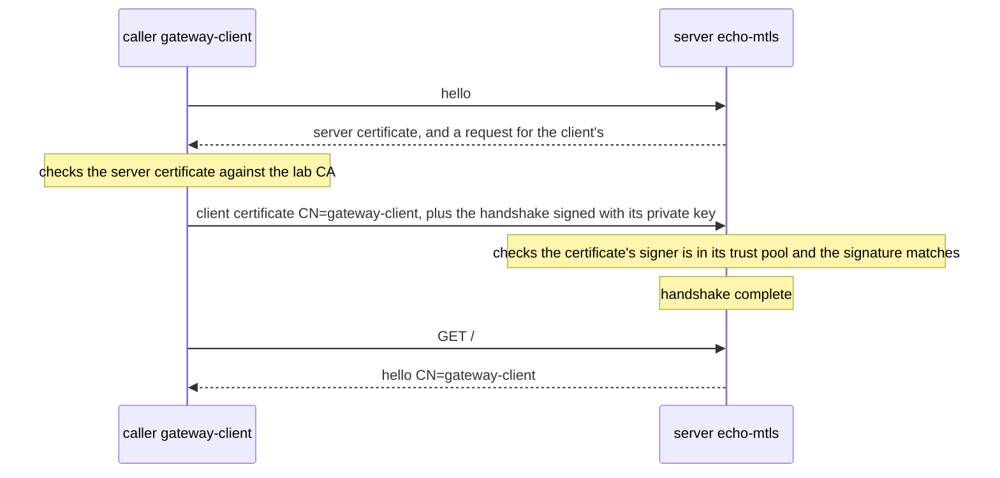

## Before you start

- [[k8s.l3.cert-manager]] — you know an `Issuer` and a `Certificate` make cert-manager write `tls.crt`, `tls.key` and, with the lab CA, `ca.crt` into a Secret, and renew it before it expires.
- [[backend.l4.pki-and-signing]] — you know a certificate is a CA's signed statement tying a name to a public key, accepted only when its chain reaches a root the verifier trusts.
- [[backend.l4.api-gateway]] — you know the Gateway is Đơn Hàng's one way in, routing requests to the api and Payments, which still check every token themselves.

## The situation

On staging, a customer's request reaches the Gateway over HTTPS. The Gateway decrypts it and passes it on to an api Pod over plain HTTP. Finding P5 of `threat-model.md` writes this down and accepts it for now: the NetworkPolicy lets only the Gateway's Pods connect, but the bytes cross the network between nodes unencrypted, and the api knows its caller only by an address. When a request arrives at the api, what could prove that it really came from the Gateway, and not from something standing in its place?

## Core concepts

- **mutual TLS (mTLS)** — TLS in which the server also asks the client for a certificate and checks it against a CA it trusts, so each end knows the other's name before any request is answered.
- Client certificate (not a new term) — an ordinary certificate marked for proving a client. A usage is a field saying what a certificate may be used for: `gateway-client`'s says `client auth`, which the `openssl` tool used later prints, under extended key usage, as `TLS Web Client Authentication`; the server's says `server auth`.
- Subject (not a new term) — the part of a certificate that names who it was issued to; one of its fields is the common name (CN), so `CN=gateway-client` names `gateway-client`.
- Trust pool (Caddy's word, not a new term) — the CA certificates a server accepts as signers of client certificates; in the lab, only the lab CA.

## How it works



In the situation above, the Gateway is the client and the api is the server. A TLS handshake is the exchange of messages that opens a connection, checks certificates and agrees on encryption before any request is sent. In ordinary TLS only the server shows a certificate, so the server learns nothing that proves who the client is. mTLS adds one step to the same handshake.

The server answers the client's hello with its own certificate and also asks for one from the client. The client checks the server's certificate against the CA it trusts. Then it sends its own certificate, carrying the name `gateway-client`, and signs the handshake so far with the matching private key. Anyone could send a copy of a public certificate; the server checks the signature with the public key in the certificate, and only the matching private key could have made it.

The server then checks the client's certificate the way a client checks a server's: was it signed by a CA the server trusts, and is it still valid. If a check fails, or no certificate came, the server ends the handshake with an alert, and no request on that connection gets an answer. If every check passes, the handshake completes, requests flow over the same encrypted connection as with any TLS, and the server knows the client's name. Only then does the client send `GET /`, and the server can answer with that name.

That name is the point: a trusted CA signed it and the caller proved it holds the key, so it does not depend on the caller's Pod, node or address.

## In the Đơn Hàng system

The lab runs in the namespace `mesh-lessons` on the `donhang` cluster, apart from Đơn Hàng's own Pods; the real Gateway is not changed. `mtls-certificates.yaml` (not shown) gives cert-manager an `Issuer` named `lab-ca`, backed by the lab CA, and two `Certificate`s from it. `echo-mtls` covers `echo-mtls.mesh-lessons.svc` with the usage `server auth`. `gateway-client` has the common name `gateway-client` and the usage `client auth`. Each lands in its own Secret, `echo-mtls-tls` and `gateway-client-tls`. The server is Caddy, a small web server, configured by a file called a Caddyfile that a ConfigMap holds:

```yaml file=deploy/k8s/lessons/echo-mtls.yaml tag=stage-4 lines=1-24
# lesson: k8s.l4.mutual-tls
# Caddy as an HTTPS server that asks every client for a certificate:
# require_and_verify refuses the handshake without one, or with one the
# lab CA (ca.crt in the Secret cert-manager wrote) did not sign. It answers
# with the subject of the client's certificate, the caller's name.
apiVersion: v1
kind: ConfigMap
metadata:
  name: echo-mtls
  namespace: mesh-lessons
data:
  Caddyfile: |
    {
      admin off
    }
    :8443 {
      tls /certs/tls.crt /certs/tls.key {
        client_auth {
          mode require_and_verify
          trust_pool file /certs/ca.crt
        }
      }
      respond "hello {http.request.tls.client.subject}"
    }
```

Lines 18–21 are the whole difference from ordinary TLS; line 17 is the usual server certificate and key, from the Secret `echo-mtls-tls`, which the Deployment further down the file mounts at `/certs`. `client_auth` turns on the request for a client certificate. `mode require_and_verify` refuses a handshake without one, or with one that fails the check, and `trust_pool file /certs/ca.crt` says which CA counts: the lab CA's certificate, which cert-manager wrote into the same Secret. Line 23 answers every request with the subject of the client's certificate. Notice what is missing: nothing here names who may call.

The script plays the caller from your machine with `openssl`, a command-line tool for keys and certificates: `s_client` opens a TLS connection as a client, and `req` and `x509` create and sign certificates.

```bash file=scripts/k8s/mutual-tls.sh tag=stage-4 lines=86-110
echo "\$ openssl s_client -connect echo-mtls (port-forward) -CAfile secrets/lab-ca.crt"
call_echo
echo

# lesson: k8s.l4.mutual-tls
# A certificate for the same name, gateway-client, but from a CA made just
# now: the server does not trust that CA, and ends the handshake.
openssl req -x509 -newkey rsa:2048 -nodes -subj /CN=other-ca -days 1 \
  -keyout "$work/other-ca.key" -out "$work/other-ca.crt" 2>/dev/null
openssl req -newkey rsa:2048 -nodes -subj /CN=gateway-client \
  -keyout "$work/other-client.key" -out "$work/other-client.csr" 2>/dev/null
printf 'extendedKeyUsage=clientAuth\n' > "$work/client.ext"
openssl x509 -req -in "$work/other-client.csr" -CA "$work/other-ca.crt" -CAkey "$work/other-ca.key" \
  -CAcreateserial -days 1 -extfile "$work/client.ext" -out "$work/other-client.crt" 2>/dev/null
echo "\$ openssl s_client -connect echo-mtls (port-forward) -CAfile secrets/lab-ca.crt -cert <gateway-client, signed by another CA> -key ..."
call_echo -cert "$work/other-client.crt" -key "$work/other-client.key"
echo

# lesson: k8s.l4.mutual-tls
# gateway-client's certificate and key, from the Secret cert-manager wrote:
# the handshake succeeds, and echo-mtls answers with the name in it.
cert gateway-client-tls > "$work/gateway-client.crt"
kubectl get secret gateway-client-tls -n mesh-lessons -o jsonpath='{.data.tls\.key}' | base64 -d > "$work/gateway-client.key"
echo "\$ openssl s_client -connect echo-mtls (port-forward) -CAfile secrets/lab-ca.crt -cert <gateway-client-tls's tls.crt> -key <its tls.key>"
call_echo -cert "$work/gateway-client.crt" -key "$work/gateway-client.key"
```

```text output=true
...
$ openssl s_client -connect echo-mtls (port-forward) -CAfile secrets/lab-ca.crt
handshake refused: tlsv13 alert certificate required

$ openssl s_client -connect echo-mtls (port-forward) -CAfile secrets/lab-ca.crt -cert <gateway-client, signed by another CA> -key ...
handshake refused: tlsv1 alert unknown ca

$ openssl s_client -connect echo-mtls (port-forward) -CAfile secrets/lab-ca.crt -cert <gateway-client-tls's tls.crt> -key <its tls.key>
HTTP/1.1 200 OK
hello CN=gateway-client
```

`call_echo`, defined above the excerpt, sends one HTTPS request to `echo-mtls` through a port-forward, which makes a port on your machine lead to a port of the Pod. It checks the server's certificate against the lab CA; options passed to it add a client certificate and key. Line 87 calls with none: the server asked, got nothing and ended the handshake with `certificate required`.

Lines 93–99 make a new CA, `other-ca`, and from it a client certificate with the same name, `gateway-client`. Line 101 offers it and gets `unknown ca`: the name matches, but its signer is not in the trust pool.

Lines 107–110 take the real certificate and key from `gateway-client-tls`; `cert`, also defined above, prints a Secret's `tls.crt`. The call succeeds with `hello CN=gateway-client`, a name read from the certificate, not from where the call came from.

To close P5 this way, the Gateway, the api and Payments would each need a key and a certificate, renewed before they expire and signed by a CA the others trust. cert-manager already issues and renews the key and certificate for `echo-mtls` into the same Secret. Getting the CA to every peer that must trust it is a separate job: the lab simply reads `ca.crt` from that Secret, which cert-manager's docs advise against for a real trust pool, because that copy changes when the certificate is renewed. Deciding which names may call which is separate too. The Caddyfile above lets in any client certificate the lab CA signed; a list of allowed names would work like a NetworkPolicy's allow list, only by name instead of label.

## Trade-offs

| | NetworkPolicy only (P5 today) | TLS with a server certificate only | Mutual TLS |
|---|---|---|---|
| Bytes between nodes | Not encrypted | Encrypted | Encrypted |
| What the server knows about the caller | Its address, which a policy allowed | Its address | The name in a certificate its trusted CA signed |
| What each service looks after | Nothing new | The server: a key and a certificate, renewed | Both ends: a key and a certificate each, renewed, and the CA every peer trusts |
| A caller that gets past the policy | Reaches the app; its token is checked | Reaches the app; its token is checked | Refused at the handshake without a key and certificate from a trusted CA |
| Deciding who may call | An allow list by label | The same | The same, plus which names each server accepts |

## What would you choose if…

- …one cluster, one team, and NetworkPolicies already limit who connects: keep P5 accepted, as `threat-model.md` does, with the conditions that reopen it written in ADR `0021`, such as a contract asking for encryption inside the cluster.
- …traffic between services crosses a network you do not control, or a contract asks for encryption inside the system: at least TLS to each service, and mutual TLS when the server must also know its caller.
- …many services call each other and each must check names: mutual TLS with certificates issued and renewed automatically, because by hand that work grows with every service added.

## Seniors often assume…

- **"A NetworkPolicy that lets only the Gateway connect already proves every request came from the Gateway."** → Actually a NetworkPolicy only decides which Pods may open a connection, chosen by label; the api receives bytes with nothing in them that proves who sent them, and on `donhang`, as P5 records, those bytes cross the node network unencrypted. You notice this when you try to log which service called the api and all you have is a Pod's IP address, which changes when that Pod is replaced.
- **"Mutual TLS is ordinary HTTPS with a stronger cipher."** → Actually the encryption, whatever cipher (method of encrypting) the two ends agree on, is the same TLS; what changes is that the server asks for a client certificate, checks who signed it and refuses the handshake without one. You notice this when a caller that trusts the server's certificate still fails before sending a request, as with `certificate required` in `mutual-tls.sh`.
- **"Once both sides have certificates, nothing about them needs looking after."** → Actually every certificate expires and must be renewed before then, every peer needs the CA that signed it, and someone still decides which names may call which. You notice this when a client certificate passes its expiry and every call it makes fails at the handshake, though no code changed.

## Try it (3 minutes)

From the root of the Đơn Hàng repository, with Docker Desktop running, the kind tool (it runs the `donhang` cluster inside Docker), `kubectl` and `openssl` installed, and the `donhang` cluster from the earlier lessons running:

1. Run `scripts/k8s/mutual-tls.sh`. If cert-manager is not installed yet, the script installs it first, which takes longer.
2. Near the top of the output, before the three calls, under `== gateway-client-tls`, read the issuer, the subject and the extended key usage. Then compare the three results at the end, and decide why the second call fails although its certificate also says `gateway-client`.

Expected result: issuer `CN=Don Hang lab CA, O=donhang-dev`, subject `CN=gateway-client` and `TLS Web Client Authentication`; then `handshake refused: tlsv13 alert certificate required`, `handshake refused: tlsv1 alert unknown ca`, and `HTTP/1.1 200 OK` followed by `hello CN=gateway-client`. The script deletes `mesh-lessons` at the end.

<details><summary>Suggested answer</summary>

A name in a certificate is only as good as whoever signed it. The second certificate was signed by `other-ca`, which the script made a moment earlier; `echo-mtls` trusts only the lab CA in `/certs/ca.crt`, so it refuses the handshake with `unknown ca` before reading any request. Anyone can make a certificate that says `gateway-client`; only the lab CA's key can make one that `echo-mtls` accepts.

</details>

## Connections

- [[k8s.l2.tls-at-the-gateway]] — TLS ends at the Gateway there; this lesson is what it would take for the hop behind it.
- [[backend.l4.threat-modeling]] — the source of finding P5, which this lesson shows one way to close.
- [[k8s.l3.network-policies]] — the control P5 relies on today; mTLS adds proof of the caller on top of it, defense in depth.
- [[foundation.l1.tls-and-https]] — the same handshake with only the server showing a certificate; mTLS makes the check run both ways.
- [[k8s.l4.sidecar-proxies]] — the next step: the same mTLS without each app holding its own certificate.

## Five-line summary

1. With mutual TLS, the server also asks the client for a certificate and checks it, so both ends know each other's name.
2. The client proves it holds the private key behind its certificate, so a copied certificate is not enough.
3. `echo-mtls` refuses a call with no certificate, and one with the right name from another CA.
4. With `gateway-client`'s certificate the call succeeds, and the server reads that name, not the caller's address.
5. Every service then needs a renewed key and certificate, and peers that trust its CA; cert-manager automates the first, not who may call whom.
