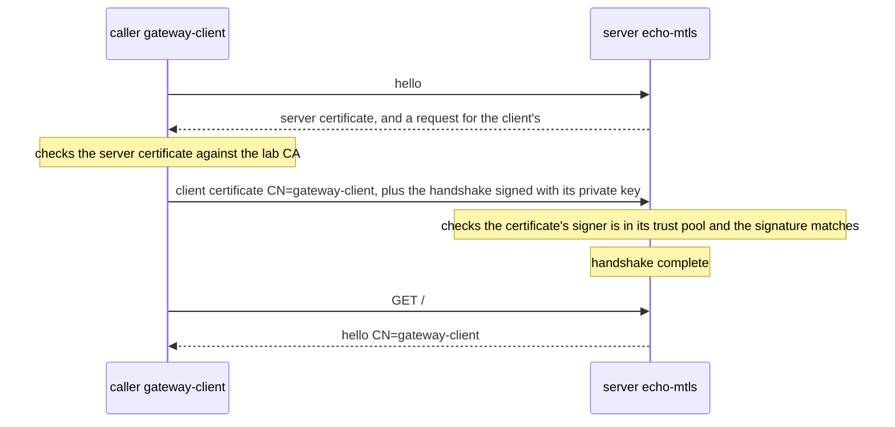

## Bạn cần biết trước

- [[k8s.l3.cert-manager]] — bạn biết một `Issuer` và một `Certificate` khiến cert-manager ghi `tls.crt`, `tls.key` và, với CA của lab, cả `ca.crt` vào một Secret, rồi gia hạn trước khi hết hạn.
- [[backend.l4.pki-and-signing]] — bạn biết chứng chỉ là lời xác nhận có chữ ký của một tổ chức cấp chứng chỉ (CA), gắn một cái tên với một public key, và chỉ được chấp nhận khi chuỗi của nó dẫn tới một root mà bên kiểm tin.
- [[backend.l4.api-gateway]] — bạn biết Gateway là lối vào duy nhất của Đơn Hàng, chuyển request tới api và Payments, và hai service này vẫn tự kiểm tra mọi token.

## Tình huống

Trên staging, request của khách tới Gateway qua HTTPS. Gateway giải mã rồi chuyển tiếp tới một Pod api bằng HTTP thường. Phát hiện P5 trong `threat-model.md` ghi lại điều này và tạm chấp nhận nó: NetworkPolicy chỉ cho Pod của Gateway kết nối, nhưng dữ liệu đi qua mạng giữa các node mà không mã hóa, và api chỉ biết bên gọi qua một địa chỉ. Khi một request tới api, điều gì chứng minh được nó thật sự đến từ Gateway, chứ không phải từ một thứ đứng vào chỗ của Gateway?

## Khái niệm cốt lõi

- **mutual TLS (mTLS)** (TLS trong đó client cũng trình chứng chỉ và server kiểm nó, nên hai bên biết danh tính của nhau) — TLS trong đó server cũng đòi client một chứng chỉ và kiểm nó với một CA mà server tin, nên mỗi đầu biết tên của đầu kia trước khi bất kỳ request nào được trả lời.
- Chứng chỉ client (không phải term mới) — một chứng chỉ bình thường, được đánh dấu để chứng minh một client. Usage là trường cho biết chứng chỉ được dùng vào việc gì: usage của `gateway-client` là `client auth`, mà công cụ `openssl` dùng ở phần sau in ra dưới extended key usage thành `TLS Web Client Authentication`. Usage của chứng chỉ server là `server auth`.
- Subject (không phải term mới) — phần của chứng chỉ ghi tên bên được cấp. Một trong các trường của nó là common name (CN), nên `CN=gateway-client` nghĩa là chứng chỉ cấp cho `gateway-client`.
- Trust pool (từ của Caddy, không phải term mới) — các chứng chỉ CA mà server chấp nhận là bên ký chứng chỉ client. Trong lab, chỉ có CA của lab.

## Cơ chế hoạt động



Trong tình huống trên, Gateway là client còn api là server. TLS handshake là chuỗi thông điệp mở một kết nối, kiểm tra chứng chỉ và thống nhất cách mã hóa trước khi gửi bất kỳ request nào. Với TLS thường, chỉ server trình chứng chỉ, nên server không biết được gì chứng minh client là ai. mTLS thêm đúng một bước vào cùng handshake đó.

Server trả lời lời chào của client bằng chứng chỉ của mình, đồng thời đòi client một chứng chỉ. Client kiểm chứng chỉ của server với CA mà nó tin. Sau đó client gửi chứng chỉ của mình, mang tên `gateway-client`, và ký phần handshake tới lúc đó bằng private key tương ứng. Ai cũng có thể gửi bản sao của một chứng chỉ công khai. Server kiểm chữ ký bằng public key trong chứng chỉ, và chỉ private key tương ứng mới tạo được chữ ký đó.

Rồi server kiểm chứng chỉ của client theo đúng cách client kiểm chứng chỉ của server: có phải một CA mà server tin đã ký nó không, và nó còn hiệu lực không. Nếu một bước kiểm thất bại, hoặc không có chứng chỉ nào gửi tới, server kết thúc handshake bằng một alert, và không request nào trên kết nối đó được trả lời. Nếu mọi bước đều qua, handshake hoàn tất, request đi trên cùng kết nối đã mã hóa như với mọi TLS khác, và server biết tên của client. Chỉ khi đó client mới gửi `GET /`, và server có thể trả lời bằng chính cái tên ấy.

Cái tên đó là điểm mấu chốt: một CA được tin đã ký nó, và bên gọi đã chứng minh mình giữ key, nên nó không phụ thuộc vào Pod, node hay địa chỉ của bên gọi.

## Trong hệ thống Đơn Hàng

Lab chạy trong namespace `mesh-lessons` trên cluster `donhang`, tách khỏi các Pod của chính Đơn Hàng. Gateway thật không bị thay đổi. `mtls-certificates.yaml` (không trích ở đây) cho cert-manager một `Issuer` tên `lab-ca`, dựa trên CA của lab, và hai `Certificate` từ Issuer đó. `echo-mtls` phủ `echo-mtls.mesh-lessons.svc` với usage `server auth`. `gateway-client` có common name `gateway-client` và usage `client auth`. Mỗi cái nằm trong Secret riêng, `echo-mtls-tls` và `gateway-client-tls`. Server là Caddy, một web server nhỏ, cấu hình bằng một file gọi là Caddyfile do một ConfigMap giữ:

```yaml file=deploy/k8s/lessons/echo-mtls.yaml tag=stage-4 lines=1-24
# lesson: k8s.l4.mutual-tls
# Caddy as an HTTPS server that asks every client for a certificate:
# require_and_verify refuses the handshake without one, or with one the
# lab CA (ca.crt in the Secret cert-manager wrote) did not sign. It answers
# with the subject of the client's certificate, the caller's name.
apiVersion: v1
kind: ConfigMap
metadata:
  name: echo-mtls
  namespace: mesh-lessons
data:
  Caddyfile: |
    {
      admin off
    }
    :8443 {
      tls /certs/tls.crt /certs/tls.key {
        client_auth {
          mode require_and_verify
          trust_pool file /certs/ca.crt
        }
      }
      respond "hello {http.request.tls.client.subject}"
    }
```

Dòng 18–21 là toàn bộ khác biệt so với TLS thường. Dòng 17 là chứng chỉ và key quen thuộc của server, lấy từ Secret `echo-mtls-tls`, được Deployment ở phần dưới file mount vào `/certs`. `client_auth` bật yêu cầu chứng chỉ client. `mode require_and_verify` từ chối handshake không có chứng chỉ, hoặc có chứng chỉ nhưng không qua bước kiểm, còn `trust_pool file /certs/ca.crt` cho biết CA nào được tính: chứng chỉ của CA lab, do cert-manager ghi vào cùng Secret. Dòng 23 trả lời mọi request bằng subject của chứng chỉ client. Để ý điều còn thiếu: không chỗ nào ở đây ghi ai được phép gọi.

Script đóng vai bên gọi từ máy của bạn bằng `openssl`, một công cụ dòng lệnh làm việc với key và chứng chỉ: `s_client` mở một kết nối TLS với vai client, còn `req` và `x509` tạo và ký chứng chỉ.

```bash file=scripts/k8s/mutual-tls.sh tag=stage-4 lines=86-110
echo "\$ openssl s_client -connect echo-mtls (port-forward) -CAfile secrets/lab-ca.crt"
call_echo
echo

# lesson: k8s.l4.mutual-tls
# A certificate for the same name, gateway-client, but from a CA made just
# now: the server does not trust that CA, and ends the handshake.
openssl req -x509 -newkey rsa:2048 -nodes -subj /CN=other-ca -days 1 \
  -keyout "$work/other-ca.key" -out "$work/other-ca.crt" 2>/dev/null
openssl req -newkey rsa:2048 -nodes -subj /CN=gateway-client \
  -keyout "$work/other-client.key" -out "$work/other-client.csr" 2>/dev/null
printf 'extendedKeyUsage=clientAuth\n' > "$work/client.ext"
openssl x509 -req -in "$work/other-client.csr" -CA "$work/other-ca.crt" -CAkey "$work/other-ca.key" \
  -CAcreateserial -days 1 -extfile "$work/client.ext" -out "$work/other-client.crt" 2>/dev/null
echo "\$ openssl s_client -connect echo-mtls (port-forward) -CAfile secrets/lab-ca.crt -cert <gateway-client, signed by another CA> -key ..."
call_echo -cert "$work/other-client.crt" -key "$work/other-client.key"
echo

# lesson: k8s.l4.mutual-tls
# gateway-client's certificate and key, from the Secret cert-manager wrote:
# the handshake succeeds, and echo-mtls answers with the name in it.
cert gateway-client-tls > "$work/gateway-client.crt"
kubectl get secret gateway-client-tls -n mesh-lessons -o jsonpath='{.data.tls\.key}' | base64 -d > "$work/gateway-client.key"
echo "\$ openssl s_client -connect echo-mtls (port-forward) -CAfile secrets/lab-ca.crt -cert <gateway-client-tls's tls.crt> -key <its tls.key>"
call_echo -cert "$work/gateway-client.crt" -key "$work/gateway-client.key"
```

```text output=true
...
$ openssl s_client -connect echo-mtls (port-forward) -CAfile secrets/lab-ca.crt
handshake refused: tlsv13 alert certificate required

$ openssl s_client -connect echo-mtls (port-forward) -CAfile secrets/lab-ca.crt -cert <gateway-client, signed by another CA> -key ...
handshake refused: tlsv1 alert unknown ca

$ openssl s_client -connect echo-mtls (port-forward) -CAfile secrets/lab-ca.crt -cert <gateway-client-tls's tls.crt> -key <its tls.key>
HTTP/1.1 200 OK
hello CN=gateway-client
```

`call_echo`, định nghĩa phía trên đoạn trích, gửi một request HTTPS tới `echo-mtls` qua một port-forward, thứ nối một port trên máy bạn tới một port của Pod. Hàm này kiểm chứng chỉ của server với CA của lab. Các tùy chọn truyền vào sẽ thêm chứng chỉ và key của client. Dòng 87 gọi mà không có gì: server đòi, không nhận được gì, và kết thúc handshake với `certificate required`.

Dòng 93–99 tạo một CA mới, `other-ca`, rồi từ đó tạo một chứng chỉ client cùng tên, `gateway-client`. Dòng 101 trình chứng chỉ này và nhận `unknown ca`: tên khớp, nhưng bên ký không có trong trust pool.

Dòng 107–110 lấy chứng chỉ và key thật từ `gateway-client-tls`. `cert`, cũng định nghĩa phía trên, in ra `tls.crt` của một Secret. Lời gọi thành công với `hello CN=gateway-client`, một cái tên đọc từ chứng chỉ, không phải từ nơi lời gọi xuất phát.

Muốn đóng P5 theo cách này, Gateway, api và Payments đều cần một key và một chứng chỉ, được gia hạn trước khi hết hạn và do một CA mà các bên kia tin ký. cert-manager đã cấp và gia hạn key cùng chứng chỉ cho `echo-mtls` vào cùng một Secret. Đưa CA tới mọi bên cần tin nó là một việc riêng: lab chỉ đơn giản đọc `ca.crt` từ Secret đó, điều mà tài liệu của cert-manager khuyên không nên làm với trust pool thật, vì bản sao ấy thay đổi khi chứng chỉ được gia hạn. Quyết định tên nào được gọi tên nào cũng là việc riêng. Caddyfile ở trên cho qua mọi chứng chỉ client do CA của lab ký. Một danh sách tên được phép sẽ hoạt động như danh sách cho phép của NetworkPolicy, chỉ khác là theo tên thay vì theo label.

## Đánh đổi

| | Chỉ NetworkPolicy (P5 hiện nay) | TLS chỉ có chứng chỉ server | Mutual TLS |
|---|---|---|---|
| Dữ liệu giữa các node | Không mã hóa | Mã hóa | Mã hóa |
| Server biết gì về bên gọi | Địa chỉ của nó, mà policy đã cho phép | Địa chỉ của nó | Tên trong một chứng chỉ do CA mà server tin ký |
| Mỗi service phải chăm lo gì | Không thêm gì | Server: một key và một chứng chỉ, được gia hạn | Cả hai đầu: mỗi bên một key và một chứng chỉ, được gia hạn, cùng CA mà mọi bên tin |
| Bên gọi lọt qua được policy | Tới được ứng dụng, token của nó bị kiểm | Tới được ứng dụng, token của nó bị kiểm | Bị từ chối ngay ở handshake nếu không có key và chứng chỉ từ một CA được tin |
| Quyết định ai được gọi | Danh sách cho phép theo label | Như trên | Như trên, cộng thêm những tên mà mỗi server chấp nhận |

## Bạn sẽ chọn gì nếu…

- …một cluster, một đội, và NetworkPolicy đã giới hạn ai được kết nối: giữ P5 ở trạng thái chấp nhận, như `threat-model.md` đang làm, với các điều kiện mở lại nó ghi trong ADR `0021`, chẳng hạn một hợp đồng yêu cầu mã hóa bên trong cluster.
- …traffic giữa các service đi qua một mạng bạn không kiểm soát, hoặc hợp đồng yêu cầu mã hóa bên trong hệ thống: ít nhất là TLS tới từng service, và mutual TLS khi server còn phải biết bên gọi là ai.
- …nhiều service gọi lẫn nhau và service nào cũng phải kiểm tên: mutual TLS với chứng chỉ được cấp và gia hạn tự động, vì làm bằng tay thì khối lượng ấy tăng theo mỗi service thêm vào.

## Senior hay nhầm rằng…

- **"NetworkPolicy chỉ cho Gateway kết nối thì đã chứng minh mọi request đều đến từ Gateway."** → Thực ra NetworkPolicy chỉ quyết định Pod nào được mở kết nối, chọn theo label. api nhận về những byte không chứa gì chứng minh ai đã gửi, và trên `donhang`, như P5 ghi lại, những byte đó đi qua mạng giữa các node mà không mã hóa. Bạn sẽ nhận ra khi muốn ghi log service nào đã gọi api và tất cả những gì bạn có là địa chỉ IP của một Pod, thứ đổi khi Pod đó bị thay.
- **"Mutual TLS là HTTPS thường với cipher mạnh hơn."** → Thực ra phần mã hóa, dù hai đầu thống nhất cipher (phương pháp mã hóa) nào, vẫn là cùng một TLS. Điều thay đổi là server đòi chứng chỉ client, kiểm ai đã ký nó và từ chối handshake nếu không có. Bạn sẽ nhận ra khi một bên gọi tin chứng chỉ của server mà vẫn thất bại trước khi kịp gửi request, như `certificate required` trong `mutual-tls.sh`.
- **"Một khi hai bên đã có chứng chỉ thì không còn gì phải chăm lo."** → Thực ra chứng chỉ nào cũng hết hạn và phải được gia hạn trước đó, mọi bên đều cần CA đã ký nó, và vẫn phải có người quyết định tên nào được gọi tên nào. Bạn sẽ nhận ra khi một chứng chỉ client quá hạn và mọi lời gọi của nó đều thất bại ở handshake, dù không dòng code nào thay đổi.

## Thử ngay (3 phút)

Ở thư mục gốc của repo Đơn Hàng, với Docker Desktop đang chạy, đã cài công cụ kind (nó chạy cluster `donhang` bên trong Docker), `kubectl` và `openssl`, và cluster `donhang` từ các bài trước đang chạy:

1. Chạy `scripts/k8s/mutual-tls.sh`. Nếu cert-manager chưa được cài, script cài nó trước, nên lâu hơn.
2. Gần đầu output, trước ba lời gọi, dưới `== gateway-client-tls`, đọc issuer, subject và extended key usage. Sau đó so sánh ba kết quả ở cuối, và tìm lý do lời gọi thứ hai thất bại dù chứng chỉ của nó cũng ghi `gateway-client`.

Kết quả mong đợi: issuer `CN=Don Hang lab CA, O=donhang-dev`, subject `CN=gateway-client` và `TLS Web Client Authentication`. Tiếp theo là `handshake refused: tlsv13 alert certificate required`, `handshake refused: tlsv1 alert unknown ca`, rồi `HTTP/1.1 200 OK` theo sau là `hello CN=gateway-client`. Cuối cùng script xóa `mesh-lessons`.

<details><summary>Gợi ý đáp án</summary>

Cái tên trong chứng chỉ chỉ đáng tin bằng bên đã ký nó. Chứng chỉ thứ hai do `other-ca` ký, CA mà script vừa tạo ra trước đó. `echo-mtls` chỉ tin CA của lab trong `/certs/ca.crt`, nên nó từ chối handshake với `unknown ca` trước khi đọc bất kỳ request nào. Ai cũng tạo được một chứng chỉ ghi `gateway-client`, nhưng chỉ key của CA lab mới tạo được chứng chỉ mà `echo-mtls` chấp nhận.

</details>

## Liên hệ

- [[k8s.l2.tls-at-the-gateway]] — ở đó TLS kết thúc tại Gateway. Bài này cho thấy cần gì cho chặng phía sau nó.
- [[backend.l4.threat-modeling]] — nguồn gốc của phát hiện P5, mà bài này chỉ ra một hướng để đóng lại.
- [[k8s.l3.network-policies]] — biện pháp P5 đang dựa vào. mTLS thêm bằng chứng về bên gọi chồng lên nó, đúng tinh thần phòng thủ nhiều lớp.
- [[foundation.l1.tls-and-https]] — cùng handshake đó nhưng chỉ server trình chứng chỉ. mTLS cho bước kiểm chạy theo cả hai chiều.
- [[k8s.l4.sidecar-proxies]] — bước tiếp theo: vẫn mTLS như vậy mà không ứng dụng nào phải tự giữ chứng chỉ.

## Tóm tắt 5 dòng

1. Với mutual TLS, server cũng đòi client một chứng chỉ và kiểm nó, nên hai đầu biết tên của nhau.
2. Client chứng minh mình giữ private key ứng với chứng chỉ, nên chỉ có bản sao chứng chỉ thì không đủ.
3. `echo-mtls` từ chối lời gọi không có chứng chỉ, và cả lời gọi có đúng tên nhưng do CA khác ký.
4. Với chứng chỉ của `gateway-client`, lời gọi thành công, và server đọc cái tên đó chứ không đọc địa chỉ của bên gọi.
5. Khi đó mỗi service cần key và chứng chỉ được gia hạn, cùng các bên tin CA của nó. cert-manager tự động hóa phần đầu, không quyết định ai được gọi ai.
