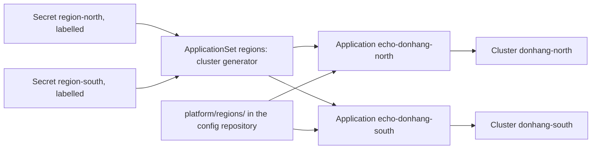

## Before you start

- [[k8s.l4.why-more-than-one-cluster]] — you know each cluster has its own control plane and platform, so another one is added for a boundary, not out of habit.
- [[devops.l3.argo-cd-applications]] — you know an Application maps one folder of the config repository to one destination, a cluster and a namespace.
- [[k8s.l3.cluster-roles]] — you know Argo CD's controller may change every kind in its cluster, so config repository write access is as strong as `cluster-admin`.
- [[k8s.l2.config-repo-overlays]] — you know a change to a shared base reaches every environment built on it.

## The situation

Đơn Hàng is trying a second region. `regions-up.sh` creates two one-node kind clusters, `donhang-north` and `donhang-south`, as stand-ins for two regions; kind runs each cluster's node as a Docker container on your machine. Their contexts, `kind-donhang-north` and `kind-donhang-south`, live in `secrets/regions.kubeconfig`. Both regions should run the same small Deployment from the config repository. Staging's Argo CD already deploys staging, neither region runs an Argo CD of its own, and you could write one Application per region by hand, plus one for every region added later. How does one Argo CD reach other clusters, and how does one file become one Application for each?

## Core concepts

- **ApplicationSet (Argo CD)** — an Argo CD object holding an Application template and generators; its controller creates one Application for each set of parameters the generators produce, such as one per registered cluster.
- Cluster Secret (not a new term) — a Secret in the namespace `argocd`, labelled `argocd.argoproj.io/secret-type: cluster`, that gives Argo CD another cluster's name, API server address and credentials.
- Generator (not a new term) — the part of an ApplicationSet that produces parameter sets; the cluster generator yields one set per cluster Secret its selector matches, with that cluster's `name` and `server`.
- Template (not a new term) — the Application written once, with placeholders the controller fills in from each parameter set; with `goTemplate: true`, as in the lab, they are written `{{.name}}`.

## How it works



Read the diagram from the left. In the situation above, staging's Argo CD can deploy to `donhang-north` only once it knows where that cluster's API server is and how to log in. A cluster Secret tells it: `applicationset.sh` creates one per region in `argocd`. From then on, an Application in staging can name that address as its destination, and Argo CD applies the manifests there instead of in its own cluster, much as kubectl does with a context.

The ApplicationSet `regions` sits in the middle. Its controller is part of Argo CD's install, so staging already runs it. The cluster generator reads the cluster Secrets, keeps those with the label `donhang.lab/region: "true"`, and yields one parameter set per match. For each set the controller fills in the template and creates an Application: `echo-donhang-north` and `echo-donhang-south`. Staging's own cluster has no cluster Secret, so it gets no Application from this set.

The ApplicationSet deploys nothing itself. Each Application it creates syncs like one written by hand: it reads `platform/regions/` at `main` and applies it to its one destination. Register a third cluster with the same label and a third Application appears. Delete the ApplicationSet and its Applications go with it, and by default so does everything they deployed in the regions.

## In the Đơn Hàng system

The ApplicationSet, from `regions-appset.yaml`:

```yaml file=deploy/gitops/lessons/regions-appset.yaml tag=stage-4 lines=13-37
  generators:
    - clusters:
        selector:
          matchLabels:
            donhang.lab/region: "true"
  # lesson: k8s.l4.one-argo-cd-many-clusters
  # The template, filled in once per cluster: .name and .server come from
  # that cluster's Secret. Every region syncs the same path at the same
  # revision.
  template:
    metadata:
      name: "echo-{{.name}}"
    spec:
      project: default
      source:
        repoURL: http://gitea.git.svc:3000/donhang/donhang-config.git
        targetRevision: main
        path: platform/regions
      destination:
        server: "{{.server}}"
        namespace: regions
      syncPolicy:
        automated:
          selfHeal: true
          prune: true
```

Lines 14–17 are the cluster generator: only cluster Secrets carrying `donhang.lab/region: "true"` count. Only lines 24 and 32 change per cluster, the Application's name and its destination; line 12, above the excerpt, sets `goTemplate: true`. The repository, `targetRevision: main` and `path: platform/regions` are the same for every region, and automated sync applies a new commit without anyone starting it. `prune: true` lets that sync also delete live objects whose manifest was removed from Git.

The cluster Secrets come from the script, never from Git:

```bash file=scripts/k8s/applicationset.sh tag=stage-4 lines=43-60
# lesson: k8s.l4.one-argo-cd-many-clusters
# A cluster Secret per region in argocd: the API server's address inside
# Docker's network kind (where staging's node runs too) and the region's
# admin certificate and key, from kind's kubeconfig for that network. It is
# made here, from secrets/, and never written to Git.
for name in "${regions[@]}"; do
  internal=secrets/regions-$name-internal.kubeconfig
  kind get kubeconfig --name "donhang-$name" --internal > "$internal"
  field() { command kubectl config view --kubeconfig "$internal" --raw -o jsonpath="{.$1}"; }
  config=$(printf '{"tlsClientConfig":{"caData":"%s","certData":"%s","keyData":"%s"}}' \
    "$(field 'clusters[0].cluster.certificate-authority-data')" \
    "$(field 'users[0].user.client-certificate-data')" "$(field 'users[0].user.client-key-data')")
  rm -f "$internal"
  echo "\$ kubectl create secret generic region-$name -n argocd --from-literal=name=donhang-$name --from-literal=server=https://donhang-$name-control-plane:6443 --from-literal=config=<its certificates>"
  kubectl create secret generic "region-$name" -n argocd --from-literal=name="donhang-$name" \
    --from-literal=server="https://donhang-$name-control-plane:6443" --from-literal=config="$config"
  show kubectl label secret "region-$name" -n argocd argocd.argoproj.io/secret-type=cluster donhang.lab/region=true
done
```

```text output=true
...
$ kubectl get applications -n argocd -o custom-columns=NAME,DESTINATION,SYNC,HEALTH
NAME                 DESTINATION                                SYNC     HEALTH
echo-donhang-north   https://donhang-north-control-plane:6443   Synced   Healthy
echo-donhang-south   https://donhang-south-control-plane:6443   Synced   Healthy
staging              https://kubernetes.default.svc             Synced   Healthy
...
$ docker exec donhang-north-control-plane curl -s http://localhost:30090/
hello from donhang-north-control-plane
$ docker exec donhang-south-control-plane curl -s http://localhost:30090/
hello from donhang-south-control-plane
...
```

Line 50 asks kind for the address inside Docker's network `kind`, where staging's node runs too, not the one your machine uses. Lines 52–54 put the region's certificate authority, client certificate and key into `config`. The client certificate and its key are the login: the region's API server checks them to know who is calling, as it does for kubectl with the pair in a kubeconfig. Lines 57–58 store them with `name` and `server`, and line 59 adds both labels (`show` prints a command and then runs it; line 56 only prints 57–58 with the certificates hidden).

The output shows one Application per region, each pointing at its region's API server, next to `staging`, whose destination `https://kubernetes.default.svc` is Argo CD's own cluster. Each region first answered on node port 30090 with `greetings from` and its node's name, which `echo-region.yaml` (not shown) puts in the answer; the output above is after the script changed that to `hello from` in one commit. When it ends, it deletes the ApplicationSet, both cluster Secrets and `platform/regions/`.

Lines 45–46 say the certificate is the region's admin certificate. Staging's Argo CD now holds credentials that can change everything in both regions. Its blast radius covers every region at once, and so does that of anyone who can write to the config repository or read the Secrets `region-north` and `region-south`, since they hold the admin key.

## Trade-offs

| | An Application per region, by hand | One ApplicationSet, same path and revision (the lab) | One ApplicationSet, a path or revision per region |
|---|---|---|---|
| Adding a region | Write and apply another Application | Create a labelled cluster Secret | Create a labelled cluster Secret and give it its own path or revision |
| A bad commit to the shared folder | Reaches every Application that reads it | Reaches both regions at their next sync | Reaches only regions whose path or revision includes it |
| One region goes first | Edit that region's Application | Not possible | Move one region's revision or folder first |
| Regions drifting apart | Possible, by hand | Not through the template | As far as the per-region values allow |
| Who can change every region | Argo CD and config repository writers | The same | The same |

## What would you choose if…

- …both regions must always run the same thing and every change is tried on staging first: one ApplicationSet with the same path and revision, as here, since staging is the trial and the regions moving together is accepted.
- …a change must reach one region and pass a check there before the other: a path or revision per region in the template, so a commit moves region by region the way a promotion moves between environments.
- …there are two regions and none planned: two hand-written Applications cost little; an ApplicationSet pays off when clusters are added or removed often.

## Seniors often assume…

- **"Deploying to several clusters means running one Argo CD inside each of them."** → Actually one Argo CD deploys to any cluster it has a cluster Secret for; `donhang-north` and `donhang-south` run no Argo CD; what Đơn Hàng runs there comes only from staging's Argo CD. You notice this when `kubectl --kubeconfig secrets/regions.kubeconfig --context kind-donhang-north get namespaces`, run while `applicationset.sh` is still running, lists `regions` but no `argocd`.
- **"An ApplicationSet is a larger Application that deploys to many clusters by itself."** → Actually it only creates Applications from its template, and each Application syncs its one destination and reports its own sync and health status. You notice this when `echo-donhang-south` is `OutOfSync` while `echo-donhang-north` is `Synced`.
- **"With one template for all regions, a bad change can break only one region at a time."** → Actually every Application reads the same path at the same revision, so one commit reaches both regions at their next sync, as `hello from` did. You notice this when both regions start failing within the same minutes, right after one commit to `platform/regions/`.

## Try it (3 minutes)

In the `don-hang` repository folder:

1. Run `git show stage-4:deploy/gitops/lessons/regions-appset.yaml | grep -n "{{"`.
2. Note which fields of the template differ from one region to the next, then decide what would have to change to let north take a commit before south.

Expected result: two lines, 24 with `name: "echo-{{.name}}"` and 32 with `server: "{{.server}}"`.

<details><summary>Suggested answer</summary>

Only each Application's name and destination differ per region. `repoURL`, `targetRevision: main` and `path: platform/regions` are fixed, so a commit to that folder reaches both regions. To let north go first, the template's path or revision must also take a value that differs per region, so south can stay on the older revision or folder until north has passed its check.

</details>

## Connections

- [[devops.l3.argo-cd-applications]] — the object an ApplicationSet produces; everything said there about one Application holds for `echo-donhang-north` and `echo-donhang-south`.
- [[devops.l3.promoting-between-environments]] — the same question between regions: letting one go first needs a folder or revision of its own, as production needed.
- [[devops.l3.synced-versus-healthy]] — each region's Application reports its own sync and health status, read the same way.
- [[k8s.l1.kubectl-and-the-api-server]] — Argo CD reaches a region the way kubectl does: an API server address and credentials.
- [[backend.l4.shared-credentials]] — the same blast-radius question one layer up: one holder of credentials that can change everything.
- [[k8s.l4.failover-between-clusters]] — next: one entry in front of both regions that moves traffic when one fails.

## Five-line summary

1. An ApplicationSet turns one Application template into one Application per registered cluster, so one Argo CD deploys the same folder to every region.
2. Argo CD reaches another cluster through a Secret in `argocd`, labelled `argocd.argoproj.io/secret-type: cluster`, holding its API server address and credentials.
3. The cluster generator yields each matching cluster's `name` and `server`; the ApplicationSet deploys nothing itself, its Applications do.
4. With the same path and revision for every region, one commit, a mistake included, reaches both regions at their next sync.
5. Staging's Argo CD holds admin credentials for every registered cluster, so it, config repository writers and readers of its Secrets can break every region.
