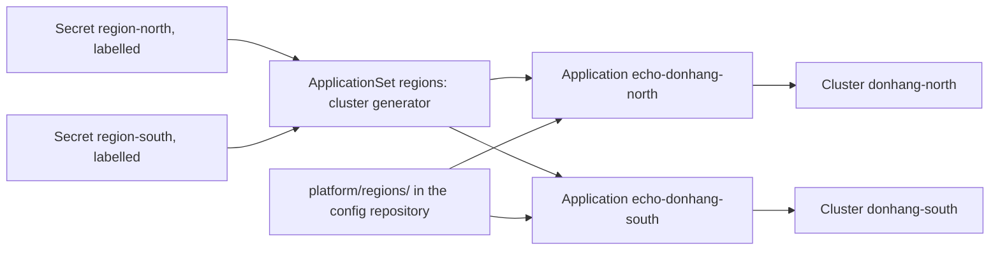

## Bạn cần biết trước

- [[k8s.l4.why-more-than-one-cluster]] — bạn biết mỗi cluster có control plane và nền tảng của riêng nó, nên người ta thêm một cluster để có một ranh giới, chứ không phải theo thói quen.
- [[devops.l3.argo-cd-applications]] — bạn biết một Application nối một thư mục trong repo cấu hình với một đích đến, gồm một cluster và một namespace.
- [[k8s.l3.cluster-roles]] — bạn biết controller của Argo CD được sửa mọi loại object trong cluster của nó, nên quyền ghi vào repo cấu hình mạnh ngang `cluster-admin`.
- [[k8s.l2.config-repo-overlays]] — bạn biết một thay đổi ở base dùng chung sẽ tới mọi môi trường xây trên base đó.

## Tình huống

Đơn Hàng đang thử chạy ở một vùng thứ hai. `regions-up.sh` dựng hai cluster kind một node, `donhang-north` và `donhang-south`, đóng vai hai vùng. kind chạy node của mỗi cluster thành một container Docker trên máy bạn. Context của chúng, `kind-donhang-north` và `kind-donhang-south`, nằm trong `secrets/regions.kubeconfig`. Cả hai vùng cần chạy cùng một Deployment nhỏ lấy từ repo cấu hình. Argo CD của staging đã deploy staging, không vùng nào chạy Argo CD riêng, và bạn có thể tự viết tay một Application cho mỗi vùng, rồi thêm một cái nữa cho mỗi vùng mở sau này. Làm sao một Argo CD với tới các cluster khác, và làm sao một file sinh ra một Application cho từng cluster?

## Khái niệm cốt lõi

- **ApplicationSet (Argo CD)** (Mẫu Application cùng generator; controller sinh một Application cho mỗi bộ tham số, như mỗi cluster đã đăng ký) — một object của Argo CD chứa một mẫu Application và các generator. Controller của nó tạo một Application cho mỗi bộ tham số mà các generator sinh ra, ví dụ mỗi cluster đã đăng ký một bộ.
- Cluster Secret (không phải term mới) — một Secret trong namespace `argocd`, gắn label `argocd.argoproj.io/secret-type: cluster`, cho Argo CD biết tên, địa chỉ API server và thông tin đăng nhập của một cluster khác.
- Generator (không phải term mới) — phần của ApplicationSet sinh ra các bộ tham số. Cluster generator sinh một bộ cho mỗi cluster Secret khớp selector của nó, gồm `name` và `server` của cluster đó.
- Template (không phải term mới) — Application được viết một lần, với các chỗ trống mà controller điền từ từng bộ tham số. Khi có `goTemplate: true`, như trong bài lab, chúng được viết là `{{.name}}`.

## Cơ chế hoạt động



Đọc sơ đồ từ trái sang. Trong tình huống trên, Argo CD của staging chỉ deploy được lên `donhang-north` khi nó biết API server của cluster đó ở đâu và đăng nhập bằng gì. Cluster Secret cho nó biết điều này: `applicationset.sh` tạo một Secret như vậy cho mỗi vùng trong `argocd`. Từ lúc đó, một Application ở staging có thể lấy địa chỉ ấy làm đích đến, và Argo CD apply manifest ở đó thay vì trong cluster của chính nó, giống kubectl làm với một context.

ApplicationSet `regions` nằm ở giữa. Controller của nó là một phần trong bản cài Argo CD, nên staging đã chạy sẵn. Cluster generator đọc các cluster Secret, giữ lại những Secret có label `donhang.lab/region: "true"`, và sinh một bộ tham số cho mỗi Secret khớp. Với mỗi bộ, controller điền vào template và tạo một Application: `echo-donhang-north` và `echo-donhang-south`. Cluster của chính staging không có cluster Secret, nên không nhận Application nào từ ApplicationSet này.

Bản thân ApplicationSet không deploy gì. Mỗi Application nó tạo ra sync y như một Application viết tay: đọc `platform/regions/` ở `main` và apply lên đúng một đích đến của mình. Đăng ký cluster thứ ba với cùng label, và một Application thứ ba xuất hiện. Xóa ApplicationSet thì các Application của nó cũng mất theo, và mặc định mọi thứ chúng đã deploy ở các vùng cũng mất theo.

## Trong hệ thống Đơn Hàng

ApplicationSet, trích từ `regions-appset.yaml`:

```yaml file=deploy/gitops/lessons/regions-appset.yaml tag=stage-4 lines=13-37
  generators:
    - clusters:
        selector:
          matchLabels:
            donhang.lab/region: "true"
  # lesson: k8s.l4.one-argo-cd-many-clusters
  # The template, filled in once per cluster: .name and .server come from
  # that cluster's Secret. Every region syncs the same path at the same
  # revision.
  template:
    metadata:
      name: "echo-{{.name}}"
    spec:
      project: default
      source:
        repoURL: http://gitea.git.svc:3000/donhang/donhang-config.git
        targetRevision: main
        path: platform/regions
      destination:
        server: "{{.server}}"
        namespace: regions
      syncPolicy:
        automated:
          selfHeal: true
          prune: true
```

Dòng 14–17 là cluster generator: chỉ những cluster Secret mang `donhang.lab/region: "true"` mới được tính. Chỉ dòng 24 và 32 đổi theo từng cluster, là tên Application và đích đến của nó. Dòng 12, phía trên đoạn trích, đặt `goTemplate: true`. Repo, `targetRevision: main` và `path: platform/regions` giống nhau cho mọi vùng, và automated sync apply commit mới mà không cần ai khởi động. `prune: true` cho phép lần sync đó xóa luôn các object đang chạy mà manifest đã bị gỡ khỏi Git.

Các cluster Secret do script tạo, không bao giờ lấy từ Git:

```bash file=scripts/k8s/applicationset.sh tag=stage-4 lines=43-60
# lesson: k8s.l4.one-argo-cd-many-clusters
# A cluster Secret per region in argocd: the API server's address inside
# Docker's network kind (where staging's node runs too) and the region's
# admin certificate and key, from kind's kubeconfig for that network. It is
# made here, from secrets/, and never written to Git.
for name in "${regions[@]}"; do
  internal=secrets/regions-$name-internal.kubeconfig
  kind get kubeconfig --name "donhang-$name" --internal > "$internal"
  field() { command kubectl config view --kubeconfig "$internal" --raw -o jsonpath="{.$1}"; }
  config=$(printf '{"tlsClientConfig":{"caData":"%s","certData":"%s","keyData":"%s"}}' \
    "$(field 'clusters[0].cluster.certificate-authority-data')" \
    "$(field 'users[0].user.client-certificate-data')" "$(field 'users[0].user.client-key-data')")
  rm -f "$internal"
  echo "\$ kubectl create secret generic region-$name -n argocd --from-literal=name=donhang-$name --from-literal=server=https://donhang-$name-control-plane:6443 --from-literal=config=<its certificates>"
  kubectl create secret generic "region-$name" -n argocd --from-literal=name="donhang-$name" \
    --from-literal=server="https://donhang-$name-control-plane:6443" --from-literal=config="$config"
  show kubectl label secret "region-$name" -n argocd argocd.argoproj.io/secret-type=cluster donhang.lab/region=true
done
```

```text output=true
...
$ kubectl get applications -n argocd -o custom-columns=NAME,DESTINATION,SYNC,HEALTH
NAME                 DESTINATION                                SYNC     HEALTH
echo-donhang-north   https://donhang-north-control-plane:6443   Synced   Healthy
echo-donhang-south   https://donhang-south-control-plane:6443   Synced   Healthy
staging              https://kubernetes.default.svc             Synced   Healthy
...
$ docker exec donhang-north-control-plane curl -s http://localhost:30090/
hello from donhang-north-control-plane
$ docker exec donhang-south-control-plane curl -s http://localhost:30090/
hello from donhang-south-control-plane
...
```

Dòng 50 xin kind địa chỉ bên trong mạng Docker `kind`, nơi node của staging cũng đang chạy, chứ không phải địa chỉ mà máy bạn dùng. Dòng 52–54 đưa certificate authority, client certificate và key của vùng vào `config`. Client certificate cùng key của nó chính là thông tin đăng nhập: API server của vùng kiểm tra chúng để biết ai đang gọi, giống như với cặp certificate và key trong kubeconfig mà kubectl dùng. Dòng 57–58 lưu chúng cùng `name` và `server`, và dòng 59 gắn cả hai label (`show` in một lệnh rồi chạy lệnh đó, còn dòng 56 chỉ in dòng 57–58 với phần certificate được giấu đi).

Output cho thấy mỗi vùng một Application, mỗi cái trỏ tới API server của vùng mình, bên cạnh `staging`, có đích đến `https://kubernetes.default.svc` là cluster của chính Argo CD. Lúc đầu mỗi vùng trả lời trên node port 30090 bằng `greetings from` kèm tên node của nó, do `echo-region.yaml` (không trích ở đây) đưa vào câu trả lời. Output ở trên là sau khi script đổi câu đó thành `hello from` trong một commit. Khi chạy xong, script xóa ApplicationSet, cả hai cluster Secret và `platform/regions/`.

Dòng 45–46 nói certificate là admin certificate của vùng. Giờ Argo CD của staging giữ thông tin đăng nhập có thể thay đổi mọi thứ ở cả hai vùng. Phạm vi ảnh hưởng của nó phủ mọi vùng cùng lúc, và phạm vi ảnh hưởng của bất kỳ ai ghi được vào repo cấu hình hoặc đọc được hai Secret `region-north` và `region-south` cũng vậy, vì hai Secret này giữ admin key.

## Đánh đổi

| | Mỗi vùng một Application, viết tay | Một ApplicationSet, cùng path và revision (bài lab) | Một ApplicationSet, mỗi vùng một path hoặc revision |
|---|---|---|---|
| Thêm một vùng | Viết và apply thêm một Application | Tạo một cluster Secret có label | Tạo một cluster Secret có label và cho nó path hoặc revision riêng |
| Một commit lỗi vào thư mục dùng chung | Tới mọi Application đọc thư mục đó | Tới cả hai vùng ở lần sync kế tiếp | Chỉ tới những vùng có path hoặc revision chứa commit đó |
| Cho một vùng đi trước | Sửa Application của vùng đó | Không làm được | Dời revision hoặc thư mục của một vùng trước |
| Các vùng lệch nhau | Có thể, do tay người | Không thể qua template | Lệch tới mức các giá trị riêng từng vùng cho phép |
| Ai sửa được mọi vùng | Argo CD và những ai ghi được vào repo cấu hình | Như cột bên trái | Như cột bên trái |

## Bạn sẽ chọn gì nếu…

- …cả hai vùng luôn phải chạy giống nhau và mọi thay đổi đều được thử ở staging trước: một ApplicationSet cùng path và revision, như ở đây, vì staging là nơi thử, và hai vùng luôn đi cùng nhau là điều đã chấp nhận.
- …một thay đổi phải tới một vùng và qua được một bước kiểm tra ở đó trước khi tới vùng kia: mỗi vùng một path hoặc revision trong template, để một commit đi lần lượt từng vùng, giống cách một lần promote đi qua các môi trường.
- …chỉ có hai vùng và không định mở thêm: hai Application viết tay tốn rất ít công. ApplicationSet đáng giá khi cluster được thêm hoặc bỏ thường xuyên.

## Senior hay nhầm rằng…

- **"Deploy lên nhiều cluster nghĩa là phải chạy một Argo CD bên trong mỗi cluster."** → Thực ra một Argo CD deploy được lên bất kỳ cluster nào mà nó có cluster Secret, vì Secret đó cho nó địa chỉ và thông tin đăng nhập. `donhang-north` và `donhang-south` không chạy Argo CD nào, và những gì Đơn Hàng chạy ở đó chỉ đến từ Argo CD của staging. Bạn sẽ nhận ra khi chạy `kubectl --kubeconfig secrets/regions.kubeconfig --context kind-donhang-north get namespaces` lúc `applicationset.sh` vẫn đang chạy: kết quả có `regions` nhưng không có `argocd`.
- **"ApplicationSet là một Application lớn hơn, tự deploy lên nhiều cluster."** → Thực ra nó chỉ tạo Application từ template của mình, vì mỗi Application tự sync lên đúng một đích đến và tự báo trạng thái sync và health của nó. Bạn sẽ nhận ra khi `echo-donhang-south` ở `OutOfSync` trong lúc `echo-donhang-north` vẫn `Synced`.
- **"Có một template chung cho mọi vùng thì một thay đổi lỗi chỉ làm hỏng được từng vùng một."** → Thực ra mọi Application đọc cùng một path ở cùng một revision, vì vậy một commit tới cả hai vùng ở lần sync kế tiếp, như `hello from` đã làm. Bạn sẽ nhận ra khi cả hai vùng cùng bắt đầu lỗi trong vài phút, ngay sau một commit vào `platform/regions/`.

## Thử ngay (3 phút)

Trong thư mục repo `don-hang`:

1. Chạy `git show stage-4:deploy/gitops/lessons/regions-appset.yaml | grep -n "{{"`.
2. Ghi lại những field nào của template khác nhau giữa các vùng, rồi xác định cần đổi gì để north nhận một commit trước south.

Kết quả mong đợi: hai dòng, dòng 24 với `name: "echo-{{.name}}"` và dòng 32 với `server: "{{.server}}"`.

<details><summary>Gợi ý đáp án</summary>

Chỉ tên và đích đến của mỗi Application là khác nhau giữa các vùng. `repoURL`, `targetRevision: main` và `path: platform/regions` cố định, nên một commit vào thư mục đó tới cả hai vùng. Để north đi trước, path hoặc revision của template cũng phải nhận một giá trị khác nhau theo từng vùng, để south có thể ở lại revision hoặc thư mục cũ tới khi north qua được bước kiểm tra.

</details>

## Liên hệ

- [[devops.l3.argo-cd-applications]] — object mà ApplicationSet sinh ra. Mọi điều bài đó nói về một Application đều đúng với `echo-donhang-north` và `echo-donhang-south`.
- [[devops.l3.promoting-between-environments]] — cùng câu hỏi đó giữa các vùng: muốn một vùng đi trước thì nó cần thư mục hoặc revision riêng, như production đã cần.
- [[devops.l3.synced-versus-healthy]] — Application của mỗi vùng tự báo trạng thái sync và health, và bạn đọc chúng y như ở bài đó.
- [[k8s.l1.kubectl-and-the-api-server]] — Argo CD với tới một vùng giống cách kubectl làm: một địa chỉ API server và thông tin đăng nhập.
- [[backend.l4.shared-credentials]] — cùng câu hỏi về phạm vi ảnh hưởng ở tầng trên một bậc: một nơi giữ thông tin đăng nhập có thể thay đổi mọi thứ.
- [[k8s.l4.failover-between-clusters]] — tiếp theo: một lối vào duy nhất đứng trước cả hai vùng, chuyển lưu lượng đi khi một vùng hỏng.

## Tóm tắt 5 dòng

1. ApplicationSet biến một mẫu Application thành một Application cho mỗi cluster đã đăng ký, nên một Argo CD deploy cùng một thư mục lên mọi vùng.
2. Argo CD với tới cluster khác qua một Secret trong `argocd`, gắn label `argocd.argoproj.io/secret-type: cluster`, chứa địa chỉ API server và thông tin đăng nhập của cluster đó.
3. Cluster generator sinh `name` và `server` của từng cluster khớp selector. Bản thân ApplicationSet không deploy gì, các Application của nó mới deploy.
4. Khi mọi vùng dùng cùng path và revision, một commit, kể cả một commit lỗi, tới cả hai vùng ở lần sync kế tiếp.
5. Argo CD của staging giữ thông tin đăng nhập admin của mọi cluster đã đăng ký, nên nó, những ai ghi được vào repo cấu hình và những ai đọc được các Secret của nó đều có thể làm hỏng mọi vùng.
