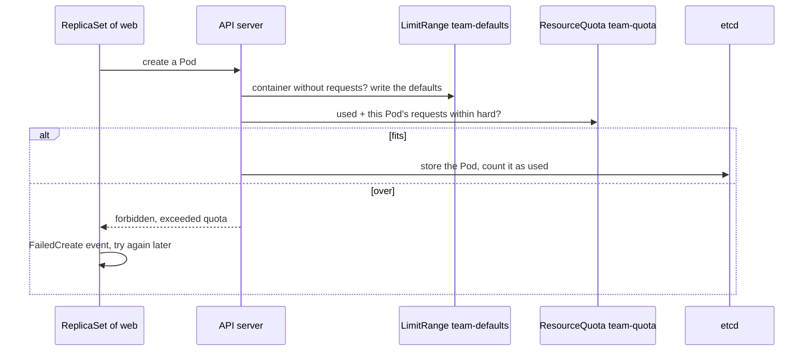

## Before you start

- [[k8s.l3.roles-and-role-bindings]] — you know a RoleBinding grants a Role's actions in one namespace only, and that RBAC rules only allow.
- [[k8s.l1.requests-and-limits]] — you know requests are what kube-scheduler reserves on a node, and a Pod whose requests fit no node stays `Pending`.
- [[k8s.l3.network-policies]] — you know a NetworkPolicy turns a Pod's open incoming traffic into an allow list of Pods and namespaces.
- [[backend.l3.multi-tenancy]] — you know a tenant is one organisation using a shared system as its own, and that a noisy neighbor slows the others.

## The situation

The lab cluster `donhang` runs on your machine: one control-plane node and two workers, with Đơn Hàng in the namespace `donhang`. A second team of the same company wants to run its own `web` service there instead of building a cluster of its own. You can give it a namespace with its own RoleBinding, NetworkPolicies and Pod Security level. Yet nothing stops that team from scaling `web` until its Pods' requests fill both workers, and a new Pod of Đơn Hàng's could then stay `Pending`. How can a namespace stop one team from claiming the whole cluster, and what does it still share with every other team?

## Core concepts

- **ResourceQuota** — an object in one namespace that caps what all its Pods may claim together, such as the sum of their CPU and memory requests and the number of Pods; the API server refuses a Pod that would go over it.
- **LimitRange** — an object in one namespace that writes default requests and limits into every container that declares none, when its Pod is created.
- Per namespace (not a new term) — the RoleBindings, the NetworkPolicies and the Pod Security level set by the namespace's labels, so each team gets its own rights, connections and rules.
- Shared by every namespace (not a new term) — the nodes and their kernel (the part of the operating system that every container on a node runs on top of), the control plane with its API server and etcd, and objects that belong to no namespace, such as CRDs and ClusterRoles.

## How it works



The API server first lets the LimitRange fill in missing requests (explained below), then checks the quota. In the situation above, the team's namespace is `tenancy-lessons`, and the ResourceQuota `team-quota` lets its Pods request 200m of CPU, 256Mi of memory and four Pods in total. The quota does not watch running containers; it acts when a Pod is created: an admission controller in the API server adds the new Pod's requests to what the namespace already uses and compares the sum with the quota. If the sum fits, the Pod is stored and counted. If not, the request fails with `exceeded quota`, and no Pod exists, not even a `Pending` one.

A Deployment does not create Pods itself; its ReplicaSet does. So when `web` is scaled past the quota, the refusal goes to the ReplicaSet, which records a `FailedCreate` event and keeps trying. The `kubectl scale` command itself succeeds.

Once a quota counts CPU or memory requests, the API server refuses a Pod that sets neither requests nor limits for them, because it cannot count what that Pod would claim. The LimitRange writes its defaults into such a Pod before the quota is checked, and the quota then counts those defaults.

Everything above lives inside one namespace. The kernel of each node, the API server and etcd, and the objects that belong to no namespace stay shared. The quota here counts requests and Pods, not calls to the API server, so one team's operator or script that sends it too many calls can slow the other teams too. A CRD one team upgrades changes it for all of them.

## In the Đơn Hàng system

The quota on the team's namespace:

```yaml file=deploy/k8s/lessons/team-quota.yaml tag=stage-4 lines=11-20
apiVersion: v1
kind: ResourceQuota
metadata:
  name: team-quota
  namespace: tenancy-lessons
spec:
  hard:
    requests.cpu: 200m
    requests.memory: 256Mi
    pods: "4"
```

Lines 17–20 set the quota's `hard` limits. `requests.cpu` and `requests.memory` cap the sum of the requests of every Pod in `tenancy-lessons`; `pods` caps how many Pods it holds. The same file's Deployment `web` (lines 25–46, outside the excerpt) requests 50m of CPU and 32Mi of memory per Pod, so four Pods fill the CPU part exactly: 4 × 50m = 200m.

The refusals, then the LimitRange:

```bash file=scripts/k8s/team-quota.sh tag=stage-4 lines=52-69
# lesson: k8s.l4.sharing-a-cluster
# Back to one web Pod. Once a quota counts CPU and memory requests, a Pod
# that sets none is refused: the API server cannot count what it would
# claim.
kubectl scale deployment web -n tenancy-lessons --replicas=1 >/dev/null
kubectl rollout status deployment/web -n tenancy-lessons --timeout=180s >/dev/null
until [ "$(kubectl get pods -n tenancy-lessons --no-headers | wc -l)" -eq 1 ]; do sleep 2; done
echo "\$ kubectl run bare -n tenancy-lessons --image=caddy:2.10.0"
kubectl run bare -n tenancy-lessons --image=caddy:2.10.0 2>&1 || true
echo

# lesson: k8s.l4.sharing-a-cluster
# With the LimitRange, the API server gives the Pod's container the
# default requests and limits, and the quota accepts it.
show kubectl apply -f deploy/k8s/lessons/team-limit-range.yaml
show kubectl run bare -n tenancy-lessons --image=caddy:2.10.0
echo "\$ kubectl get pod bare -n tenancy-lessons -o jsonpath='{.spec.containers[0].resources}'"
kubectl get pod bare -n tenancy-lessons -o jsonpath='{.spec.containers[0].resources}{"\n"}'
```

```text output=true
$ kubectl apply -f deploy/k8s/lessons/team-quota.yaml
namespace/tenancy-lessons created
resourcequota/team-quota created
deployment.apps/web created
$ kubectl get resourcequota team-quota -n tenancy-lessons (used of hard, per resource)
pods: 1 of 4
requests.cpu: 50m of 200m
requests.memory: 32Mi of 256Mi

$ kubectl scale deployment web -n tenancy-lessons --replicas=6
deployment.apps/web scaled
$ kubectl get deployment web -n tenancy-lessons
NAME   READY   UP-TO-DATE   AVAILABLE   AGE
web    4/6     4            4           ...
$ kubectl get pods -n tenancy-lessons --no-headers | wc -l
4
== the ReplicaSet's FailedCreate events (each message once)
Error creating: pods "web-<new Pod>" is forbidden: exceeded quota: team-quota, requested: pods=1,requests.cpu=50m, used: pods=4,requests.cpu=200m, limited: pods=4,requests.cpu=200m

$ kubectl run bare -n tenancy-lessons --image=caddy:2.10.0
Error from server (Forbidden): pods "bare" is forbidden: failed quota: team-quota: must specify requests.cpu for: bare; requests.memory for: bare

$ kubectl apply -f deploy/k8s/lessons/team-limit-range.yaml
limitrange/team-defaults created
$ kubectl run bare -n tenancy-lessons --image=caddy:2.10.0
pod/bare created
$ kubectl get pod bare -n tenancy-lessons -o jsonpath='{.spec.containers[0].resources}'
{"limits":{"cpu":"100m","memory":"64Mi"},"requests":{"cpu":"20m","memory":"32Mi"}}

$ kubectl get resourcequota team-quota -n tenancy-lessons (used of hard, per resource)
pods: 2 of 4
requests.cpu: 70m of 200m
requests.memory: 64Mi of 256Mi
```

The output starts before the excerpt. Line 20 applies `team-quota.yaml`, and line 30 scales `web` to six replicas. The Deployment shows `4/6`, and only four Pods exist: the other two were never created. The `FailedCreate` message names the quota and the numbers: the new Pod asked for `pods=1,requests.cpu=50m`, while the namespace already used `pods=4,requests.cpu=200m`, its limit.

In the excerpt, lines 56–58 scale `web` back to one Pod. Line 60 runs a Pod `bare` from a small web server image (`caddy`) that sets no requests or limits, and the API server refuses it with `must specify requests.cpu`.

`show` is a helper of the script that prints a command with `$` and then runs it. Line 66 applies `team-limit-range.yaml`, whose defaults are 20m and 32Mi as requests and 100m and 64Mi as limits per container. Line 67 runs the same command, and it now succeeds. Line 69 prints the container's resources: the LimitRange's defaults, which the command never set. The last reading, from line 76 after the excerpt, adds `bare`'s 20m to `web`'s 50m: `70m of 200m`.

## Trade-offs

| | Namespace per team, nothing else | Namespace with bindings, policies, Pod Security level, quota and LimitRange | A cluster per team or tenant |
|---|---|---|---|
| Who may change what | Whatever cluster-wide bindings allow | Each team's RoleBindings | Each cluster's own bindings |
| Traffic between teams' Pods | Open across namespaces | Only what NetworkPolicies allow | Not on one Pod network |
| Room on the nodes | Whoever requests first | Capped per namespace by the quota | Its own nodes |
| Kernel, API server, etcd, CRDs | Shared | Shared | Its own |
| What there is to run | One cluster | One cluster, plus these objects per namespace | One control plane and set of nodes per cluster, each upgraded on its own |

## What would you choose if…

- …two teams of one company, under one on-call rotation, deploy services to the same cluster: namespaces with their own RoleBindings, NetworkPolicies, Pod Security level, quota and LimitRange, because the teams trust each other and accept sharing the control plane's upgrades.
- …one team needs a CRD at a version another team's operator cannot work with: namespaces cannot solve it, since a CRD is one definition for the whole cluster. Agree on one version, or run separate clusters.
- …a customer's contract says no other workload may run on the machines that hold its data: a namespace alone cannot promise that, since by default its Pods are placed on the same nodes, and share their kernel, with everyone else's. Whether that is worth a second cluster is the question of the next lesson.

## Seniors often assume…

- **"A namespace is a small separate cluster with resources of its own."** → Actually a namespace only groups objects; its Pods are placed on the same nodes as everyone else's and use the same API server. Without a quota, one namespace may request all the free room on the nodes. You notice this when another team scales up and new Pods in `donhang` stay `Pending` with `Insufficient cpu` in their events.
- **"A ResourceQuota slows a namespace down once its Pods use too much CPU."** → Actually a quota is checked when a Pod is created, against its requests, not its use; it never slows or stops a running Pod. Slowing a container that uses too much CPU is the job of its CPU limit. You notice this when a namespace at `200m of 200m` keeps running its four Pods normally, while a fifth never appears.
- **"Each of Đơn Hàng's shops should get its own namespace to keep their data apart."** → Actually Đơn Hàng now serves several shops, and ADR `0012` decided that one deployment serves them all instead of one copy of Đơn Hàng per shop. So a shop is a tenant inside the application, and isolation between shops is built there; a namespace per shop would bring back the copy per shop the ADR did not choose. You notice this when a shop is opened: under ADR `0012` that is not a deploy, so no Kubernetes object changes.

## Try it (3 minutes)

In the `don-hang` repository folder, with kubectl and kind installed:

1. Run `scripts/k8s/team-quota.sh`. If the kind cluster `donhang` is missing, the script builds it first, which takes longer than the 3 minutes in the heading.
2. Read the `Error creating:` line and the last three lines.

Expected result: the `Error creating:` line contains `exceeded quota: team-quota` and `used: pods=4,requests.cpu=200m`, and the output ends with `pods: 2 of 4`, `requests.cpu: 70m of 200m` and `requests.memory: 64Mi of 256Mi`.

## Connections

- [[k8s.l1.namespaces]] — where a namespace was only a grouping of objects; this lesson adds what a team's namespace needs before the cluster is shared.
- [[k8s.l3.pod-security-admission]] — the Pod Security level per namespace, one of the rules each team's namespace gets.
- [[k8s.l3.custom-resources]] — why a CRD belongs to the whole cluster, one of the things a namespace cannot divide.
- [[design.l4.one-deployment-for-all-shops]] — the same sharing question one layer up: shops share one deployment, so their isolation lives in the application, not in namespaces.
- [[k8s.l4.why-more-than-one-cluster]] — next: when a boundary a namespace cannot hold is worth a second cluster.

## Five-line summary

1. Namespaces let teams of one company share a cluster with separate rights, connections, rules and room, but never its control plane, kernel or CRDs.
2. A ResourceQuota caps the summed requests and the Pod count of one namespace; the API server refuses a Pod that would go over it.
3. `team-quota.sh` scales `web` to six: four Pods exist, the others never do, and the ReplicaSet's events say `exceeded quota`.
4. Under a quota on requests, a Pod that sets neither requests nor limits is refused; a LimitRange such as `team-limit-range.yaml` gives it defaults first.
5. Tenants that must neither affect nor see each other need more than namespaces; Đơn Hàng's shops are tenants inside the application.
