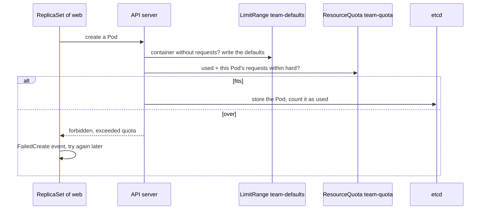

## Bạn cần biết trước

- [[k8s.l3.roles-and-role-bindings]] — bạn biết một RoleBinding chỉ trao các hành động của một Role trong đúng một namespace, và các rule RBAC chỉ cho phép chứ không cấm.
- [[k8s.l1.requests-and-limits]] — bạn biết request là phần kube-scheduler giữ chỗ trên một node, và Pod có request không vừa node nào sẽ nằm ở `Pending`.
- [[k8s.l3.network-policies]] — bạn biết một NetworkPolicy biến lưu lượng đi vào Pod từ chỗ mở hoàn toàn thành một danh sách Pod và namespace được phép.
- [[backend.l3.multi-tenancy]] — bạn biết tenant là một tổ chức dùng hệ thống chung như của riêng mình, và một noisy neighbor làm chậm những tenant còn lại.

## Tình huống

Cluster thử nghiệm `donhang` chạy trên máy bạn: một node control plane và hai worker, Đơn Hàng nằm trong namespace `donhang`. Một đội thứ hai cùng công ty muốn chạy service `web` của họ ở đây thay vì tự dựng một cluster riêng. Bạn có thể cho đội đó một namespace với RoleBinding, NetworkPolicy và mức Pod Security của riêng nó. Dù vậy, không gì ngăn đội đó scale `web` tới khi request của các Pod lấp đầy cả hai worker, và lúc đó một Pod mới của Đơn Hàng có thể nằm mãi ở `Pending`. Làm sao để một namespace ngăn một đội chiếm cả cluster, và namespace đó vẫn dùng chung những gì với mọi đội khác?

## Khái niệm cốt lõi

- **ResourceQuota** (Object giới hạn tổng request và số Pod mà mọi Pod của một namespace được xin; vượt thì API server từ chối) — một object trong một namespace, đặt trần cho tổng những gì mọi Pod trong đó được xin, như tổng request CPU và bộ nhớ và số Pod. API server từ chối Pod nào làm tổng vượt trần.
- **LimitRange** (Object đặt request/limit mặc định và mức cho phép cho từng container trong một namespace) — một object trong một namespace, ghi request và limit mặc định vào mọi container không tự khai báo, ngay lúc Pod của container đó được tạo.
- Theo từng namespace (không phải term mới) — các RoleBinding, các NetworkPolicy và mức Pod Security do label của namespace đặt, nên mỗi đội có quyền, kết nối và quy tắc của riêng mình.
- Mọi namespace dùng chung (không phải term mới) — các node và kernel của chúng (phần của hệ điều hành mà mọi container trên một node chạy bên trên), control plane cùng API server và etcd, và những object không thuộc namespace nào, như CRD và ClusterRole.

## Cơ chế hoạt động



API server cho LimitRange điền request còn thiếu trước (giải thích ở dưới), rồi mới kiểm tra quota. Trong tình huống trên, namespace của đội là `tenancy-lessons`, và ResourceQuota `team-quota` cho các Pod trong đó xin tổng cộng 200m CPU, 256Mi bộ nhớ và bốn Pod. Quota không theo dõi các container đang chạy. Nó chỉ ra tay khi một Pod được tạo: một admission controller trong API server cộng request của Pod mới vào phần namespace đã dùng, rồi so tổng với quota. Nếu vừa, Pod được lưu và được tính vào phần đã dùng. Nếu không, yêu cầu thất bại với `exceeded quota`, và không có Pod nào tồn tại, kể cả một Pod `Pending`.

Deployment không tự tạo Pod, ReplicaSet của nó mới tạo. Nên khi `web` được scale quá quota, lời từ chối đi về ReplicaSet. ReplicaSet ghi một event `FailedCreate` và tiếp tục thử lại. Bản thân lệnh `kubectl scale` vẫn thành công.

Khi quota đã đếm request CPU hoặc bộ nhớ, API server từ chối Pod nào không đặt cả request lẫn limit cho chúng, vì nó không đếm được Pod đó sẽ xin bao nhiêu. LimitRange ghi giá trị mặc định vào Pod như thế trước khi quota được kiểm tra, và quota sau đó đếm theo các giá trị mặc định này.

Mọi thứ ở trên đều nằm gọn trong một namespace. Kernel của từng node, API server và etcd, và các object không thuộc namespace nào thì vẫn là của chung. Quota ở đây đếm request và số Pod, không đếm số lời gọi tới API server. Vì vậy một operator hay một script của một đội gửi quá nhiều lời gọi có thể làm chậm cả các đội khác. Một CRD mà một đội nâng cấp sẽ đổi theo cho tất cả.

## Trong hệ thống Đơn Hàng

Quota trên namespace của đội:

```yaml file=deploy/k8s/lessons/team-quota.yaml tag=stage-4 lines=11-20
apiVersion: v1
kind: ResourceQuota
metadata:
  name: team-quota
  namespace: tenancy-lessons
spec:
  hard:
    requests.cpu: 200m
    requests.memory: 256Mi
    pods: "4"
```

Dòng 17–20 đặt các giới hạn `hard` của quota. `requests.cpu` và `requests.memory` đặt trần cho tổng request của mọi Pod trong `tenancy-lessons`, còn `pods` đặt trần cho số Pod namespace được chứa. Deployment `web` trong cùng file (dòng 25–46, ngoài đoạn trích) xin 50m CPU và 32Mi bộ nhớ cho mỗi Pod, nên bốn Pod lấp vừa khít phần CPU: 4 × 50m = 200m.

Các lời từ chối, rồi tới LimitRange:

```bash file=scripts/k8s/team-quota.sh tag=stage-4 lines=52-69
# lesson: k8s.l4.sharing-a-cluster
# Back to one web Pod. Once a quota counts CPU and memory requests, a Pod
# that sets none is refused: the API server cannot count what it would
# claim.
kubectl scale deployment web -n tenancy-lessons --replicas=1 >/dev/null
kubectl rollout status deployment/web -n tenancy-lessons --timeout=180s >/dev/null
until [ "$(kubectl get pods -n tenancy-lessons --no-headers | wc -l)" -eq 1 ]; do sleep 2; done
echo "\$ kubectl run bare -n tenancy-lessons --image=caddy:2.10.0"
kubectl run bare -n tenancy-lessons --image=caddy:2.10.0 2>&1 || true
echo

# lesson: k8s.l4.sharing-a-cluster
# With the LimitRange, the API server gives the Pod's container the
# default requests and limits, and the quota accepts it.
show kubectl apply -f deploy/k8s/lessons/team-limit-range.yaml
show kubectl run bare -n tenancy-lessons --image=caddy:2.10.0
echo "\$ kubectl get pod bare -n tenancy-lessons -o jsonpath='{.spec.containers[0].resources}'"
kubectl get pod bare -n tenancy-lessons -o jsonpath='{.spec.containers[0].resources}{"\n"}'
```

```text output=true
$ kubectl apply -f deploy/k8s/lessons/team-quota.yaml
namespace/tenancy-lessons created
resourcequota/team-quota created
deployment.apps/web created
$ kubectl get resourcequota team-quota -n tenancy-lessons (used of hard, per resource)
pods: 1 of 4
requests.cpu: 50m of 200m
requests.memory: 32Mi of 256Mi

$ kubectl scale deployment web -n tenancy-lessons --replicas=6
deployment.apps/web scaled
$ kubectl get deployment web -n tenancy-lessons
NAME   READY   UP-TO-DATE   AVAILABLE   AGE
web    4/6     4            4           ...
$ kubectl get pods -n tenancy-lessons --no-headers | wc -l
4
== the ReplicaSet's FailedCreate events (each message once)
Error creating: pods "web-<new Pod>" is forbidden: exceeded quota: team-quota, requested: pods=1,requests.cpu=50m, used: pods=4,requests.cpu=200m, limited: pods=4,requests.cpu=200m

$ kubectl run bare -n tenancy-lessons --image=caddy:2.10.0
Error from server (Forbidden): pods "bare" is forbidden: failed quota: team-quota: must specify requests.cpu for: bare; requests.memory for: bare

$ kubectl apply -f deploy/k8s/lessons/team-limit-range.yaml
limitrange/team-defaults created
$ kubectl run bare -n tenancy-lessons --image=caddy:2.10.0
pod/bare created
$ kubectl get pod bare -n tenancy-lessons -o jsonpath='{.spec.containers[0].resources}'
{"limits":{"cpu":"100m","memory":"64Mi"},"requests":{"cpu":"20m","memory":"32Mi"}}

$ kubectl get resourcequota team-quota -n tenancy-lessons (used of hard, per resource)
pods: 2 of 4
requests.cpu: 70m of 200m
requests.memory: 64Mi of 256Mi
```

Output bắt đầu từ trước đoạn trích. Dòng 20 apply `team-quota.yaml`, và dòng 30 scale `web` lên sáu replica. Deployment hiện `4/6`, và chỉ có bốn Pod tồn tại: hai Pod còn lại chưa bao giờ được tạo. Thông báo `FailedCreate` nêu tên quota và các con số: Pod mới xin `pods=1,requests.cpu=50m`, trong khi namespace đã dùng `pods=4,requests.cpu=200m`, đúng bằng giới hạn.

Trong đoạn trích, dòng 56–58 scale `web` về lại một Pod. Dòng 60 chạy Pod `bare` từ image của một web server nhỏ (`caddy`), không đặt request hay limit nào, và API server từ chối nó với `must specify requests.cpu`.

`show` là một hàm phụ trong script, in lệnh kèm `$` rồi chạy lệnh đó. Dòng 66 apply `team-limit-range.yaml`, với giá trị mặc định cho mỗi container là 20m và 32Mi cho request, 100m và 64Mi cho limit. Dòng 67 chạy lại đúng lệnh cũ, và lần này thành công. Dòng 69 in resources của container: chính là giá trị mặc định của LimitRange, thứ mà lệnh không hề đặt. Lần đọc cuối, từ dòng 76 sau đoạn trích, cộng 20m của `bare` với 50m của `web`: `70m of 200m`.

## Đánh đổi

| | Mỗi đội một namespace, không thêm gì | Namespace có binding, policy, mức Pod Security, quota và LimitRange | Mỗi đội hoặc tenant một cluster |
|---|---|---|---|
| Ai được sửa gì | Tùy các binding toàn cluster cho phép | RoleBinding của từng đội | Binding riêng của từng cluster |
| Lưu lượng giữa Pod của các đội | Mở giữa các namespace | Chỉ những gì NetworkPolicy cho phép | Không chung một mạng Pod |
| Chỗ trên các node | Ai xin trước được trước | Giới hạn theo namespace bằng quota | Node của riêng mình |
| Kernel, API server, etcd, CRD | Dùng chung | Dùng chung | Của riêng mình |
| Những gì phải vận hành | Một cluster | Một cluster, cộng các object này cho mỗi namespace | Mỗi cluster một control plane và một nhóm node, nâng cấp riêng từng cái |

## Bạn sẽ chọn gì nếu…

- …hai đội cùng công ty, chung một lịch trực sự cố, deploy service lên cùng một cluster: dùng namespace với RoleBinding, NetworkPolicy, mức Pod Security, quota và LimitRange riêng, vì hai đội tin nhau và chấp nhận dùng chung các đợt nâng cấp control plane.
- …một đội cần một CRD ở phiên bản mà operator của đội khác không làm việc được: namespace không giải được chuyện này, vì CRD là một định nghĩa duy nhất cho cả cluster. Hãy thống nhất một phiên bản, hoặc chạy các cluster riêng.
- …hợp đồng của một khách hàng nói không workload nào khác được chạy trên những máy giữ dữ liệu của họ: chỉ namespace thì không hứa được điều đó, vì mặc định Pod của nó được đặt lên cùng các node, và dùng chung kernel, với Pod của mọi người khác. Có đáng dựng cluster thứ hai cho chuyện đó không là câu hỏi của bài sau.

## Senior hay nhầm rằng…

- **"Namespace là một cluster nhỏ tách riêng, có tài nguyên của riêng nó."** → Thực ra namespace chỉ gom nhóm các object, vì Pod của nó được đặt lên cùng các node với Pod của mọi người và dùng cùng API server. Không có quota, một namespace có thể xin hết chỗ trống trên các node. Bạn sẽ nhận ra khi một đội khác scale lên và các Pod mới trong `donhang` nằm ở `Pending` với `Insufficient cpu` trong event.
- **"ResourceQuota làm chậm một namespace khi Pod của nó dùng quá nhiều CPU."** → Thực ra quota được kiểm tra lúc tạo Pod, dựa trên request chứ không dựa trên mức dùng thật, vì vậy nó không bao giờ làm chậm hay dừng một Pod đang chạy. Làm chậm container dùng quá nhiều CPU là việc của CPU limit. Bạn sẽ nhận ra khi một namespace ở mức `200m of 200m` vẫn chạy bốn Pod bình thường, còn Pod thứ năm thì không bao giờ xuất hiện.
- **"Mỗi cửa hàng của Đơn Hàng nên có namespace riêng để tách dữ liệu."** → Thực ra Đơn Hàng giờ phục vụ nhiều cửa hàng, và ADR `0012` đã quyết định một bản deploy phục vụ tất cả, thay vì mỗi cửa hàng một bản Đơn Hàng. Vì vậy cửa hàng là một tenant bên trong ứng dụng, và sự cô lập giữa các cửa hàng được xây ở đó. Mỗi cửa hàng một namespace sẽ đưa lại đúng kiểu mỗi cửa hàng một bản mà ADR không chọn. Bạn sẽ nhận ra khi mở một cửa hàng: theo ADR `0012`, đó không phải một lần deploy, nên không object Kubernetes nào thay đổi.

## Thử ngay (3 phút)

Trong thư mục repo `don-hang`, khi đã cài kubectl và kind:

1. Chạy `scripts/k8s/team-quota.sh`. Nếu chưa có cluster kind `donhang`, script sẽ dựng nó trước, mất lâu hơn 3 phút ghi ở tiêu đề.
2. Đọc dòng `Error creating:` và ba dòng cuối.

Kết quả mong đợi: dòng `Error creating:` chứa `exceeded quota: team-quota` và `used: pods=4,requests.cpu=200m`, còn output kết thúc bằng `pods: 2 of 4`, `requests.cpu: 70m of 200m` và `requests.memory: 64Mi of 256Mi`.

## Liên hệ

- [[k8s.l1.namespaces]] — nơi namespace chỉ là cách gom nhóm object, bài này thêm những gì namespace của một đội cần trước khi cluster được chia sẻ.
- [[k8s.l3.pod-security-admission]] — mức Pod Security theo từng namespace, một trong các quy tắc mà namespace của mỗi đội nhận được.
- [[k8s.l3.custom-resources]] — vì sao CRD thuộc về cả cluster, một trong những thứ namespace không chia được.
- [[design.l4.one-deployment-for-all-shops]] — cùng câu hỏi chia sẻ ở tầng trên một bậc: các cửa hàng dùng chung một bản deploy, nên sự cô lập giữa chúng nằm trong ứng dụng, không nằm ở namespace.
- [[k8s.l4.why-more-than-one-cluster]] — tiếp theo: khi nào một ranh giới mà namespace không giữ được thì đáng để dựng cluster thứ hai.

## Tóm tắt 5 dòng

1. Namespace cho các đội cùng công ty dùng chung một cluster với quyền, kết nối, quy tắc và chỗ chạy tách riêng, nhưng không bao giờ tách được control plane, kernel hay CRD.
2. ResourceQuota đặt trần cho tổng request và số Pod của một namespace, và API server từ chối Pod nào làm vượt trần.
3. `team-quota.sh` scale `web` lên sáu: bốn Pod tồn tại, các Pod còn lại không bao giờ được tạo, và event của ReplicaSet ghi `exceeded quota`.
4. Khi có quota trên request, Pod không đặt cả request lẫn limit sẽ bị từ chối, còn LimitRange như `team-limit-range.yaml` cấp giá trị mặc định cho nó trước.
5. Các tenant không được ảnh hưởng hay nhìn thấy nhau cần nhiều hơn namespace, còn các cửa hàng của Đơn Hàng là tenant bên trong ứng dụng.
