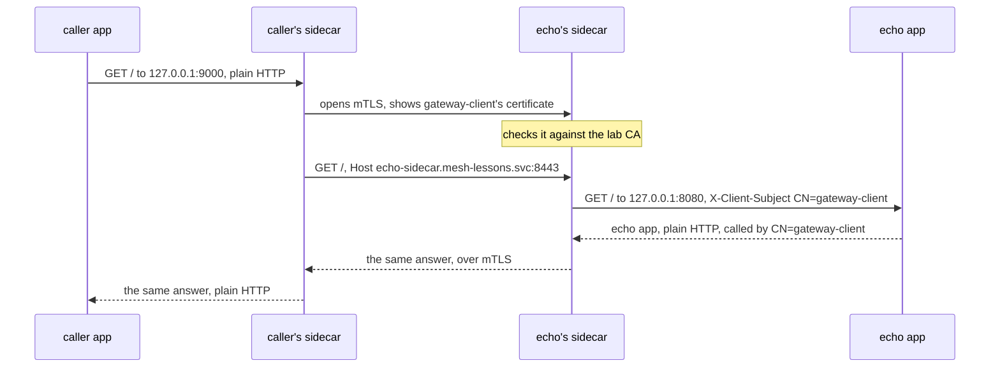

## Before you start

- [[k8s.l4.mutual-tls]] — you know a Caddy server with `client_auth` `require_and_verify` refuses a caller without a certificate from its CA and reads the caller's name from it.
- [[k8s.l3.pod-network-model]] — you know the containers of one Pod share its IP address and ports.
- [[k8s.l3.service-accounts]] — you know every Pod runs as a ServiceAccount, the identity the API server knows it by.
- [[backend.l3.resilience-pipeline]] — you know Payments wraps every gateway call in a pipeline of strategies, such as a timeout, set up in its own code.

## The situation

In the last lesson, closing finding P5 meant giving the Gateway, the api and Payments each a key and a certificate. `echo-mtls` was Caddy, so a few lines of its Caddyfile did the work. The api and Payments are .NET services: each would need code to load its key and certificate, ask for and check the caller's, and pick up the new pair every time cert-manager renews it. A service added later, perhaps in another language, would need the same code again. Could the mTLS sit beside each app instead of inside it, so that the app keeps sending and receiving plain HTTP?

## Core concepts

- **sidecar container** — a helper container in the same Pod as the app container, started before it and kept running beside it for the Pod's whole life.
- **service mesh** — infrastructure that puts such a proxy beside every app in a cluster and configures all of them, and their certificates, from one place, so calls between services get mTLS, retries, timeouts and a record of each call.
- Init container — a container listed under `initContainers` in a Pod spec; an ordinary one runs to completion, one after another, before the containers under `containers` start.
- Upstream (Caddy's word) — the server a proxy forwards requests to.

## How it works



In the situation above, each app would keep its plain HTTP, and a sidecar container would do the mTLS for it. Kubernetes 1.34 has no separate list for sidecars: you list one under `initContainers` with `restartPolicy: Always`. Unlike an ordinary init container, it is left running. If it exits, the kubelet restarts it; when the Pod stops, the kubelet stops the app first and the sidecar after it.

The kubelet starts the sidecar before any container under `containers`, waits until it has started, and only then starts the app. Started means its process runs, or, if it has one, that its startup probe has passed: a probe the kubelet runs only while the container starts. It does not mean the proxy already accepts connections.

Containers of one Pod share its IP address, so they reach each other on `127.0.0.1`, which nothing outside the Pod can reach. The caller's app sends plain HTTP to its own sidecar on `127.0.0.1:9000`. That sidecar opens an mTLS connection to the echo Pod's sidecar and shows `gateway-client`'s certificate, as `openssl` did in the last lesson. The echo sidecar checks it against the lab CA. It then sends the request over that connection, with `Host` set to the echo Service's name and port; the next section shows why. The echo sidecar passes the request to its app on `127.0.0.1:8080` with the certificate's subject, the name it was issued for, in a header; Caddy writes it as `CN=gateway-client`.

The answer goes back the same way. Neither app opens TLS or holds a key; only the two sidecars do. Between the two Pods, this call crosses the network only as encrypted bytes.

## In the Đơn Hàng system

The lab runs in the namespace `mesh-lessons` on the `donhang` cluster and reuses the two certificates of `mtls-certificates.yaml`; the server certificate also covers the name `echo-sidecar.mesh-lessons.svc`. `echo-mtls-sidecar.yaml` starts with a ConfigMap holding two Caddyfiles (not shown). `app.Caddyfile` is the echo app: plain HTTP on port 8080 with `bind 127.0.0.1`, answering with the header `X-Client-Subject`. `proxy.Caddyfile` is the sidecar: on port 8443, the same `tls` and `client_auth` lines as `echo-mtls`, then `reverse_proxy 127.0.0.1:8080`, which copies the subject of the client's certificate into that header. The Pod spec puts the two together:

```yaml file=deploy/k8s/lessons/echo-mtls-sidecar.yaml tag=stage-4 lines=55-78
      # lesson: k8s.l4.sidecar-proxies
      # The sidecar: under initContainers, with restartPolicy Always.
      initContainers:
        - name: tls-proxy
          image: caddy:2.10.0
          restartPolicy: Always
          command: ["caddy", "run", "--config", "/config/proxy.Caddyfile", "--adapter", "caddyfile"]
          ports:
            - containerPort: 8443
          volumeMounts:
            - name: config
              mountPath: /config
            - name: certs
              mountPath: /certs
              readOnly: true
      # lesson: k8s.l4.sidecar-proxies
      # The echo app: its own Caddyfile, no certificate mounted.
      containers:
        - name: echo
          image: caddy:2.10.0
          command: ["caddy", "run", "--config", "/config/app.Caddyfile", "--adapter", "caddyfile"]
          volumeMounts:
            - name: config
              mountPath: /config
```

Lines 57–60 make `tls-proxy` a sidecar; lines 72–78 are the app, `echo`. Only `tls-proxy` mounts `certs`, the Secret `echo-mtls-tls` defined further down; `echo` mounts only its configuration. The Service `echo-sidecar`, also further down, sends port 8443 to the sidecar and never exposes 8080.

The caller's side is the same shape, seen from the client:

```yaml file=deploy/k8s/lessons/mtls-client-sidecar.yaml tag=stage-4 lines=1-25
# lesson: k8s.l4.sidecar-proxies
# The caller's sidecar: plain HTTP on 127.0.0.1:9000 for its own app, and
# for each request an mTLS connection to echo-sidecar with gateway-client's
# certificate, checking the server's against the lab CA. Host is set to
# the upstream's name and port, the name its certificate is for.
apiVersion: v1
kind: ConfigMap
metadata:
  name: caller-sidecar
  namespace: mesh-lessons
data:
  proxy.Caddyfile: |
    {
      admin off
    }
    http://:9000 {
      bind 127.0.0.1
      reverse_proxy https://echo-sidecar.mesh-lessons.svc:8443 {
        header_up Host {upstream_hostport}
        transport http {
          tls_client_auth /certs/tls.crt /certs/tls.key
          tls_trust_pool file /certs/ca.crt
        }
      }
    }
```

Lines 13–15 are a Caddy setting this lesson does not need. Lines 16–17 listen for plain HTTP on `127.0.0.1:9000`, for the caller's own app only. Line 18 forwards every request over HTTPS to `echo-sidecar.mesh-lessons.svc`, port 8443. Lines 21–22 show `gateway-client`'s certificate and key and check the server's against the lab CA. The Deployment below the excerpt puts this proxy under `initContainers` and mounts `gateway-client-tls` into it alone; the app container only runs `sleep`.

With Caddy 2.10, the version this lab runs, Caddy passes on the `Host` the app sent, `127.0.0.1:9000`, unless line 19 sets it. Caddy opens the TLS connection for the upstream's name, telling the server at the start which name's certificate it expects. A Caddy server that checks client certificates also requires the request's `Host` to match that name and answers a mismatch with `421`. Line 19 sets `Host` to `echo-sidecar.mesh-lessons.svc:8443`, and the call goes through.

These two files did three jobs by hand: add the proxy container, mount its certificate and write its Caddyfile. A service mesh does them for every Pod. Its controllers, programs in the cluster that each run a control loop over objects in the API server, typically add the proxy to each Pod as it is created. They give each app's Pods a certificate of their own, in many meshes named after the Pod's ServiceAccount, and renew it before it expires. They configure every proxy from objects stored in the API server, so nobody writes each proxy's own configuration file.

Since every call passes through two proxies, a mesh can also retry a failed call, time out a slow one, send a share of calls to a new version by weight or by header, and record each call. Đơn Hàng does this elsewhere today: Payments times out gateway calls in its own code, the services record spans with OpenTelemetry, and a canary's weights live in an HTTPRoute at the Gateway.

Not every mesh puts a proxy in every Pod. Some run one shared proxy per node instead, trading the memory of many sidecars for one shared component on each node, whose fault then reaches every Pod on that node.

## Trade-offs

| | mTLS in each app (`echo-mtls`) | A sidecar written by hand (this lab) | Service mesh |
|---|---|---|---|
| Who holds the key | The app | The sidecar; the app holds none | The proxy the mesh adds |
| Each new service | Writes the same TLS and certificate code again, in its own language | Gets a proxy container and its configuration, written by you | Gets a proxy and a certificate from the mesh's controllers |
| Extra cost per Pod | Nothing beyond the app | One more container | One more container, or a share of a per-node proxy |
| Retries, timeouts, a record of each call | In each app's code | Only what you configure in each proxy | Configured from the API server, for every call |
| What the team runs and must understand | Each app's TLS code | Its own proxy configurations | The mesh's controllers and proxies |

## What would you choose if…

- …one or two services must speak mTLS to a single partner, and the team owns their code: mTLS in the app, or a hand-written sidecar when the app cannot easily load and renew certificates.
- …many services from several teams or languages call each other and every call must be encrypted and named: a service mesh, because its controllers then do for every Pod what each team would otherwise build.
- …the cluster runs many small Pods and memory per node is tight: a mesh with one proxy per node, accepting that a fault in that proxy reaches every Pod on the node.

## Seniors often assume…

- **"Adding a service mesh means changing every service's code to call the mesh."** → Actually the proxy, not the app, does the TLS and holds the key. In the lab, the echo app has no `tls` line and no key, and the caller's only change is the address it calls. You notice this when `echo` answers `called by CN=gateway-client`, a name from a certificate it never saw, while `ls /certs` fails inside it.
- **"A sidecar is just a second app container, and Kubernetes starts both in no particular order."** → Actually a sidecar sits under `initContainers` with `restartPolicy: Always`, and the kubelet starts it before the app and stops it after. Started does not mean the proxy already accepts connections. You notice this when an app that calls its proxy the moment it starts gets a refused connection now and then, until the sidecar has a startup probe that checks the port the app calls.
- **"A service mesh replaces Kubernetes Services and their DNS names."** → Actually, in the lab the proxies still find each other through them: the caller's sidecar sends to `echo-sidecar.mesh-lessons.svc`, a Service's DNS name, and that Service still picks its Pods by label. You notice this when you delete the Service `echo-sidecar` and the call fails, although both sidecars still run.

## Try it (3 minutes)

From the root of the Đơn Hàng repository, with the `donhang` cluster from the earlier lessons running:

1. Run `scripts/k8s/sidecar-proxy.sh`. It installs cert-manager first if it is missing.
2. Read the `READY` column, the two `initContainers:` lines, the answer to the call on `127.0.0.1:9000`, the direct call to port 8443 and the four `ls /certs` results. Decide why the direct call fails although the caller's Pod holds `gateway-client`'s certificate.

Expected result: both Pods `2/2` and `Running`; `initContainers: tls-proxy (restartPolicy: Always)` for each Pod, with `containers: echo` and `containers: app`; `echo app, plain HTTP, called by CN=gateway-client`; the direct call prints `wget: error getting response: Resource temporarily unavailable`; `ls /certs` fails in `echo` and `app` and lists `ca.crt`, `tls.crt` and `tls.key` in both `tls-proxy` containers. The script deletes `mesh-lessons` at the end.

<details><summary>Suggested answer</summary>

The certificate is in the Pod, but only in its sidecar. The `app` container has no `/certs`, so its `wget` goes straight to port 8443 with no client certificate. The echo sidecar requires one and drops the connection, as `echo-mtls` did with `certificate required`, so no response comes back. Inside a Pod, a container can use only what is mounted into it, not everything the Pod holds.

</details>

## Connections

- [[k8s.l4.mutual-tls]] — the same certificate check, moved from the app into a proxy beside it.
- [[k8s.l4.when-a-mesh-pays-off]] — the next step: whether Đơn Hàng should pay for a mesh, decided in ADR `0021`.
- [[backend.l3.traces-and-spans]] — spans the services record in their own code; a mesh's proxies could record every call.
- [[devops.l4.canary-release]] — a split by weight at the Gateway; a mesh can split calls between versions of any service.
- [[k8s.l3.operator-pattern]] — the pattern behind a mesh's controllers.
- [[k8s.l3.admission-policies]] — where the API server checks a Pod before storing it; a mesh typically adds its proxy to each Pod at that same step, which this lesson leaves out.

## Five-line summary

1. A sidecar container runs a proxy beside the app in its Pod, so the proxy, not the app, does the mTLS for its calls.
2. Kubernetes 1.34 lists a sidecar under `initContainers` with `restartPolicy: Always`: started before the app, kept running beside it.
3. Each app sends plain HTTP on `127.0.0.1`; the two sidecars do mTLS between Pods, and neither app container holds a key.
4. A service mesh adds such a proxy to every Pod, gives each app's Pods a renewed certificate and configures every proxy from the API server.
5. Its proxies can also retry, time out, split calls by weight and record each call; some meshes use one proxy per node.
