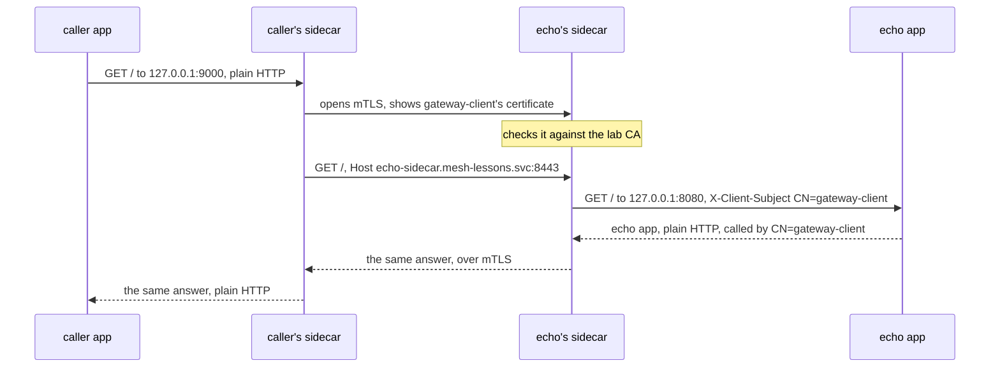

## Bạn cần biết trước

- [[k8s.l4.mutual-tls]] — bạn biết một Caddy server có `client_auth` `require_and_verify` sẽ từ chối bên gọi không có chứng chỉ do CA của nó ký, và đọc tên bên gọi từ chứng chỉ đó.
- [[k8s.l3.pod-network-model]] — bạn biết các container trong một Pod dùng chung địa chỉ IP và các port của Pod.
- [[k8s.l3.service-accounts]] — bạn biết Pod nào cũng chạy dưới một ServiceAccount, danh tính mà API server dùng để nhận ra nó.
- [[backend.l3.resilience-pipeline]] — bạn biết Payments bọc mọi lời gọi tới cổng thanh toán trong một pipeline gồm các chiến lược, chẳng hạn timeout, dựng ngay trong code của nó.

## Tình huống

Ở bài trước, muốn đóng phát hiện P5 thì Gateway, api và Payments đều phải có key và chứng chỉ riêng. `echo-mtls` là Caddy, nên vài dòng trong Caddyfile là xong. api và Payments là service .NET: mỗi service sẽ cần code để nạp key và chứng chỉ, đòi và kiểm chứng chỉ của bên gọi, rồi nạp lại cặp mới mỗi lần cert-manager gia hạn. Một service thêm vào sau này, có khi viết bằng ngôn ngữ khác, lại cần đúng code đó thêm lần nữa. Liệu mTLS có thể nằm cạnh mỗi ứng dụng thay vì bên trong nó, để ứng dụng vẫn gửi và nhận HTTP thường?

## Khái niệm cốt lõi

- **sidecar container** (Container phụ chạy cạnh container ứng dụng trong cùng Pod, khởi động trước và chạy suốt đời Pod) — một container phụ trợ nằm trong cùng Pod với container ứng dụng, khởi động trước ứng dụng và chạy song song với nó suốt đời Pod.
- **service mesh** (Hạ tầng đặt proxy cạnh mỗi service để lo mTLS, retry, chia traffic và đo từng lời gọi mà không sửa code) — hạ tầng đặt một proxy như thế cạnh mọi ứng dụng trong cluster và cấu hình tất cả chúng, cùng chứng chỉ của chúng, từ một chỗ, nhờ đó lời gọi giữa các service có mTLS, thử lại, timeout và bản ghi cho từng lời gọi.
- Init container — container khai báo dưới `initContainers` trong spec của Pod. Một init container thường chạy đến khi xong, lần lượt từng cái, trước khi các container dưới `containers` khởi động.
- Upstream (từ của Caddy) — server mà một proxy chuyển request tới.

## Cơ chế hoạt động



Trong tình huống trên, mỗi ứng dụng giữ nguyên HTTP thường, còn một sidecar container lo mTLS thay nó. Kubernetes 1.34 không có danh sách riêng cho sidecar: bạn khai báo nó dưới `initContainers` với `restartPolicy: Always`. Khác với init container thường, nó không dừng lại sau khi khởi động. Nếu nó thoát, kubelet khởi động lại nó. Khi Pod dừng, kubelet dừng ứng dụng trước rồi mới dừng sidecar.

Kubelet khởi động sidecar trước mọi container dưới `containers`, chờ tới khi nó đã khởi động xong, rồi mới khởi động ứng dụng. "Khởi động xong" nghĩa là tiến trình của nó đang chạy, hoặc nếu có startup probe thì probe đó đã qua: startup probe là probe mà kubelet chỉ chạy trong lúc container đang khởi động. Điều đó không có nghĩa proxy đã nhận kết nối.

Các container của một Pod dùng chung địa chỉ IP, nên chúng gọi nhau qua `127.0.0.1`, địa chỉ mà không gì bên ngoài Pod tới được. Ứng dụng bên gọi gửi HTTP thường tới sidecar của chính nó ở `127.0.0.1:9000`. Sidecar đó mở kết nối mTLS tới sidecar của Pod echo và trình chứng chỉ của `gateway-client`, giống `openssl` đã làm ở bài trước. Sidecar của echo kiểm chứng chỉ với CA của lab. Sau đó sidecar bên gọi gửi request qua kết nối ấy, với `Host` đặt thành tên và port của Service echo, vì sao thì phần sau sẽ giải thích. Sidecar của echo chuyển request cho ứng dụng của nó ở `127.0.0.1:8080`, kèm subject của chứng chỉ, tức cái tên mà chứng chỉ được cấp cho, trong một header. Caddy ghi nó thành `CN=gateway-client`.

Câu trả lời đi ngược lại theo đúng đường đó. Không ứng dụng nào mở TLS hay giữ key, chỉ hai sidecar làm việc ấy. Giữa hai Pod, lời gọi này chỉ đi qua mạng dưới dạng byte đã mã hóa.

## Trong hệ thống Đơn Hàng

Lab chạy trong namespace `mesh-lessons` trên cluster `donhang` và dùng lại hai chứng chỉ của `mtls-certificates.yaml`. Chứng chỉ server phủ thêm cả tên `echo-sidecar.mesh-lessons.svc`. `echo-mtls-sidecar.yaml` mở đầu bằng một ConfigMap chứa hai Caddyfile (không trích ở đây). `app.Caddyfile` là ứng dụng echo: HTTP thường trên port 8080 với `bind 127.0.0.1`, trả lời bằng header `X-Client-Subject`. `proxy.Caddyfile` là sidecar: trên port 8443, cùng các dòng `tls` và `client_auth` như `echo-mtls`, rồi `reverse_proxy 127.0.0.1:8080`, thứ chép subject trong chứng chỉ của client vào header đó. Spec của Pod ghép hai phần lại:

```yaml file=deploy/k8s/lessons/echo-mtls-sidecar.yaml tag=stage-4 lines=55-78
      # lesson: k8s.l4.sidecar-proxies
      # The sidecar: under initContainers, with restartPolicy Always.
      initContainers:
        - name: tls-proxy
          image: caddy:2.10.0
          restartPolicy: Always
          command: ["caddy", "run", "--config", "/config/proxy.Caddyfile", "--adapter", "caddyfile"]
          ports:
            - containerPort: 8443
          volumeMounts:
            - name: config
              mountPath: /config
            - name: certs
              mountPath: /certs
              readOnly: true
      # lesson: k8s.l4.sidecar-proxies
      # The echo app: its own Caddyfile, no certificate mounted.
      containers:
        - name: echo
          image: caddy:2.10.0
          command: ["caddy", "run", "--config", "/config/app.Caddyfile", "--adapter", "caddyfile"]
          volumeMounts:
            - name: config
              mountPath: /config
```

Dòng 57–60 biến `tls-proxy` thành sidecar. Dòng 72–78 là ứng dụng, `echo`. Chỉ `tls-proxy` mount `certs`, tức Secret `echo-mtls-tls` khai báo ở phần dưới file. `echo` chỉ mount cấu hình của nó. Service `echo-sidecar`, cũng ở phần dưới, chuyển port 8443 tới sidecar và không bao giờ mở port 8080 ra ngoài.

Phía bên gọi có cùng hình dạng, chỉ là nhìn từ vai client:

```yaml file=deploy/k8s/lessons/mtls-client-sidecar.yaml tag=stage-4 lines=1-25
# lesson: k8s.l4.sidecar-proxies
# The caller's sidecar: plain HTTP on 127.0.0.1:9000 for its own app, and
# for each request an mTLS connection to echo-sidecar with gateway-client's
# certificate, checking the server's against the lab CA. Host is set to
# the upstream's name and port, the name its certificate is for.
apiVersion: v1
kind: ConfigMap
metadata:
  name: caller-sidecar
  namespace: mesh-lessons
data:
  proxy.Caddyfile: |
    {
      admin off
    }
    http://:9000 {
      bind 127.0.0.1
      reverse_proxy https://echo-sidecar.mesh-lessons.svc:8443 {
        header_up Host {upstream_hostport}
        transport http {
          tls_client_auth /certs/tls.crt /certs/tls.key
          tls_trust_pool file /certs/ca.crt
        }
      }
    }
```

Dòng 13–15 là một thiết lập của Caddy mà bài này không cần tới. Dòng 16–17 nhận HTTP thường trên `127.0.0.1:9000`, chỉ dành cho ứng dụng của chính bên gọi. Dòng 18 chuyển mọi request qua HTTPS tới `echo-sidecar.mesh-lessons.svc`, port 8443. Dòng 21–22 trình chứng chỉ và key của `gateway-client`, và kiểm chứng chỉ của server với CA của lab. Deployment bên dưới đoạn trích đặt proxy này dưới `initContainers` và chỉ mount `gateway-client-tls` vào riêng nó. Container ứng dụng chỉ chạy `sleep`.

Với Caddy 2.10, phiên bản lab này dùng, Caddy chuyển tiếp nguyên `Host` mà ứng dụng gửi, tức `127.0.0.1:9000`, trừ khi dòng 19 đặt lại. Caddy mở kết nối TLS theo tên của upstream, nghĩa là ngay từ đầu nó báo cho server biết nó chờ chứng chỉ của tên nào. Một Caddy server có kiểm chứng chỉ client thì còn đòi `Host` của request khớp với tên đó, và trả `421` khi không khớp. Dòng 19 đặt `Host` thành `echo-sidecar.mesh-lessons.svc:8443`, nên lời gọi đi qua được.

Hai file này làm bằng tay ba việc: thêm container proxy, mount chứng chỉ cho nó và viết Caddyfile cho nó. Service mesh làm các việc đó cho mọi Pod. Các controller của nó, những chương trình trong cluster mà mỗi cái chạy một vòng điều khiển trên các object trong API server, thường thêm proxy vào mỗi Pod ngay khi Pod được tạo. Chúng cấp cho các Pod của mỗi ứng dụng một chứng chỉ riêng, ở nhiều mesh thì đặt theo tên ServiceAccount của Pod, và gia hạn trước khi chứng chỉ hết hạn. Chúng cấu hình mọi proxy từ các object lưu trong API server, nên không ai phải viết file cấu hình riêng cho từng proxy.

Vì lời gọi nào cũng đi qua hai proxy, mesh còn có thể thử lại lời gọi thất bại, cắt lời gọi quá chậm bằng timeout, chuyển một phần lời gọi sang phiên bản mới theo trọng số hoặc theo header, và ghi lại từng lời gọi. Hiện nay Đơn Hàng làm những việc này ở chỗ khác: Payments tự đặt timeout cho lời gọi tới cổng thanh toán trong code, các service tự ghi span bằng OpenTelemetry, còn trọng số của canary nằm trong một HTTPRoute ở Gateway.

Không phải mesh nào cũng đặt một proxy trong mỗi Pod. Có mesh chạy một proxy dùng chung cho mỗi node, đổi bộ nhớ của nhiều sidecar lấy một thành phần dùng chung trên mỗi node, và khi thành phần đó lỗi thì mọi Pod trên node đều bị ảnh hưởng.

## Đánh đổi

| | mTLS trong từng ứng dụng (`echo-mtls`) | Sidecar viết tay (lab này) | Service mesh |
|---|---|---|---|
| Ai giữ key | Ứng dụng | Sidecar, ứng dụng không giữ key nào | Proxy do mesh thêm vào |
| Mỗi service mới | Viết lại cùng code TLS và chứng chỉ, bằng ngôn ngữ của nó | Có một container proxy và cấu hình của nó, do bạn viết | Có proxy và chứng chỉ do các controller của mesh cấp |
| Chi phí thêm cho mỗi Pod | Không gì ngoài ứng dụng | Thêm một container | Thêm một container, hoặc một phần của proxy chung trên node |
| Thử lại, timeout, bản ghi từng lời gọi | Trong code của từng ứng dụng | Chỉ những gì bạn cấu hình trong từng proxy | Cấu hình từ API server, cho mọi lời gọi |
| Đội phải vận hành và hiểu gì | Code TLS của từng ứng dụng | Cấu hình proxy do chính đội viết | Các controller và proxy của mesh |

## Bạn sẽ chọn gì nếu…

- …một hai service phải nói mTLS với đúng một đối tác, và đội nắm code của chúng: mTLS ngay trong ứng dụng, hoặc sidecar viết tay khi ứng dụng khó tự nạp và gia hạn chứng chỉ.
- …nhiều service của nhiều đội hoặc nhiều ngôn ngữ gọi lẫn nhau, và lời gọi nào cũng phải mã hóa và có tên: service mesh, vì khi đó các controller của nó làm cho mọi Pod điều mà đội nào cũng sẽ phải tự xây.
- …cluster chạy nhiều Pod nhỏ và bộ nhớ trên mỗi node eo hẹp: mesh với một proxy cho mỗi node, chấp nhận rằng proxy đó lỗi thì mọi Pod trên node đều bị ảnh hưởng.

## Senior hay nhầm rằng…

- **"Thêm service mesh nghĩa là phải sửa code mọi service để gọi qua mesh."** → Thực ra proxy, chứ không phải ứng dụng, lo TLS và giữ key. Trong lab, ứng dụng echo không có dòng `tls` nào và không có key, còn bên gọi chỉ đổi đúng địa chỉ nó gọi. Bạn sẽ nhận ra khi `echo` trả lời `called by CN=gateway-client`, một cái tên lấy từ chứng chỉ nó chưa từng thấy, trong khi `ls /certs` bên trong nó báo lỗi.
- **"Sidecar chỉ là một container ứng dụng thứ hai, và Kubernetes khởi động cả hai không theo thứ tự nào."** → Thực ra sidecar nằm dưới `initContainers` với `restartPolicy: Always`, và kubelet khởi động nó trước ứng dụng, dừng nó sau ứng dụng. Khởi động xong không có nghĩa proxy đã nhận kết nối. Bạn sẽ nhận ra khi một ứng dụng gọi proxy ngay lúc vừa khởi động thỉnh thoảng bị từ chối kết nối, cho tới khi sidecar có startup probe kiểm đúng port mà ứng dụng gọi.
- **"Service mesh thay thế Service của Kubernetes và tên DNS của chúng."** → Thực ra trong lab các proxy vẫn tìm thấy nhau qua Service: sidecar bên gọi gửi tới `echo-sidecar.mesh-lessons.svc`, tên DNS của một Service, và Service đó vẫn chọn Pod theo label. Bạn sẽ nhận ra khi xóa Service `echo-sidecar` và lời gọi thất bại, dù cả hai sidecar vẫn đang chạy.

## Thử ngay (3 phút)

Ở thư mục gốc của repo Đơn Hàng, với cluster `donhang` từ các bài trước đang chạy:

1. Chạy `scripts/k8s/sidecar-proxy.sh`. Nếu cert-manager chưa được cài, script cài nó trước.
2. Đọc cột `READY`, hai dòng `initContainers:`, câu trả lời của lời gọi tới `127.0.0.1:9000`, lời gọi thẳng tới port 8443 và bốn kết quả `ls /certs`. Tìm lý do lời gọi thẳng thất bại dù Pod bên gọi có giữ chứng chỉ của `gateway-client`.

Kết quả mong đợi: cả hai Pod `2/2` và `Running`. Mỗi Pod có `initContainers: tls-proxy (restartPolicy: Always)`, kèm `containers: echo` và `containers: app`. Tiếp theo là `echo app, plain HTTP, called by CN=gateway-client`. Lời gọi thẳng in ra `wget: error getting response: Resource temporarily unavailable`. `ls /certs` báo lỗi trong `echo` và `app`, còn trong cả hai container `tls-proxy` thì liệt kê `ca.crt`, `tls.crt` và `tls.key`. Cuối cùng script xóa `mesh-lessons`.

<details><summary>Gợi ý đáp án</summary>

Chứng chỉ nằm trong Pod, nhưng chỉ trong sidecar của Pod. Container `app` không có `/certs`, nên `wget` của nó đi thẳng tới port 8443 mà không có chứng chỉ client. Sidecar của echo đòi chứng chỉ và cắt kết nối, giống `echo-mtls` đã làm với `certificate required`, nên không có response nào quay về. Trong một Pod, mỗi container chỉ dùng được những gì được mount vào chính nó, không phải mọi thứ Pod đang giữ.

</details>

## Liên hệ

- [[k8s.l4.mutual-tls]] — vẫn bước kiểm chứng chỉ đó, chỉ chuyển từ ứng dụng sang một proxy đứng cạnh nó.
- [[k8s.l4.when-a-mesh-pays-off]] — bước tiếp theo: Đơn Hàng có nên trả giá cho một mesh không, quyết trong ADR `0021`.
- [[backend.l3.traces-and-spans]] — span mà các service tự ghi trong code. Proxy của mesh có thể ghi lại mọi lời gọi.
- [[devops.l4.canary-release]] — chia theo trọng số ở Gateway. Mesh có thể chia lời gọi giữa các phiên bản của bất kỳ service nào.
- [[k8s.l3.operator-pattern]] — pattern đứng sau các controller của mesh.
- [[k8s.l3.admission-policies]] — nơi API server kiểm một Pod trước khi lưu. Mesh thường thêm proxy vào Pod ở đúng bước này, phần mà bài này bỏ qua.

## Tóm tắt 5 dòng

1. Sidecar container chạy một proxy cạnh ứng dụng trong cùng Pod, nên proxy, chứ không phải ứng dụng, lo mTLS cho các lời gọi.
2. Kubernetes 1.34 khai báo sidecar dưới `initContainers` với `restartPolicy: Always`: khởi động trước ứng dụng, chạy song song với nó.
3. Mỗi ứng dụng gửi HTTP thường qua `127.0.0.1`. Hai sidecar lo mTLS giữa các Pod, và không container ứng dụng nào giữ key.
4. Service mesh thêm proxy như thế vào mọi Pod, cấp cho các Pod của mỗi ứng dụng một chứng chỉ được gia hạn và cấu hình mọi proxy từ API server.
5. Proxy của nó còn thử lại, timeout, chia lời gọi theo trọng số và ghi lại từng lời gọi. Có mesh chỉ dùng một proxy cho mỗi node.
