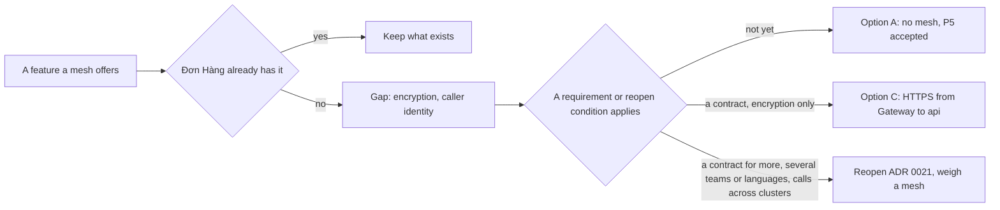

## Before you start

- [[k8s.l4.sidecar-proxies]] — you know a service mesh adds a proxy beside every app, gives each workload a certificate and configures every proxy from the API server.
- [[management.l3.self-hosting-costs]] — you know a component the team runs itself brings recurring work: upgrades, monitoring, and someone who understands it when it fails.
- [[backend.l4.api-gateway]] — you know the Gateway routes requests to the api and Payments, which still check every token themselves.
- [[management.l3.weighing-options-in-an-adr]] — you know an ADR weighs each real option, keeping things as they are among them, and names what would reopen it.

## The situation

The sidecar lab worked: two Caddy proxies did mTLS, and neither app held a key. At planning, a teammate proposes: install a service mesh on staging and close finding P5 of `threat-model.md`, the Gateway calling the api and Payments over plain HTTP, for good. Someone asks what it would cost. The mesh would put a proxy into every Pod of the api, Notifications and Payments, and its own programs would join Argo CD on the team's list of things to upgrade. Yet most of what a mesh offers, Đơn Hàng seems to do already in some other way. What would a mesh buy Đơn Hàng that it lacks, and when is that worth its price?

## Core concepts

- The cost of a mesh (a plain phrase, used in this sense here) — what a mesh charges every Pod, every call and the team: with a sidecar mesh, a proxy's memory and CPU, an extra hop (each call passes through the proxies on its way to the app), and controllers, the programs the mesh runs in the cluster to hand out certificates and configure every proxy, to upgrade and understand.
- A gap (a plain phrase, used in this sense here) — a need named in the threat model that nothing Đơn Hàng runs today covers.
- A reopen condition — a change, named in an ADR, that sends the team back to decide again.
- ADR `0021` — Đơn Hàng's record that declines a service mesh for now and keeps finding P5 accepted.

## How it works



A mesh is paid for before it does anything. With a sidecar mesh, every Pod gets a proxy, which takes memory and CPU there, and every call takes an extra hop through the proxies. Its controllers become one more platform component: upgraded, watched, and understood by someone when it breaks, the recurring work that `self-run-components.md` lists. And because its proxies sit in every call path, one wrong mesh setting or a failed mesh upgrade can break calls between all services at once. Its blast radius is every call inside the cluster.

The diagram takes a mesh's features one at a time. The first question for each is whether Đơn Hàng already has it some other way. Five of the seven features ADR `0021` lists are covered: NetworkPolicies decide who connects, the api and Payments check every token, Payments has a resilience pipeline, all three services record traces with OpenTelemetry, and HTTPRoute weights split traffic for a canary.

Two features are left: encrypting calls inside the cluster, and knowing the caller by something other than its address. These are the gaps. A gap alone does not justify the cost, so the second question is whether any requirement asks to fill it.

ADR `0021` weighs three options: A, no mesh, with P5 kept accepted; B, a mesh for mTLS between all services; C, the api serves HTTPS with a certificate from cert-manager and the Gateway calls it over HTTPS. Today no requirement asks, so the ADR picks A. If a contract asks only for encryption, C comes first. A contract that asks for more than encryption, more teams or languages, or calls between clusters send the team back to weigh a mesh.

## In the Đơn Hàng system

ADR `0021` starts from finding P5 of `threat-model.md`: the Gateway calls the api and Payments Pods over plain HTTP, NetworkPolicies limit who connects, and the api knows a caller only by its address. Its context section then maps what a mesh does to what Đơn Hàng already has:

```markdown file=docs/adr/0021-chua-dung-service-mesh.md tag=stage-4 lines=17-30
Đơn Hàng có ba service .NET (api, Notifications, Payments) và một nhóm. Những
gì mesh làm được, so với những gì đã có:

| Mesh làm được | Đơn Hàng đã có |
|---|---|
| Quyết định ai được gọi ai | NetworkPolicy cho ingress và egress của từng service |
| Kiểm bên gọi ở mức request | Token của Keycloak, kiểm bằng `AddJwtBearer` trong api và Payments |
| Retry, timeout, circuit breaker | Resilience pipeline của Payments khi gọi cổng thanh toán |
| Trace qua các service | OpenTelemetry trong cả ba service |
| Chia traffic cho canary | Trọng số của HTTPRoute (ADR 0019) |
| Mã hóa lời gọi trong cluster | Chưa có |
| Danh tính của bên gọi không dựa vào địa chỉ | Chưa có |

Hai dòng cuối là hai khoảng trống thật.
```

Line 17 sets the scale: three .NET services, the api, Notifications and Payments, and one team. Lines 22–26 are the five features already covered, the five the section above listed; line 26 points to ADR `0019` for the canary weights. Lines 27–28, encryption inside the cluster and a caller identity that does not depend on its address, have nothing on the right; line 30 calls them the two real gaps.

Between the excerpts, lines 32–38 list options A, B and C as above; C adds nothing new beside any Pod. Lines 40–47 give the cost of B, the one described in the section above.

```markdown file=docs/adr/0021-chua-dung-service-mesh.md tag=stage-4 lines=49-70
### Quyết định

Chọn A. Với ba service .NET và một nhóm, mesh chỉ lấp hai khoảng trống mà
chưa yêu cầu nào đòi lấp, và cái giá của nó trả cho mọi Pod, mọi lời gọi. P5
vẫn ở trạng thái chấp nhận.

Nếu chỉ cần mã hóa, C là bước đầu: nó lấp khoảng trống ở chặng lộ ra nhiều
nhất (từ Gateway vào) với chi phí nhỏ nhất.

### Hệ quả

- Lời gọi trong cluster vẫn không mã hóa; NetworkPolicy vẫn là lớp quyết định
  ai được kết nối.
- Không có thêm thành phần nào để nâng cấp hay diễn tập.

Ba điều kiện mở lại:

- Một hợp đồng đòi mã hóa lời gọi bên trong cluster. Nếu chỉ đòi mã hóa, làm
  C trước khi tính tới mesh.
- Service đến từ nhiều nhóm hoặc nhiều ngôn ngữ, nên mỗi codebase tự làm
  mutual TLS, retry và số đo theo lời gọi trở nên đắt hơn một mesh.
- Service bắt đầu gọi nhau giữa các cluster.
```

Lines 51–53 choose A: with three .NET services and one team, a mesh would fill only two gaps that no requirement asks to fill, at a price paid by every Pod and every call. Lines 55–56 keep C as the first step if only encryption is needed, since it covers the most exposed leg, from the Gateway in, at the lowest cost. Line 72 of `threat-model.md` records P5 as accepted for one cluster and one team, with NetworkPolicies already limiting callers, and points to this ADR for the conditions to reopen it.

Lines 64–70 are those conditions: a contract that requires encryption inside the cluster, with C done first if encryption is all it asks; services from several teams or languages; and services that start calling each other across clusters. The ADR's reasoning is that, once many services come in many languages, building mTLS, retries and per-call metrics into every codebase can cost more than a mesh. With three .NET services and one team, Đơn Hàng is not there yet.

Below the excerpt, lines 74–77 record that a backend developer asked for C now. The team declined: the api's certificate adds a renewal and one more thing that can break on the main way in, for a gap nobody has asked to fill.

## Trade-offs

| | A: no mesh (chosen) | B: a mesh for mTLS everywhere | C: HTTPS from the Gateway to the api |
|---|---|---|---|
| Calls encrypted inside the cluster | None | Every call between services | Only Gateway to api; calls to Payments stay plain |
| Caller known by more than its address | No | Yes, by its certificate | No: only the api shows a certificate |
| New things to run | Nothing | A proxy in every Pod and the mesh's controllers | One certificate for the api, renewed by cert-manager |
| Cost on every call | None | An extra hop through the proxies | TLS on the calls from the Gateway to the api |
| What one mistake can break | Nothing new | Calls between all services at once | The main way in, from the Gateway to the api |

## What would you choose if…

- …a customer's contract requires calls from the Gateway into the api to be encrypted, and says nothing about who the caller is: option C, the first step the ADR names. A mesh enters the discussion only if the contract asks for more.
- …a second team starts a service in another language that needs mTLS, retries and per-call metrics of its own: the second reopen condition. Reopen ADR `0021` and weigh a mesh against building the same work into a second codebase.
- …services in the `donhang-north` cluster begin calling services in the `donhang-south` cluster: the third condition. Reopen the ADR before the first such call ships, because the acceptance of P5 assumed one cluster.

## Seniors often assume…

- **"Every production Kubernetes cluster should run a service mesh."** → Actually a mesh pays off only when it buys something the team needs and lacks: a gap a requirement asks to fill, or work that would otherwise be rebuilt in every codebase. Its cost lands on every Pod and every call either way. For Đơn Hàng, five of its seven features are covered, and no requirement asks for the other two. You notice this when a mesh proposal lists retries, traces and canary splits as reasons, and each one already has a row on the right of ADR `0021`'s table.
- **"A service mesh is the only way to encrypt traffic between Pods."** → Actually an app can serve TLS itself: the mutual TLS lab did mTLS in Caddy with no mesh, and option C has the api serve HTTPS with a certificate from cert-manager. A mesh automates encryption for every Pod; it is not the only way to get it. You notice this when a contract asks only for encryption and the ADR's first step is C, with nothing new beside any Pod.
- **"Without a mesh, services have no retries, timeouts or per-call metrics."** → Actually Đơn Hàng builds such work into a service's own code where it is needed: Payments wraps its calls to the outside payment gateway (not the Gateway in front of the api) in a timeout and a circuit breaker, and all three services record traces of their calls with OpenTelemetry. The catch is that each exists only where someone wrote it. You notice this when you look for the resilience pipeline and find it only in `DonHang.Payments/Program.cs`, around the payment gateway's client.

## Try it (3 minutes)

Three requests reach the team in the same sprint. For each, use the table of ADR `0021` (lines 20–28) and its decision and reopen conditions (lines 49–70) to decide: keep option A, do option C, or reopen the ADR.

1. A partner bank's contract requires requests from the Gateway into the api to be encrypted. It says nothing about the caller.
2. A teammate wants a mesh so that calls between the services show up in traces.
3. A new team will write a recommendation service in Python that calls the api and needs mTLS, retries and per-call metrics.

Expected result: one line per request naming A, C or reopen, and the line of the ADR that decides it.

<details><summary>Suggested answer</summary>

1. Option C. The contract asks only for encryption, so lines 66–67 send the team to C before any mesh: the api serves HTTPS with a certificate from cert-manager, and the Gateway calls it over HTTPS.
2. Keep A. Line 25 already covers traces across the services with OpenTelemetry. A covered feature is not a gap.
3. Reopen. Lines 68–69 name services from several teams or languages as the second condition: building mTLS, retries and per-call metrics into a Python codebase as well may now cost more than a mesh. Reopening means weighing the options again, not installing a mesh by default.

</details>

## Connections

- [[k8s.l4.sidecar-proxies]] — what a mesh does; this lesson puts a price on it.
- [[backend.l4.threat-modeling]] — where finding P5 was recorded and accepted; ADR `0021` is the decision behind that acceptance.
- [[k8s.l3.network-policies]] — the layer that still decides who connects while calls inside the cluster stay unencrypted.
- [[devops.l4.release-strategy-per-component]] — ADR `0019`, whose HTTPRoute weights already cover the traffic split a mesh offers.
- [[design.l4.over-abstraction]] — the same reasoning in code: pay for something when a reason exists today, and name what would reopen it.
- [[management.l3.weighing-options-in-an-adr]] — the method ADR `0021` follows, with keeping things as they are as a real option.
- [[k8s.l4.managed-control-plane]] — next: which cluster work a provider can take off the team.

## Five-line summary

1. Đơn Hàng skips a service mesh until its cost, paid by every Pod and every call, buys something it lacks and needs.
2. A sidecar mesh adds a proxy per Pod, a hop per call and controllers to upgrade; one bad setting can break every call between services.
3. ADR `0021` maps mesh features to what exists: NetworkPolicies, token checks, a resilience pipeline, OpenTelemetry traces, HTTPRoute weights.
4. Encryption and caller identity inside the cluster are the gaps; no requirement asks for them, so finding P5 stays accepted.
5. A contract, several teams or languages, or calls across clusters reopen it; a contract for encryption alone gets option C first.
