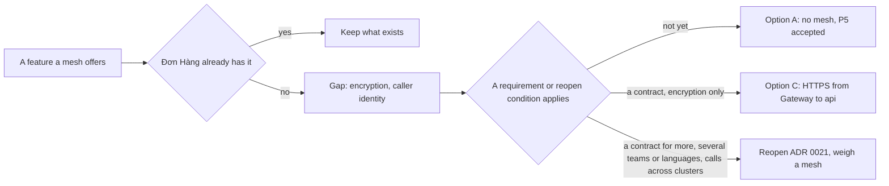

## Bạn cần biết trước

- [[k8s.l4.sidecar-proxies]] — bạn biết service mesh đặt một proxy cạnh mỗi ứng dụng, cấp cho mỗi workload một chứng chỉ và cấu hình mọi proxy từ API server.
- [[management.l3.self-hosting-costs]] — bạn biết một thành phần do đội tự chạy kéo theo việc lặp đi lặp lại: nâng cấp, theo dõi, và cần có người hiểu nó khi nó hỏng.
- [[backend.l4.api-gateway]] — bạn biết Gateway chuyển request tới api và Payments, còn hai service này vẫn tự kiểm mọi token.
- [[management.l3.weighing-options-in-an-adr]] — bạn biết một ADR cân từng lựa chọn thật, kể cả giữ nguyên hiện trạng, và ghi rõ điều gì sẽ mở lại nó.

## Tình huống

Lab sidecar đã chạy: hai proxy Caddy lo mTLS, và không ứng dụng nào giữ key. Trong buổi lập kế hoạch, một đồng đội đề xuất cài service mesh lên staging để đóng hẳn phát hiện P5 trong `threat-model.md`, tức chuyện Gateway gọi api và Payments bằng HTTP thường. Có người hỏi cái giá là bao nhiêu. Mesh sẽ đặt một proxy vào mọi Pod của api, Notifications và Payments, và các chương trình riêng của nó sẽ đứng cạnh Argo CD trong danh sách những thứ đội phải nâng cấp. Trong khi đó, phần lớn những gì mesh mang lại thì Đơn Hàng dường như đã làm theo cách khác. Vậy mesh mua được cho Đơn Hàng thứ gì mà hệ thống còn thiếu, và khi nào thứ đó đáng với cái giá phải trả?

## Khái niệm cốt lõi

- Cái giá của mesh (cụm từ thường, dùng theo nghĩa này ở đây) — những gì mesh tính lên mỗi Pod, mỗi lời gọi và cả đội: với sidecar mesh, đó là bộ nhớ và CPU của một proxy, một chặng thêm (mỗi lời gọi đi qua các proxy trước khi tới ứng dụng), và các controller, tức những chương trình mesh chạy trong cluster để cấp chứng chỉ và cấu hình mọi proxy, thứ đội phải nâng cấp và hiểu.
- Khoảng trống (cụm từ thường, dùng theo nghĩa này ở đây) — một nhu cầu có tên trong mô hình mối đe dọa mà chưa thứ gì Đơn Hàng đang chạy đáp ứng.
- Điều kiện mở lại — một thay đổi, được ghi tên trong ADR, khiến đội phải quyết định lại từ đầu.
- ADR `0021` — bản ghi của Đơn Hàng từ chối service mesh ở thời điểm này và giữ phát hiện P5 ở trạng thái chấp nhận.

## Cơ chế hoạt động



Mesh bắt bạn trả tiền trước khi nó làm được gì. Với sidecar mesh, Pod nào cũng có một proxy chiếm bộ nhớ và CPU ở đó, và lời gọi nào cũng thêm một chặng qua các proxy. Các controller của nó thành thêm một thành phần nền tảng: phải nâng cấp, phải theo dõi, và phải có người hiểu khi nó hỏng, đúng những việc lặp lại mà `self-run-components.md` liệt kê. Và vì proxy của nó nằm trên đường đi của mọi lời gọi, chỉ một thiết lập mesh sai hay một lần nâng cấp mesh thất bại cũng có thể làm hỏng lời gọi giữa tất cả service cùng lúc. Phạm vi ảnh hưởng của nó là mọi lời gọi trong cluster.

Sơ đồ xét từng tính năng của mesh. Câu hỏi đầu tiên cho mỗi tính năng là Đơn Hàng đã có nó theo cách khác chưa. Năm trong bảy tính năng ADR `0021` liệt kê đã có chỗ lo: NetworkPolicy quyết định ai được kết nối, api và Payments kiểm mọi token, Payments có resilience pipeline, cả ba service ghi trace bằng OpenTelemetry, và trọng số của HTTPRoute chia traffic cho canary.

Còn lại hai tính năng: mã hóa lời gọi bên trong cluster, và nhận ra bên gọi bằng thứ gì đó ngoài địa chỉ của nó. Đây là các khoảng trống. Một khoảng trống chưa đủ để biện minh cho cái giá, nên câu hỏi thứ hai là có yêu cầu nào đòi lấp nó không.

ADR `0021` cân ba lựa chọn. A: không dùng mesh, P5 vẫn ở trạng thái chấp nhận. B: dùng mesh để có mTLS giữa mọi service. C: api phục vụ HTTPS bằng chứng chỉ từ cert-manager, và Gateway gọi nó qua HTTPS. Hiện chưa yêu cầu nào đòi, nên ADR chọn A. Nếu một hợp đồng chỉ đòi mã hóa, C được làm trước. Một hợp đồng đòi nhiều hơn mã hóa, thêm đội hoặc thêm ngôn ngữ, hay lời gọi giữa các cluster thì đưa đội quay lại cân nhắc mesh.

## Trong hệ thống Đơn Hàng

ADR `0021` bắt đầu từ phát hiện P5 trong `threat-model.md`: Gateway gọi các Pod của api và Payments bằng HTTP thường, NetworkPolicy giới hạn ai được kết nối, và api chỉ biết bên gọi qua địa chỉ của nó. Phần bối cảnh của ADR sau đó đối chiếu những gì mesh làm với những gì Đơn Hàng đã có:

```markdown file=docs/adr/0021-chua-dung-service-mesh.md tag=stage-4 lines=17-30
Đơn Hàng có ba service .NET (api, Notifications, Payments) và một nhóm. Những
gì mesh làm được, so với những gì đã có:

| Mesh làm được | Đơn Hàng đã có |
|---|---|
| Quyết định ai được gọi ai | NetworkPolicy cho ingress và egress của từng service |
| Kiểm bên gọi ở mức request | Token của Keycloak, kiểm bằng `AddJwtBearer` trong api và Payments |
| Retry, timeout, circuit breaker | Resilience pipeline của Payments khi gọi cổng thanh toán |
| Trace qua các service | OpenTelemetry trong cả ba service |
| Chia traffic cho canary | Trọng số của HTTPRoute (ADR 0019) |
| Mã hóa lời gọi trong cluster | Chưa có |
| Danh tính của bên gọi không dựa vào địa chỉ | Chưa có |

Hai dòng cuối là hai khoảng trống thật.
```

Dòng 17 cho biết quy mô: ba service .NET, gồm api, Notifications và Payments, cùng một nhóm. Dòng 22–26 là năm tính năng đã có chỗ lo, đúng năm tính năng phần trên đã kể. Dòng 26 trỏ sang ADR `0019` cho trọng số canary. Dòng 27–28, mã hóa trong cluster và danh tính bên gọi không phụ thuộc địa chỉ, để trống ở cột phải. Dòng 30 gọi chúng là hai khoảng trống thật.

Giữa hai đoạn trích, dòng 32–38 liệt kê các lựa chọn A, B và C như trên. C không thêm gì mới cạnh Pod nào. Dòng 40–47 nêu cái giá của B, chính là cái giá phần trên đã mô tả.

```markdown file=docs/adr/0021-chua-dung-service-mesh.md tag=stage-4 lines=49-70
### Quyết định

Chọn A. Với ba service .NET và một nhóm, mesh chỉ lấp hai khoảng trống mà
chưa yêu cầu nào đòi lấp, và cái giá của nó trả cho mọi Pod, mọi lời gọi. P5
vẫn ở trạng thái chấp nhận.

Nếu chỉ cần mã hóa, C là bước đầu: nó lấp khoảng trống ở chặng lộ ra nhiều
nhất (từ Gateway vào) với chi phí nhỏ nhất.

### Hệ quả

- Lời gọi trong cluster vẫn không mã hóa; NetworkPolicy vẫn là lớp quyết định
  ai được kết nối.
- Không có thêm thành phần nào để nâng cấp hay diễn tập.

Ba điều kiện mở lại:

- Một hợp đồng đòi mã hóa lời gọi bên trong cluster. Nếu chỉ đòi mã hóa, làm
  C trước khi tính tới mesh.
- Service đến từ nhiều nhóm hoặc nhiều ngôn ngữ, nên mỗi codebase tự làm
  mutual TLS, retry và số đo theo lời gọi trở nên đắt hơn một mesh.
- Service bắt đầu gọi nhau giữa các cluster.
```

Dòng 51–53 chọn A: với ba service .NET và một nhóm, mesh chỉ lấp hai khoảng trống mà chưa yêu cầu nào đòi lấp, với cái giá mà mọi Pod và mọi lời gọi đều phải trả. Dòng 55–56 giữ C làm bước đầu nếu chỉ cần mã hóa, vì nó lo chặng lộ ra nhiều nhất, từ Gateway vào, với chi phí thấp nhất. Dòng 72 của `threat-model.md` ghi P5 là được chấp nhận với một cluster và một nhóm, khi NetworkPolicy đã giới hạn bên gọi, và trỏ sang ADR này cho các điều kiện mở lại.

Dòng 64–70 chính là các điều kiện đó: một hợp đồng đòi mã hóa bên trong cluster, khi đó làm C trước nếu hợp đồng chỉ đòi mã hóa, service đến từ nhiều nhóm hoặc nhiều ngôn ngữ, và service bắt đầu gọi nhau giữa các cluster. Lập luận của ADR là khi có nhiều service viết bằng nhiều ngôn ngữ, tự dựng mTLS, retry và số đo theo lời gọi trong từng codebase có thể tốn hơn một mesh. Với ba service .NET và một nhóm, Đơn Hàng chưa tới mức đó.

Bên dưới đoạn trích, dòng 74–77 ghi lại rằng một backend developer đã đề nghị làm C ngay. Đội từ chối: chứng chỉ của api thêm một lần gia hạn và thêm một thứ có thể hỏng trên lối vào chính, chỉ để lấp một khoảng trống chưa ai đòi.

## Đánh đổi

| | A: không dùng mesh (đã chọn) | B: mesh cho mTLS ở mọi nơi | C: HTTPS từ Gateway tới api |
|---|---|---|---|
| Lời gọi được mã hóa trong cluster | Không có | Mọi lời gọi giữa các service | Chỉ Gateway tới api, lời gọi tới Payments vẫn là HTTP thường |
| Nhận ra bên gọi bằng thứ khác ngoài địa chỉ | Không | Có, bằng chứng chỉ của nó | Không: chỉ api trình chứng chỉ |
| Thứ mới phải vận hành | Không có | Một proxy trong mỗi Pod và các controller của mesh | Một chứng chỉ cho api, do cert-manager gia hạn |
| Chi phí trên mỗi lời gọi | Không có | Thêm một chặng qua các proxy | TLS trên các lời gọi từ Gateway tới api |
| Một sai sót có thể làm hỏng gì | Không có gì mới | Lời gọi giữa mọi service cùng lúc | Lối vào chính, từ Gateway tới api |

## Bạn sẽ chọn gì nếu…

- …hợp đồng của một khách hàng đòi lời gọi từ Gateway vào api phải được mã hóa, và không nói gì về bên gọi là ai: lựa chọn C, bước đầu mà ADR đã nêu. Mesh chỉ được đem ra bàn nếu hợp đồng đòi nhiều hơn thế.
- …một đội thứ hai dựng service bằng ngôn ngữ khác, cần mTLS, retry và số đo theo lời gọi của riêng nó: điều kiện mở lại thứ hai. Mở lại ADR `0021` và cân mesh với việc dựng lại cùng phần việc đó trong codebase thứ hai.
- …các service trong cluster `donhang-north` bắt đầu gọi service trong cluster `donhang-south`: điều kiện thứ ba. Mở lại ADR trước khi lời gọi đầu tiên như thế lên production, vì việc chấp nhận P5 dựa trên giả định chỉ có một cluster.

## Senior hay nhầm rằng…

- **"Cluster Kubernetes production nào cũng nên chạy service mesh."** → Thực ra mesh chỉ đáng khi nó mua được thứ đội cần mà chưa có: một khoảng trống mà yêu cầu nào đó đòi lấp, hoặc phần việc lẽ ra phải dựng lại trong từng codebase. Dù thế nào, cái giá của nó vẫn đổ lên mọi Pod và mọi lời gọi. Với Đơn Hàng, năm trong bảy tính năng của mesh đã có chỗ lo, và chưa yêu cầu nào đòi hai tính năng còn lại. Bạn sẽ nhận ra khi một đề xuất mesh lấy retry, trace và chia traffic canary làm lý do, trong khi mỗi thứ đó đã có một dòng ở cột phải trong bảng của ADR `0021`.
- **"Service mesh là cách duy nhất để mã hóa traffic giữa các Pod."** → Thực ra ứng dụng có thể tự phục vụ TLS: lab mutual TLS đã làm mTLS trong Caddy mà không cần mesh, và lựa chọn C cho api phục vụ HTTPS bằng chứng chỉ từ cert-manager. Mesh tự động hóa mã hóa cho mọi Pod, nhưng không phải cách duy nhất để có nó. Bạn sẽ nhận ra khi một hợp đồng chỉ đòi mã hóa và bước đầu của ADR là C, không thêm gì mới cạnh Pod nào.
- **"Không có mesh thì service không có retry, timeout hay số đo theo lời gọi."** → Thực ra Đơn Hàng dựng những phần việc đó ngay trong code của service, ở chỗ cần: Payments bọc các lời gọi tới cổng thanh toán bên ngoài (không phải Gateway đứng trước api) trong một timeout và một circuit breaker, và cả ba service ghi trace các lời gọi bằng OpenTelemetry. Điểm cần để ý là mỗi thứ chỉ có ở nơi có người viết nó. Bạn sẽ nhận ra khi đi tìm resilience pipeline và chỉ thấy nó trong `DonHang.Payments/Program.cs`, quanh client của cổng thanh toán.

## Thử ngay (3 phút)

Ba yêu cầu đến với đội trong cùng một sprint. Với mỗi yêu cầu, dùng bảng của ADR `0021` (dòng 20–28) cùng phần quyết định và các điều kiện mở lại (dòng 49–70) để chọn: giữ lựa chọn A, làm lựa chọn C, hay mở lại ADR.

1. Hợp đồng của một ngân hàng đối tác đòi request từ Gateway vào api phải được mã hóa. Hợp đồng không nói gì về bên gọi.
2. Một đồng đội muốn dùng mesh để lời gọi giữa các service hiện lên trong trace.
3. Một đội mới sẽ viết service gợi ý sản phẩm bằng Python, gọi tới api và cần mTLS, retry cùng số đo theo lời gọi.

Kết quả mong đợi: mỗi yêu cầu một dòng, ghi A, C hay mở lại, kèm dòng của ADR quyết định điều đó.

<details><summary>Gợi ý đáp án</summary>

1. Lựa chọn C. Hợp đồng chỉ đòi mã hóa, nên dòng 66–67 đưa đội tới C trước mọi mesh: api phục vụ HTTPS bằng chứng chỉ từ cert-manager, và Gateway gọi nó qua HTTPS.
2. Giữ A. Dòng 25 đã lo trace qua các service bằng OpenTelemetry. Tính năng đã có chỗ lo thì không phải khoảng trống.
3. Mở lại. Dòng 68–69 nêu service từ nhiều nhóm hoặc nhiều ngôn ngữ là điều kiện thứ hai: dựng thêm mTLS, retry và số đo theo lời gọi trong một codebase Python có thể giờ đã tốn hơn một mesh. Mở lại nghĩa là cân lại các lựa chọn, không phải mặc định cài mesh.

</details>

## Liên hệ

- [[k8s.l4.sidecar-proxies]] — mesh làm gì. Bài này đặt giá cho nó.
- [[backend.l4.threat-modeling]] — nơi phát hiện P5 được ghi và được chấp nhận. ADR `0021` là quyết định đứng sau sự chấp nhận đó.
- [[k8s.l3.network-policies]] — lớp vẫn quyết định ai được kết nối trong khi lời gọi bên trong cluster chưa được mã hóa.
- [[devops.l4.release-strategy-per-component]] — ADR `0019`, nơi trọng số của HTTPRoute đã lo phần chia traffic mà mesh mang lại.
- [[design.l4.over-abstraction]] — cùng lập luận ấy trong code: chỉ trả giá khi lý do có ngay hôm nay, và ghi rõ điều gì sẽ mở lại quyết định.
- [[management.l3.weighing-options-in-an-adr]] — phương pháp ADR `0021` làm theo, trong đó giữ nguyên hiện trạng là một lựa chọn thật.
- [[k8s.l4.managed-control-plane]] — bài tiếp theo: phần việc nào của cluster mà nhà cung cấp có thể gánh thay đội.

## Tóm tắt 5 dòng

1. Đơn Hàng chưa dùng service mesh cho tới khi cái giá của nó, trả bởi mọi Pod và mọi lời gọi, mua được thứ hệ thống thiếu và cần.
2. Sidecar mesh thêm một proxy cho mỗi Pod, một chặng cho mỗi lời gọi và các controller phải nâng cấp. Một thiết lập sai có thể làm hỏng mọi lời gọi giữa các service.
3. ADR `0021` đối chiếu tính năng của mesh với thứ đã có: NetworkPolicy, kiểm token, resilience pipeline, trace OpenTelemetry, trọng số HTTPRoute.
4. Mã hóa và danh tính bên gọi trong cluster là các khoảng trống. Chưa yêu cầu nào đòi chúng, nên phát hiện P5 vẫn được chấp nhận.
5. Một hợp đồng, nhiều nhóm hoặc nhiều ngôn ngữ, hay lời gọi giữa các cluster sẽ mở lại ADR. Hợp đồng chỉ đòi mã hóa thì làm C trước.
