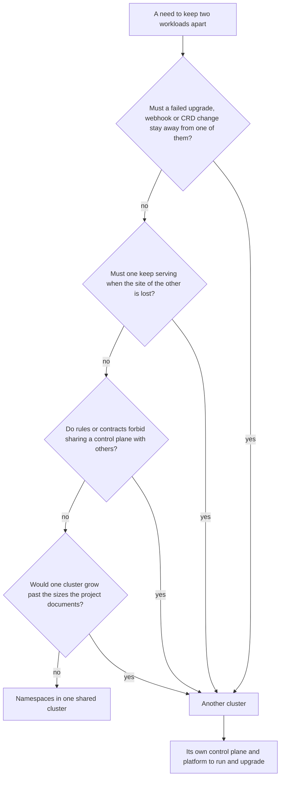

## Before you start

- [[k8s.l4.sharing-a-cluster]] — you know namespaces divide rights, connections, rules and room, but never the control plane, the nodes' kernel or CRDs.
- [[k8s.l3.cluster-upgrades]] — you know an upgrade moves the whole control plane one minor version, then every node, in one order.
- [[devops.l3.one-state-per-environment]] — you know staging and production each have their own OpenTofu folder and state, calling the same `kind-cluster` module.
- [[design.l4.architectural-drivers]] — you know a structure is chosen from the needs and constraints that shape it, not from a style.

## The situation

Đơn Hàng runs on `donhang-staging`, a one-node cluster that OpenTofu builds with kind, a tool that runs a whole Kubernetes cluster on one machine. Argo CD, the Git server and the whole backend run inside. Production's cluster, `donhang-production`, is only planned. A teammate suggests dropping it: production could be a namespace in the same cluster, with its own RoleBindings, NetworkPolicies and quota, and save a second control plane and Argo CD. Then you look at next month's plan: try the Kubernetes upgrade and a new CRD on staging first. Would a namespace keep those trials away from customers, and when is another cluster worth its cost?

## Core concepts

- **multi-cluster** — running one system on several clusters, each with its own control plane and its own platform; for Đơn Hàng, `donhang-staging` and `donhang-production`.
- Shared by one cluster (not a new term) — the control plane with its API server and etcd, the Kubernetes version, the network plugin, and objects that belong to no namespace, such as CRDs and admission webhook settings.
- Platform (not a new term) — the components a cluster runs before any application: in Đơn Hàng's `donhang-staging`, Argo CD, Traefik (which takes incoming traffic into the cluster) and a Sealed Secrets controller; a cluster that issues its own certificates also runs cert-manager.
- Boundary driver (not a new term) — a need that one cluster cannot meet however its namespaces are set up, and so the only good reason to add a cluster.

## How it works



Read the diagram from the top. In the situation above, the need is to keep production apart from staging, and the first question already answers it.

Everything in one cluster shares its control plane, etcd, network plugin and cluster-wide objects. A control plane upgrade moves the API server for every namespace at once. A CRD is one definition for the whole cluster, so a CRD changed for staging's trial applies to production's objects of that kind too. Each admission webhook's settings include a failure policy; with `Fail`, the API server rejects a matching request when it cannot reach the webhook's server, in every namespace the webhook matches. So a trial that goes wrong in staging's namespace can stop production's changes too, and no RoleBinding or quota prevents it.

The other questions name the other boundaries. A second site, one physical location with its own machines, power and network, keeps serving only if it does not share the first one's control plane, network and machines. Some customers' rules demand that nothing of theirs be shared with another customer, control plane included; nodes set aside inside one cluster still share its API server. And the Kubernetes project documents the largest cluster it is designed for, counted in nodes and Pods; past it, a team splits the load across several clusters.

Every "yes" ends in the same box: **multi-cluster**. Each cluster has its own control plane and its own platform, each with its own upgrades and its own on-call questions. That cost is why a team should reach this box through a driver, not a habit. If all four answers are no, the need ends in the other box: namespaces in one shared cluster, as in the last lesson.

## In the Đơn Hàng system

Production's cluster is a separate call to the same module:

```hcl file=deploy/tofu/envs/production/cluster/main.tf tag=stage-3 lines=1-13
# lesson: devops.l3.one-state-per-environment
# Production's cluster: the same kind-cluster module as staging, with a
# control plane and two workers. scripts/devops/tofu-environments.sh only
# plans it: in the lab nothing runs production.
terraform {
  required_version = "~> 1.10.0"
}

module "cluster" {
  source  = "../../../modules/kind-cluster"
  name    = "donhang-production"
  workers = 2
}
```

Line 10 is the same `source` as staging's `cluster/main.tf`, so both clusters come from one recipe. Line 11 gives a different `name`, so kind builds a separate cluster: its own control-plane node, its own etcd, its own network plugin. Line 12 gives it two workers, where staging has none. A Kubernetes upgrade or a new CRD tried on `donhang-staging` changes only that cluster's control plane; `donhang-production` keeps what it had until someone applies the change there. Lines 3–4 say the lab only plans production, so this boundary costs nothing until production runs.

What production adds is a second platform. The second block shows one piece of it:

```yaml file=deploy/sealed-secrets/controller.yaml tag=stage-3 lines=42-45
      # lesson: devops.l3.sealed-secrets
      # Changed from the release: never create a new sealing key on a schedule;
      # the only key is the one OpenTofu's platform layer installs.
      - args: ["--key-renew-period=0"]
```

By default the controller makes a new key on a schedule; `--key-renew-period=0` turns that off. "The release" is the controller manifest as the Sealed Secrets project publishes it.

Every cluster that holds SealedSecrets runs its own controller, and a controller left alone makes its own key pair when it finds none. A SealedSecret sealed with staging's certificate then cannot be opened by production's controller, and every secret must be sealed once per cluster.

Đơn Hàng avoids that on purpose: lines 43–44 say the only key is the one OpenTofu's platform layer installs, and both `envs/staging/platform/main.tf` and `envs/production/platform/main.tf` (not shown) read the same `secrets/sealing.crt` and `secrets/sealing.key`. One sealing serves both clusters; one leaked private half opens both clusters' secrets.

The same holds for the rest of the platform. Argo CD, the Git server and the controllers for secrets and incoming traffic each need recurring upgrades and checks, as `docs/team/self-run-components.md` lists for every self-run component. A second cluster doubles that list.

## Trade-offs

| | Production as a namespace in staging's cluster | One cluster per environment (Đơn Hàng's plan) | One cluster per team of one company | A cluster in a second site |
|---|---|---|---|---|
| A failed upgrade, CRD or webhook on staging | Reaches production | Stays in staging | Stays in that team's cluster | Stays in one site |
| The site or its machines lost | Everything stops | Everything in that site stops | Everything in that site stops | The other site can keep serving |
| Platforms to run and upgrade | One | One per environment | One per team | One per site |
| Secrets sealed | Once | Once per key; Đơn Hàng shares one key | Once per key | Once per key |
| Who can break everything at once | Anyone with cluster-wide rights | Rights per cluster | Rights per cluster | Rights per cluster |

## What would you choose if…

- …one product has staging and production, and upgrades are tried on staging first: a cluster per environment, because the trial is only a trial if a broken control plane in staging cannot touch production.
- …three teams of one company, under one on-call rotation, each ask for their own cluster to stop getting in each other's way: namespaces with their own bindings, policies and quotas, since none of the four drivers applies. Revisit it if one team needs a CRD version the others cannot use.
- …a customer's contract forbids sharing machines or a control plane with any other customer: a cluster for that customer is a real driver, and its platform cost belongs in the price of the contract.

## Seniors often assume…

- **"More clusters always means higher availability."** → Actually a second cluster helps only when it does not share the first one's failure: another site, its own control plane, traffic that can move to it, and the data it needs. Two clusters in one site, deployed from the same commit, can fail together, and each adds a platform to upgrade. You notice this when one bad commit or one expired certificate breaks both clusters in the same hour.
- **"Teams of the same company each need their own cluster to stop getting in each other's way."** → Actually namespaces with RoleBindings, NetworkPolicies and quotas already keep trusting teams apart; a cluster per team adds a control plane and a platform per team. You notice this when the team that runs the clusters spends its weeks upgrading copies of Argo CD and Traefik, and their versions drift apart.
- **"A SealedSecret committed once works on every cluster that syncs the repository."** → Actually only a controller holding the private half that matches the certificate it was sealed with can open it, and by default each controller makes its own key. Đơn Hàng's clusters share one key on purpose, so here it would work, at the price of one key opening both. You notice this when the SealedSecret exists in a new cluster, no Secret of its name appears, and the Pod that reads it never starts.

## Try it (3 minutes)

In the `don-hang` repository folder:

1. Run `git diff stage-3:deploy/tofu/envs/staging/cluster/main.tf stage-3:deploy/tofu/envs/production/cluster/main.tf`.
2. Note which lines differ, then decide which difference makes production a boundary that staging's trials cannot cross.

Expected result: only the comment at the top, `name`, `workers` and staging's `published_ports`, which lets your machine reach staging's Traefik, differ; `source`, `required_version` and the four outputs are the same.

<details><summary>Suggested answer</summary>

`name`. A different name makes kind build a separate cluster, with its own control plane, etcd and network plugin, so an upgrade or CRD tried on `donhang-staging` changes nothing in `donhang-production`. `workers` only sizes the cluster, and `published_ports` only lets your machine reach staging's Traefik. The shared `source` is what keeps the two clusters alike, so a trial on staging says something about production.

</details>

## Connections

- [[k8s.l4.sharing-a-cluster]] — the step before: what namespaces divide in one cluster; this lesson starts where they stop.
- [[k8s.l3.admission-policies]] — a rule the API server applies across namespaces; a broken webhook of that kind is one reason staging needs its own control plane.
- [[devops.l3.sealed-secrets]] — where Đơn Hàng's one sealing key came from; here it meets a second cluster.
- [[management.l3.self-hosting-costs]] — the same cost question one layer down: each cluster repeats the recurring work of every self-run component.
- [[k8s.l3.control-plane-ha]] — the boundary inside one cluster: three control-plane nodes survive a lost node, not a broken upgrade or a lost site.
- [[k8s.l4.one-argo-cd-many-clusters]] — next: deploying to several clusters from one Argo CD.

## Five-line summary

1. A second cluster pays off only when a driver needs a boundary one cluster cannot hold, because everything in a cluster shares its control plane.
2. A failed upgrade, broken webhook or new CRD can reach every namespace, so Đơn Hàng plans `donhang-production` apart from `donhang-staging`.
3. Other drivers: a second site that keeps serving when the first is lost, rules forbidding a shared control plane, and documented cluster size limits.
4. Each cluster runs and upgrades its own platform; a SealedSecret opens only where its key is, and Đơn Hàng shares one key.
5. Environments, and tenants that need a boundary one cluster cannot hold, justify a cluster each; teams of one company usually share one through namespaces.
