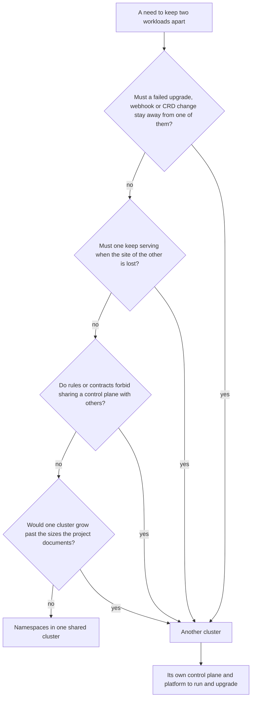

## Bạn cần biết trước

- [[k8s.l4.sharing-a-cluster]] — bạn biết namespace chia được quyền, kết nối, quy tắc và chỗ chạy, nhưng không bao giờ chia được control plane, kernel của các node hay CRD.
- [[k8s.l3.cluster-upgrades]] — bạn biết một lần nâng cấp đưa cả control plane lên một minor version, rồi tới từng node, theo đúng một thứ tự.
- [[devops.l3.one-state-per-environment]] — bạn biết staging và production mỗi bên có thư mục OpenTofu và state riêng, cùng gọi một module `kind-cluster`.
- [[design.l4.architectural-drivers]] — bạn biết một cấu trúc được chọn từ các nhu cầu và ràng buộc định hình nó, không phải từ một kiểu kiến trúc.

## Tình huống

Đơn Hàng chạy trên `donhang-staging`, một cluster một node do OpenTofu dựng bằng kind, công cụ chạy cả một cluster Kubernetes trên một máy. Argo CD, Git server và toàn bộ backend đều chạy bên trong. Cluster của production, `donhang-production`, mới chỉ nằm trong kế hoạch. Một đồng đội đề nghị bỏ nó đi: production có thể là một namespace trong chính cluster đó, với RoleBinding, NetworkPolicy và quota riêng, đỡ được một control plane và một Argo CD nữa. Rồi bạn nhìn kế hoạch tháng sau: thử nâng cấp Kubernetes và một CRD mới trên staging trước. Một namespace có giữ được các lần thử đó tránh xa khách hàng không, và khi nào thì thêm một cluster đáng với cái giá của nó?

## Khái niệm cốt lõi

- **multi-cluster** (Chạy cùng một hệ thống trên nhiều cluster, mỗi cluster có control plane và nền tảng riêng) — chạy một hệ thống trên nhiều cluster, mỗi cluster có control plane riêng và platform riêng. Với Đơn Hàng, đó là `donhang-staging` và `donhang-production`.
- Những gì một cluster dùng chung (không phải term mới) — control plane cùng API server và etcd, phiên bản Kubernetes, network plugin, và các object không thuộc namespace nào, như CRD và thiết lập của admission webhook.
- Platform (không phải term mới) — các thành phần một cluster chạy trước mọi ứng dụng. Trong `donhang-staging` của Đơn Hàng, đó là Argo CD, Traefik (nhận traffic từ ngoài vào cluster) và một controller Sealed Secrets. Cluster nào tự cấp certificate thì chạy thêm cert-manager.
- Yếu tố đòi ranh giới (không phải term mới) — một nhu cầu mà một cluster không đáp ứng được dù các namespace của nó được thiết lập thế nào, nên là lý do chính đáng duy nhất để thêm cluster.

## Cơ chế hoạt động



Đọc sơ đồ từ trên xuống. Trong tình huống trên, nhu cầu là tách production khỏi staging, và ngay câu hỏi đầu tiên đã có câu trả lời.

Mọi thứ trong một cluster dùng chung control plane, etcd, network plugin và các object toàn cluster. Nâng cấp control plane là đổi API server cho mọi namespace cùng lúc. CRD là một định nghĩa duy nhất cho cả cluster, nên một CRD đổi cho lần thử của staging cũng áp lên các object cùng loại của production. Thiết lập của mỗi admission webhook có một mục quy định cách xử lý khi lỗi. Với `Fail`, API server từ chối request khớp với webhook khi không gọi được tới server của webhook, ở mọi namespace mà webhook khớp. Vậy một lần thử hỏng trong namespace của staging cũng có thể chặn các thay đổi của production, và không RoleBinding hay quota nào ngăn được chuyện đó.

Các câu hỏi còn lại nêu những ranh giới khác. Một site thứ hai, tức một địa điểm thực có máy, nguồn điện và mạng riêng, chỉ tiếp tục phục vụ được khi nó không dùng chung control plane, mạng và máy với site thứ nhất. Quy định của một số khách hàng đòi không thứ gì của họ được dùng chung với khách hàng khác, kể cả control plane. Các node được dành riêng bên trong một cluster vẫn dùng chung API server của cluster đó. Còn dự án Kubernetes có ghi rõ cluster lớn nhất mà nó được thiết kế cho, tính bằng số node và số Pod. Vượt mức đó, đội sẽ chia tải ra nhiều cluster.

Mọi câu "yes" đều dẫn về cùng một ô: **multi-cluster**. Mỗi cluster có control plane riêng và platform riêng, kèm các đợt nâng cấp riêng và những câu hỏi riêng khi trực sự cố. Cái giá đó là lý do đội nên tới ô này vì một yếu tố đòi ranh giới, không phải vì thói quen. Nếu cả bốn câu đều là "no", nhu cầu kết thúc ở ô còn lại: các namespace trong một cluster dùng chung, như bài trước.

## Trong hệ thống Đơn Hàng

Cluster của production là một lần gọi riêng tới cùng module:

```hcl file=deploy/tofu/envs/production/cluster/main.tf tag=stage-3 lines=1-13
# lesson: devops.l3.one-state-per-environment
# Production's cluster: the same kind-cluster module as staging, with a
# control plane and two workers. scripts/devops/tofu-environments.sh only
# plans it: in the lab nothing runs production.
terraform {
  required_version = "~> 1.10.0"
}

module "cluster" {
  source  = "../../../modules/kind-cluster"
  name    = "donhang-production"
  workers = 2
}
```

Dòng 10 có cùng `source` với `cluster/main.tf` của staging, nên hai cluster ra từ một công thức. Dòng 11 đặt `name` khác, nên kind dựng một cluster riêng: node control plane riêng, etcd riêng, network plugin riêng. Dòng 12 cho nó hai worker, trong khi staging không có worker nào. Một lần nâng cấp Kubernetes hay một CRD mới thử trên `donhang-staging` chỉ đổi control plane của cluster đó. `donhang-production` giữ nguyên những gì nó có cho tới khi có người áp thay đổi lên đó. Dòng 3–4 nói lab chỉ plan production, nên ranh giới này chưa tốn gì cho tới khi production chạy thật.

Thứ production thêm vào là một platform thứ hai. Khối thứ hai cho thấy một phần của nó:

```yaml file=deploy/sealed-secrets/controller.yaml tag=stage-3 lines=42-45
      # lesson: devops.l3.sealed-secrets
      # Changed from the release: never create a new sealing key on a schedule;
      # the only key is the one OpenTofu's platform layer installs.
      - args: ["--key-renew-period=0"]
```

Mặc định controller tạo key mới theo lịch, và `--key-renew-period=0` tắt việc đó. "The release" là manifest của controller đúng như dự án Sealed Secrets công bố.

Cluster nào chứa SealedSecret cũng chạy controller riêng, và một controller để mặc định sẽ tự tạo cặp khóa khi không tìm thấy cặp nào. Khi đó một SealedSecret mã hóa bằng certificate của staging không mở được bằng controller của production, và mỗi secret phải mã hóa một lần cho mỗi cluster.

Đơn Hàng cố ý tránh chuyện đó: dòng 43–44 nói key duy nhất là key do tầng platform của OpenTofu cài, và cả `envs/staging/platform/main.tf` lẫn `envs/production/platform/main.tf` (không trích ở đây) đều đọc cùng `secrets/sealing.crt` và `secrets/sealing.key`. Một lần mã hóa dùng được cho cả hai cluster. Đổi lại, chỉ cần lộ một nửa bí mật là mở được secret của cả hai.

Phần còn lại của platform cũng vậy. Argo CD, Git server và các controller cho secret và traffic từ ngoài vào đều cần nâng cấp và kiểm tra định kỳ, như `docs/team/self-run-components.md` liệt kê cho từng thành phần tự vận hành. Cluster thứ hai nhân đôi danh sách đó.

## Đánh đổi

| | Production là một namespace trong cluster của staging | Mỗi môi trường một cluster (kế hoạch của Đơn Hàng) | Mỗi đội trong một công ty một cluster | Một cluster ở site thứ hai |
|---|---|---|---|---|
| Một lần nâng cấp, CRD hay webhook hỏng trên staging | Lan tới production | Ở lại trong staging | Ở lại trong cluster của đội đó | Ở lại trong một site |
| Mất site hoặc các máy của site | Mọi thứ dừng | Mọi thứ trong site đó dừng | Mọi thứ trong site đó dừng | Site còn lại có thể tiếp tục phục vụ |
| Số platform phải vận hành và nâng cấp | Một | Mỗi môi trường một | Mỗi đội một | Mỗi site một |
| Số lần mã hóa secret | Một lần | Mỗi key một lần, Đơn Hàng dùng chung một key | Mỗi key một lần | Mỗi key một lần |
| Ai có thể làm hỏng mọi thứ cùng lúc | Bất kỳ ai có quyền toàn cluster | Quyền theo từng cluster | Quyền theo từng cluster | Quyền theo từng cluster |

## Bạn sẽ chọn gì nếu…

- …một sản phẩm có staging và production, và các đợt nâng cấp được thử trên staging trước: mỗi môi trường một cluster, vì lần thử chỉ thật sự là thử khi một control plane hỏng ở staging không chạm được tới production.
- …ba đội cùng công ty, chung một lịch trực sự cố, mỗi đội xin một cluster riêng để khỏi vướng nhau: dùng namespace với binding, policy và quota riêng, vì không yếu tố nào trong bốn yếu tố đòi ranh giới áp dụng ở đây. Xem lại nếu một đội cần một phiên bản CRD mà các đội khác không dùng được.
- …hợp đồng của một khách hàng cấm dùng chung máy hay control plane với bất kỳ khách hàng nào khác: một cluster cho khách hàng đó là một yếu tố đòi ranh giới thật, và chi phí platform của nó phải tính vào giá hợp đồng.

## Senior hay nhầm rằng…

- **"Càng nhiều cluster thì tính sẵn sàng càng cao."** → Thực ra cluster thứ hai chỉ giúp khi nó không hỏng cùng kiểu với cluster thứ nhất, vì nó cần một site khác, control plane riêng, traffic chuyển sang được, và dữ liệu nó cần. Hai cluster trong một site, deploy từ cùng một commit, có thể hỏng cùng nhau, và mỗi cluster thêm một platform phải nâng cấp. Bạn sẽ nhận ra khi một commit lỗi hay một certificate hết hạn làm hỏng cả hai cluster trong cùng một giờ.
- **"Các đội cùng công ty, mỗi đội cần một cluster riêng để khỏi vướng nhau."** → Thực ra namespace với RoleBinding, NetworkPolicy và quota đã đủ tách các đội tin nhau, còn mỗi đội một cluster là thêm một control plane và một platform cho mỗi đội. Bạn sẽ nhận ra khi đội vận hành các cluster dành hết tuần này qua tuần khác để nâng cấp từng bản Argo CD và Traefik, và phiên bản của chúng lệch dần khỏi nhau.
- **"Một SealedSecret commit một lần là dùng được trên mọi cluster sync repo đó."** → Thực ra chỉ controller giữ nửa bí mật khớp với certificate đã dùng để mã hóa mới mở được nó, vì mặc định mỗi controller tự tạo key riêng. Các cluster của Đơn Hàng cố ý dùng chung một key, nên ở đây nó dùng được, với cái giá là một key mở được cả hai. Bạn sẽ nhận ra khi SealedSecret đã có trong một cluster mới mà không Secret nào cùng tên xuất hiện, và Pod đọc Secret đó không bao giờ khởi động.

## Thử ngay (3 phút)

Trong thư mục repo `don-hang`:

1. Chạy `git diff stage-3:deploy/tofu/envs/staging/cluster/main.tf stage-3:deploy/tofu/envs/production/cluster/main.tf`.
2. Ghi lại những dòng khác nhau, rồi quyết định khác biệt nào biến production thành một ranh giới mà các lần thử của staging không vượt qua được.

Kết quả mong đợi: chỉ comment ở đầu file, `name`, `workers` và `published_ports` của staging (cho máy bạn gọi được tới Traefik của staging) là khác nhau. `source`, `required_version` và bốn output thì giống nhau.

<details><summary>Gợi ý đáp án</summary>

`name`. Tên khác khiến kind dựng một cluster riêng, có control plane, etcd và network plugin riêng, nên một lần nâng cấp hay một CRD thử trên `donhang-staging` không đổi gì trong `donhang-production`. `workers` chỉ quyết định kích thước cluster, còn `published_ports` chỉ cho máy bạn gọi được tới Traefik của staging. Chính `source` dùng chung giữ cho hai cluster giống nhau, nhờ đó một lần thử trên staging mới nói được điều gì đó về production.

</details>

## Liên hệ

- [[k8s.l4.sharing-a-cluster]] — bước trước: những gì namespace chia được trong một cluster. Bài này bắt đầu từ chỗ namespace dừng lại.
- [[k8s.l3.admission-policies]] — một quy tắc API server áp lên mọi namespace. Một webhook kiểu đó bị hỏng là một lý do để staging cần control plane riêng.
- [[devops.l3.sealed-secrets]] — nơi sealing key duy nhất của Đơn Hàng ra đời. Ở đây nó gặp cluster thứ hai.
- [[management.l3.self-hosting-costs]] — cùng câu hỏi chi phí ở tầng dưới một bậc: mỗi cluster lặp lại phần việc định kỳ của mọi thành phần tự vận hành.
- [[k8s.l3.control-plane-ha]] — ranh giới bên trong một cluster: ba node control plane chịu được việc mất một node, nhưng không chịu được một lần nâng cấp hỏng hay mất cả site.
- [[k8s.l4.one-argo-cd-many-clusters]] — tiếp theo: deploy lên nhiều cluster từ một Argo CD.

## Tóm tắt 5 dòng

1. Cluster thứ hai chỉ đáng khi một yếu tố đòi ranh giới mà một cluster không giữ được, vì mọi thứ trong một cluster dùng chung control plane của nó.
2. Một lần nâng cấp hỏng, một webhook lỗi hay một CRD mới có thể lan tới mọi namespace, nên Đơn Hàng tách `donhang-production` khỏi `donhang-staging` ngay từ kế hoạch.
3. Các yếu tố khác: site thứ hai vẫn phục vụ khi site đầu mất, quy định cấm dùng chung control plane, và giới hạn kích thước cluster đã được ghi rõ.
4. Mỗi cluster tự vận hành và nâng cấp platform của mình, một SealedSecret chỉ mở được ở nơi có key của nó, và Đơn Hàng dùng chung một key.
5. Các môi trường, và các tenant cần ranh giới mà một cluster không giữ được, mỗi bên đáng một cluster, còn các đội cùng công ty thường dùng chung một cluster qua namespace.
