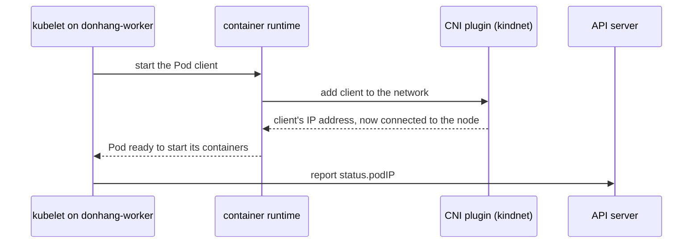

## Before you start

- [[k8s.l3.pod-network-model]] — every Pod has its own address and reaches every other Pod, on any node; that lesson said a component chosen when the cluster is built makes this true, and this lesson opens that component up.
- [[k8s.l1.control-plane-components]] — the kubelet on each node starts the containers of the Pods assigned to it and reports their status to the API server.
- [[k8s.l3.network-policies]] — the API server only stores NetworkPolicies; the component that wires Pods together enforces them, and on kind that component is kindnet.

## The situation

In the last lesson, a client Pod on `donhang-worker` called `echo-ip` on `donhang-worker2` at its Pod IP address, and the call simply worked. You list the Pods in `kube-system` and find three named `kindnet-...`, one for each node. Their addresses come from no node's Pod range: each has its node's own address, `172.22.0.x`. You never installed kindnet, and none of Đơn Hàng's manifests mention it. Yet the NetworkPolicies lesson said kindnet is what enforces staging's policies. What put kindnet there, and does every packet between Pods on different nodes pass through one of these Pods?

## Core concepts

- Container runtime — the program on each node that the kubelet asks to start containers; it also prepares each Pod's network before the Pod's containers run.
- **CNI plugin** (Container Network Interface plugin) — the component, installed with the cluster rather than with any application, that the container runtime calls when a Pod starts, to give the Pod its IP address and connect it to the node.
- kindnet — the CNI plugin kind installs in every cluster it builds by default, `donhang` included.
- Route — a line in a node's routing table that says "to reach this range of addresses, send the packet to this next address"; the node's operating system follows it for every packet it forwards. A packet is one unit of data the network carries, labelled with the address it is going to.

## How it works



In the situation above, the kubelet on `donhang-worker` asks the container runtime to start the Pod `client`, and the runtime calls the CNI plugin on the node. The plugin gives the Pod its address, connects it to the node and hands the address back. The runtime tells the kubelet the Pod is ready to start its containers; the kubelet reports the address to the API server as `status.podIP`.

Without a plugin, the runtime cannot connect any Pod that uses the Pod network, and the kubelet reports its node as `NotReady`. Every working cluster therefore needs one. kind installs kindnet while building `donhang`; with some other tools, whoever builds the cluster installs one as a separate step.

A packet for an address in `10.244.1.0/24` (every address starting `10.244.1.`; `donhang-worker2`'s range below) must reach that node. Each kindnet Pod writes on its node one route per other node's range, pointing at that node's address. The node's operating system then forwards Pod packets by those routes; kindnet keeps them current but never carries them.

A route only picks the next machine; the packet still carries the Pod address. On kind that is enough: the node containers share one Docker network, so the next machine is the node that owns the range. Nodes on separate networks pass packets through routers, machines joining networks that forward each packet by their own routes, which by default know nothing about Pod ranges. A plugin for such nodes can wrap each Pod packet inside one sent between the two node addresses, which routers deliver; the receiving node unwraps it.

So the plugin, chosen when the cluster is built, decides how Pod traffic travels and whether NetworkPolicies are enforced for every application on it: a decision about the cluster, not one application.

## In the Đơn Hàng system

```bash file=scripts/k8s/cni.sh tag=stage-3 lines=9-24
# lesson: k8s.l3.cni-plugins
# kind's network plugin, kindnet: one Pod on every node, the control-plane
# node included. It runs on the node's own network, so its address is the
# node's.
show kubectl get pods -n kube-system -l app=kindnet \
  -o custom-columns=POD:.metadata.name,ADDRESS:.status.podIP,NODE:.spec.nodeName
echo
show kubectl get nodes -o custom-columns=NODE:.metadata.name,ADDRESS:.status.addresses[0].address,POD-RANGE:.spec.podCIDR
echo

# lesson: k8s.l3.cni-plugins
# A node is a container, so docker exec reaches its own routing table.
# kindnet wrote one route per other node: that node's Pod range goes to that
# node's address, on the Docker network kind shares between the nodes.
echo "\$ docker exec donhang-worker ip route | grep via"
docker exec donhang-worker ip route | grep via
```

```text output=true
$ kubectl get pods -n kube-system -l app=kindnet -o custom-columns=POD:.metadata.name,ADDRESS:.status.podIP,NODE:.spec.nodeName
POD           ADDRESS      NODE
kindnet-...   172.22.0.2   donhang-control-plane
kindnet-...   172.22.0.4   donhang-worker...
kindnet-...   172.22.0.3   donhang-worker...

$ kubectl get nodes -o custom-columns=NODE:.metadata.name,ADDRESS:.status.addresses[0].address,POD-RANGE:.spec.podCIDR
NODE                    ADDRESS      POD-RANGE
donhang-control-plane   172.22.0.2   10.244.0.0/24
donhang-worker          172.22.0.3   10.244.2.0/24
donhang-worker2         172.22.0.4   10.244.1.0/24

$ docker exec donhang-worker ip route | grep via
default via 172.22.0.1 dev eth0 
10.244.0.0/24 via 172.22.0.2 dev eth0 
10.244.1.0/24 via 172.22.0.4 dev eth0 
```

`show`, a helper from `scripts/lib/network-lessons.sh` that the script loads first, prints a command after `$` and then runs it. The first command lists kindnet's Pods with their address and node, selected by the label `app=kindnet`; the second lists each node's address and Pod range. In the captured output the two worker names are shortened to `donhang-worker...`; your run shows `donhang-worker` and `donhang-worker2`, one kindnet Pod each. Compare the two lists: every kindnet Pod's address is a node address, because kindnet runs on the node's own network, not inside the Pod network. A Pod can be set to use its node's network instead of getting a Pod address, so kindnet's Pods need no plugin to start and can then set up the network for every other Pod.

The last command runs `ip route` inside the node container `donhang-worker` and keeps the lines with `via`, a next address; `dev eth0` names the node's network card on the Docker network, which you can ignore here. The `default` line covers every address no other line covers. The other two lines are kindnet's: `10.244.0.0/24`, the range of `donhang-control-plane`, goes to `172.22.0.2`, and `10.244.1.0/24`, the range of `donhang-worker2`, goes to `172.22.0.4`. Each points straight at the node that owns the range. The worker's own range, `10.244.2.0/24`, has no `via` line, because its Pods are on this node.

## Seniors often assume…

- **"Kubernetes itself assigns Pod IP addresses and moves packets between nodes."** → Actually the kubelet and the API server only report and store the address; the CNI plugin, called by the container runtime, gives it, and the plugin's routes or wrapping move the packets. You notice this when a cluster built without a plugin lists every node as `NotReady` in `kubectl get nodes`.
- **"kindnet's Pods forward every packet between nodes themselves."** → Actually they write routes into the node, and the node's operating system forwards packets by those routes. You notice this when `ip route` on `donhang-worker` shows each other node's range sent straight to that node's address: ordinary routes, with no program in between.
- **"Every cluster connects Pods the same way, so what you see on kind holds everywhere."** → Actually each cluster gets the plugin chosen when it was built: kind's plain routes work only because its nodes share one Docker network, and a plugin for nodes on separate networks may wrap packets instead. A plugin may also not enforce NetworkPolicies. You notice this when a NetworkPolicy that blocks connections on kind blocks nothing on a cluster whose plugin does not support NetworkPolicies, although the API server accepted it.

## Try it (3 minutes)

From the root of the Đơn Hàng repository, with Docker Desktop running:

1. Run `scripts/k8s/cni.sh`. If the cluster `donhang` is gone, the script builds it first, which takes longer.
2. In your own output, take each `via` line other than `default`. Find the node whose `ADDRESS` matches the address after `via`, and compare the range at the start of the line with that node's `POD-RANGE`.

Expected result: two lines besides `default`, one for each other node; each sends that node's `POD-RANGE` to that node's `ADDRESS`; no line names the range of `donhang-worker` itself.

<details><summary>Suggested answer</summary>

The node ranges in your run may differ from the captured ones, but the pattern holds: `donhang-worker` sends each other node's Pod range to that node's address. Those two routes are all kindnet needs on kind, because every node can reach every other node's address directly on the shared Docker network. On nodes in separate networks, joined by routers that are not told about Pod ranges, a plain route like these would not get a Pod packet across.

</details>

## Connections

- [[k8s.l3.pod-network-model]] — the rules this lesson shows being carried out: the CNI plugin is the component that gives each Pod its address and connects Pods across nodes.
- [[k8s.l3.network-policies]] — enforced by the CNI plugin, not by the API server, so the plugin chosen for a cluster decides whether those policies take effect.
- [[k8s.l1.cluster-nodes-and-control-plane]] — why plain routes are enough on kind: the nodes are Docker containers sharing one Docker network.
- [[k8s.l3.kube-proxy]] — the next lesson: the rules on every node that turn a Service's cluster IP into one of the Pod addresses this plugin gave out.

## Five-line summary

1. Kubernetes ships no Pod networking: the container runtime calls a CNI plugin, which gives each Pod its address and connects it to the node.
2. Without a CNI plugin, Pods on the Pod network cannot be connected and nodes stay `NotReady`, so every working cluster has one; kind installs kindnet.
3. kindnet runs one Pod per node, which writes a route per other node's Pod range, pointing at that node's address.
4. Plain routes suffice on kind's one Docker network; plugins for nodes on separate networks can wrap Pod packets between node addresses.
5. The plugin, chosen when the cluster is built, decides how Pod traffic travels and whether NetworkPolicies are enforced.
