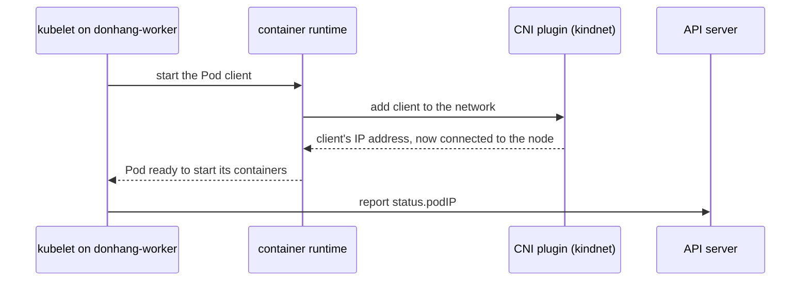

## Bạn cần biết trước

- [[k8s.l3.pod-network-model]] — mỗi Pod có địa chỉ riêng và tới được mọi Pod khác, trên bất kỳ node nào. Bài đó nói một thành phần được chọn lúc dựng cluster làm cho điều này thành sự thật, và bài này mở thành phần đó ra xem.
- [[k8s.l1.control-plane-components]] — kubelet trên mỗi node khởi động container của các Pod được gán vào node đó và báo trạng thái của chúng cho API server.
- [[k8s.l3.network-policies]] — API server chỉ lưu NetworkPolicy. Thành phần nối các Pod với nhau mới thực thi chúng, và trên kind thành phần đó là kindnet.

## Tình huống

Ở bài trước, một Pod client trên `donhang-worker` gọi `echo-ip` trên `donhang-worker2` bằng địa chỉ IP Pod của nó, và lời gọi cứ thế chạy. Bạn liệt kê các Pod trong `kube-system` và thấy ba Pod tên `kindnet-...`, mỗi node một Pod. Địa chỉ của chúng không thuộc dải Pod của node nào: mỗi Pod mang chính địa chỉ của node nó chạy, `172.22.0.x`. Bạn chưa hề cài kindnet, và không manifest nào của Đơn Hàng nhắc tới nó. Vậy mà bài NetworkPolicy nói kindnet là thứ thực thi các policy của staging. Cái gì đã đặt kindnet vào đó, và có phải mọi gói tin giữa các Pod trên hai node khác nhau đều đi qua một trong các Pod này không?

## Khái niệm cốt lõi

- Container runtime — chương trình trên mỗi node mà kubelet nhờ khởi động container. Nó cũng chuẩn bị mạng cho từng Pod trước khi các container của Pod chạy.
- **CNI plugin** (thành phần cài cùng cluster, cấp IP cho Pod và nối Pod vào mạng; thực thi NetworkPolicy nếu hỗ trợ) — viết tắt của Container Network Interface plugin. Nó được cài cùng cluster chứ không cùng ứng dụng nào, và container runtime gọi nó khi một Pod khởi động để cấp địa chỉ IP cho Pod và nối Pod vào node.
- kindnet — CNI plugin mà kind cài mặc định vào mọi cluster nó dựng, kể cả `donhang`.
- Route — một dòng trong bảng định tuyến của node, nói rằng "muốn tới dải địa chỉ này thì gửi gói tin tới địa chỉ kế tiếp này". Hệ điều hành của node làm theo nó với mọi gói tin nó chuyển tiếp. Gói tin là một đơn vị dữ liệu mà mạng chuyển đi, có ghi địa chỉ nơi nó cần tới.

## Cơ chế hoạt động



Trong tình huống trên, kubelet trên `donhang-worker` nhờ container runtime khởi động Pod `client`, và runtime gọi CNI plugin trên node. Plugin cấp địa chỉ cho Pod, nối Pod vào node rồi trả địa chỉ lại. Runtime báo kubelet rằng Pod đã sẵn sàng để khởi động các container. kubelet báo địa chỉ đó cho API server dưới dạng `status.podIP`.

Không có plugin, runtime không nối được Pod nào dùng mạng Pod, và kubelet báo node của nó là `NotReady`. Vì thế cluster nào chạy được cũng cần một plugin. kind cài kindnet trong lúc dựng `donhang`. Với một số công cụ khác, người dựng cluster cài plugin ở một bước riêng.

Một gói tin gửi tới địa chỉ trong `10.244.1.0/24` (mọi địa chỉ bắt đầu bằng `10.244.1.`, dải của `donhang-worker2` ở phần dưới) phải tới được node đó. Mỗi Pod kindnet ghi lên node của nó một route cho dải của từng node khác, trỏ tới địa chỉ của node ấy. Sau đó hệ điều hành của node chuyển tiếp gói tin của Pod theo các route này. kindnet giữ chúng luôn đúng nhưng không bao giờ tự chở gói tin.

Route chỉ chọn máy kế tiếp, còn gói tin vẫn mang địa chỉ Pod. Trên kind như vậy là đủ: các container node chung một Docker network, nên máy kế tiếp chính là node sở hữu dải. Các node nằm ở những mạng khác nhau thì chuyển gói tin qua router, tức máy nối các mạng và chuyển tiếp từng gói tin theo route của riêng nó. Mặc định, router không biết gì về dải Pod. Plugin cho những node như vậy có thể bọc từng gói tin Pod vào trong một gói tin gửi giữa hai địa chỉ node, thứ mà router giao được. Node nhận sẽ mở gói ra.

Vậy plugin, được chọn lúc dựng cluster, quyết định traffic giữa các Pod đi bằng cách nào và NetworkPolicy có được thực thi hay không, cho mọi ứng dụng trên cluster: đó là quyết định về cluster, không phải về một ứng dụng.

## Trong hệ thống Đơn Hàng

```bash file=scripts/k8s/cni.sh tag=stage-3 lines=9-24
# lesson: k8s.l3.cni-plugins
# kind's network plugin, kindnet: one Pod on every node, the control-plane
# node included. It runs on the node's own network, so its address is the
# node's.
show kubectl get pods -n kube-system -l app=kindnet \
  -o custom-columns=POD:.metadata.name,ADDRESS:.status.podIP,NODE:.spec.nodeName
echo
show kubectl get nodes -o custom-columns=NODE:.metadata.name,ADDRESS:.status.addresses[0].address,POD-RANGE:.spec.podCIDR
echo

# lesson: k8s.l3.cni-plugins
# A node is a container, so docker exec reaches its own routing table.
# kindnet wrote one route per other node: that node's Pod range goes to that
# node's address, on the Docker network kind shares between the nodes.
echo "\$ docker exec donhang-worker ip route | grep via"
docker exec donhang-worker ip route | grep via
```

```text output=true
$ kubectl get pods -n kube-system -l app=kindnet -o custom-columns=POD:.metadata.name,ADDRESS:.status.podIP,NODE:.spec.nodeName
POD           ADDRESS      NODE
kindnet-...   172.22.0.2   donhang-control-plane
kindnet-...   172.22.0.4   donhang-worker...
kindnet-...   172.22.0.3   donhang-worker...

$ kubectl get nodes -o custom-columns=NODE:.metadata.name,ADDRESS:.status.addresses[0].address,POD-RANGE:.spec.podCIDR
NODE                    ADDRESS      POD-RANGE
donhang-control-plane   172.22.0.2   10.244.0.0/24
donhang-worker          172.22.0.3   10.244.2.0/24
donhang-worker2         172.22.0.4   10.244.1.0/24

$ docker exec donhang-worker ip route | grep via
default via 172.22.0.1 dev eth0 
10.244.0.0/24 via 172.22.0.2 dev eth0 
10.244.1.0/24 via 172.22.0.4 dev eth0 
```

`show` là hàm trợ giúp trong `scripts/lib/network-lessons.sh`, file mà script nạp đầu tiên: nó in lệnh sau dấu `$` rồi chạy lệnh đó. Lệnh đầu liệt kê các Pod của kindnet kèm địa chỉ và node, chọn theo label `app=kindnet`. Lệnh thứ hai liệt kê địa chỉ và dải Pod của từng node. Trong output ghi lại, tên hai worker bị cắt thành `donhang-worker...`, còn lần chạy của bạn sẽ hiện `donhang-worker` và `donhang-worker2`, mỗi worker một Pod kindnet. So hai danh sách: địa chỉ của mọi Pod kindnet đều là địa chỉ node, vì kindnet chạy trên mạng riêng của node chứ không nằm trong mạng Pod. Một Pod có thể được cấu hình để dùng mạng của node thay vì nhận địa chỉ Pod. Nhờ vậy các Pod của kindnet khởi động được mà không cần plugin, rồi dựng mạng cho mọi Pod khác.

Lệnh cuối chạy `ip route` bên trong container node `donhang-worker` và giữ lại các dòng có `via`, tức một địa chỉ kế tiếp. `dev eth0` là card mạng của node trên Docker network, ở đây bạn bỏ qua được. Dòng `default` phủ mọi địa chỉ mà không dòng nào khác phủ. Hai dòng còn lại là của kindnet: `10.244.0.0/24`, dải của `donhang-control-plane`, đi tới `172.22.0.2`, còn `10.244.1.0/24`, dải của `donhang-worker2`, đi tới `172.22.0.4`. Mỗi dòng trỏ thẳng tới node sở hữu dải đó. Dải của chính worker này, `10.244.2.0/24`, không có dòng `via` nào, vì các Pod của nó nằm ngay trên node này.

## Senior hay nhầm rằng…

- **"Chính Kubernetes cấp địa chỉ IP cho Pod và chuyển gói tin giữa các node."** → Thực ra kubelet và API server chỉ báo và lưu địa chỉ. CNI plugin, do container runtime gọi, mới là thứ cấp địa chỉ, và route hoặc cách bọc gói tin của plugin mới chuyển gói tin đi. Bạn sẽ nhận ra khi một cluster dựng không có plugin liệt kê mọi node là `NotReady` trong `kubectl get nodes`.
- **"Các Pod của kindnet tự chuyển tiếp mọi gói tin giữa các node."** → Thực ra chúng ghi route vào node, rồi hệ điều hành của node chuyển tiếp gói tin theo các route đó. Bạn sẽ nhận ra khi `ip route` trên `donhang-worker` cho thấy dải của từng node khác được gửi thẳng tới địa chỉ của node ấy: route bình thường, không có chương trình nào đứng giữa.
- **"Cluster nào cũng nối Pod giống nhau, nên điều thấy trên kind đúng ở mọi nơi."** → Thực ra mỗi cluster dùng plugin được chọn lúc dựng nó: route thuần của kind chạy được chỉ vì các node chung một Docker network, còn plugin cho node ở các mạng khác nhau có thể bọc gói tin. Plugin cũng có thể không thực thi NetworkPolicy. Bạn sẽ nhận ra khi một NetworkPolicy chặn được kết nối trên kind lại không chặn gì trên cluster có plugin không hỗ trợ NetworkPolicy, dù API server đã nhận nó.

## Thử ngay (3 phút)

Ở thư mục gốc của repo Đơn Hàng, khi Docker Desktop đang chạy:

1. Chạy `scripts/k8s/cni.sh`. Nếu cluster `donhang` không còn, script dựng lại nó trước, nên sẽ lâu hơn.
2. Trong output của bạn, lấy từng dòng `via` trừ dòng `default`. Tìm node có `ADDRESS` trùng với địa chỉ sau `via`, rồi so dải ở đầu dòng với `POD-RANGE` của node đó.

Kết quả mong đợi: ngoài `default` có hai dòng, mỗi dòng cho một node khác. Mỗi dòng gửi `POD-RANGE` của node đó tới `ADDRESS` của chính node đó. Không dòng nào nhắc tới dải của `donhang-worker`.

<details><summary>Gợi ý đáp án</summary>

Dải của các node trong lần chạy của bạn có thể khác output ghi lại, nhưng quy luật vẫn giữ: `donhang-worker` gửi dải Pod của từng node khác tới địa chỉ của node ấy. Hai route đó là tất cả những gì kindnet cần trên kind, vì mọi node tới thẳng được địa chỉ của mọi node khác trên Docker network dùng chung. Với các node ở những mạng khác nhau, nối qua router không được báo về dải Pod, một route thuần như thế này sẽ không đưa được gói tin Pod sang bên kia.

</details>

## Liên hệ

- [[k8s.l3.pod-network-model]] — các luật mà bài này cho thấy đang được thực hiện: CNI plugin là thành phần cấp địa chỉ cho từng Pod và nối các Pod giữa các node.
- [[k8s.l3.network-policies]] — do CNI plugin thực thi chứ không phải API server, nên plugin chọn cho cluster quyết định các policy đó có hiệu lực hay không.
- [[k8s.l1.cluster-nodes-and-control-plane]] — lý do route thuần là đủ trên kind: các node là container Docker chung một Docker network.
- [[k8s.l3.kube-proxy]] — bài tiếp theo: các luật trên mọi node biến cluster IP của Service thành một trong các địa chỉ Pod mà plugin này đã cấp.

## Tóm tắt 5 dòng

1. Kubernetes không kèm sẵn mạng cho Pod: container runtime gọi một CNI plugin, và plugin cấp địa chỉ cho từng Pod rồi nối Pod vào node.
2. Không có CNI plugin thì Pod trên mạng Pod không nối được và node nằm ở `NotReady`, nên cluster nào chạy được cũng có một plugin. kind cài kindnet.
3. kindnet chạy mỗi node một Pod, Pod này ghi cho dải Pod của từng node khác một route trỏ tới địa chỉ của node ấy.
4. Route thuần là đủ trên Docker network duy nhất của kind. Plugin cho node ở các mạng khác nhau có thể bọc gói tin Pod giữa hai địa chỉ node.
5. Plugin, được chọn lúc dựng cluster, quyết định traffic giữa các Pod đi bằng cách nào và NetworkPolicy có được thực thi hay không.
