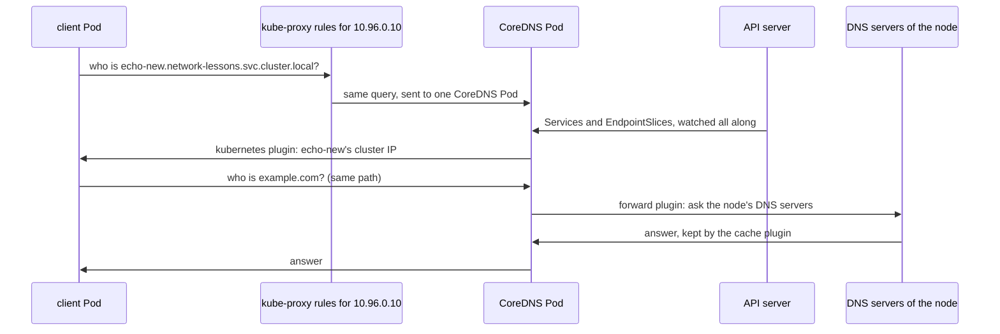

## Before you start

- [[k8s.l1.service-and-dns]] — a Pod with the default DNS settings has an `/etc/resolv.conf` naming the cluster DNS, the Service `kube-dns`; this lesson opens what stands behind that Service.
- [[k8s.l3.kube-proxy]] — kube-proxy watches Services and EndpointSlices and writes rules for each cluster IP; the cluster's DNS server watches the same objects and is itself reached through those rules.
- [[k8s.l1.configmaps]] — a ConfigMap keeps settings as a cluster object; here one ConfigMap holds the whole configuration of the DNS server.

## The situation

On the cluster `donhang` you run `kubectl create service clusterip echo-new -n network-lessons --tcp=80:8080`. One second later, a client Pod looks up `echo-new.network-lessons.svc.cluster.local` and gets an address back. Nobody edited a DNS record, a stored name-to-address entry a DNS server answers from. You only know that the cluster DNS sits behind the Service `kube-dns`. Then you read that this DNS server is just two ordinary Pods in `kube-system`, and that scaling them to zero once made lookups in a cluster fail, even of names outside the cluster. What answers behind `kube-dns`, and where does it get its answers?

## Core concepts

- **CoreDNS** — the cluster's DNS server, running as Pods in `kube-system` behind the Service `kube-dns`, which answers Service names from what it learns through the API server and forwards every other name to the node's DNS servers.
- Corefile — the text configuration of CoreDNS, stored in the ConfigMap `coredns`; it holds server blocks, groups of lines in braces, and each first-level line of a server block turns on one plugin, a part of CoreDNS that handles one job.
- The `kubernetes` plugin — the plugin that answers names under `cluster.local` from the Services and EndpointSlices it watches.
- The `forward` plugin — the plugin that sends a name CoreDNS cannot answer itself to other DNS servers.
- The `cache` plugin — the plugin that keeps answers for a limited number of seconds so a repeated question needs no new lookup.

## How it works



In the situation above, the client Pod's `/etc/resolv.conf` names `10.96.0.10`, the cluster IP of `kube-dns`. A lookup goes to that address on port 53, the DNS port, and the kube-proxy rules on the Pod's node send it to one CoreDNS Pod, as for any Service.

CoreDNS reads its Corefile from the ConfigMap `coredns`. The Corefile on `donhang` has one server block, `.:53`: `.` means every name and `53` the port. Each line at the first level of the block names one plugin; lines in braces under it are that plugin's options. Line order does not set the order in which plugins see a query: CoreDNS fixes that order when it is built. Three plugins matter here.

The `kubernetes` plugin owns names under `cluster.local`. It watches Services and EndpointSlices through the API server and answers from what it has seen, so the query for `echo-new` gets that Service's cluster IP. No one writes a DNS record for the Service: it resolves as soon as CoreDNS sees it, and once CoreDNS sees it deleted the name no longer resolves.

Any other name, such as `example.com`, goes on to the `forward` plugin. `forward . /etc/resolv.conf` sends it to the DNS servers listed in the CoreDNS Pod's own `/etc/resolv.conf`. The CoreDNS Pods do not use the default DNS settings: they are set to take the node's own settings, so that file lists the node's DNS servers, not `kube-dns`. If it named `kube-dns`, CoreDNS would send outside names back to itself.

`cache 30` keeps answers for at most 30 seconds, so a repeated outside name can be answered without asking the node's DNS servers again; its two `disable` lines turn caching off for `cluster.local`, so Service answers always come fresh.

## In the Đơn Hàng system

```bash file=scripts/k8s/coredns.sh tag=stage-3 lines=17-30
# lesson: k8s.l3.coredns
# The cluster's DNS server: CoreDNS Pods in kube-system, behind the Service
# kube-dns. Every Pod's resolv.conf names that Service's address.
show kubectl get pods -n kube-system -l k8s-app=kube-dns -o custom-columns=POD:.metadata.name,IMAGE:.spec.containers[0].image
show kubectl get service kube-dns -n kube-system
show kubectl exec client -n network-lessons -- grep nameserver /etc/resolv.conf
echo

# lesson: k8s.l3.coredns
# The Corefile, from the ConfigMap coredns: one server block for every
# name (.:53), one plugin per line.
echo "\$ kubectl get configmap coredns -n kube-system -o jsonpath='{.data.Corefile}'"
kubectl get configmap coredns -n kube-system -o jsonpath='{.data.Corefile}'
echo
```

```text output=true
$ kubectl get pods -n kube-system -l k8s-app=kube-dns -o custom-columns=POD:.metadata.name,IMAGE:.spec.containers[0].image
POD               IMAGE
coredns-...-...   registry.k8s.io/coredns/coredns:v1.12.1
coredns-...-...   registry.k8s.io/coredns/coredns:v1.12.1
$ kubectl get service kube-dns -n kube-system
NAME       TYPE        CLUSTER-IP   EXTERNAL-IP   PORT(S)                  AGE
kube-dns   ClusterIP   10.96.0.10   <none>        53/UDP,53/TCP,9153/TCP   ...
$ kubectl exec client -n network-lessons -- grep nameserver /etc/resolv.conf
nameserver 10.96.0.10

$ kubectl get configmap coredns -n kube-system -o jsonpath='{.data.Corefile}'
.:53 {
    errors
    health {
       lameduck 5s
    }
    ready
    kubernetes cluster.local in-addr.arpa ip6.arpa {
       pods insecure
       fallthrough in-addr.arpa ip6.arpa
       ttl 30
    }
    prometheus :9153
    forward . /etc/resolv.conf {
       max_concurrent 1000
    }
    cache 30 {
       disable success cluster.local
       disable denial cluster.local
    }
    loop
    reload
    loadbalance
}
...
```

`show`, a helper from `scripts/lib/network-lessons.sh`, prints a command after `$` and then runs it. The label `k8s-app=kube-dns` finds two CoreDNS Pods, both running CoreDNS 1.12.1. The Service `kube-dns` has the cluster IP `10.96.0.10`, the same address as the `nameserver` line in the client Pod, and lists port 53 twice because DNS can travel over TCP or over UDP, which sends single messages without opening a connection.

The Corefile is the text stored under the key `Corefile` of the ConfigMap. Find the `kubernetes`, `forward` and `cache` lines; only `cluster.local` on the `kubernetes` line matters here. The other lines turn on housekeeping plugins, such as `health` for health checks and `prometheus` for metrics on port 9153.

```bash file=scripts/k8s/coredns.sh tag=stage-3 lines=32-50
# lesson: k8s.l3.coredns
# The kubernetes plugin answers from what the API server holds: a Service
# created a moment ago resolves at once, with no DNS record written by hand.
kubectl delete service echo-new -n network-lessons --ignore-not-found >/dev/null
show kubectl create service clusterip echo-new -n network-lessons --tcp=80:8080
show kubectl exec client -n network-lessons -- getent hosts echo-new.network-lessons.svc.cluster.local
kubectl delete service echo-new -n network-lessons >/dev/null
echo

# lesson: k8s.l3.coredns
# No CoreDNS Pod: no name resolves, yet a connection to a Pod's address,
# which needs no lookup, still works.
pod_ip=$(kubectl get pods -n network-lessons -l app=echo-ip -o jsonpath='{.items[0].status.podIP}')
show kubectl scale deployment coredns -n kube-system --replicas=0
kubectl wait --for=delete pod -n kube-system -l k8s-app=kube-dns --timeout=120s >/dev/null
echo "\$ kubectl exec client -n network-lessons -- getent hosts echo-ip"
kubectl exec client -n network-lessons -- getent hosts echo-ip 2>&1 || echo "(no answer: exit $?)"
echo "\$ kubectl exec client -n network-lessons -- wget -qO- http://<an echo-ip Pod's address>:8080"
kubectl exec client -n network-lessons -- wget -qO- "http://$pod_ip:8080"
```

```text output=true
...
$ kubectl create service clusterip echo-new -n network-lessons --tcp=80:8080
service/echo-new created
$ kubectl exec client -n network-lessons -- getent hosts echo-new.network-lessons.svc.cluster.local
...   echo-new.network-lessons.svc.cluster.local   echo-new.network-lessons.svc.cluster.local

$ kubectl scale deployment coredns -n kube-system --replicas=0
deployment.apps/coredns scaled
$ kubectl exec client -n network-lessons -- getent hosts echo-ip
command terminated with exit code 2
(no answer: exit 2)
$ kubectl exec client -n network-lessons -- wget -qO- http://<an echo-ip Pod's address>:8080
echo-ip-...-... saw ...
```

The script creates `echo-new` and looks it up straight away with `getent hosts`, a command that resolves a name through the Pod's DNS settings and prints the address it gets. An answer comes back at once; the captured output hides the address behind `...`.

`echo-ip`, set up by the script outside these excerpts, is a Service in `network-lessons` whose Pods answer HTTP on port 8080 with their own name and the address they saw the call come from. The script saves the address of the first `echo-ip` Pod in `pod_ip`, then scales the CoreDNS Deployment to zero and waits until its Pods are gone. `getent hosts echo-ip` now gets no answer and exits with code 2. `wget -qO-`, a command that sends an HTTP `GET` to a URL and prints the response body, still gets a reply from one `echo-ip` Pod's address, because a connection to an address needs no lookup. A `trap` line near the top of the script, which runs a command when the script exits, scales CoreDNS back to two Pods, even after an error.

## Seniors often assume…

- **"Kubernetes writes a DNS record into a zone file whenever a Service is created."** → Actually there is no zone file, a file of DNS records a DNS server answers from: the `kubernetes` plugin answers each query from the Services and EndpointSlices it watches through the API server. You notice this when you look for the record to fix by hand and find only the Corefile in the ConfigMap `coredns`, with no line for any Service.
- **"Pods resolve outside names through the node directly, not through CoreDNS."** → Actually a Pod with the default DNS settings has only `kube-dns` in its `/etc/resolv.conf`, so a lookup of `example.com` also goes to CoreDNS, and the `forward` plugin passes it on to the node's DNS servers. You notice this when CoreDNS is down and outside names fail inside your Pods, while the same names still resolve on the node itself.
- **"A cluster keeps working normally while its DNS Pods are down, since Services have fixed IP addresses."** → Actually the addresses still work, but programs reach Services by name, and every new DNS lookup from a Pod with the default DNS settings fails. You notice this when many Pods start failing at once with name-resolution errors while all of them show `Running`, and a call from one of those Pods to another Pod's address still succeeds.

## Try it (3 minutes)

From the root of the Đơn Hàng repository, with Docker Desktop running (the cluster `donhang` runs inside it):

1. Run `scripts/k8s/coredns.sh`. If the cluster `donhang` is gone, the script builds it first, which takes longer.
2. In your own output, compare the `nameserver` line with the `CLUSTER-IP` of `kube-dns`, then find the line of the Corefile that names `/etc/resolv.conf`, and say in one sentence why the two addresses match and where that `forward` line sends outside names.

Expected result: the `nameserver` address equals the `CLUSTER-IP` of `kube-dns`; `/etc/resolv.conf` appears on the `forward` line; after the scale to zero, `getent hosts echo-ip` reports `exit 2` while `wget` to the Pod's address prints a reply.

<details><summary>Suggested answer</summary>

A Pod with the default DNS settings sends its lookups to the cluster IP of `kube-dns`, and kube-proxy's rules carry them to a CoreDNS Pod. The `forward` line says that names CoreDNS does not own go to the DNS servers in its own `/etc/resolv.conf`, which holds the node's settings. With no CoreDNS Pod, the Service has nowhere to send lookups, so names fail, while a connection to a Pod's address skips DNS entirely.

</details>

## Connections

- [[k8s.l1.service-and-dns]] — the same names seen from inside: the cluster DNS that lesson used is CoreDNS, answering from the API server.
- [[k8s.l3.kube-proxy]] — the layer below: the lookup reaches a CoreDNS Pod through the same kube-proxy rules as any other Service.
- [[k8s.l2.headless-services]] — the same `kubernetes` plugin answers a headless Service's name with its ready Pods' addresses instead of a cluster IP.
- [[foundation.l1.dns]] — the general lookup that lesson described; inside a cluster, CoreDNS is the first server a Pod with the default DNS settings asks.
- [[k8s.l3.dns-search-and-ndots]] — the next lesson: why one lookup of an outside name reaches CoreDNS as several queries.

## Five-line summary

1. CoreDNS, a few Pods behind the Service `kube-dns`, answers cluster names from the API server and forwards every other name.
2. With the default DNS settings, a Pod's `/etc/resolv.conf` names the cluster IP of `kube-dns`, so all its lookups, outside names included, go to CoreDNS.
3. The Corefile in the ConfigMap `coredns` turns on one plugin per first-level line; `kubernetes`, `forward` and `cache` do the main work.
4. The `kubernetes` plugin answers from the Services and EndpointSlices it watches, so a new Service resolves with no record written.
5. With CoreDNS scaled to zero, every DNS lookup from Pods with the default DNS settings fails, while connections to Pod addresses keep working.
