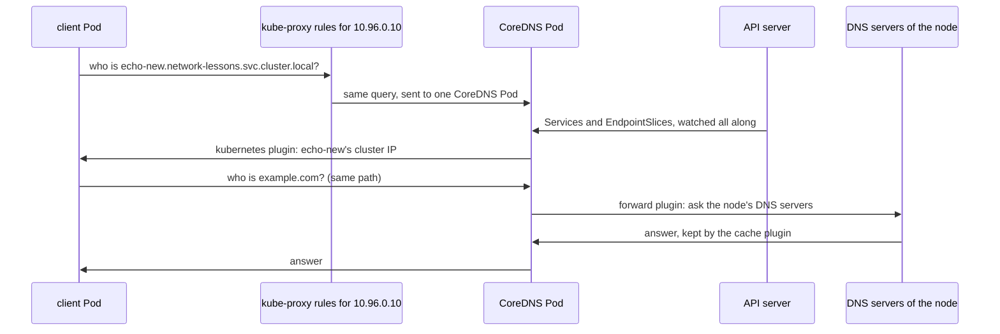

## Bạn cần biết trước

- [[k8s.l1.service-and-dns]] — Pod dùng thiết lập DNS mặc định có file `/etc/resolv.conf` trỏ tới cluster DNS, tức Service `kube-dns`. Bài này mở ra xem thứ gì đứng sau Service đó.
- [[k8s.l3.kube-proxy]] — kube-proxy theo dõi Service và EndpointSlice rồi ghi luật cho từng cluster IP. DNS server của cluster theo dõi đúng các object đó, và chính nó cũng được gọi tới qua các luật ấy.
- [[k8s.l1.configmaps]] — ConfigMap giữ thiết lập dưới dạng một object trong cluster. Ở đây, một ConfigMap chứa toàn bộ cấu hình của DNS server.

## Tình huống

Trên cluster `donhang`, bạn chạy `kubectl create service clusterip echo-new -n network-lessons --tcp=80:8080`. Một giây sau, một Pod client tra tên `echo-new.network-lessons.svc.cluster.local` và nhận về một địa chỉ. Không ai sửa DNS record nào, tức mục lưu sẵn cặp tên và địa chỉ mà DNS server dựa vào để trả lời. Bạn chỉ biết cluster DNS nằm sau Service `kube-dns`. Rồi bạn đọc được rằng DNS server này chỉ là hai Pod bình thường trong `kube-system`, và có lần scale chúng về 0 đã làm mọi lần tra tên trong cluster thất bại, kể cả tên nằm ngoài cluster. Thứ gì đang trả lời sau `kube-dns`, và nó lấy câu trả lời từ đâu?

## Khái niệm cốt lõi

- **CoreDNS** (DNS server của cluster: trả lời tên Service từ API, chuyển tiếp tên khác tới resolver của node) — DNS server của cluster, chạy dưới dạng các Pod trong `kube-system` sau Service `kube-dns`. Nó trả lời tên Service từ những gì biết được qua API server, và chuyển mọi tên khác tới các DNS server của node.
- Corefile — cấu hình dạng văn bản của CoreDNS, lưu trong ConfigMap `coredns`. Nó gồm các server block, tức các nhóm dòng nằm trong dấu ngoặc nhọn. Mỗi dòng cấp một của server block bật một plugin, một phần của CoreDNS lo đúng một việc.
- Plugin `kubernetes` — plugin trả lời các tên dưới `cluster.local` từ những Service và EndpointSlice nó theo dõi.
- Plugin `forward` — plugin gửi tên mà CoreDNS không tự trả lời được sang các DNS server khác.
- Plugin `cache` — plugin giữ câu trả lời trong một số giây giới hạn, để câu hỏi lặp lại không phải tra lại.

## Cơ chế hoạt động



Trong tình huống trên, `/etc/resolv.conf` của Pod client ghi `10.96.0.10`, cluster IP của `kube-dns`. Mỗi lần tra tên được gửi tới địa chỉ đó ở port 53, port của DNS. Các luật kube-proxy trên node của Pod chuyển nó tới một Pod CoreDNS, như với mọi Service khác.

CoreDNS đọc Corefile từ ConfigMap `coredns`. Corefile trên `donhang` có một server block, `.:53`: `.` nghĩa là mọi tên, còn `53` là port. Mỗi dòng ở cấp một của block gọi tên một plugin, các dòng trong ngoặc nhọn bên dưới là tùy chọn của plugin đó. Thứ tự các dòng không quyết định thứ tự plugin xem một câu hỏi: CoreDNS cố định thứ tự ấy từ lúc được build. Ở đây có ba plugin đáng chú ý.

Plugin `kubernetes` phụ trách các tên dưới `cluster.local`. Nó theo dõi Service và EndpointSlice qua API server rồi trả lời từ những gì đã thấy, nên câu hỏi về `echo-new` nhận được cluster IP của Service đó. Không ai viết DNS record cho Service: tên phân giải được ngay khi CoreDNS thấy Service, và khi CoreDNS thấy Service bị xóa thì tên thôi phân giải.

Mọi tên khác, chẳng hạn `example.com`, đi tiếp tới plugin `forward`. `forward . /etc/resolv.conf` gửi nó tới các DNS server ghi trong `/etc/resolv.conf` của chính Pod CoreDNS. Pod CoreDNS không dùng thiết lập DNS mặc định: chúng được đặt để lấy thiết lập của node, nên file đó liệt kê các DNS server của node chứ không phải `kube-dns`. Nếu file ghi `kube-dns`, CoreDNS sẽ gửi tên bên ngoài ngược về chính nó.

`cache 30` giữ câu trả lời tối đa 30 giây, nên một tên bên ngoài được hỏi lại có thể được trả lời mà không cần hỏi lại DNS server của node. Hai dòng `disable` của nó tắt cache cho `cluster.local`, nên câu trả lời về Service luôn mới.

## Trong hệ thống Đơn Hàng

```bash file=scripts/k8s/coredns.sh tag=stage-3 lines=17-30
# lesson: k8s.l3.coredns
# The cluster's DNS server: CoreDNS Pods in kube-system, behind the Service
# kube-dns. Every Pod's resolv.conf names that Service's address.
show kubectl get pods -n kube-system -l k8s-app=kube-dns -o custom-columns=POD:.metadata.name,IMAGE:.spec.containers[0].image
show kubectl get service kube-dns -n kube-system
show kubectl exec client -n network-lessons -- grep nameserver /etc/resolv.conf
echo

# lesson: k8s.l3.coredns
# The Corefile, from the ConfigMap coredns: one server block for every
# name (.:53), one plugin per line.
echo "\$ kubectl get configmap coredns -n kube-system -o jsonpath='{.data.Corefile}'"
kubectl get configmap coredns -n kube-system -o jsonpath='{.data.Corefile}'
echo
```

```text output=true
$ kubectl get pods -n kube-system -l k8s-app=kube-dns -o custom-columns=POD:.metadata.name,IMAGE:.spec.containers[0].image
POD               IMAGE
coredns-...-...   registry.k8s.io/coredns/coredns:v1.12.1
coredns-...-...   registry.k8s.io/coredns/coredns:v1.12.1
$ kubectl get service kube-dns -n kube-system
NAME       TYPE        CLUSTER-IP   EXTERNAL-IP   PORT(S)                  AGE
kube-dns   ClusterIP   10.96.0.10   <none>        53/UDP,53/TCP,9153/TCP   ...
$ kubectl exec client -n network-lessons -- grep nameserver /etc/resolv.conf
nameserver 10.96.0.10

$ kubectl get configmap coredns -n kube-system -o jsonpath='{.data.Corefile}'
.:53 {
    errors
    health {
       lameduck 5s
    }
    ready
    kubernetes cluster.local in-addr.arpa ip6.arpa {
       pods insecure
       fallthrough in-addr.arpa ip6.arpa
       ttl 30
    }
    prometheus :9153
    forward . /etc/resolv.conf {
       max_concurrent 1000
    }
    cache 30 {
       disable success cluster.local
       disable denial cluster.local
    }
    loop
    reload
    loadbalance
}
...
```

`show` là hàm trợ giúp trong `scripts/lib/network-lessons.sh`: nó in lệnh sau dấu `$` rồi chạy lệnh đó. Label `k8s-app=kube-dns` tìm ra hai Pod CoreDNS, cả hai chạy CoreDNS 1.12.1. Service `kube-dns` có cluster IP `10.96.0.10`, trùng với dòng `nameserver` trong Pod client. Nó liệt kê port 53 hai lần vì DNS có thể đi qua TCP hoặc qua UDP, giao thức gửi từng message riêng lẻ mà không mở kết nối.

Corefile là đoạn văn bản lưu dưới key `Corefile` của ConfigMap. Hãy tìm các dòng `kubernetes`, `forward` và `cache`. Trên dòng `kubernetes`, bạn chỉ cần để ý `cluster.local`. Các dòng còn lại bật những plugin lo việc phụ, như `health` để kiểm tra sức khỏe và `prometheus` để xuất metrics ở port 9153.

```bash file=scripts/k8s/coredns.sh tag=stage-3 lines=32-50
# lesson: k8s.l3.coredns
# The kubernetes plugin answers from what the API server holds: a Service
# created a moment ago resolves at once, with no DNS record written by hand.
kubectl delete service echo-new -n network-lessons --ignore-not-found >/dev/null
show kubectl create service clusterip echo-new -n network-lessons --tcp=80:8080
show kubectl exec client -n network-lessons -- getent hosts echo-new.network-lessons.svc.cluster.local
kubectl delete service echo-new -n network-lessons >/dev/null
echo

# lesson: k8s.l3.coredns
# No CoreDNS Pod: no name resolves, yet a connection to a Pod's address,
# which needs no lookup, still works.
pod_ip=$(kubectl get pods -n network-lessons -l app=echo-ip -o jsonpath='{.items[0].status.podIP}')
show kubectl scale deployment coredns -n kube-system --replicas=0
kubectl wait --for=delete pod -n kube-system -l k8s-app=kube-dns --timeout=120s >/dev/null
echo "\$ kubectl exec client -n network-lessons -- getent hosts echo-ip"
kubectl exec client -n network-lessons -- getent hosts echo-ip 2>&1 || echo "(no answer: exit $?)"
echo "\$ kubectl exec client -n network-lessons -- wget -qO- http://<an echo-ip Pod's address>:8080"
kubectl exec client -n network-lessons -- wget -qO- "http://$pod_ip:8080"
```

```text output=true
...
$ kubectl create service clusterip echo-new -n network-lessons --tcp=80:8080
service/echo-new created
$ kubectl exec client -n network-lessons -- getent hosts echo-new.network-lessons.svc.cluster.local
...   echo-new.network-lessons.svc.cluster.local   echo-new.network-lessons.svc.cluster.local

$ kubectl scale deployment coredns -n kube-system --replicas=0
deployment.apps/coredns scaled
$ kubectl exec client -n network-lessons -- getent hosts echo-ip
command terminated with exit code 2
(no answer: exit 2)
$ kubectl exec client -n network-lessons -- wget -qO- http://<an echo-ip Pod's address>:8080
echo-ip-...-... saw ...
```

Script tạo `echo-new` rồi tra tên nó ngay bằng `getent hosts`, lệnh phân giải một tên theo thiết lập DNS của Pod và in ra địa chỉ nhận được. Câu trả lời về ngay lập tức. Output ghi lại giấu địa chỉ sau `...`.

`echo-ip` được script dựng ở ngoài các đoạn trích này. Đó là một Service trong `network-lessons`, các Pod của nó trả lời HTTP ở port 8080 bằng tên của chính Pod và địa chỉ nơi lời gọi xuất phát. Script lưu địa chỉ của Pod `echo-ip` đầu tiên vào `pod_ip`, rồi scale Deployment CoreDNS về 0 và chờ tới khi các Pod của nó biến mất. Lúc này `getent hosts echo-ip` không nhận được câu trả lời và thoát với mã 2. `wget -qO-`, lệnh gửi HTTP `GET` tới một URL rồi in body của response, vẫn nhận được trả lời từ địa chỉ của một Pod `echo-ip`, vì kết nối tới một địa chỉ không cần tra tên. Gần đầu script có một dòng `trap`, dòng chạy một lệnh khi script kết thúc, để scale CoreDNS về lại hai Pod, kể cả khi có lỗi.

## Senior hay nhầm rằng…

- **"Mỗi khi tạo Service, Kubernetes ghi một DNS record vào zone file."** → Thực ra không có zone file nào, tức file chứa các DNS record mà DNS server dựa vào để trả lời. Plugin `kubernetes` trả lời từng câu hỏi từ các Service và EndpointSlice nó theo dõi qua API server. Bạn sẽ nhận ra khi đi tìm record để sửa tay và chỉ thấy Corefile trong ConfigMap `coredns`, không có dòng nào cho bất kỳ Service nào.
- **"Pod tra tên bên ngoài thẳng qua node, không đi qua CoreDNS."** → Thực ra Pod dùng thiết lập DNS mặc định chỉ có `kube-dns` trong `/etc/resolv.conf`, nên lần tra `example.com` cũng tới CoreDNS, rồi plugin `forward` chuyển nó tới các DNS server của node. Bạn sẽ nhận ra khi CoreDNS ngừng chạy và tên bên ngoài thất bại trong các Pod, trong khi chính những tên đó vẫn phân giải được trên node.
- **"Cluster vẫn chạy bình thường khi các Pod DNS ngừng, vì Service có địa chỉ IP cố định."** → Thực ra địa chỉ vẫn dùng được, nhưng chương trình gọi Service bằng tên, và mọi lần tra DNS mới từ Pod dùng thiết lập DNS mặc định đều thất bại. Bạn sẽ nhận ra khi nhiều Pod cùng lúc báo lỗi phân giải tên dù tất cả đều hiện `Running`, còn lời gọi từ một Pod trong số đó tới địa chỉ của Pod khác vẫn thành công.

## Thử ngay (3 phút)

Ở thư mục gốc của repo Đơn Hàng, khi Docker Desktop đang chạy (cluster `donhang` chạy bên trong nó):

1. Chạy `scripts/k8s/coredns.sh`. Nếu cluster `donhang` không còn, script dựng lại nó trước, nên sẽ lâu hơn.
2. Trong output của bạn, so dòng `nameserver` với `CLUSTER-IP` của `kube-dns`, rồi tìm dòng Corefile có `/etc/resolv.conf`. Giải thích trong một câu vì sao hai địa chỉ trùng nhau và dòng `forward` đó gửi tên bên ngoài đi đâu.

Kết quả mong đợi: địa chỉ ở dòng `nameserver` bằng `CLUSTER-IP` của `kube-dns`. `/etc/resolv.conf` nằm trên dòng `forward`. Sau khi scale về 0, `getent hosts echo-ip` báo `exit 2`, còn `wget` tới địa chỉ Pod vẫn in ra câu trả lời.

<details><summary>Gợi ý đáp án</summary>

Pod dùng thiết lập DNS mặc định gửi mọi lần tra tên tới cluster IP của `kube-dns`, và luật của kube-proxy đưa chúng tới một Pod CoreDNS. Dòng `forward` nói rằng tên nào CoreDNS không phụ trách thì gửi tới các DNS server trong `/etc/resolv.conf` của chính nó, file mang thiết lập của node. Khi không còn Pod CoreDNS nào, Service không có chỗ để gửi lần tra tên, nên tên thất bại, còn kết nối tới địa chỉ Pod thì bỏ qua DNS hoàn toàn.

</details>

## Liên hệ

- [[k8s.l1.service-and-dns]] — cũng những cái tên đó, nhìn từ bên trong: cluster DNS mà bài đó dùng chính là CoreDNS, trả lời từ API server.
- [[k8s.l3.kube-proxy]] — tầng bên dưới: lần tra tên tới Pod CoreDNS qua chính các luật kube-proxy như mọi Service khác.
- [[k8s.l2.headless-services]] — cũng plugin `kubernetes` đó trả lời tên của headless Service bằng địa chỉ các Pod đang ready thay vì cluster IP.
- [[foundation.l1.dns]] — quá trình tra tên tổng quát mà bài đó mô tả. Trong cluster, CoreDNS là server đầu tiên mà Pod dùng thiết lập DNS mặc định hỏi tới.
- [[k8s.l3.dns-search-and-ndots]] — bài tiếp theo: vì sao một lần tra tên bên ngoài lại tới CoreDNS thành nhiều câu hỏi.

## Tóm tắt 5 dòng

1. CoreDNS, vài Pod nằm sau Service `kube-dns`, trả lời tên trong cluster từ API server và chuyển tiếp mọi tên khác.
2. Với thiết lập DNS mặc định, `/etc/resolv.conf` của Pod ghi cluster IP của `kube-dns`, nên mọi lần tra tên, kể cả tên bên ngoài, đều tới CoreDNS.
3. Corefile trong ConfigMap `coredns` bật một plugin cho mỗi dòng cấp một. `kubernetes`, `forward` và `cache` làm phần việc chính.
4. Plugin `kubernetes` trả lời từ các Service và EndpointSlice nó theo dõi, nên Service mới phân giải được mà không cần viết record nào.
5. Khi CoreDNS bị scale về 0, mọi lần tra DNS từ Pod dùng thiết lập DNS mặc định đều thất bại, còn kết nối tới địa chỉ Pod vẫn chạy.
