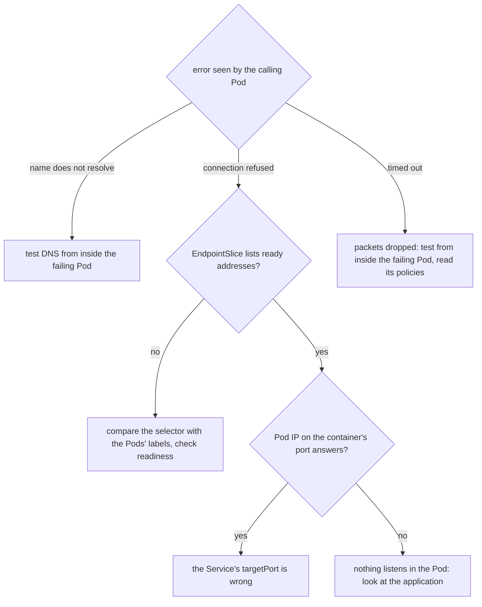

## Before you start

- [[k8s.l3.egress-policies]] — an egress policy that forgets DNS breaks every name lookup of the Pods it selects; this lesson finds that mistake from the outside.
- [[k8s.l3.dns-search-and-ndots]] — a Pod resolves names through the resolver settings the kubelet writes into its `/etc/resolv.conf`, which is where a name that does not resolve starts.
- [[k8s.l3.kube-proxy]] — kube-proxy's rules send a connection to a cluster IP on to one ready address from the Service's EndpointSlices.
- [[foundation.l1.tcp-vs-udp]] — a refused connection is an answer, while a timeout is no answer at all.

## The situation

You look after the lab cluster `donhang`, and three things in `network-lessons` fail at once. Two new Services, `broken-selector` and `broken-port`, refuse every call. A Pod named `caller` cannot reach `echo-ip`: inside it, the name gets no address, although `echo-ip`'s two Pods answer every other caller. All three were meant to reach the same Pods. Restarting changes nothing, and reading YAML line by line is slow when you do not know which line to read. Which checks, in which order, show where each connection breaks?

## Core concepts

- The error as evidence — what the calling Pod reports: a name with no address, `connection refused`, or a timeout, each pointing at a different part of the path.
- Ready endpoints (not an API's HTTP endpoints) — the addresses in a Service's EndpointSlices whose Pods are ready; these are the ones a Service normally sends new connections to.
- Bypass test — a connection to one Pod's IP address on the port its container listens on, which skips the cluster IP and the Service's ports.
- `kubectl debug` — a command that adds a temporary container, from an image you choose, to a running Pod; the container shares the Pod's network, so the Pod's NetworkPolicies apply to its connections.

## How it works



Start from what the calling Pod sees, not from the YAML. In the situation above, each failure gives a different error, and the error picks the branch.

A name that does not resolve means the lookup failed before any connection to the Service was tried. Test DNS from the Pod that fails, because its resolver settings and its policies decide whether it reaches CoreDNS. Policies select Pods by label, so a test from another Pod passes rules the failing Pod never meets. In the situation above, `caller` gets no address for `echo-ip`, and `kubectl debug` runs the DNS test inside `caller`, under `caller`'s own policies.

`Connection refused` is an answer. On `donhang`, a connection to a Service with no ready endpoints is refused at once, as `broken-selector` shows below, so the Service's EndpointSlice comes next. No address, or only addresses not ready, means the selector matches no Pod or the Pods fail their readiness probe. Compare the Service's `selector` with the Pods' labels.

If the EndpointSlice does list ready Pods, connect to one Pod's IP address on the port its container listens on. If that answers while the cluster IP is refused, the Service sends connections to a port nothing listens on: its `targetPort` is wrong. If the Pod refuses too, the problem is inside the Pod.

A timeout is no answer: something dropped the packets, and on `donhang` that is what a NetworkPolicy does. Test from inside the failing Pod for the same reason, then read the policies that select it.

## In the Đơn Hàng system

```bash file=scripts/k8s/network-debug.sh tag=stage-3 lines=24-43
# lesson: k8s.l3.debugging-pod-networking
# One: connection refused, and an empty EndpointSlice. The Service's
# selector matches no Pod: compare it with the Pods' labels.
echo "== broken-selector"
client_get http://broken-selector
slices broken-selector
show kubectl get service broken-selector -n network-lessons -o jsonpath='{.spec.selector}{"\n"}'
show kubectl get pods -n network-lessons -l app=echo-ip -o custom-columns=POD:.metadata.name,LABELS:.metadata.labels.app
echo

# lesson: k8s.l3.debugging-pod-networking
# Two: refused again, but the EndpointSlice lists both Pods, on port 80.
# A Pod's own address on the port it listens on answers, skipping the
# Service: the Service's targetPort is wrong.
echo "== broken-port"
client_get http://broken-port
slices broken-port
pod_ip=$(kubectl get pods -n network-lessons -l app=echo-ip -o jsonpath='{.items[0].status.podIP}')
client_get "http://$pod_ip:8080"
echo
```

Before this excerpt the script applies `broken-echo.yaml`, which holds all three faults. `broken-selector` selects `app: echo-pi`, a typo; its `targetPort` is 8080, the right one. `broken-port` selects the right Pods but sends port 80 to `targetPort: 80`, while `echo-ip`'s container listens on 8080.

`show`, `client_get` and `slices` are defined above the excerpt. `show` prints a command, then runs it. `client_get` runs `wget -T 5 -qO-` in the Pod `client`: `wget` fetches a URL over HTTP; `-T 5` sets its timeout, after which it prints `download timed out`, and `-qO-` prints the response body without progress messages. `slices` lists the Service's EndpointSlices: the Service they belong to (their `kubernetes.io/service-name` label), each endpoint's first address (here one per Pod), and the port. No policy selects `client`, so these first two tests are fair from there.

```bash file=scripts/k8s/network-debug.sh tag=stage-3 lines=45-64
# lesson: k8s.l3.debugging-pod-networking
# Three: caller cannot reach echo-ip, yet from client, a Pod no policy
# selects, everything works. kubectl debug adds a container with tools to
# caller itself: same network, same policies. There the name does not
# resolve while the cluster IP answers: the policy has no rule for DNS.
echo "== caller"
echo "\$ kubectl exec client -n network-lessons -- getent hosts echo-ip"
kubectl exec client -n network-lessons -- getent hosts echo-ip >/dev/null && echo "(resolves)"
cluster_ip=$(kubectl get service echo-ip -n network-lessons -o jsonpath='{.spec.clusterIP}')
echo "\$ kubectl debug caller -n network-lessons --profile=general --image=caddy:2.10.0 --target=caller -c debug \\"
echo "    -- sh -c 'getent hosts echo-ip || echo \"echo-ip: no address\"; wget -T 5 -qO- http://<echo-ip's cluster IP>'"
kubectl debug caller -n network-lessons --profile=general --image=caddy:2.10.0 --target=caller -c debug \
  -- sh -c "getent hosts echo-ip || echo 'echo-ip: no address'; wget -T 5 -qO- http://$cluster_ip" >/dev/null 2>&1
# The temporary container runs on its own; its output is in its log.
until [ -n "$(kubectl get pod caller -n network-lessons \
    -o jsonpath='{.status.ephemeralContainerStatuses[?(@.name=="debug")].state.terminated.exitCode}')" ]; do
  sleep 1
done
show kubectl logs caller -n network-lessons -c debug
show kubectl get networkpolicy caller-egress -n network-lessons -o jsonpath='{.spec.egress}{"\n"}'
```

```text output=true
...
== broken-selector
$ kubectl exec client -n network-lessons -- wget -T 5 -qO- http://broken-selector
wget: can't connect to remote host (...): Connection refused
$ kubectl get endpointslices -n network-lessons -l kubernetes.io/service-name=broken-selector ...
NAME              ADDRESSES   PORT
broken-selector   <none>      <none>
$ kubectl get service broken-selector -n network-lessons -o jsonpath={.spec.selector}{"\n"}
{"app":"echo-pi"}
$ kubectl get pods -n network-lessons -l app=echo-ip -o custom-columns=POD:.metadata.name,LABELS:.metadata.labels.app
POD               LABELS
echo-ip-...-...   echo-ip
echo-ip-...-...   echo-ip

== broken-port
$ kubectl exec client -n network-lessons -- wget -T 5 -qO- http://broken-port
wget: can't connect to remote host (...): Connection refused
$ kubectl get endpointslices -n network-lessons -l kubernetes.io/service-name=broken-port ...
NAME          ADDRESSES   PORT
broken-port   ...,...     80
$ kubectl exec client -n network-lessons -- wget -T 5 -qO- http://...:8080
echo-ip-...-... saw ...

== caller
$ kubectl exec client -n network-lessons -- getent hosts echo-ip
(resolves)
$ kubectl debug caller -n network-lessons --profile=general --image=caddy:2.10.0 --target=caller -c debug \
    -- sh -c 'getent hosts echo-ip || echo "echo-ip: no address"; wget -T 5 -qO- http://<echo-ip's cluster IP>'
$ kubectl logs caller -n network-lessons -c debug
echo-ip: no address
echo-ip-...-... saw ...
$ kubectl get networkpolicy caller-egress -n network-lessons -o jsonpath={.spec.egress}{"\n"}
[{"ports":[{"port":8080,"protocol":"TCP"}],"to":[{"podSelector":{"matchLabels":{"app":"echo-ip"}}}]}]
```

`broken-selector` is refused at once and its EndpointSlice lists no address: the branch that compares labels. The selector says `echo-pi`, the Pods say `echo-ip`. `broken-port` is refused too, but its EndpointSlice lists two addresses on port 80, the port the Service sends connections to on each Pod. The first Pod's own address on 8080 answers, so the Pods are fine and the `targetPort` is not.

`caller` is the third case. From `client` the name resolves, which proves nothing about `caller`. `kubectl debug` adds a container named `debug` to `caller`, from the image `caddy:2.10.0`, which has `getent` and `wget`; `getent hosts <name>` looks a name up through the Pod's resolver settings and prints its address, or nothing if the lookup fails. `--target=caller` lets it see the processes of the container `caller`, and `--profile=general` picks one of kubectl's named sets of settings for the added container instead of kubectl 1.34's default set, `legacy`. The network tests depend on neither option, since every container of a Pod shares the Pod's network. Without a terminal attached, the command returns at once, so the loop waits until the Pod's status reports that `debug` has ended, and `kubectl logs` prints what it wrote.

Inside `caller`, `echo-ip` has no address, yet the cluster IP answers. The policy `caller-egress` allows `echo-ip`'s Pods on 8080 and nothing else, so DNS queries to CoreDNS are dropped. A container that `kubectl debug` adds stays in the Pod until the Pod is deleted; the script deletes `caller` at the end.

## Seniors often assume…

- **"A timeout and `connection refused` from a Service mean the same failure."** → Actually a refusal is an answer: no ready endpoint, or no listener on the Pod's port. A timeout means packets were dropped on the way. You notice this when `broken-selector` fails at once, while a call a policy blocks waits out its whole `-T 5`.
- **"A test from any Pod shows what the failing Pod experiences."** → Actually NetworkPolicies select Pods by label, so another Pod meets other rules or none. You notice this when `getent hosts echo-ip` resolves in `client` and gives no address inside `caller`.
- **"A Service with no matching Pods accepts connections and then hangs."** → Actually, on `donhang`, a connection to a Service without ready endpoints is refused at once. You notice this when `wget` prints `Connection refused` immediately for `broken-selector`, with no wait.

## Try it (3 minutes)

From the root of the Đơn Hàng repository, with the cluster `donhang` running. `kind-donhang` is the kubeconfig context of `donhang`; `network-debug.sh` passes it to every `kubectl` through `scripts/lib/network-lessons.sh`.

1. Run `kubectl --context kind-donhang apply -f deploy/k8s/lessons/echo-ip.yaml -f deploy/k8s/lessons/broken-echo.yaml` and `kubectl --context kind-donhang run client -n network-lessons --image=caddy:2.10.0 --command -- sleep 3600`.
2. Fix the typo with `kubectl --context kind-donhang patch service broken-selector -n network-lessons -p '{"spec":{"selector":{"app":"echo-ip"}}}'`. Predict the result, then run `kubectl --context kind-donhang get endpointslices -n network-lessons -l kubernetes.io/service-name=broken-selector` and `kubectl --context kind-donhang exec client -n network-lessons -- wget -T 5 -qO- http://broken-selector`.
3. Clean up with `kubectl --context kind-donhang delete -f deploy/k8s/lessons/broken-echo.yaml` and `kubectl --context kind-donhang delete pod client -n network-lessons`.

Expected result: the EndpointSlice now lists two addresses with port 8080, and `wget` prints a line naming an `echo-ip` Pod instead of `Connection refused`.

<details><summary>Suggested answer</summary>

The control plane keeps a Service's EndpointSlices in step with its selector. Once the selector matches `echo-ip`'s ready Pods, their addresses appear, with `targetPort` 8080, and kube-proxy's rules send the connection to one of them. Nothing else changed: the EndpointSlice was the evidence, and the selector was the fault.

</details>

## Connections

- [[k8s.l3.egress-policies]] — the third fault here is that lesson's warning, met from the failing side.
- [[k8s.l3.kube-proxy]] — its rules send each connection to a ready address from the EndpointSlices, which is why a refusal sends you to them.
- [[k8s.l1.readiness-probes]] — a failing probe keeps Pods out of the ready addresses, the other reason an EndpointSlice offers nothing.
- [[k8s.l1.labels]] — a selector typo is a label mismatch; the first fault breaks the rule taught there.
- [[k8s.l3.dns-search-and-ndots]] — where to look next once the error says a name does not resolve.

## Five-line summary

1. Read the error from the calling Pod first: no address points at DNS, refused means nothing accepted, a timeout means dropped packets.
2. On `donhang` a Service without ready endpoints refuses connections at once, so check its EndpointSlice and compare the selector with Pod labels.
3. If a Pod's address on its container's port answers while the cluster IP is refused, the Service's `targetPort` is wrong.
4. Policies select Pods by label, so `kubectl debug` tests from a temporary container inside the failing Pod, under its policies.
5. `network-debug.sh` finds a selector typo, a wrong `targetPort` and an egress policy without DNS with exactly these steps.
