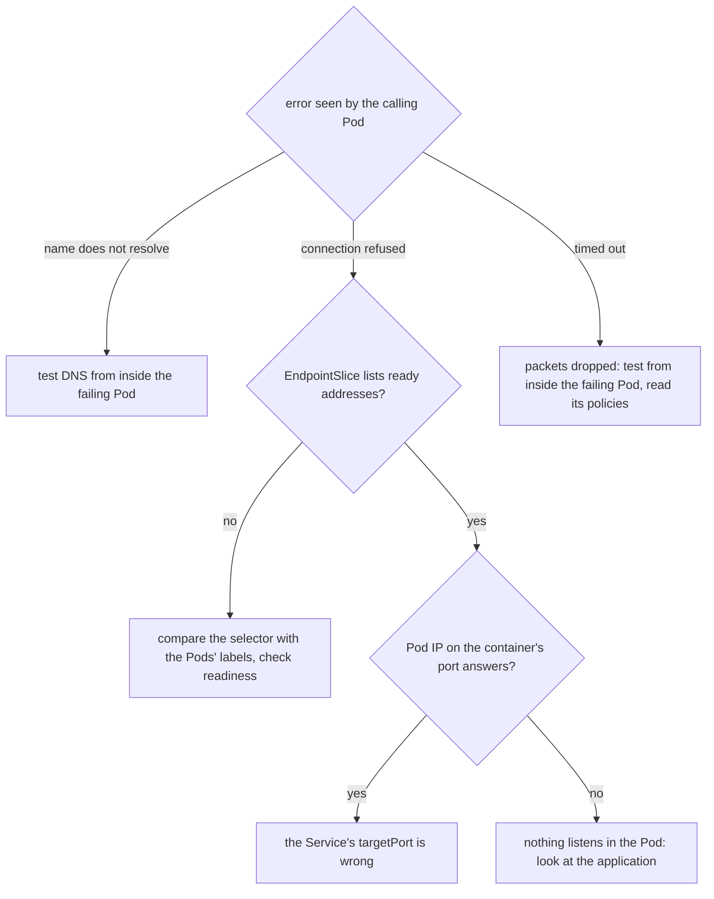

## Bạn cần biết trước

- [[k8s.l3.egress-policies]] — policy chiều đi ra quên chừa DNS sẽ làm hỏng mọi lần tra tên của các Pod nó chọn. Bài này tìm ra lỗi đó từ phía bên ngoài.
- [[k8s.l3.dns-search-and-ndots]] — Pod tra tên theo các thiết lập resolver mà kubelet ghi vào `/etc/resolv.conf` của nó, và một tên không tra được bắt đầu từ chính chỗ đó.
- [[k8s.l3.kube-proxy]] — luật của kube-proxy chuyển một kết nối tới cluster IP sang một địa chỉ đang sẵn sàng lấy từ các EndpointSlice của Service.
- [[foundation.l1.tcp-vs-udp]] — kết nối bị từ chối là một câu trả lời, còn hết thời gian chờ là không có câu trả lời nào.

## Tình huống

Bạn trông coi cluster thử nghiệm `donhang`, và ba thứ trong `network-lessons` hỏng cùng lúc. Hai Service mới, `broken-selector` và `broken-port`, từ chối mọi lời gọi. Một Pod tên `caller` không gọi được `echo-ip`: bên trong nó, cái tên không ra địa chỉ nào, dù hai Pod của `echo-ip` vẫn trả lời mọi bên gọi khác. Cả ba lẽ ra đều tới cùng những Pod đó. Khởi động lại không thay đổi gì, và đọc YAML từng dòng thì chậm khi bạn không biết phải đọc dòng nào. Kiểm tra gì, theo thứ tự nào, để thấy mỗi kết nối hỏng ở đâu?

## Khái niệm cốt lõi

- Lỗi là bằng chứng — thứ mà Pod gọi báo lại: một tên không có địa chỉ, `connection refused`, hoặc hết thời gian chờ. Mỗi loại chỉ tới một đoạn khác nhau trên đường đi.
- Endpoint sẵn sàng (không phải endpoint HTTP của một API) — các địa chỉ trong EndpointSlice của Service mà Pod tương ứng đang sẵn sàng. Đây là những địa chỉ mà Service thường gửi kết nối mới tới.
- Kiểm tra vòng qua — kết nối thẳng tới địa chỉ IP của một Pod ở port mà container của nó đang lắng nghe, bỏ qua cluster IP và các port của Service.
- `kubectl debug` — lệnh thêm một container tạm, từ image bạn chọn, vào một Pod đang chạy. Container đó dùng chung mạng của Pod, nên các NetworkPolicy của Pod áp lên kết nối của nó.

## Cơ chế hoạt động



Hãy bắt đầu từ những gì Pod gọi nhìn thấy, không phải từ YAML. Trong tình huống trên, mỗi chỗ hỏng cho ra một lỗi khác nhau, và lỗi quyết định nhánh nào.

Một tên không tra được nghĩa là lần tra tên đã thất bại trước khi có kết nối nào tới Service. Hãy kiểm tra DNS từ chính Pod bị lỗi, vì thiết lập resolver và các policy của nó quyết định nó có tới được CoreDNS hay không. Policy chọn Pod theo label, nên kiểm tra từ Pod khác sẽ đi qua những luật mà Pod bị lỗi không bao giờ gặp. Trong tình huống trên, `caller` không nhận được địa chỉ nào cho `echo-ip`, và `kubectl debug` chạy phép thử DNS bên trong `caller`, dưới chính các policy của `caller`.

`Connection refused` là một câu trả lời. Trên `donhang`, kết nối tới Service không có endpoint sẵn sàng nào bị từ chối ngay lập tức, như `broken-selector` cho thấy bên dưới, nên bước tiếp theo là EndpointSlice của Service. Không có địa chỉ nào, hoặc chỉ có địa chỉ chưa sẵn sàng, nghĩa là selector không khớp Pod nào hoặc các Pod không qua readiness probe. Hãy so `selector` của Service với label của các Pod.

Nếu EndpointSlice có liệt kê Pod sẵn sàng, hãy kết nối tới địa chỉ IP của một Pod ở port mà container của nó lắng nghe. Nếu Pod trả lời trong khi cluster IP bị từ chối, Service đang gửi kết nối tới một port không có gì lắng nghe: `targetPort` của nó sai. Nếu Pod cũng từ chối, vấn đề nằm bên trong Pod.

Hết thời gian chờ là không có câu trả lời: có thứ gì đó đã bỏ các gói tin, và trên `donhang` đó chính là điều NetworkPolicy làm. Hãy kiểm tra từ bên trong Pod bị lỗi, cùng lý do như trên, rồi đọc các policy chọn nó.

## Trong hệ thống Đơn Hàng

```bash file=scripts/k8s/network-debug.sh tag=stage-3 lines=24-43
# lesson: k8s.l3.debugging-pod-networking
# One: connection refused, and an empty EndpointSlice. The Service's
# selector matches no Pod: compare it with the Pods' labels.
echo "== broken-selector"
client_get http://broken-selector
slices broken-selector
show kubectl get service broken-selector -n network-lessons -o jsonpath='{.spec.selector}{"\n"}'
show kubectl get pods -n network-lessons -l app=echo-ip -o custom-columns=POD:.metadata.name,LABELS:.metadata.labels.app
echo

# lesson: k8s.l3.debugging-pod-networking
# Two: refused again, but the EndpointSlice lists both Pods, on port 80.
# A Pod's own address on the port it listens on answers, skipping the
# Service: the Service's targetPort is wrong.
echo "== broken-port"
client_get http://broken-port
slices broken-port
pod_ip=$(kubectl get pods -n network-lessons -l app=echo-ip -o jsonpath='{.items[0].status.podIP}')
client_get "http://$pod_ip:8080"
echo
```

Trước đoạn trích này, script áp dụng `broken-echo.yaml`, file chứa cả ba lỗi. `broken-selector` chọn `app: echo-pi`, một lỗi gõ nhầm, còn `targetPort` của nó là 8080, đúng port. `broken-port` chọn đúng Pod nhưng gửi port 80 sang `targetPort: 80`, trong khi container của `echo-ip` lắng nghe ở 8080.

`show`, `client_get` và `slices` được định nghĩa phía trên đoạn trích. `show` in một lệnh rồi chạy nó. `client_get` chạy `wget -T 5 -qO-` trong Pod `client`: `wget` lấy một URL qua HTTP, `-T 5` đặt thời gian chờ, hết thời gian đó nó in `download timed out`, còn `-qO-` in phần thân câu trả lời mà không kèm thông báo tiến độ. `slices` liệt kê các EndpointSlice của Service: Service mà chúng thuộc về (label `kubernetes.io/service-name` của chúng), địa chỉ đầu tiên của mỗi endpoint (ở đây mỗi Pod một địa chỉ), và port. Không policy nào chọn `client`, nên hai phép thử đầu chạy từ đó là công bằng.

```bash file=scripts/k8s/network-debug.sh tag=stage-3 lines=45-64
# lesson: k8s.l3.debugging-pod-networking
# Three: caller cannot reach echo-ip, yet from client, a Pod no policy
# selects, everything works. kubectl debug adds a container with tools to
# caller itself: same network, same policies. There the name does not
# resolve while the cluster IP answers: the policy has no rule for DNS.
echo "== caller"
echo "\$ kubectl exec client -n network-lessons -- getent hosts echo-ip"
kubectl exec client -n network-lessons -- getent hosts echo-ip >/dev/null && echo "(resolves)"
cluster_ip=$(kubectl get service echo-ip -n network-lessons -o jsonpath='{.spec.clusterIP}')
echo "\$ kubectl debug caller -n network-lessons --profile=general --image=caddy:2.10.0 --target=caller -c debug \\"
echo "    -- sh -c 'getent hosts echo-ip || echo \"echo-ip: no address\"; wget -T 5 -qO- http://<echo-ip's cluster IP>'"
kubectl debug caller -n network-lessons --profile=general --image=caddy:2.10.0 --target=caller -c debug \
  -- sh -c "getent hosts echo-ip || echo 'echo-ip: no address'; wget -T 5 -qO- http://$cluster_ip" >/dev/null 2>&1
# The temporary container runs on its own; its output is in its log.
until [ -n "$(kubectl get pod caller -n network-lessons \
    -o jsonpath='{.status.ephemeralContainerStatuses[?(@.name=="debug")].state.terminated.exitCode}')" ]; do
  sleep 1
done
show kubectl logs caller -n network-lessons -c debug
show kubectl get networkpolicy caller-egress -n network-lessons -o jsonpath='{.spec.egress}{"\n"}'
```

```text output=true
...
== broken-selector
$ kubectl exec client -n network-lessons -- wget -T 5 -qO- http://broken-selector
wget: can't connect to remote host (...): Connection refused
$ kubectl get endpointslices -n network-lessons -l kubernetes.io/service-name=broken-selector ...
NAME              ADDRESSES   PORT
broken-selector   <none>      <none>
$ kubectl get service broken-selector -n network-lessons -o jsonpath={.spec.selector}{"\n"}
{"app":"echo-pi"}
$ kubectl get pods -n network-lessons -l app=echo-ip -o custom-columns=POD:.metadata.name,LABELS:.metadata.labels.app
POD               LABELS
echo-ip-...-...   echo-ip
echo-ip-...-...   echo-ip

== broken-port
$ kubectl exec client -n network-lessons -- wget -T 5 -qO- http://broken-port
wget: can't connect to remote host (...): Connection refused
$ kubectl get endpointslices -n network-lessons -l kubernetes.io/service-name=broken-port ...
NAME          ADDRESSES   PORT
broken-port   ...,...     80
$ kubectl exec client -n network-lessons -- wget -T 5 -qO- http://...:8080
echo-ip-...-... saw ...

== caller
$ kubectl exec client -n network-lessons -- getent hosts echo-ip
(resolves)
$ kubectl debug caller -n network-lessons --profile=general --image=caddy:2.10.0 --target=caller -c debug \
    -- sh -c 'getent hosts echo-ip || echo "echo-ip: no address"; wget -T 5 -qO- http://<echo-ip's cluster IP>'
$ kubectl logs caller -n network-lessons -c debug
echo-ip: no address
echo-ip-...-... saw ...
$ kubectl get networkpolicy caller-egress -n network-lessons -o jsonpath={.spec.egress}{"\n"}
[{"ports":[{"port":8080,"protocol":"TCP"}],"to":[{"podSelector":{"matchLabels":{"app":"echo-ip"}}}]}]
```

`broken-selector` bị từ chối ngay và EndpointSlice của nó không có địa chỉ nào: đây là nhánh so label. Selector ghi `echo-pi`, còn các Pod ghi `echo-ip`. `broken-port` cũng bị từ chối, nhưng EndpointSlice của nó liệt kê hai địa chỉ ở port 80, port mà Service gửi kết nối tới trên mỗi Pod. Địa chỉ riêng của Pod đầu tiên ở 8080 thì trả lời, nên các Pod vẫn ổn, còn `targetPort` thì không.

`caller` là trường hợp thứ ba. Từ `client` tên tra được, nhưng điều đó chẳng chứng minh gì về `caller`. `kubectl debug` thêm vào `caller` một container tên `debug`, từ image `caddy:2.10.0`, image có sẵn `getent` và `wget`. `getent hosts <name>` tra một tên qua thiết lập resolver của Pod rồi in địa chỉ, hoặc không in gì nếu tra thất bại. `--target=caller` cho container mới nhìn thấy các process của container `caller`, còn `--profile=general` chọn một trong các bộ thiết lập có tên của kubectl cho container được thêm, thay cho bộ mặc định của kubectl 1.34 là `legacy`. Các phép thử mạng không phụ thuộc vào tùy chọn nào trong hai cái này, vì mọi container của một Pod đều dùng chung mạng của Pod. Khi không gắn terminal, lệnh trả về ngay, nên vòng lặp chờ tới khi status của Pod báo `debug` đã kết thúc, rồi `kubectl logs` in ra những gì nó đã ghi.

Bên trong `caller`, `echo-ip` không có địa chỉ, vậy mà cluster IP vẫn trả lời. Policy `caller-egress` cho phép tới các Pod của `echo-ip` ở 8080 và không gì khác, nên truy vấn DNS tới CoreDNS bị bỏ. Container mà `kubectl debug` thêm vào sẽ ở lại trong Pod cho tới khi Pod bị xóa. Script xóa `caller` ở cuối.

## Senior hay nhầm rằng…

- **"Hết thời gian chờ và `connection refused` từ một Service là cùng một kiểu hỏng."** → Thực ra bị từ chối là một câu trả lời: không có endpoint sẵn sàng, hoặc không có gì lắng nghe ở port của Pod. Hết thời gian chờ nghĩa là gói tin bị bỏ trên đường đi. Bạn sẽ nhận ra khi `broken-selector` thất bại ngay lập tức, còn một lời gọi bị policy chặn thì chờ hết trọn `-T 5`.
- **"Kiểm tra từ Pod nào cũng cho thấy điều Pod bị lỗi gặp phải."** → Thực ra NetworkPolicy chọn Pod theo label, nên Pod khác gặp những luật khác, hoặc không gặp luật nào. Bạn sẽ nhận ra khi `getent hosts echo-ip` tra được trong `client` nhưng không ra địa chỉ nào bên trong `caller`.
- **"Service không khớp Pod nào vẫn nhận kết nối rồi treo."** → Thực ra trên `donhang`, kết nối tới Service không có endpoint sẵn sàng bị từ chối ngay lập tức. Bạn sẽ nhận ra khi `wget` in `Connection refused` ngay với `broken-selector`, không phải chờ.

## Thử ngay (3 phút)

Ở thư mục gốc của repo Đơn Hàng, khi cluster `donhang` đang chạy. `kind-donhang` là context kubeconfig của `donhang`, và `network-debug.sh` truyền nó cho mọi lệnh `kubectl` thông qua `scripts/lib/network-lessons.sh`.

1. Chạy `kubectl --context kind-donhang apply -f deploy/k8s/lessons/echo-ip.yaml -f deploy/k8s/lessons/broken-echo.yaml` và `kubectl --context kind-donhang run client -n network-lessons --image=caddy:2.10.0 --command -- sleep 3600`.
2. Sửa lỗi gõ nhầm bằng `kubectl --context kind-donhang patch service broken-selector -n network-lessons -p '{"spec":{"selector":{"app":"echo-ip"}}}'`. Đoán trước kết quả, rồi chạy `kubectl --context kind-donhang get endpointslices -n network-lessons -l kubernetes.io/service-name=broken-selector` và `kubectl --context kind-donhang exec client -n network-lessons -- wget -T 5 -qO- http://broken-selector`.
3. Dọn dẹp bằng `kubectl --context kind-donhang delete -f deploy/k8s/lessons/broken-echo.yaml` và `kubectl --context kind-donhang delete pod client -n network-lessons`.

Kết quả mong đợi: EndpointSlice giờ liệt kê hai địa chỉ với port 8080, và `wget` in một dòng nêu tên một Pod `echo-ip` thay cho `Connection refused`.

<details><summary>Gợi ý đáp án</summary>

Control plane giữ các EndpointSlice của Service luôn khớp với selector của nó. Khi selector khớp các Pod sẵn sàng của `echo-ip`, địa chỉ của chúng xuất hiện, kèm `targetPort` 8080, và luật của kube-proxy gửi kết nối tới một trong số đó. Không có gì khác thay đổi: EndpointSlice là bằng chứng, còn selector là chỗ hỏng.

</details>

## Liên hệ

- [[k8s.l3.egress-policies]] — lỗi thứ ba ở đây chính là điều bài đó cảnh báo, giờ gặp lại từ phía bị hỏng.
- [[k8s.l3.kube-proxy]] — luật của nó gửi mỗi kết nối tới một địa chỉ sẵn sàng lấy từ EndpointSlice, nên bị từ chối là lúc bạn đi xem chúng.
- [[k8s.l1.readiness-probes]] — probe thất bại giữ Pod ngoài danh sách địa chỉ sẵn sàng, lý do còn lại khiến EndpointSlice không có gì để đưa ra.
- [[k8s.l1.labels]] — gõ nhầm selector là label không khớp. Lỗi thứ nhất phá đúng quy tắc dạy ở bài đó.
- [[k8s.l3.dns-search-and-ndots]] — chỗ cần xem tiếp khi lỗi báo một tên không tra được.

## Tóm tắt 5 dòng

1. Đọc lỗi từ Pod gọi trước: không có địa chỉ là do DNS, bị từ chối là không có gì nhận kết nối, hết thời gian chờ là gói tin bị bỏ.
2. Trên `donhang`, Service không có endpoint sẵn sàng từ chối kết nối ngay, nên hãy xem EndpointSlice của nó và so selector với label của Pod.
3. Nếu địa chỉ của Pod ở port của container trả lời trong khi cluster IP bị từ chối, `targetPort` của Service sai.
4. Policy chọn Pod theo label, nên `kubectl debug` kiểm tra từ một container tạm bên trong chính Pod bị lỗi, dưới các policy của nó.
5. `network-debug.sh` tìm ra một selector gõ nhầm, một `targetPort` sai và một policy chiều đi ra thiếu DNS bằng đúng các bước này.
