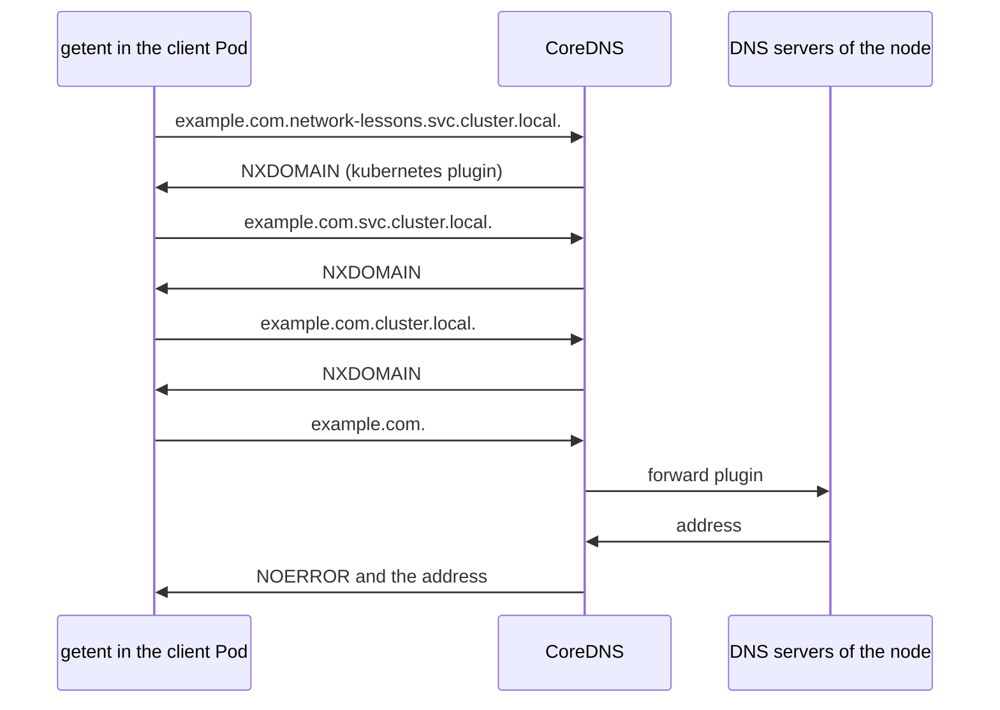

## Before you start

- [[k8s.l3.coredns]] — every lookup from a Pod with the default DNS settings goes to CoreDNS, whose `kubernetes` plugin answers names under `cluster.local` and whose `forward` plugin sends every other name to the node's DNS servers; this lesson counts how many questions one lookup actually sends.

## The situation

On the cluster `donhang` you turn on query logging in CoreDNS to see what Pods ask it. When you look up `example.com` once from a client Pod in `network-lessons`, CoreDNS logs four queries. The first is `example.com.network-lessons.svc.cluster.local.`, then come two more names ending in `cluster.local`, and each of the three gets the answer "no such name". Only the fourth, `example.com.` itself, gets an address. Your program asked for one name and got the right address, so nothing looked wrong from inside the Pod. Why does one lookup of an outside name reach CoreDNS as four queries?

## Core concepts

- `dnsPolicy` — the Pod field that decides where the Pod's DNS settings come from; a Pod that does not set it gets `ClusterFirst`, which names the cluster DNS and the cluster's search domains in its `/etc/resolv.conf`.
- **ndots** — an option in `/etc/resolv.conf`: a name with fewer dots than this number is tried with each search domain (each suffix on the file's `search` line) appended before it is tried as written; with `ClusterFirst` its value is 5.
- NXDOMAIN — the DNS answer meaning "no such name", the answer to the first three queries in the situation; NOERROR is the answer when the name exists, as for the fourth.
- Final dot — a dot at the end of a name, as in `example.com.`, which marks the name as complete, so no search domain is appended.
- `dnsConfig` — the Pod field that adds to or changes the settings `dnsPolicy` produced, for example one option in `/etc/resolv.conf`.

## How it works



In the situation above, `getent`, the lookup command the script runs, asks for `example.com` in the client Pod. That Pod sets no `dnsPolicy`, so it has `ClusterFirst`. When the kubelet started the Pod, it wrote the Pod's `/etc/resolv.conf`: on `donhang` the `search` line lists `network-lessons.svc.cluster.local`, `svc.cluster.local` and `cluster.local`, and the last line is `options ndots:5`.

The resolver, the code inside the Pod that turns a name into DNS queries, reads that file before it sends anything. `example.com` has one dot, fewer than five, so the resolver appends each search domain in turn and asks CoreDNS for the result. All three names end in `cluster.local`, so the `kubernetes` plugin owns them, and since no such Service exists, each answer is NXDOMAIN. Only when the search list is used up does the resolver try `example.com.` as written; CoreDNS forwards it to the node's DNS servers, and the answer is NOERROR with an address.

The rule works in your favour for names of Services. `echo-ip` has no dots, so its first try, `echo-ip.network-lessons.svc.cluster.local`, is already the Service's full name and gets its cluster IP at once.

A name with at least as many dots as `ndots` goes the other way: it is tried as written first. A name with a final dot is never extended. Both are the ways out of the three wasted queries, and the next section shows each one.

## In the Đơn Hàng system

```bash file=scripts/k8s/dns-search.sh tag=stage-3 lines=59-75
# lesson: k8s.l3.dns-search-and-ndots
# example.com has one dot, fewer than five: every search domain is tried
# first, each answered NXDOMAIN, and the name as written comes last.
lookup client example.com
echo
# A final dot marks the name as complete: one query.
lookup client example.com.
echo

# lesson: k8s.l3.dns-search-and-ndots
# ndots 1 in the Pod's dnsConfig: example.com is tried as written first.
kubectl delete pod dns-ndots dns-node -n network-lessons --ignore-not-found --grace-period=1 >/dev/null
show kubectl apply -f deploy/k8s/lessons/dns-config-pod.yaml
kubectl wait --for=condition=Ready pod/dns-ndots pod/dns-node -n network-lessons --timeout=180s >/dev/null
show kubectl exec dns-ndots -n network-lessons -- grep options /etc/resolv.conf
lookup dns-ndots example.com
echo
```

```text output=true
...
$ kubectl exec client -n network-lessons -- getent ahostsv4 example.com
queries CoreDNS logged:
  example.com.network-lessons.svc.cluster.local. NXDOMAIN
  example.com.svc.cluster.local. NXDOMAIN
  example.com.cluster.local. NXDOMAIN
  example.com. NOERROR

$ kubectl exec client -n network-lessons -- getent ahostsv4 example.com.
queries CoreDNS logged:
  example.com. NOERROR

$ kubectl apply -f deploy/k8s/lessons/dns-config-pod.yaml
pod/dns-ndots created
pod/dns-node created
$ kubectl exec dns-ndots -n network-lessons -- grep options /etc/resolv.conf
options ndots:1
$ kubectl exec dns-ndots -n network-lessons -- getent ahostsv4 example.com
queries CoreDNS logged:
  example.com. NOERROR
...
```

Earlier in the script, outside this excerpt, it adds the `log` plugin to the Corefile in the ConfigMap `coredns`, so CoreDNS writes every query to its log, and removes it again when the script exits; that Corefile does not cache answers under `cluster.local`. `show` prints a command, then runs it. `lookup`, also defined earlier, runs `getent ahostsv4`, which resolves a name to IPv4 addresses through the Pod's DNS settings, then prints the queries for IPv4 addresses from that Pod that the CoreDNS Pods logged, each once, with their answers. The client Pod's lookup of `example.com` produces the four queries of the situation. The same name with a final dot produces one. The Pod `dns-ndots`, with `ndots:1`, also needs only one query for `example.com`.

```yaml file=deploy/k8s/lessons/dns-config-pod.yaml tag=stage-3 lines=1-18
# lesson: k8s.l3.dns-search-and-ndots
# The default dnsPolicy, ClusterFirst, with one option changed: ndots 1. A
# name with at least one dot, such as example.com, is tried as written first,
# before any search domain is appended.
apiVersion: v1
kind: Pod
metadata:
  name: dns-ndots
  namespace: network-lessons
spec:
  dnsConfig:
    options:
      - name: ndots
        value: "1"
  containers:
    - name: client
      image: caddy:2.10.0
      command: ["sleep", "3600"]
```

The Pod sets no `dnsPolicy`, so it still has `ClusterFirst`, and its `dnsConfig` changes a single option. The value `"1"` is a string in quotes, as the field requires.

Lowering `ndots` moves the cost rather than removing it. `echo-ip.network-lessons`, the Service name plus its namespace, is how a Pod in another namespace names that Service. With one dot, that name is now tried as written first, and that query leaves the cluster. When a Pod mostly calls outside names, a final dot or a lower `ndots` saves queries; for Services in the same namespace, the short name stays the simplest choice, because its first try already succeeds.

The second Pod in the same file, `dns-node`, outside this excerpt, sets `dnsPolicy: Default`. The script's last part prints its `/etc/resolv.conf`: one `nameserver` from the node's settings and no `search` line. In that Pod `getent hosts echo-ip` prints `(no address)`, while the client Pod resolves `echo-ip` to its cluster IP.

## Seniors often assume…

- **"Looking up an outside name from a Pod sends exactly one DNS query."** → Actually, with `ClusterFirst` and `ndots:5`, a name with fewer than five dots is first tried with each of the three search domains, so `example.com` costs three NXDOMAIN answers before the real one. You notice this when CoreDNS's log, as in `dns-search.sh`, shows names like `example.com.svc.cluster.local.` that no program in the Pod ever wrote.
- **"`dnsPolicy: Default` is the policy a Pod gets when none is set."** → Actually a Pod without the field gets `ClusterFirst`; `Default` gives the Pod the node's resolver settings, with no cluster DNS and no cluster search domains. You notice this when a Pod with `dnsPolicy: Default` cannot resolve `echo-ip`, a name that resolves in every other Pod of the namespace.
- **"Extra DNS queries cost nothing because CoreDNS caches the answers."** → Actually the cache lives in CoreDNS, so every query still travels from the Pod to a CoreDNS Pod and back, and on `donhang` the Corefile turns caching off for names under `cluster.local`, so the failed search-domain queries are answered afresh each time. You notice this in the Corefile on `donhang`: `cache 30` has `disable denial cluster.local`, so no NXDOMAIN under `cluster.local` is kept.

## Try it (3 minutes)

From the root of the Đơn Hàng repository, with Docker Desktop running (the cluster `donhang` runs inside it):

1. Run `scripts/k8s/dns-search.sh`. If the cluster `donhang` is gone, the script builds it first, which takes longer; turning on the `log` plugin can also take up to two minutes.
2. In your own output, count the queries under each `queries CoreDNS logged:` line, and compare the last two `getent hosts echo-ip` results.

Expected result: four queries for `example.com` from `client`, one for `example.com.`, one for `example.com` from `dns-ndots`; `dns-node` prints `(no address)` for `echo-ip` while `client` resolves it.

<details><summary>Suggested answer</summary>

`client` has `ndots:5`, and `example.com` has one dot, so the three search domains are tried first, each answered NXDOMAIN. The final dot marks the name as complete, and `ndots:1` lets a name with one dot go out as written first, so both need one query. `dns-node` has the node's settings, which have no search domains of the cluster and no cluster DNS, so `echo-ip` resolves nowhere.

</details>

## Connections

- [[k8s.l3.coredns]] — the server behind these queries: the `kubernetes` plugin gives the NXDOMAIN answers and the `forward` plugin sends out the last query.
- [[k8s.l1.service-and-dns]] — the same search list seen from the other side: it is what lets the short name `web` work inside its namespace.
- [[k8s.l3.egress-policies]] — the next lesson: every one of these queries needs a path to CoreDNS, which a policy blocking outgoing connections must leave open.
- [[k8s.l3.debugging-pod-networking]] — a later lesson where a name that does not resolve is the first thing to check, and `/etc/resolv.conf` is where to look.

## Five-line summary

1. A Pod with `ClusterFirst` and `ndots:5` tries every search domain before an outside name with fewer than five dots.
2. `dnsPolicy` is `ClusterFirst` when not set; the kubelet then writes the cluster's three search domains and `options ndots:5` into `/etc/resolv.conf`.
3. On `donhang`, one lookup of `example.com` reaches CoreDNS as three NXDOMAIN queries under `cluster.local`, then `example.com.` itself.
4. A final dot, or a lower `ndots` in `dnsConfig`, cuts that to one query; a short Service name in the same namespace already needs one.
5. `dnsPolicy: Default` gives the Pod the node's settings, so names of the cluster's Services stop resolving in it.
