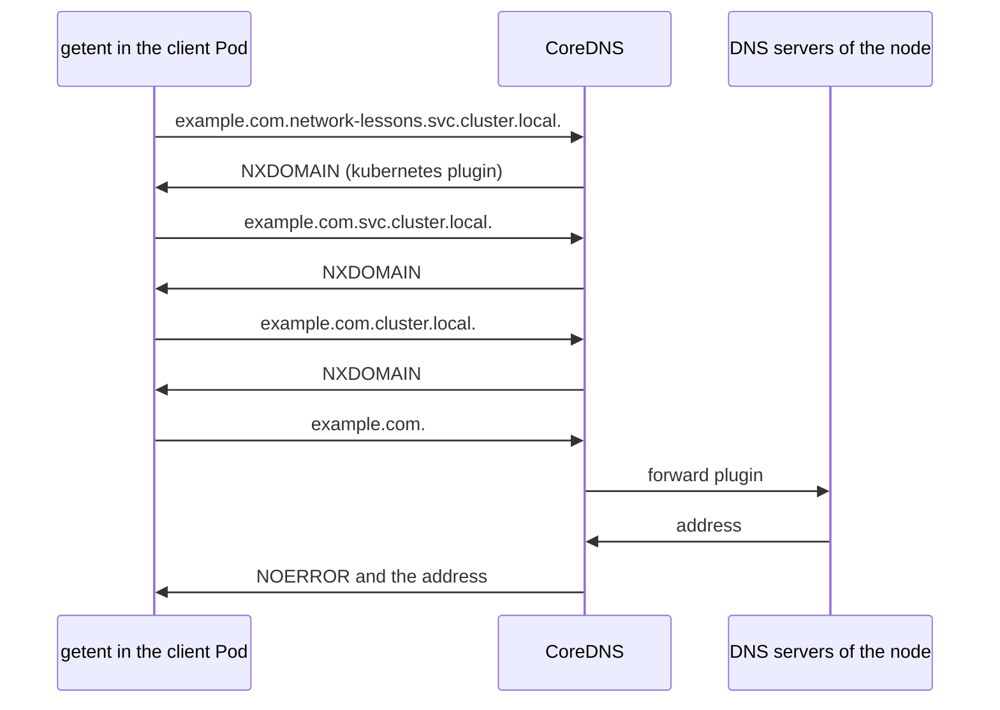

## Bạn cần biết trước

- [[k8s.l3.coredns]] — mọi lần tra tên từ Pod dùng thiết lập DNS mặc định đều tới CoreDNS. Plugin `kubernetes` của nó trả lời các tên dưới `cluster.local`, còn plugin `forward` gửi mọi tên khác tới các DNS server của node. Bài này đếm xem một lần tra tên thực ra gửi đi bao nhiêu câu hỏi.

## Tình huống

Trên cluster `donhang`, bạn bật ghi log câu hỏi trong CoreDNS để xem các Pod hỏi nó những gì. Khi bạn tra `example.com` một lần từ một Pod client trong `network-lessons`, CoreDNS ghi lại bốn câu hỏi. Câu đầu là `example.com.network-lessons.svc.cluster.local.`, tiếp theo là hai tên nữa cũng kết thúc bằng `cluster.local`, và cả ba đều nhận câu trả lời "không có tên này". Chỉ câu thứ tư, chính `example.com.`, mới nhận được địa chỉ. Chương trình chỉ hỏi một tên và nhận đúng địa chỉ, nên nhìn từ bên trong Pod thì không có gì bất thường. Vì sao một lần tra tên bên ngoài lại tới CoreDNS thành bốn câu hỏi?

## Khái niệm cốt lõi

- `dnsPolicy` — field của Pod quyết định thiết lập DNS của Pod lấy từ đâu. Pod không đặt field này sẽ nhận `ClusterFirst`, giá trị ghi cluster DNS và các search domain của cluster vào `/etc/resolv.conf` của Pod.
- **ndots** (Tùy chọn trong /etc/resolv.conf: tên có ít dấu chấm hơn số này được thử với từng search domain trước) — một tùy chọn trong `/etc/resolv.conf`. Tên có ít dấu chấm hơn số này sẽ được thử lần lượt với từng search domain (mỗi hậu tố trên dòng `search` của file) nối vào sau, rồi mới được thử nguyên dạng. Với `ClusterFirst`, giá trị của nó là 5.
- NXDOMAIN — câu trả lời DNS có nghĩa "không có tên này", là câu trả lời cho ba câu hỏi đầu trong tình huống. NOERROR là câu trả lời khi tên tồn tại, như với câu thứ tư.
- Dấu chấm cuối — dấu chấm ở cuối tên, như trong `example.com.`, đánh dấu tên đã đầy đủ, nên không search domain nào được nối thêm.
- `dnsConfig` — field của Pod bổ sung hoặc thay đổi thiết lập mà `dnsPolicy` tạo ra, chẳng hạn một tùy chọn trong `/etc/resolv.conf`.

## Cơ chế hoạt động



Trong tình huống trên, `getent`, lệnh tra tên mà script chạy, hỏi `example.com` trong Pod client. Pod đó không đặt `dnsPolicy`, nên nó có `ClusterFirst`. Khi khởi động Pod, kubelet đã ghi `/etc/resolv.conf` cho nó: trên `donhang`, dòng `search` liệt kê `network-lessons.svc.cluster.local`, `svc.cluster.local` và `cluster.local`, còn dòng cuối là `options ndots:5`.

Resolver, phần code trong Pod biến một tên thành các câu hỏi DNS, đọc file đó trước khi gửi bất cứ thứ gì. `example.com` có một dấu chấm, ít hơn năm, nên resolver lần lượt nối từng search domain vào sau và hỏi CoreDNS tên vừa ghép. Cả ba tên đều kết thúc bằng `cluster.local`, nên chúng thuộc phần plugin `kubernetes` phụ trách, và vì không có Service nào như thế, mỗi câu trả lời đều là NXDOMAIN. Chỉ khi đã dùng hết danh sách search, resolver mới thử `example.com.` nguyên dạng. CoreDNS chuyển nó tới các DNS server của node, và câu trả lời là NOERROR kèm một địa chỉ.

Với tên Service, quy tắc này lại có lợi cho bạn. `echo-ip` không có dấu chấm nào, nên lần thử đầu tiên, `echo-ip.network-lessons.svc.cluster.local`, đã là tên đầy đủ của Service và nhận ngay cluster IP của nó.

Tên có số dấu chấm ít nhất bằng `ndots` thì đi theo chiều ngược lại: nó được thử nguyên dạng trước. Tên có dấu chấm cuối thì không bao giờ bị nối thêm. Đó là hai cách tránh ba câu hỏi thừa, và phần tiếp theo cho thấy từng cách.

## Trong hệ thống Đơn Hàng

```bash file=scripts/k8s/dns-search.sh tag=stage-3 lines=59-75
# lesson: k8s.l3.dns-search-and-ndots
# example.com has one dot, fewer than five: every search domain is tried
# first, each answered NXDOMAIN, and the name as written comes last.
lookup client example.com
echo
# A final dot marks the name as complete: one query.
lookup client example.com.
echo

# lesson: k8s.l3.dns-search-and-ndots
# ndots 1 in the Pod's dnsConfig: example.com is tried as written first.
kubectl delete pod dns-ndots dns-node -n network-lessons --ignore-not-found --grace-period=1 >/dev/null
show kubectl apply -f deploy/k8s/lessons/dns-config-pod.yaml
kubectl wait --for=condition=Ready pod/dns-ndots pod/dns-node -n network-lessons --timeout=180s >/dev/null
show kubectl exec dns-ndots -n network-lessons -- grep options /etc/resolv.conf
lookup dns-ndots example.com
echo
```

```text output=true
...
$ kubectl exec client -n network-lessons -- getent ahostsv4 example.com
queries CoreDNS logged:
  example.com.network-lessons.svc.cluster.local. NXDOMAIN
  example.com.svc.cluster.local. NXDOMAIN
  example.com.cluster.local. NXDOMAIN
  example.com. NOERROR

$ kubectl exec client -n network-lessons -- getent ahostsv4 example.com.
queries CoreDNS logged:
  example.com. NOERROR

$ kubectl apply -f deploy/k8s/lessons/dns-config-pod.yaml
pod/dns-ndots created
pod/dns-node created
$ kubectl exec dns-ndots -n network-lessons -- grep options /etc/resolv.conf
options ndots:1
$ kubectl exec dns-ndots -n network-lessons -- getent ahostsv4 example.com
queries CoreDNS logged:
  example.com. NOERROR
...
```

Ở phần trước của script, ngoài đoạn trích này, script thêm plugin `log` vào Corefile trong ConfigMap `coredns` để CoreDNS ghi mọi câu hỏi vào log, và gỡ nó ra khi script kết thúc. Corefile đó không cache câu trả lời dưới `cluster.local`. `show` in một lệnh rồi chạy lệnh đó. `lookup`, cũng được định nghĩa ở phần trước, chạy `getent ahostsv4`, lệnh phân giải một tên ra địa chỉ IPv4 theo thiết lập DNS của Pod. Sau đó nó in các câu hỏi địa chỉ IPv4 từ Pod đó mà các Pod CoreDNS đã ghi log, mỗi câu một lần, kèm câu trả lời. Lần tra `example.com` của Pod client tạo ra bốn câu hỏi như trong tình huống. Cùng tên đó có dấu chấm cuối chỉ tạo ra một câu. Pod `dns-ndots`, với `ndots:1`, cũng chỉ cần một câu hỏi cho `example.com`.

```yaml file=deploy/k8s/lessons/dns-config-pod.yaml tag=stage-3 lines=1-18
# lesson: k8s.l3.dns-search-and-ndots
# The default dnsPolicy, ClusterFirst, with one option changed: ndots 1. A
# name with at least one dot, such as example.com, is tried as written first,
# before any search domain is appended.
apiVersion: v1
kind: Pod
metadata:
  name: dns-ndots
  namespace: network-lessons
spec:
  dnsConfig:
    options:
      - name: ndots
        value: "1"
  containers:
    - name: client
      image: caddy:2.10.0
      command: ["sleep", "3600"]
```

Pod này không đặt `dnsPolicy`, nên vẫn có `ClusterFirst`, và `dnsConfig` của nó chỉ đổi đúng một tùy chọn. Giá trị `"1"` là chuỗi nằm trong ngoặc kép, như field này yêu cầu.

Hạ `ndots` chỉ dời chi phí sang chỗ khác chứ không xóa nó. `echo-ip.network-lessons`, tức tên Service cộng namespace của nó, là cách một Pod ở namespace khác gọi Service đó. Tên này có một dấu chấm, nên giờ nó được thử nguyên dạng trước, và câu hỏi đó đi ra ngoài cluster. Khi Pod chủ yếu gọi tên bên ngoài, dấu chấm cuối hoặc `ndots` thấp hơn giúp bớt câu hỏi. Còn với Service cùng namespace, tên ngắn vẫn là lựa chọn đơn giản nhất, vì lần thử đầu tiên của nó đã thành công.

Pod thứ hai trong cùng file, `dns-node`, nằm ngoài đoạn trích này, đặt `dnsPolicy: Default`. Phần cuối của script in `/etc/resolv.conf` của nó: một `nameserver` lấy từ thiết lập của node và không có dòng `search`. Trong Pod đó, `getent hosts echo-ip` in ra `(no address)`, còn Pod client phân giải `echo-ip` ra cluster IP của nó.

## Senior hay nhầm rằng…

- **"Tra một tên bên ngoài từ Pod chỉ gửi đúng một câu hỏi DNS."** → Thực ra với `ClusterFirst` và `ndots:5`, tên có ít hơn năm dấu chấm được thử với từng search domain trong ba search domain trước, nên `example.com` tốn ba câu trả lời NXDOMAIN rồi mới tới câu trả lời thật. Bạn sẽ nhận ra khi log của CoreDNS, như trong `dns-search.sh`, hiện những tên như `example.com.svc.cluster.local.` mà không chương trình nào trong Pod từng viết ra.
- **"`dnsPolicy: Default` là policy mà Pod nhận khi không đặt gì."** → Thực ra Pod không có field này sẽ nhận `ClusterFirst`. `Default` cho Pod thiết lập resolver của node, không có cluster DNS và không có search domain của cluster. Bạn sẽ nhận ra khi một Pod đặt `dnsPolicy: Default` không phân giải được `echo-ip`, cái tên phân giải được trong mọi Pod khác của namespace.
- **"Câu hỏi DNS thừa không tốn gì vì CoreDNS cache câu trả lời."** → Thực ra cache nằm trong CoreDNS, nên mỗi câu hỏi vẫn phải đi từ Pod tới một Pod CoreDNS rồi quay về. Hơn nữa, trên `donhang` Corefile tắt cache cho các tên dưới `cluster.local`, nên các câu hỏi search domain thất bại lần nào cũng được trả lời lại từ đầu. Bạn sẽ nhận ra khi đọc Corefile trên `donhang`: `cache 30` có `disable denial cluster.local`, nên không NXDOMAIN nào dưới `cluster.local` được giữ lại.

## Thử ngay (3 phút)

Ở thư mục gốc của repo Đơn Hàng, khi Docker Desktop đang chạy (cluster `donhang` chạy bên trong nó):

1. Chạy `scripts/k8s/dns-search.sh`. Nếu cluster `donhang` không còn, script dựng lại nó trước, nên sẽ lâu hơn. Bật plugin `log` cũng có thể mất tới hai phút.
2. Trong output của bạn, đếm số câu hỏi dưới mỗi dòng `queries CoreDNS logged:`, rồi so hai kết quả `getent hosts echo-ip` cuối cùng.

Kết quả mong đợi: bốn câu hỏi cho `example.com` từ `client`, một câu cho `example.com.`, một câu cho `example.com` từ `dns-ndots`. `dns-node` in `(no address)` cho `echo-ip`, còn `client` phân giải được tên đó.

<details><summary>Gợi ý đáp án</summary>

`client` có `ndots:5`, còn `example.com` có một dấu chấm, nên ba search domain được thử trước, mỗi lần đều nhận NXDOMAIN. Dấu chấm cuối đánh dấu tên đã đầy đủ, còn `ndots:1` cho tên có một dấu chấm được thử nguyên dạng trước, nên cả hai chỉ cần một câu hỏi. `dns-node` mang thiết lập của node, không có search domain của cluster và không có cluster DNS, nên `echo-ip` không phân giải được ở đâu cả.

</details>

## Liên hệ

- [[k8s.l3.coredns]] — server đứng sau các câu hỏi này: plugin `kubernetes` trả về các NXDOMAIN, còn plugin `forward` gửi câu hỏi cuối cùng ra ngoài.
- [[k8s.l1.service-and-dns]] — cũng danh sách search đó, nhìn từ phía bên kia: nhờ nó mà tên ngắn `web` dùng được trong namespace của mình.
- [[k8s.l3.egress-policies]] — bài tiếp theo: mọi câu hỏi ở đây đều cần đường tới CoreDNS, và policy chặn kết nối đi ra phải chừa đường đó lại.
- [[k8s.l3.debugging-pod-networking]] — một bài sau, nơi tên không phân giải được là thứ đầu tiên cần kiểm tra, và `/etc/resolv.conf` là chỗ để xem.

## Tóm tắt 5 dòng

1. Pod có `ClusterFirst` và `ndots:5` thử mọi search domain trước khi tới một tên bên ngoài có ít hơn năm dấu chấm.
2. `dnsPolicy` là `ClusterFirst` khi không đặt. Khi đó kubelet ghi ba search domain của cluster và `options ndots:5` vào `/etc/resolv.conf`.
3. Trên `donhang`, một lần tra `example.com` tới CoreDNS thành ba câu hỏi NXDOMAIN dưới `cluster.local`, rồi mới tới chính `example.com.`.
4. Dấu chấm cuối, hoặc `ndots` thấp hơn trong `dnsConfig`, giảm còn một câu hỏi. Tên Service ngắn trong cùng namespace vốn đã chỉ cần một câu.
5. `dnsPolicy: Default` cho Pod thiết lập của node, nên tên Service của cluster không còn phân giải được trong Pod đó.
