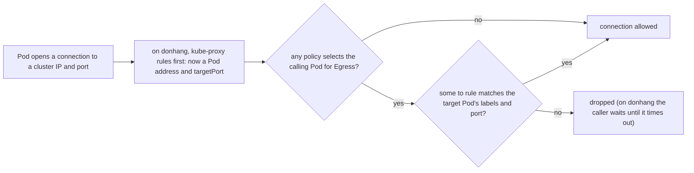

## Before you start

- [[k8s.l3.network-policies]] — a NetworkPolicy selects Pods by label and turns their incoming connections into an allow list; this lesson does the same for the connections they open.
- [[k8s.l3.coredns]] — every lookup from a Pod goes to the CoreDNS Pods behind the Service `kube-dns` in `kube-system`, which is exactly what a careless egress policy cuts off.
- [[k8s.l3.kube-proxy]] — kube-proxy turns a connection to a cluster IP into one to a Pod address; on `donhang`, egress rules see the connection after that step.
- [[k8s.l2.config-repo-overlays]] — staging's manifests live in the config repository's `base`, so new policies reach `donhang` by a commit that Argo CD syncs.

## The situation

The ingress policies of the previous module keep everything but its callers away from staging's `db`, but the other direction is still open. From an api Pod in `donhang` you open a connection to `gitea.git` on port 3000, the Git server that holds the config repository, and it connects. The api has no reason to talk to it; a container an attacker took over would. So you try the obvious fix in the test namespace `network-lessons`: one policy that blocks every outgoing connection. Now the test Pod `client` cannot even turn the name of the Service `echo-ip` into an address. How do you limit the connections a Pod opens without breaking the lookups every connection starts with?

## Core concepts

- Egress isolation — a Pod becomes isolated for egress once at least one NetworkPolicy selects it with `Egress` in its `policyTypes`; from then on it can open only connections that some such policy allows.
- Default-deny egress policy — a policy with `podSelector: {}`, `Egress` in `policyTypes` and no `egress` list, so every Pod in its namespace is isolated for egress and may open nothing.
- `to` rule — an entry in a policy's `egress` list naming where the selected Pods may connect, by `podSelector` and `namespaceSelector`, and on which `ports`.
- DNS rule — a `to` rule that lets Pods reach the CoreDNS Pods on port 53, over both UDP and TCP.

## How it works



In the situation above, `client` resolves `echo-ip` by sending a query to the cluster IP of `kube-dns` on port 53. kube-proxy's rules turn it into a connection to one CoreDNS Pod. With `deny-egress.yaml` applied, a policy selects `client` for `Egress` and lists no rule, so that connection is dropped like any other. To a policy, CoreDNS is just a few Pods in `kube-system`; nothing exempts DNS.

The DNS rule names those Pods. Its `namespaceSelector` picks `kube-system` by the label `kubernetes.io/metadata.name`, which Kubernetes itself sets on every namespace, with the namespace's name as value. Its `podSelector`, in the same entry, picks Pods labelled `k8s-app: kube-dns`; a Pod must match both. Port 53 is listed twice: DNS sends a query over UDP, which carries single messages without a connection, and falls back to TCP when an answer is too large.

A second trap concerns ports. A rule's port is a port on the target Pod, and a policy cannot name a Service. So a rule names the Pods behind a Service by label and the Service's `targetPort`. On `donhang` the policy sees the connection after kube-proxy's rewrite: `echo-ip` sends port 80 to port 8080, and a rule for port 80 times out while the same rule for 8080 works.

Egress policies combine the way ingress policies do: each one only adds allowed connections, in any order. A connection between two Pods must pass the caller's egress policies and the target's ingress policies.

## In the Đơn Hàng system

```yaml file=deploy/gitops/config-repo-kustomize/base/egress-policies.yaml tag=stage-3 lines=15-37
# lesson: k8s.l3.egress-policies
# Every Pod in donhang may ask CoreDNS for names.
apiVersion: networking.k8s.io/v1
kind: NetworkPolicy
metadata:
  name: dns-egress
  namespace: donhang
spec:
  podSelector: {}
  policyTypes: ["Egress"]
  egress:
    - to:
        - namespaceSelector:
            matchLabels:
              kubernetes.io/metadata.name: kube-system
          podSelector:
            matchLabels:
              k8s-app: kube-dns
      ports:
        - protocol: UDP
          port: 53
        - protocol: TCP
          port: 53
```

This is staging's DNS rule, with the same `spec` as `allow-dns-egress.yaml` in `network-lessons`. Above it sits `default-deny-egress`, which isolates every Pod in `donhang`. Below it, one policy per service names its callees by Pod labels and ports: the api may reach `db` on 5432, `redis` on 6379, `rabbitmq` on 5672 and Keycloak, the sign-in server, on 8080, where it fetches the keys that check tokens. Payments and Notifications get similar lists, and the migration hooks and the backup reach only `db`.

```bash file=scripts/k8s/egress-policy.sh tag=stage-3 lines=34-58
# DNS allowed again: the name resolves, but nothing allows the connection
# to echo-ip itself, which times out.
show kubectl apply -f deploy/k8s/lessons/allow-dns-egress.yaml
sleep 3
try_name
try_echo
echo

# lesson: k8s.l3.egress-policies
# A rule for echo-ip's Pods on port 80, the Service's port, still times out:
# kube-proxy has already turned the connection into one to a Pod's port
# 8080 when the policy looks at it. With the targetPort it goes through.
kubectl apply -f - >/dev/null <<'YAML'
apiVersion: networking.k8s.io/v1
kind: NetworkPolicy
metadata:
  name: allow-echo-ip-egress
  namespace: network-lessons
spec:
  podSelector: {}
  policyTypes: ["Egress"]
  egress:
    - to: [{ podSelector: { matchLabels: { app: echo-ip } } }]
      ports: [{ port: 80 }]
YAML
```

```text output=true
...
$ kubectl apply -f deploy/k8s/lessons/deny-egress.yaml
networkpolicy.networking.k8s.io/deny-egress created
$ kubectl exec client -n network-lessons -- getent hosts echo-ip
does not resolve
$ kubectl apply -f deploy/k8s/lessons/allow-dns-egress.yaml
networkpolicy.networking.k8s.io/allow-dns-egress created
$ kubectl exec client -n network-lessons -- getent hosts echo-ip
resolves
$ kubectl exec client -n network-lessons -- wget -T 5 -qO- http://echo-ip
wget: download timed out

$ kubectl apply -f - (allow-echo-ip-egress: to app=echo-ip, port 80)
$ kubectl exec client -n network-lessons -- wget -T 5 -qO- http://echo-ip
wget: download timed out
$ kubectl patch networkpolicy allow-echo-ip-egress -n network-lessons --type json -p [{"op": "replace", "path": "/spec/egress/0/ports/0/port", "value": 8080}]
networkpolicy.networking.k8s.io/allow-echo-ip-egress patched
$ kubectl exec client -n network-lessons -- wget -T 5 -qO- http://echo-ip
echo-ip-...-... saw ...
...
$ kubectl exec deployment/api -n donhang -- timeout 5 bash -c '</dev/tcp/gitea.git/3000'
no connection (exit 124; 124: timeout gave up waiting)
...
== GET https://donhang.localhost:18443/api/v1/orders/1 with a token (the api checks it with Keycloak's keys)
HTTP 200
...
== Pods in donhang not ready: 0
```

`show` prints a command and runs it. `try_name` runs `getent hosts`, which asks the Pod's resolver for the name, and prints `resolves` or `does not resolve`. `try_echo` runs `wget -T 5 -qO- http://echo-ip`, which prints the answer or gives up after 5 seconds.

The output follows the script's order. The lines before the excerpt apply `deny-egress.yaml`, and the name does not resolve. The excerpt adds the DNS rule: the name resolves, but the call to `echo-ip` times out, since nothing allows it. Its port 80 rule changes nothing; the patch after the excerpt sets 8080, and the answer comes back.

Part two, not shown, commits `base/egress-policies.yaml` to staging's config repository and waits for Argo CD to sync. There bash opens a TCP connection to `gitea.git` port 3000 and `timeout 5` gives up after 5 seconds: the api Pod gets no connection. A signed-in `GET /api/v1/orders/1` still returns `HTTP 200`. The last line counts running Pods in `donhang` whose first container is not ready: zero.

Egress policies cover only connections a Pod opens; answers on a connection it accepted are allowed with that connection, so `db` still answers the api. The kubelet runs probes from the node and pulls images on the Pod's behalf, so neither is blocked.

## Seniors often assume…

- **"A deny-all egress policy still lets Pods resolve names, because DNS is part of the cluster."** → Actually CoreDNS is ordinary Pods in `kube-system`, and a lookup is a connection to them on port 53 like any other. You notice this when every call from the Pod fails with a name that does not resolve right after the policy lands.
- **"An egress rule for a Service's cluster IP and port allows connections through that Service."** → Actually a rule's port is a port on the target Pod and a policy cannot name a Service, so a rule names the Pods by label and the `targetPort`. You notice this when, on `donhang`, a rule for port 80 times out and the same rule with 8080 works.
- **"An egress policy on a Pod stops its node from pulling the Pod's image."** → Actually the kubelet pulls the image on the Pod's behalf and runs probes from the node, outside any Pod's connections. You notice this when staging's api Pods, recreated after the egress policies, turn ready as before: their probes come from the node.

## Try it (3 minutes)

From the root of the Đơn Hàng repository, with the cluster `donhang` running:

1. Run `kubectl --context kind-donhang apply -f deploy/k8s/lessons/echo-ip.yaml` and `kubectl --context kind-donhang run client -n network-lessons --image=caddy:2.10.0 --command -- sleep 3600`.
2. Apply only `deploy/k8s/lessons/allow-dns-egress.yaml`, without `deny-egress.yaml`. Predict the result, then run `kubectl --context kind-donhang exec client -n network-lessons -- wget -T 5 -qO- http://echo-ip`.
3. Clean up with `kubectl --context kind-donhang delete networkpolicy --all -n network-lessons` and `kubectl --context kind-donhang delete pod client -n network-lessons`.

Expected result: step 2 prints `wget: download timed out` (and kubectl adds `command terminated with exit code 1`), even though no deny-all policy exists.

<details><summary>Suggested answer</summary>

`allow-dns-egress.yaml` lists `Egress` in its `policyTypes` and selects every Pod with `podSelector: {}`. That alone isolates `client` for egress, so the only connections left are the ones the policy allows: DNS. A policy that allows something still takes everything else away from the Pods it selects. `deny-egress.yaml` makes the intent explicit, and it keeps the Pods isolated if the DNS policy is ever removed.

</details>

## Connections

- [[k8s.l3.network-policies]] — the same object for the other direction; staging now has both, and a connection must pass each side.
- [[k8s.l3.dns-search-and-ndots]] — every extra query that `ndots` causes is one more connection the DNS rule has to allow.
- [[k8s.l3.coredns]] — explains why the DNS rule targets `k8s-app: kube-dns` in `kube-system`: those are the Pods behind every lookup.
- [[k8s.l3.debugging-pod-networking]] — the next lesson: a timeout, as seen here, is the sign that a policy may be dropping the connection.

## Five-line summary

1. A Pod isolated for egress can open only connections some policy allows, so the policy must also allow DNS to CoreDNS.
2. Any policy with `Egress` in `policyTypes` isolates the Pods it selects; deny-all blocks lookups along with everything else.
3. The DNS rule allows UDP and TCP port 53 to `k8s-app: kube-dns` Pods in the namespace `kube-system`.
4. A rule's port is the target Pod's port, so rules name Pods by label and the `targetPort`, never a Service.
5. Staging denies all egress, then allows DNS and each service's callees; probes and image pulls come from the node.
