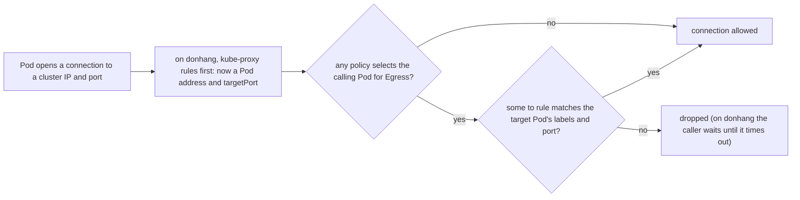

## Bạn cần biết trước

- [[k8s.l3.network-policies]] — NetworkPolicy chọn Pod theo label và biến các kết nối đi vào của chúng thành danh sách cho phép. Bài này làm điều tương tự cho những kết nối mà chúng mở ra.
- [[k8s.l3.coredns]] — mọi lần tra tên từ một Pod đều tới các Pod CoreDNS phía sau Service `kube-dns` trong `kube-system`, và đó chính là thứ một policy chiều đi ra viết ẩu sẽ cắt mất.
- [[k8s.l3.kube-proxy]] — kube-proxy biến kết nối tới một cluster IP thành kết nối tới địa chỉ của một Pod. Trên `donhang`, luật chiều đi ra nhìn thấy kết nối sau bước đó.
- [[k8s.l2.config-repo-overlays]] — manifest của staging nằm trong `base` của repo cấu hình, nên policy mới đến `donhang` bằng một commit mà Argo CD sync.

## Tình huống

Các policy chiều đi vào ở module trước giữ `db` của staging tránh xa mọi thứ trừ những Pod gọi tới nó, nhưng chiều ngược lại vẫn mở. Từ một Pod api trong `donhang`, bạn mở kết nối tới `gitea.git` ở port 3000, Git server giữ repo cấu hình, và kết nối thành công. Api chẳng có lý do gì để nói chuyện với nó, nhưng một container đã bị kẻ tấn công chiếm thì có. Vậy bạn thử cách sửa hiển nhiên trong namespace thử nghiệm `network-lessons`: một policy chặn mọi kết nối đi ra. Giờ Pod thử nghiệm `client` thậm chí không đổi được tên của Service `echo-ip` thành địa chỉ. Làm sao giới hạn những kết nối mà Pod mở ra mà không làm hỏng các lần tra tên, bước đầu tiên của mọi kết nối?

## Khái niệm cốt lõi

- Pod bị cô lập chiều đi ra — Pod rơi vào trạng thái này khi ít nhất một NetworkPolicy chọn nó và có `Egress` trong `policyTypes`. Từ đó nó chỉ mở được những kết nối mà một policy như thế cho phép.
- Policy chặn mặc định chiều đi ra — policy có `podSelector: {}`, có `Egress` trong `policyTypes` và không có danh sách `egress`, nên mọi Pod trong namespace của nó bị cô lập chiều đi ra và không mở được gì.
- Luật `to` — một mục trong danh sách `egress` của policy, nêu các Pod được chọn được phép kết nối tới đâu, bằng `podSelector` và `namespaceSelector`, và trên những `ports` nào.
- Luật DNS — luật `to` cho phép Pod tới các Pod CoreDNS ở port 53, qua cả UDP lẫn TCP.

## Cơ chế hoạt động



Trong tình huống trên, `client` tra tên `echo-ip` bằng cách gửi truy vấn tới cluster IP của `kube-dns` ở port 53. Luật của kube-proxy biến nó thành kết nối tới một Pod CoreDNS. Khi `deny-egress.yaml` đã được áp dụng, có một policy chọn `client` cho `Egress` mà không nêu luật nào, nên kết nối đó bị bỏ như mọi kết nối khác. Với policy, CoreDNS chỉ là vài Pod trong `kube-system`. Không có gì miễn trừ cho DNS.

Luật DNS nêu tên những Pod đó. `namespaceSelector` của nó chọn `kube-system` theo label `kubernetes.io/metadata.name`, label mà chính Kubernetes gắn cho mọi namespace, với giá trị là tên namespace. `podSelector` của nó, nằm trong cùng mục, chọn Pod có label `k8s-app: kube-dns`. Pod phải khớp cả hai. Port 53 được liệt kê hai lần: DNS gửi truy vấn qua UDP, giao thức mang từng thông điệp riêng lẻ mà không cần kết nối, và chuyển sang TCP khi câu trả lời quá lớn.

Cái bẫy thứ hai nằm ở port. Port trong luật là port trên Pod đích, và policy không nêu tên Service được. Vì vậy luật nêu các Pod phía sau Service bằng label và bằng `targetPort` của Service. Trên `donhang`, policy nhìn thấy kết nối sau khi kube-proxy đã đổi đích: `echo-ip` chuyển port 80 sang port 8080, nên luật cho port 80 hết thời gian chờ, còn cùng luật đó với 8080 thì chạy.

Policy chiều đi ra kết hợp với nhau giống policy chiều đi vào: mỗi policy chỉ cộng thêm kết nối được phép, thứ tự nào cũng vậy. Một kết nối giữa hai Pod phải qua được cả policy chiều đi ra của bên gọi lẫn policy chiều đi vào của bên đích.

## Trong hệ thống Đơn Hàng

```yaml file=deploy/gitops/config-repo-kustomize/base/egress-policies.yaml tag=stage-3 lines=15-37
# lesson: k8s.l3.egress-policies
# Every Pod in donhang may ask CoreDNS for names.
apiVersion: networking.k8s.io/v1
kind: NetworkPolicy
metadata:
  name: dns-egress
  namespace: donhang
spec:
  podSelector: {}
  policyTypes: ["Egress"]
  egress:
    - to:
        - namespaceSelector:
            matchLabels:
              kubernetes.io/metadata.name: kube-system
          podSelector:
            matchLabels:
              k8s-app: kube-dns
      ports:
        - protocol: UDP
          port: 53
        - protocol: TCP
          port: 53
```

Đây là luật DNS của staging, có cùng `spec` với `allow-dns-egress.yaml` trong `network-lessons`. Phía trên nó là `default-deny-egress`, policy cô lập mọi Pod trong `donhang`. Phía dưới, mỗi service có một policy nêu những nơi nó gọi tới bằng label Pod và port: api được tới `db` ở 5432, `redis` ở 6379, `rabbitmq` ở 5672 và Keycloak, server đăng nhập, ở 8080, nơi api lấy khóa để kiểm tra token. Payments và Notifications có danh sách tương tự, còn migration hook và job backup chỉ tới được `db`.

```bash file=scripts/k8s/egress-policy.sh tag=stage-3 lines=34-58
# DNS allowed again: the name resolves, but nothing allows the connection
# to echo-ip itself, which times out.
show kubectl apply -f deploy/k8s/lessons/allow-dns-egress.yaml
sleep 3
try_name
try_echo
echo

# lesson: k8s.l3.egress-policies
# A rule for echo-ip's Pods on port 80, the Service's port, still times out:
# kube-proxy has already turned the connection into one to a Pod's port
# 8080 when the policy looks at it. With the targetPort it goes through.
kubectl apply -f - >/dev/null <<'YAML'
apiVersion: networking.k8s.io/v1
kind: NetworkPolicy
metadata:
  name: allow-echo-ip-egress
  namespace: network-lessons
spec:
  podSelector: {}
  policyTypes: ["Egress"]
  egress:
    - to: [{ podSelector: { matchLabels: { app: echo-ip } } }]
      ports: [{ port: 80 }]
YAML
```

```text output=true
...
$ kubectl apply -f deploy/k8s/lessons/deny-egress.yaml
networkpolicy.networking.k8s.io/deny-egress created
$ kubectl exec client -n network-lessons -- getent hosts echo-ip
does not resolve
$ kubectl apply -f deploy/k8s/lessons/allow-dns-egress.yaml
networkpolicy.networking.k8s.io/allow-dns-egress created
$ kubectl exec client -n network-lessons -- getent hosts echo-ip
resolves
$ kubectl exec client -n network-lessons -- wget -T 5 -qO- http://echo-ip
wget: download timed out

$ kubectl apply -f - (allow-echo-ip-egress: to app=echo-ip, port 80)
$ kubectl exec client -n network-lessons -- wget -T 5 -qO- http://echo-ip
wget: download timed out
$ kubectl patch networkpolicy allow-echo-ip-egress -n network-lessons --type json -p [{"op": "replace", "path": "/spec/egress/0/ports/0/port", "value": 8080}]
networkpolicy.networking.k8s.io/allow-echo-ip-egress patched
$ kubectl exec client -n network-lessons -- wget -T 5 -qO- http://echo-ip
echo-ip-...-... saw ...
...
$ kubectl exec deployment/api -n donhang -- timeout 5 bash -c '</dev/tcp/gitea.git/3000'
no connection (exit 124; 124: timeout gave up waiting)
...
== GET https://donhang.localhost:18443/api/v1/orders/1 with a token (the api checks it with Keycloak's keys)
HTTP 200
...
== Pods in donhang not ready: 0
```

`show` in một lệnh rồi chạy nó. `try_name` chạy `getent hosts`, lệnh hỏi resolver của Pod về một tên, rồi in `resolves` hoặc `does not resolve`. `try_echo` chạy `wget -T 5 -qO- http://echo-ip`, lệnh in câu trả lời hoặc bỏ cuộc sau 5 giây.

Output theo đúng thứ tự của script. Các dòng trước đoạn trích áp dụng `deny-egress.yaml`, và tên không tra được. Đoạn trích thêm luật DNS: tên tra được, nhưng lời gọi tới `echo-ip` hết thời gian chờ, vì không có gì cho phép nó. Luật cho port 80 không thay đổi gì. Lệnh patch sau đoạn trích đặt 8080, và câu trả lời quay về.

Phần hai, không trích ở đây, commit `base/egress-policies.yaml` vào repo cấu hình của staging rồi chờ Argo CD sync. Ở đó bash mở kết nối TCP tới `gitea.git` port 3000, và `timeout 5` bỏ cuộc sau 5 giây: Pod api không có kết nối. Một lời gọi `GET /api/v1/orders/1` đã đăng nhập vẫn trả về `HTTP 200`. Dòng cuối đếm những Pod đang chạy trong `donhang` có container đầu tiên chưa sẵn sàng: không có Pod nào.

Policy chiều đi ra chỉ áp lên kết nối mà Pod mở ra. Câu trả lời trên một kết nối mà Pod đã nhận thì được cho phép cùng kết nối đó, nên `db` vẫn trả lời api. Kubelet chạy probe từ node và kéo image thay cho Pod, nên cả hai đều không bị chặn.

## Senior hay nhầm rằng…

- **"Policy chặn mọi kết nối đi ra vẫn để Pod tra được tên, vì DNS là một phần của cluster."** → Thực ra CoreDNS là các Pod bình thường trong `kube-system`, và một lần tra tên là một kết nối tới chúng ở port 53 như mọi kết nối khác. Bạn sẽ nhận ra khi ngay sau khi policy có hiệu lực, mọi lời gọi từ Pod đều thất bại với một tên không tra được.
- **"Luật chiều đi ra cho cluster IP và port của một Service sẽ cho phép kết nối qua Service đó."** → Thực ra port trong luật là port trên Pod đích, và policy không nêu tên Service được, nên luật nêu các Pod bằng label và bằng `targetPort`. Bạn sẽ nhận ra khi trên `donhang`, luật cho port 80 hết thời gian chờ còn cùng luật đó với 8080 thì chạy.
- **"Policy chiều đi ra trên một Pod chặn node kéo image của Pod đó."** → Thực ra kubelet kéo image thay cho Pod và chạy probe từ node, nằm ngoài mọi kết nối của Pod. Bạn sẽ nhận ra khi các Pod api của staging, được tạo lại sau khi có policy chiều đi ra, vẫn sẵn sàng như trước: probe của chúng đến từ node.

## Thử ngay (3 phút)

Ở thư mục gốc của repo Đơn Hàng, khi cluster `donhang` đang chạy:

1. Chạy `kubectl --context kind-donhang apply -f deploy/k8s/lessons/echo-ip.yaml` và `kubectl --context kind-donhang run client -n network-lessons --image=caddy:2.10.0 --command -- sleep 3600`.
2. Chỉ áp dụng `deploy/k8s/lessons/allow-dns-egress.yaml`, không áp dụng `deny-egress.yaml`. Đoán trước kết quả, rồi chạy `kubectl --context kind-donhang exec client -n network-lessons -- wget -T 5 -qO- http://echo-ip`.
3. Dọn dẹp bằng `kubectl --context kind-donhang delete networkpolicy --all -n network-lessons` và `kubectl --context kind-donhang delete pod client -n network-lessons`.

Kết quả mong đợi: bước 2 in `wget: download timed out` (và kubectl thêm `command terminated with exit code 1`), dù không có policy chặn tất cả nào.

<details><summary>Gợi ý đáp án</summary>

`allow-dns-egress.yaml` có `Egress` trong `policyTypes` và chọn mọi Pod bằng `podSelector: {}`. Chỉ vậy thôi đã cô lập chiều đi ra của `client`, nên chỉ còn lại những kết nối mà policy cho phép: DNS. Một policy cho phép thứ gì đó vẫn lấy đi mọi thứ khác của các Pod mà nó chọn. `deny-egress.yaml` nói rõ ý định, và giữ các Pod bị cô lập nếu một ngày policy DNS bị xóa.

</details>

## Liên hệ

- [[k8s.l3.network-policies]] — cùng object đó cho chiều ngược lại. Staging giờ có cả hai, và một kết nối phải qua được từng phía.
- [[k8s.l3.dns-search-and-ndots]] — mỗi truy vấn thừa mà `ndots` gây ra là thêm một kết nối mà luật DNS phải cho phép.
- [[k8s.l3.coredns]] — giải thích vì sao luật DNS nhắm tới `k8s-app: kube-dns` trong `kube-system`: đó là các Pod đứng sau mọi lần tra tên.
- [[k8s.l3.debugging-pod-networking]] — bài tiếp theo: hết thời gian chờ, như bạn thấy ở đây, là dấu hiệu có thể một policy đang bỏ kết nối.

## Tóm tắt 5 dòng

1. Pod bị cô lập chiều đi ra chỉ mở được những kết nối mà một policy nào đó cho phép, nên policy cũng phải cho phép DNS tới CoreDNS.
2. Policy nào có `Egress` trong `policyTypes` cũng cô lập các Pod nó chọn. Chặn tất cả là chặn luôn các lần tra tên.
3. Luật DNS cho phép UDP và TCP port 53 tới các Pod `k8s-app: kube-dns` trong namespace `kube-system`.
4. Port trong luật là port của Pod đích, nên luật nêu Pod bằng label và `targetPort`, không bao giờ nêu Service.
5. Staging chặn mọi kết nối đi ra, rồi cho phép DNS và những nơi từng service gọi tới. Probe và lượt kéo image đều đến từ node.
