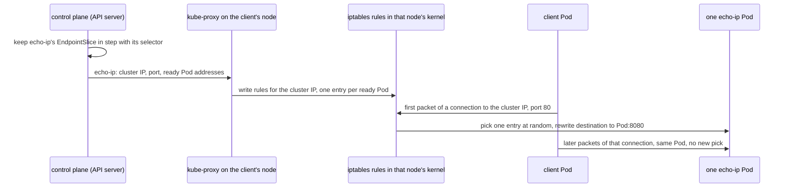

## Before you start

- [[k8s.l3.cni-plugins]] — the CNI plugin gives each Pod its address and its routes carry packets between nodes; this lesson adds the rules that decide which Pod address a Service connection goes to.
- [[k8s.l1.readiness-probes]] — a Pod that fails its readiness probe is taken out of its Services; here you see the list that records this and the rules built from it.
- [[k8s.l2.headless-services]] — a Service with `clusterIP: None` has no cluster IP, and its name resolves straight to its ready Pods' addresses.

## The situation

From a client Pod in `network-lessons` you call `http://echo-ip` ten times with `wget`, a command that sends one HTTP request and prints the response. Each answer names the Pod that served it, and both `echo-ip` Pods show up. Then you send ten requests down one connection with `nc`, a command that opens one TCP connection and sends whatever text it is given. A single Pod answers all ten. You look for whatever owns the Service's cluster IP and compare it with the addresses from `kubectl get pods -o wide` and `kubectl get nodes -o wide`: none matches. What turns your connection into a call to one Pod, and why did the second test stay on one Pod?

## Core concepts

- **EndpointSlice** — an object the control plane keeps for a Service with a selector, listing the addresses of the Pods the selector matches and whether each one is ready.
- **kube-proxy** — the component running on every node that watches Services and EndpointSlices through the API server and writes rules on its node that send connections for a cluster IP to a ready Pod.
- iptables — a Linux feature that keeps rules for packets inside the kernel, the core of the node's operating system: which packets to match and how to change them.
- **eBPF** — a way to load small programs into the Linux kernel; some CNI plugins use such programs to handle Service connections instead of kube-proxy's rules.

## How it works



In the situation above, the control plane keeps `echo-ip`'s EndpointSlice in step with its selector: when a Pod starts, stops or changes readiness, its entry changes. kube-proxy on each node watches Services and EndpointSlices and writes rules for every Service that has a cluster IP. On `donhang`, kube-proxy runs in `iptables` mode, so these are iptables rules. Here the cluster IP is never given to a Pod or a network card; it exists only as the destination those rules match.

When the client Pod opens a connection to the cluster IP on port 80, the first packet meets the rules in its node's kernel. They pick one of the ready Pods at random and rewrite the packet's destination to that Pod's address and port 8080. The Service listens on port 80, but its definition says its Pods listen on 8080 (`targetPort`), so the rewrite changes the port as well as the address. A Pod that is not ready normally has no entry, so it gets no new connections. The node's kernel keeps a record of each open connection and the Pod picked for it, so every later packet of that connection goes to the same Pod without a new pick. The packets then travel over the Pod network like any Pod-to-Pod packet; on `donhang` kube-proxy itself never handles them.

That is why your two tests differed. Each `wget` opened its own connection, so each request got its own pick. With `nc`, ten requests shared one connection, which HTTP allows by keeping a connection open between requests, so one pick served all ten.

A headless Service has no cluster IP, so kube-proxy writes no rules for it. Its clients get the Pod addresses from cluster DNS and connect to them directly.

## In the Đơn Hàng system

```bash file=scripts/k8s/kube-proxy.sh tag=stage-3 lines=11-31
# lesson: k8s.l3.kube-proxy
# The Service's cluster IP, and the EndpointSlice the control plane keeps
# for it: one entry per Pod the selector matches, with whether it is ready.
show kubectl get service echo-ip -n network-lessons
show kubectl get endpointslices -n network-lessons -l kubernetes.io/service-name=echo-ip \
  -o 'custom-columns=ADDRESSES:.endpoints[*].addresses[0],READY:.endpoints[*].conditions.ready,PORT:.ports[0].port'
echo

# lesson: k8s.l3.kube-proxy
# kube-proxy runs in iptables mode here. On every node it wrote rules for
# the cluster IP: send it to the Service's chain; there, one entry per Pod,
# the first taken with probability 0.5; each entry rewrites the destination
# to its Pod's address and port (DNAT).
echo "\$ kubectl get configmap kube-proxy -n kube-system -o jsonpath='{.data.config\.conf}' | grep '^mode'"
kubectl get configmap kube-proxy -n kube-system -o jsonpath='{.data.config\.conf}' | grep '^mode'
echo "\$ docker exec donhang-worker iptables-save -t nat | grep 'network-lessons/echo-ip ' (comments cut)"
docker exec donhang-worker iptables-save -t nat | grep -F '"network-lessons/echo-ip ' \
  | grep -e '-A KUBE-SERVICES' -e '-A KUBE-SVC-.* -j KUBE-SEP' | sed -E 's/ -m comment --comment "[^"]*"//'
docker exec donhang-worker iptables-save -t nat | grep -F '"network-lessons/echo-ip"' \
  | grep DNAT | sed -E 's/ -m comment --comment "[^"]*"//'
echo
```

```text output=true
$ kubectl get service echo-ip -n network-lessons
NAME      TYPE        CLUSTER-IP   EXTERNAL-IP   PORT(S)   AGE
echo-ip   ClusterIP   ...          <none>        80/TCP    ...
$ kubectl get endpointslices -n network-lessons -l kubernetes.io/service-name=echo-ip -o custom-columns=ADDRESSES:.endpoints[*].addresses[0],READY:.endpoints[*].conditions.ready,PORT:.ports[0].port
ADDRESSES   READY       PORT
...,...     true,true   8080

$ kubectl get configmap kube-proxy -n kube-system -o jsonpath='{.data.config\.conf}' | grep '^mode'
mode: iptables
$ docker exec donhang-worker iptables-save -t nat | grep 'network-lessons/echo-ip ' (comments cut)
-A KUBE-SERVICES -d .../32 -p tcp -m tcp --dport 80 -j KUBE-SVC-CLMCAZ67BDWMELKC
-A KUBE-SVC-CLMCAZ67BDWMELKC -m statistic --mode random --probability 0.50000000000 -j KUBE-SEP-...
-A KUBE-SVC-CLMCAZ67BDWMELKC -j KUBE-SEP-...
-A KUBE-SEP-... -p tcp -m tcp -j DNAT --to-destination ...:8080
-A KUBE-SEP-... -p tcp -m tcp -j DNAT --to-destination ...:8080
...
```

`show`, a helper from `scripts/lib/network-lessons.sh`, prints a command after `$` and then runs it. The EndpointSlice is found by its label `kubernetes.io/service-name=echo-ip`: two addresses, both `true` under `READY`, with port `8080`, the Pods' port. The next line shows kube-proxy's mode, `iptables`. Each node of the kind cluster is a Docker container, so `docker exec donhang-worker` runs `iptables-save` on that node; kube-proxy puts a comment on each rule, and the script cuts them. The captured output hides addresses and generated names behind `...`.

Read the rules from the top. The first line matches the cluster IP on port 80. The script keeps only the next lines that pick a Pod: one per Pod, the first taken with probability 0.5 and the second taking the rest, so each Pod gets about half of the new connections. The last two rewrite the destination to one Pod's address and port `8080`.

Each `echo-ip` answer is one line: the answering Pod's name, then `saw` and the address the connection came from. The script keeps that first word to count Pods.

```bash file=scripts/k8s/kube-proxy.sh tag=stage-3 lines=33-48
# lesson: k8s.l3.kube-proxy
# Ten requests, each on a new connection: each connection picks a Pod.
echo "\$ for i in \$(seq 10); do kubectl exec client -n network-lessons -- wget -qO- http://echo-ip; done"
for i in $(seq 10); do
  kubectl exec client -n network-lessons -- wget -qO- http://echo-ip
done | awk '{ print $1 }' | sort -u | awk '{ n++ } END { print "different Pods that answered: " n }'

# Ten requests on one connection kept open (HTTP keep-alive, written by
# hand and sent with nc): the Pod was picked once, when it opened.
requests='for i in $(seq 9); do printf "GET / HTTP/1.1\r\nHost: echo-ip\r\n\r\n"; done
printf "GET / HTTP/1.1\r\nHost: echo-ip\r\nConnection: close\r\n\r\n"'
echo "\$ kubectl exec client -n network-lessons -- sh -c '(ten requests) | nc echo-ip 80'"
kubectl exec client -n network-lessons -- sh -c "($requests) | nc echo-ip 80" \
  | grep ' saw ' | awk '{ print $1 }' \
  | awk '!seen[$1]++ { pods++ } { n++ } END { print "answers: " n ", different Pods that answered: " pods }'
echo
```

```text output=true
...
$ for i in $(seq 10); do kubectl exec client -n network-lessons -- wget -qO- http://echo-ip; done
different Pods that answered: 2
$ kubectl exec client -n network-lessons -- sh -c '(ten requests) | nc echo-ip 80'
answers: 10, different Pods that answered: 1

$ kubectl get service echo-ip-headless -n network-lessons
NAME               TYPE        CLUSTER-IP   EXTERNAL-IP   PORT(S)    AGE
echo-ip-headless   ClusterIP   None         <none>        8080/TCP   ...
rules for echo-ip-headless on donhang-worker: 0
```

The loop starts `wget` ten times, so ten connections, and both Pods answered. The second command writes ten `GET` requests by hand and sends them to `echo-ip` on port 80 over one `nc` connection; only the last one carries `Connection: close`, asking the server to close the connection after answering. All ten answers came from one Pod, the one picked when the connection opened.

The last lines come from the script's final part, outside these excerpts: it creates `echo-ip-headless`, a headless Service with the same selector, and counts the rules naming it on `donhang-worker`. Its `CLUSTER-IP` is `None`, and the count is `0`.

kube-proxy has other modes, and some CNI plugins replace it with eBPF programs in the kernel. The node then holds different rules or programs, but a connection to the cluster IP is still sent to one of the Service's ready Pods.

## Seniors often assume…

- **"A Service is a proxy process that every request passes through."** → Actually on `donhang` kube-proxy only writes rules, and the node's kernel rewrites the destination of each new connection; packets go from the client Pod to the chosen Pod with no process in between. You notice this when you look for a Service's process to read its logs or give it more resources, and find only rules in `iptables-save` on each node.
- **"A Service spreads each HTTP request across its Pods."** → Actually it picks a Pod once per connection, so every request sent on a kept-open connection reaches the same Pod. You notice this when a few clients holding long connections keep one Pod busy while another sits almost idle, or when Pods you just added get nothing from clients whose connections were already open.
- **"A Service's cluster IP is assigned to some machine or Pod in the cluster."** → Actually no single host answers it; on `donhang` it is only the destination that the rules on every node match. You notice this when the cluster IP appears in no Pod's and no node's address list, and on a node only inside a rule, after `-d`.

## Try it (3 minutes)

From the root of the Đơn Hàng repository, with Docker Desktop running:

1. Run `scripts/k8s/kube-proxy.sh`. If the cluster `donhang` is gone, the script builds it first, which takes longer.
2. In your own output, compare each address after `--to-destination` with the `ADDRESSES` of the EndpointSlice, and the address after `-d` with the Service's `CLUSTER-IP`.

Expected result: two lines with `--to-destination`, one for each EndpointSlice address, both with port `8080`; the address after `-d` is the Service's `CLUSTER-IP`; the one-connection test reports ten answers from one Pod.

<details><summary>Suggested answer</summary>

The rules are built from the EndpointSlice: one rule per ready address, rewriting the destination to that address and the Pods' port, 8080. The cluster IP appears only as the destination the first rule matches. Which Pod answered the one-connection test may differ between runs, because the pick is random, but it is always a single Pod for all ten answers.

</details>

## Connections

- [[k8s.l1.services]] — the same Service seen from inside: the stable address that lesson gave a changing set of Pods is a set of rules kube-proxy writes on every node.
- [[k8s.l3.cni-plugins]] — the layer below: once the rules rewrite the destination, the CNI plugin's routes carry the packet to the chosen Pod.
- [[k8s.l3.service-types]] — the next lesson: Services opened to the outside of the cluster, built on these same kube-proxy rules.
- [[backend.l3.message-broker]] — a different way to spread work: there the broker decides which consumer gets each message; here the choice is made once per connection.

## Five-line summary

1. On `donhang` no Pod or node holds a cluster IP: kube-proxy on every node turns each Service into rules sending connections to a ready Pod.
2. An EndpointSlice lists a Service's Pod addresses and readiness; the control plane keeps it current, and normally only ready addresses get new connections.
3. On `donhang` kube-proxy runs in `iptables` mode: one rule per Pod, one picked at random when a connection opens.
4. The pick happens once per connection, so every request sharing a kept-open connection reaches the same Pod.
5. A headless Service gets no rules; other kube-proxy modes or eBPF-based CNI plugins change the rules, but a connection still reaches one ready Pod.
