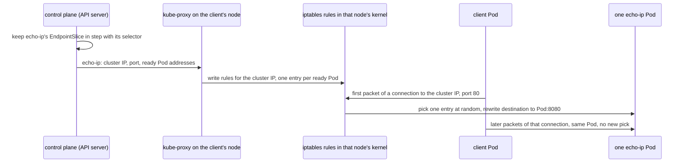

## Bạn cần biết trước

- [[k8s.l3.cni-plugins]] — CNI plugin cấp địa chỉ cho từng Pod, và các route của nó chở gói tin giữa các node. Bài này thêm các luật quyết định một kết nối tới Service sẽ đi tới địa chỉ Pod nào.
- [[k8s.l1.readiness-probes]] — Pod không qua readiness probe bị rút khỏi các Service của nó. Ở đây bạn thấy danh sách ghi lại điều đó và các luật được dựng từ danh sách ấy.
- [[k8s.l2.headless-services]] — Service có `clusterIP: None` thì không có cluster IP, và tên của nó phân giải thẳng ra địa chỉ các Pod đang ready.

## Tình huống

Từ một Pod client trong `network-lessons`, bạn gọi `http://echo-ip` mười lần bằng `wget`, lệnh gửi một HTTP request rồi in response. Mỗi câu trả lời ghi tên Pod đã phục vụ nó, và cả hai Pod `echo-ip` đều xuất hiện. Sau đó bạn gửi mười request trên cùng một kết nối bằng `nc`, lệnh mở một kết nối TCP và gửi đi bất cứ đoạn chữ nào nó nhận được. Chỉ một Pod trả lời cả mười. Bạn tìm xem thứ gì đang giữ cluster IP của Service, rồi so với các địa chỉ trong `kubectl get pods -o wide` và `kubectl get nodes -o wide`: không địa chỉ nào khớp. Cái gì biến kết nối của bạn thành một lời gọi tới một Pod, và vì sao lần thử thứ hai cứ ở lại một Pod?

## Khái niệm cốt lõi

- **EndpointSlice** (object liệt kê địa chỉ các Pod sau một Service và Pod nào đang ready; control plane tự cập nhật) — object mà control plane duy trì cho mỗi Service có selector. Nó liệt kê địa chỉ các Pod khớp selector và cho biết từng Pod có đang ready hay không.
- **kube-proxy** (thành phần chạy trên mọi node, theo dõi Service và viết luật chuyển kết nối từ cluster IP tới IP của Pod) — thành phần chạy trên mọi node, theo dõi Service và EndpointSlice qua API server. Nó ghi luật lên node của mình để gửi các kết nối tới một cluster IP sang một Pod đang ready.
- iptables — tính năng của Linux giữ các luật cho gói tin ngay trong kernel, tức phần lõi của hệ điều hành trên node: khớp gói tin nào và sửa chúng ra sao.
- **eBPF** (cách nạp chương trình nhỏ đã được kiểm vào nhân Linux, dùng xử lý gói tin thay cho luật iptables) — cách nạp những chương trình nhỏ vào kernel Linux. Một số CNI plugin dùng các chương trình như vậy để xử lý kết nối tới Service, thay cho luật của kube-proxy.

## Cơ chế hoạt động



Trong tình huống trên, control plane giữ EndpointSlice của `echo-ip` luôn khớp với selector của nó: khi một Pod khởi động, dừng hoặc đổi trạng thái ready, mục của Pod đó thay đổi theo. kube-proxy trên mỗi node theo dõi Service và EndpointSlice, rồi ghi luật cho mọi Service có cluster IP. Trên `donhang`, kube-proxy chạy ở chế độ `iptables`, nên đây là các luật iptables. Cluster IP ở đây không bao giờ được gán cho Pod hay card mạng nào. Nó chỉ tồn tại như địa chỉ đích mà các luật đó khớp.

Khi Pod client mở kết nối tới cluster IP ở port 80, gói tin đầu tiên gặp các luật trong kernel của node nó. Các luật chọn ngẫu nhiên một trong các Pod đang ready và sửa đích của gói tin thành địa chỉ của Pod đó, port 8080. Service nghe ở port 80, nhưng định nghĩa của nó ghi rằng các Pod nghe ở 8080 (`targetPort`), nên lần sửa này đổi cả port lẫn địa chỉ. Pod chưa ready thường không có mục nào, nên không nhận kết nối mới. Kernel của node ghi nhớ từng kết nối đang mở cùng Pod đã chọn cho nó, nên mọi gói tin sau của kết nối đó tới đúng Pod ấy mà không chọn lại. Sau đó gói tin đi qua mạng Pod như mọi gói tin giữa hai Pod. Trên `donhang`, bản thân kube-proxy không bao giờ chạm vào chúng.

Đó là lý do hai lần thử của bạn khác nhau. Mỗi lần `wget` mở một kết nối riêng, nên mỗi request được chọn Pod riêng. Với `nc`, mười request dùng chung một kết nối, điều HTTP cho phép bằng cách giữ kết nối mở giữa các request, nên một lần chọn phục vụ cả mười.

Headless Service không có cluster IP, nên kube-proxy không ghi luật nào cho nó. Client của nó lấy địa chỉ Pod từ cluster DNS rồi kết nối thẳng tới các địa chỉ đó.

## Trong hệ thống Đơn Hàng

```bash file=scripts/k8s/kube-proxy.sh tag=stage-3 lines=11-31
# lesson: k8s.l3.kube-proxy
# The Service's cluster IP, and the EndpointSlice the control plane keeps
# for it: one entry per Pod the selector matches, with whether it is ready.
show kubectl get service echo-ip -n network-lessons
show kubectl get endpointslices -n network-lessons -l kubernetes.io/service-name=echo-ip \
  -o 'custom-columns=ADDRESSES:.endpoints[*].addresses[0],READY:.endpoints[*].conditions.ready,PORT:.ports[0].port'
echo

# lesson: k8s.l3.kube-proxy
# kube-proxy runs in iptables mode here. On every node it wrote rules for
# the cluster IP: send it to the Service's chain; there, one entry per Pod,
# the first taken with probability 0.5; each entry rewrites the destination
# to its Pod's address and port (DNAT).
echo "\$ kubectl get configmap kube-proxy -n kube-system -o jsonpath='{.data.config\.conf}' | grep '^mode'"
kubectl get configmap kube-proxy -n kube-system -o jsonpath='{.data.config\.conf}' | grep '^mode'
echo "\$ docker exec donhang-worker iptables-save -t nat | grep 'network-lessons/echo-ip ' (comments cut)"
docker exec donhang-worker iptables-save -t nat | grep -F '"network-lessons/echo-ip ' \
  | grep -e '-A KUBE-SERVICES' -e '-A KUBE-SVC-.* -j KUBE-SEP' | sed -E 's/ -m comment --comment "[^"]*"//'
docker exec donhang-worker iptables-save -t nat | grep -F '"network-lessons/echo-ip"' \
  | grep DNAT | sed -E 's/ -m comment --comment "[^"]*"//'
echo
```

```text output=true
$ kubectl get service echo-ip -n network-lessons
NAME      TYPE        CLUSTER-IP   EXTERNAL-IP   PORT(S)   AGE
echo-ip   ClusterIP   ...          <none>        80/TCP    ...
$ kubectl get endpointslices -n network-lessons -l kubernetes.io/service-name=echo-ip -o custom-columns=ADDRESSES:.endpoints[*].addresses[0],READY:.endpoints[*].conditions.ready,PORT:.ports[0].port
ADDRESSES   READY       PORT
...,...     true,true   8080

$ kubectl get configmap kube-proxy -n kube-system -o jsonpath='{.data.config\.conf}' | grep '^mode'
mode: iptables
$ docker exec donhang-worker iptables-save -t nat | grep 'network-lessons/echo-ip ' (comments cut)
-A KUBE-SERVICES -d .../32 -p tcp -m tcp --dport 80 -j KUBE-SVC-CLMCAZ67BDWMELKC
-A KUBE-SVC-CLMCAZ67BDWMELKC -m statistic --mode random --probability 0.50000000000 -j KUBE-SEP-...
-A KUBE-SVC-CLMCAZ67BDWMELKC -j KUBE-SEP-...
-A KUBE-SEP-... -p tcp -m tcp -j DNAT --to-destination ...:8080
-A KUBE-SEP-... -p tcp -m tcp -j DNAT --to-destination ...:8080
...
```

`show` là hàm trợ giúp trong `scripts/lib/network-lessons.sh`: nó in lệnh sau dấu `$` rồi chạy lệnh đó. EndpointSlice được tìm theo label `kubernetes.io/service-name=echo-ip`: hai địa chỉ, cả hai `true` ở cột `READY`, kèm port `8080`, port của các Pod. Dòng kế tiếp cho thấy chế độ của kube-proxy, `iptables`. Mỗi node của cluster kind là một container Docker, nên `docker exec donhang-worker` chạy `iptables-save` trên node đó. kube-proxy gắn một chú thích vào mỗi luật, và script cắt chúng đi. Output ghi lại giấu địa chỉ và các tên tự sinh sau `...`.

Đọc các luật từ trên xuống. Dòng đầu khớp cluster IP ở port 80. Script chỉ giữ lại các dòng tiếp theo chọn Pod: mỗi Pod một dòng, dòng đầu được chọn với xác suất 0,5 và dòng thứ hai nhận phần còn lại, nên mỗi Pod nhận khoảng một nửa số kết nối mới. Hai dòng cuối sửa đích thành địa chỉ của một Pod, port `8080`.

Mỗi câu trả lời của `echo-ip` là một dòng: tên Pod trả lời, rồi `saw` và địa chỉ nơi kết nối xuất phát. Script giữ lại từ đầu tiên này để đếm Pod.

```bash file=scripts/k8s/kube-proxy.sh tag=stage-3 lines=33-48
# lesson: k8s.l3.kube-proxy
# Ten requests, each on a new connection: each connection picks a Pod.
echo "\$ for i in \$(seq 10); do kubectl exec client -n network-lessons -- wget -qO- http://echo-ip; done"
for i in $(seq 10); do
  kubectl exec client -n network-lessons -- wget -qO- http://echo-ip
done | awk '{ print $1 }' | sort -u | awk '{ n++ } END { print "different Pods that answered: " n }'

# Ten requests on one connection kept open (HTTP keep-alive, written by
# hand and sent with nc): the Pod was picked once, when it opened.
requests='for i in $(seq 9); do printf "GET / HTTP/1.1\r\nHost: echo-ip\r\n\r\n"; done
printf "GET / HTTP/1.1\r\nHost: echo-ip\r\nConnection: close\r\n\r\n"'
echo "\$ kubectl exec client -n network-lessons -- sh -c '(ten requests) | nc echo-ip 80'"
kubectl exec client -n network-lessons -- sh -c "($requests) | nc echo-ip 80" \
  | grep ' saw ' | awk '{ print $1 }' \
  | awk '!seen[$1]++ { pods++ } { n++ } END { print "answers: " n ", different Pods that answered: " pods }'
echo
```

```text output=true
...
$ for i in $(seq 10); do kubectl exec client -n network-lessons -- wget -qO- http://echo-ip; done
different Pods that answered: 2
$ kubectl exec client -n network-lessons -- sh -c '(ten requests) | nc echo-ip 80'
answers: 10, different Pods that answered: 1

$ kubectl get service echo-ip-headless -n network-lessons
NAME               TYPE        CLUSTER-IP   EXTERNAL-IP   PORT(S)    AGE
echo-ip-headless   ClusterIP   None         <none>        8080/TCP   ...
rules for echo-ip-headless on donhang-worker: 0
```

Vòng lặp chạy `wget` mười lần, tức mười kết nối, và cả hai Pod đều trả lời. Lệnh thứ hai tự viết mười request `GET` rồi gửi tới `echo-ip` ở port 80 qua một kết nối `nc`. Chỉ request cuối mang `Connection: close`, yêu cầu server đóng kết nối sau khi trả lời. Cả mười câu trả lời đến từ một Pod, chính Pod được chọn lúc kết nối mở.

Mấy dòng cuối đến từ phần cuối của script, nằm ngoài các đoạn trích này: nó tạo `echo-ip-headless`, một headless Service cùng selector, rồi đếm các luật nhắc tới Service đó trên `donhang-worker`. `CLUSTER-IP` của nó là `None`, và số đếm là `0`.

kube-proxy còn những chế độ khác, và một số CNI plugin thay nó bằng các chương trình eBPF trong kernel. Khi đó node giữ luật hoặc chương trình khác, nhưng kết nối tới cluster IP vẫn được gửi tới một trong các Pod đang ready của Service.

## Senior hay nhầm rằng…

- **"Service là một tiến trình proxy mà mọi request đều đi qua."** → Thực ra trên `donhang`, kube-proxy chỉ ghi luật, còn kernel của node sửa đích của từng kết nối mới. Gói tin đi từ Pod client tới Pod được chọn mà không có tiến trình nào đứng giữa. Bạn sẽ nhận ra khi đi tìm tiến trình của một Service để đọc log hoặc cấp thêm tài nguyên, và chỉ thấy các luật trong `iptables-save` trên từng node.
- **"Service rải từng HTTP request ra các Pod."** → Thực ra nó chọn Pod một lần cho mỗi kết nối, nên mọi request gửi trên một kết nối được giữ mở đều tới cùng một Pod. Bạn sẽ nhận ra khi vài client giữ kết nối dài làm một Pod bận liên tục trong khi Pod khác gần như ngồi không, hoặc khi các Pod vừa thêm không nhận được gì từ những client đã mở kết nối từ trước.
- **"Cluster IP của Service được gán cho một máy hoặc một Pod nào đó trong cluster."** → Thực ra không có host nào đứng ra nhận địa chỉ đó. Trên `donhang`, nó chỉ là địa chỉ đích mà các luật trên mọi node khớp. Bạn sẽ nhận ra khi cluster IP không xuất hiện trong danh sách địa chỉ của Pod hay node nào, và trên node chỉ thấy nó trong một luật, sau `-d`.

## Thử ngay (3 phút)

Ở thư mục gốc của repo Đơn Hàng, khi Docker Desktop đang chạy:

1. Chạy `scripts/k8s/kube-proxy.sh`. Nếu cluster `donhang` không còn, script dựng lại nó trước, nên sẽ lâu hơn.
2. Trong output của bạn, so từng địa chỉ sau `--to-destination` với `ADDRESSES` của EndpointSlice, và địa chỉ sau `-d` với `CLUSTER-IP` của Service.

Kết quả mong đợi: hai dòng có `--to-destination`, mỗi dòng ứng với một địa chỉ của EndpointSlice, cả hai đều port `8080`. Địa chỉ sau `-d` là `CLUSTER-IP` của Service. Lần thử một kết nối báo mười câu trả lời từ một Pod.

<details><summary>Gợi ý đáp án</summary>

Các luật được dựng từ EndpointSlice: mỗi địa chỉ ready một luật, sửa đích thành địa chỉ đó và port của các Pod, 8080. Cluster IP chỉ xuất hiện như địa chỉ đích mà luật đầu tiên khớp. Pod trả lời lần thử một kết nối có thể khác nhau giữa các lần chạy, vì Pod được chọn ngẫu nhiên, nhưng cả mười câu trả lời luôn đến từ một Pod duy nhất.

</details>

## Liên hệ

- [[k8s.l1.services]] — cũng Service đó, nhìn từ bên trong: địa chỉ ổn định mà bài đó cho một nhóm Pod luôn thay đổi chính là các luật kube-proxy ghi trên mọi node.
- [[k8s.l3.cni-plugins]] — tầng bên dưới: sau khi các luật sửa đích, route của CNI plugin chở gói tin tới Pod được chọn.
- [[k8s.l3.service-types]] — bài tiếp theo: Service mở ra bên ngoài cluster, dựng trên chính các luật kube-proxy này.
- [[backend.l3.message-broker]] — một kiểu chia việc khác: ở đó broker quyết định consumer nào nhận từng message, còn ở đây Pod được chọn một lần cho mỗi kết nối.

## Tóm tắt 5 dòng

1. Trên `donhang`, không Pod hay node nào giữ cluster IP: kube-proxy trên mọi node biến mỗi Service thành luật gửi kết nối tới một Pod đang ready.
2. EndpointSlice liệt kê địa chỉ và trạng thái ready của các Pod sau một Service. Control plane giữ nó luôn mới, và thường chỉ địa chỉ ready mới nhận kết nối mới.
3. Trên `donhang`, kube-proxy chạy ở chế độ `iptables`: mỗi Pod một luật, một luật được chọn ngẫu nhiên khi kết nối mở.
4. Pod được chọn một lần cho mỗi kết nối, nên mọi request dùng chung một kết nối được giữ mở đều tới cùng một Pod.
5. Headless Service không có luật nào. Chế độ kube-proxy khác hoặc CNI plugin dựa trên eBPF đổi các luật, nhưng kết nối vẫn tới một Pod đang ready.
