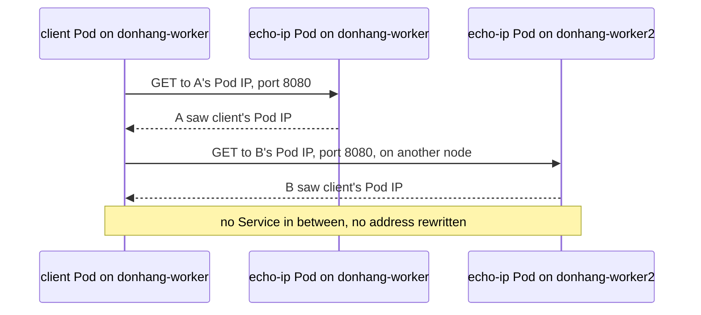

## Before you start

- [[k8s.l1.services]] — a Pod's IP address can change when the Pod is replaced, so a Service puts one stable address in front of Pods; this lesson looks at the Pod addresses themselves.
- [[k8s.l1.cluster-nodes-and-control-plane]] — the cluster `donhang` has one control-plane node and two workers, each a Docker container that kind runs on your machine.
- [[devops.l1.docker-networks]] — in Compose, containers reach each other only when they share a Docker network; this lesson compares the cluster with that.

## The situation

In the lab box, Compose put `api` and `db` on the Docker network `donhang`, and a container on another network could not reach them. The cluster `donhang` has two workers, and each one is a separate Docker container. You start two copies of a tiny web server, `echo-ip`, one on each worker, and a client Pod on `donhang-worker`. kubectl lists a separate IP address for every Pod. You never created a network, opened a port or connected the two workers yourself. Can the client call the copy on the other worker straight at its address, and whose address will that server see the call coming from?

## Core concepts

- **Pod network** — the cluster's one network, in which every Pod has its own IP address and can connect directly to the IP address of any other Pod, on any node.
- Pod IP address — the address in a Pod's `status.podIP`, different from every other Pod's in the cluster; a replacement Pod is a new Pod, and you cannot count on it getting the same address.
- Pod address range — the block of Pod addresses assigned to a node, in its `spec.podCIDR`; `10.244.2.0/24` means every address from `10.244.2.0` to `10.244.2.255`.
- Shared Pod address — all containers of one Pod use the Pod's single IP address and one set of ports, so they reach each other on `localhost`, the name a program uses to reach its own machine; here, the machine is the Pod, so `localhost` reaches the other containers of the same Pod.

## How it works



In the situation above, the client Pod and the two `echo-ip` Pods all sit on the Pod network. Its rules: every Pod gets its own IP address, and every Pod can connect to every other Pod's address, on any node. Kubernetes defines these rules but does not wire Pods together itself: a component, the pod network implementation, chosen when the cluster is built, makes them true on each node. The next lesson opens it up.

The client first calls the `echo-ip` Pod on its own node at that Pod's address and port `8080`, then the Pod on `donhang-worker2` the same way. Some networks replace a connection's source address with the address of the machine it leaves, so the server sees only that machine. The Pod network does not, and no Service sits in between. Each connection arrives with the client's Pod IP address as its source, and `echo-ip` prints that address back. The client uses the same kind of address and port, with no extra step, whichever node the other Pod runs on.

In your run of `donhang`, each Pod's address falls inside the range of the node that runs it. Once you know the ranges, a Pod's address tells you its node.

Inside a Pod, the containers share one address and its ports. They behave like two programs on one machine: one reaches the other on `localhost`, and only one of them can listen on a given port.

Compose draws a line with each Docker network, and containers outside it cannot connect. The Pod network draws no such line: every Pod accepts connections from every other Pod until NetworkPolicies limit them.

## In the Đơn Hàng system

```bash file=scripts/k8s/pod-network.sh tag=stage-3 lines=11-26
# lesson: k8s.l3.pod-network-model
# Every node owns one range of Pod addresses; a Pod gets its address from
# the range of the node it runs on.
show kubectl get nodes -o custom-columns=NODE:.metadata.name,POD-RANGE:.spec.podCIDR
show kubectl get pods -n network-lessons -o custom-columns=POD:.metadata.name,IP:.status.podIP,NODE:.spec.nodeName
echo

# lesson: k8s.l3.pod-network-model
# From client, on donhang-worker, to each echo-ip Pod by its own address,
# one of them on the other worker. Nothing rewrites the source address:
# each Pod sees client's Pod IP.
echo "client's Pod IP: $(kubectl get pod client -n network-lessons -o jsonpath='{.status.podIP}')"
for ip in $(kubectl get pods -n network-lessons -l app=echo-ip -o jsonpath='{.items[*].status.podIP}'); do
  echo "\$ kubectl exec client -n network-lessons -- wget -qO- http://$ip:8080"
  kubectl exec client -n network-lessons -- wget -qO- "http://$ip:8080"
done
```

```text output=true
$ kubectl get nodes -o custom-columns=NODE:.metadata.name,POD-RANGE:.spec.podCIDR
NODE                    POD-RANGE
donhang-control-plane   10.244.0.0/24
donhang-worker          10.244.2.0/24
donhang-worker2         10.244.1.0/24
$ kubectl get pods -n network-lessons -o custom-columns=POD:.metadata.name,IP:.status.podIP,NODE:.spec.nodeName
POD               IP    NODE
client            ...   donhang-worker...
echo-ip-...-...   ...   donhang-worker...
echo-ip-...-...   ...   donhang-worker...

client's Pod IP: ...
$ kubectl exec client -n network-lessons -- wget -qO- http://...:8080
echo-ip-...-... saw ...
$ kubectl exec client -n network-lessons -- wget -qO- http://...:8080
echo-ip-...-... saw ...

$ kubectl apply -f deploy/k8s/lessons/two-container-pod.yaml
pod/two-containers created
Pod IP: ...
$ kubectl exec two-containers -c web -n network-lessons -- hostname -i
...
$ kubectl exec two-containers -c client -n network-lessons -- hostname -i
...
$ kubectl exec two-containers -c client -n network-lessons -- wget -qO- http://localhost:80 | grep -o '<title>.*</title>'
<title>Caddy works!</title>
$ kubectl exec two-containers -c client -n network-lessons -- nc -l -p 80
nc: bind: Address in use
```

Earlier lines, not shown, start the two `echo-ip` Pods and the Pod `client` on `donhang-worker`. `show`, a helper from `scripts/lib/network-lessons.sh` that the script loads first, prints a command after `$` and then runs it. The first command prints one range per node, the control-plane node included. The captured output hides Pod addresses and names with `...` because they change on every run; the node names are cut too, so check the `NODE` column and the `saw` lines in your own run.

The `echo` line and the `for` loop at the end read the client's own address, then call each `echo-ip` Pod at its Pod IP address on port `8080`. `kubectl exec` runs the command after `--` inside the Pod (`-c` picks which container), and `wget -qO-` fetches a URL and prints the response. Each answer is the answering Pod's name, then `saw`, then the address the connection came from. Caddy, the web server program that each `echo-ip` Pod runs, fills in that address, as configured in `echo-ip.yaml`, outside the excerpt. In your run, both answers show the client's Pod IP address, including the answer from the Pod on the other worker.

So far each Pod had one container; what if a Pod has two? The rest of the output comes from lines after the excerpt, which apply the next file and run commands in its two containers.

```yaml file=deploy/k8s/lessons/two-container-pod.yaml tag=stage-3 lines=1-18
# lesson: k8s.l3.pod-network-model
# Two containers in one Pod. web serves on port 80; client has no server of
# its own and reaches web on localhost, because both share the Pod's address
# and its ports.
apiVersion: v1
kind: Pod
metadata:
  name: two-containers
  namespace: network-lessons
spec:
  containers:
    - name: web
      image: caddy:2.10.0
      ports:
        - containerPort: 80
    - name: client
      image: caddy:2.10.0
      command: ["sleep", "3600"]
```

`web` starts Caddy the way the image does by default, serving a welcome page on port 80. `client` uses the same image, but its `command` replaces the image's start command with `sleep 3600`, so no server runs in it. In your run, `hostname -i` prints the same address in both containers, the one on the `Pod IP:` line. In the captured output, `client` fetches the welcome page from `http://localhost:80`, and `nc -l -p 80`, which tries to listen on port 80, fails with `Address in use`: `web` already holds that port of the shared address.

## Seniors often assume…

- **"A Pod on one node can reach a Pod on another node only through a Service."** → Actually every Pod can connect straight to any other Pod's IP address, on any node; a Service adds a stable address in front of Pods that come and go, not the ability to connect. You notice this when a call to a Pod IP address on the other worker answers, then fails once that Pod is replaced and its replacement has a different address.
- **"A Pod sees connections from other Pods as coming from their node's IP address."** → Actually nothing rewrites the source address between Pods, so the server sees the caller's own Pod IP address. You notice this when `echo-ip` on `donhang-worker2` prints `saw` followed by the client's Pod IP address.
- **"Two containers in one Pod each get their own IP address, like two Compose services."** → Actually they share the Pod's single address and its ports, like two programs on one machine. You notice this when a second container cannot listen on a port the first one already uses and fails with `Address in use`.

## Try it (3 minutes)

From the root of the Đơn Hàng repository, with Docker Desktop running:

1. Run `scripts/k8s/pod-network.sh`. If the cluster `donhang` is gone, the script builds it first, which takes longer.
2. In your own output, compare the `client's Pod IP:` line with the address after `saw` in both answers. Then check each Pod's address against the range of the node in its `NODE` column. Finally, compare the two `hostname -i` lines with the `Pod IP:` line.

Expected result: both answers end with the client's Pod IP address; every Pod's address lies inside its node's range; the two `hostname -i` lines print the address on the `Pod IP:` line.

<details><summary>Suggested answer</summary>

One answer comes from the `echo-ip` Pod on `donhang-worker2`, yet it reports the client's own Pod IP address, not an address of `donhang-worker`: the connection crossed nodes with its source unchanged. The node ranges in your run may differ from the captured ones, but each Pod's address still falls inside the range of the node that runs it.

</details>

## Connections

- [[foundation.l1.ip-and-ports]] — the address-and-port basics this lesson applies to Pods, where one address belongs to a whole Pod and its containers share the ports.
- [[k8s.l3.network-policies]] — the limit on the open network described here: it turns "every Pod reaches every Pod" into an allow list.
- [[k8s.l3.cni-plugins]] — the next lesson: the component that actually gives each Pod its address and connects it to the node.
- [[k8s.l3.kube-proxy]] — how a connection to a Service's cluster IP ends up at one of the Pod IP addresses shown here.

## Five-line summary

1. In the Pod network, every Pod has its own IP address and connects directly to every other Pod's address, on any node.
2. Kubernetes defines these rules but does not wire Pods together itself; a component chosen when the cluster is built does.
3. Nothing rewrites addresses between Pods, so a server sees the caller's own Pod IP address.
4. In your run of `donhang`, each Pod's address falls inside its node's range in `spec.podCIDR`.
5. Containers of one Pod share its address and ports; unlike Compose networks, the Pod network is open cluster-wide.
