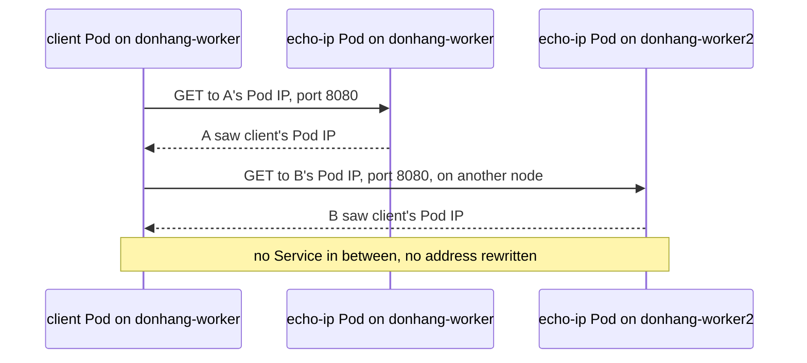

## Bạn cần biết trước

- [[k8s.l1.services]] — địa chỉ IP của Pod có thể đổi khi Pod bị thay, nên Service đặt một địa chỉ cố định đứng trước các Pod. Bài này xem xét chính địa chỉ của Pod.
- [[k8s.l1.cluster-nodes-and-control-plane]] — cluster `donhang` có một node control plane và hai worker, mỗi node là một container Docker mà kind chạy trên máy bạn.
- [[devops.l1.docker-networks]] — trong Compose, các container chỉ gọi được nhau khi chung một Docker network. Bài này so sánh cluster với cách đó.

## Tình huống

Trong lab box, Compose đặt `api` và `db` vào Docker network `donhang`, và container ở network khác không gọi tới chúng được. Cluster `donhang` có hai worker, mỗi worker là một container Docker riêng. Bạn khởi động hai bản của một web server nhỏ tên `echo-ip`, mỗi worker một bản, cùng một Pod client trên `donhang-worker`. kubectl liệt kê cho mỗi Pod một địa chỉ IP riêng. Bạn chưa hề tạo network, mở port hay tự nối hai worker với nhau. Client có gọi thẳng được bản chạy trên worker kia bằng địa chỉ của nó không, và server sẽ thấy lời gọi đến từ địa chỉ của ai?

## Khái niệm cốt lõi

- **mạng Pod** (Pod network) — mạng duy nhất của cluster, trong đó mỗi Pod có địa chỉ IP riêng và kết nối thẳng được tới địa chỉ IP của bất kỳ Pod nào khác, trên bất kỳ node nào.
- Địa chỉ IP của Pod — địa chỉ trong `status.podIP` của Pod, khác với địa chỉ của mọi Pod khác trong cluster. Pod thay thế là một Pod mới, và bạn không thể trông vào chuyện nó nhận lại đúng địa chỉ cũ.
- Dải địa chỉ Pod — khối địa chỉ Pod cấp cho một node, nằm trong `spec.podCIDR` của node. `10.244.2.0/24` nghĩa là mọi địa chỉ từ `10.244.2.0` đến `10.244.2.255`.
- Địa chỉ Pod dùng chung — mọi container của một Pod dùng chung một địa chỉ IP của Pod và một bộ port, nên chúng gọi nhau qua `localhost`, cái tên mà chương trình dùng để gọi tới chính máy của nó. Ở đây máy đó là Pod, nên `localhost` dẫn tới các container khác trong cùng Pod.

## Cơ chế hoạt động



Trong tình huống trên, Pod client và hai Pod `echo-ip` đều nằm trên mạng Pod. Luật của nó: mỗi Pod có địa chỉ IP riêng, và mỗi Pod kết nối được tới địa chỉ của mọi Pod khác, trên bất kỳ node nào. Kubernetes đặt ra các luật này nhưng không tự nối các Pod với nhau. Một thành phần, phần hiện thực mạng Pod, được chọn lúc dựng cluster, làm cho chúng thành sự thật trên từng node. Bài tiếp theo mở thành phần này ra xem.

Client gọi Pod `echo-ip` trên chính node của mình trước, bằng địa chỉ của Pod đó và port `8080`, rồi gọi Pod trên `donhang-worker2` theo cùng cách. Có những mạng thay địa chỉ nguồn của kết nối bằng địa chỉ của máy mà kết nối rời đi, nên server chỉ thấy máy đó. Mạng Pod thì không, và cũng không có Service nào đứng giữa. Mỗi kết nối đến nơi với địa chỉ nguồn là địa chỉ IP Pod của client, và `echo-ip` in lại địa chỉ đó. Client dùng cùng một kiểu địa chỉ và port, không thêm bước nào, dù Pod kia chạy trên node nào.

Trong lần chạy `donhang` của bạn, địa chỉ của mỗi Pod nằm trong dải của node chạy nó. Biết các dải rồi thì nhìn địa chỉ của Pod là biết nó ở node nào.

Trong một Pod, các container dùng chung một địa chỉ và các port của nó. Chúng hành xử như hai chương trình trên cùng một máy: chương trình này gọi chương trình kia qua `localhost`, và mỗi port chỉ một trong hai được lắng nghe.

Compose vạch ranh giới bằng từng Docker network, và container nằm ngoài không kết nối vào được. Mạng Pod không vạch ranh giới nào như vậy: mọi Pod nhận kết nối từ mọi Pod khác cho tới khi NetworkPolicy giới hạn lại.

## Trong hệ thống Đơn Hàng

```bash file=scripts/k8s/pod-network.sh tag=stage-3 lines=11-26
# lesson: k8s.l3.pod-network-model
# Every node owns one range of Pod addresses; a Pod gets its address from
# the range of the node it runs on.
show kubectl get nodes -o custom-columns=NODE:.metadata.name,POD-RANGE:.spec.podCIDR
show kubectl get pods -n network-lessons -o custom-columns=POD:.metadata.name,IP:.status.podIP,NODE:.spec.nodeName
echo

# lesson: k8s.l3.pod-network-model
# From client, on donhang-worker, to each echo-ip Pod by its own address,
# one of them on the other worker. Nothing rewrites the source address:
# each Pod sees client's Pod IP.
echo "client's Pod IP: $(kubectl get pod client -n network-lessons -o jsonpath='{.status.podIP}')"
for ip in $(kubectl get pods -n network-lessons -l app=echo-ip -o jsonpath='{.items[*].status.podIP}'); do
  echo "\$ kubectl exec client -n network-lessons -- wget -qO- http://$ip:8080"
  kubectl exec client -n network-lessons -- wget -qO- "http://$ip:8080"
done
```

```text output=true
$ kubectl get nodes -o custom-columns=NODE:.metadata.name,POD-RANGE:.spec.podCIDR
NODE                    POD-RANGE
donhang-control-plane   10.244.0.0/24
donhang-worker          10.244.2.0/24
donhang-worker2         10.244.1.0/24
$ kubectl get pods -n network-lessons -o custom-columns=POD:.metadata.name,IP:.status.podIP,NODE:.spec.nodeName
POD               IP    NODE
client            ...   donhang-worker...
echo-ip-...-...   ...   donhang-worker...
echo-ip-...-...   ...   donhang-worker...

client's Pod IP: ...
$ kubectl exec client -n network-lessons -- wget -qO- http://...:8080
echo-ip-...-... saw ...
$ kubectl exec client -n network-lessons -- wget -qO- http://...:8080
echo-ip-...-... saw ...

$ kubectl apply -f deploy/k8s/lessons/two-container-pod.yaml
pod/two-containers created
Pod IP: ...
$ kubectl exec two-containers -c web -n network-lessons -- hostname -i
...
$ kubectl exec two-containers -c client -n network-lessons -- hostname -i
...
$ kubectl exec two-containers -c client -n network-lessons -- wget -qO- http://localhost:80 | grep -o '<title>.*</title>'
<title>Caddy works!</title>
$ kubectl exec two-containers -c client -n network-lessons -- nc -l -p 80
nc: bind: Address in use
```

Các dòng phía trước, không trích ở đây, khởi động hai Pod `echo-ip` và Pod `client` trên `donhang-worker`. `show` là hàm trợ giúp trong `scripts/lib/network-lessons.sh`, file mà script nạp đầu tiên: nó in lệnh sau dấu `$` rồi chạy lệnh đó. Lệnh đầu in mỗi node một dải, kể cả node control plane. Output ghi lại che địa chỉ và tên Pod bằng `...` vì chúng đổi sau mỗi lần chạy. Tên node cũng bị cắt, nên hãy xem cột `NODE` và các dòng `saw` trong lần chạy của chính bạn.

Dòng `echo` và vòng `for` ở cuối đọc địa chỉ của chính client, rồi gọi từng Pod `echo-ip` bằng địa chỉ IP Pod của nó ở port `8080`. `kubectl exec` chạy lệnh đứng sau `--` bên trong Pod (`-c` chọn container), còn `wget -qO-` tải một URL và in response ra. Mỗi câu trả lời gồm tên Pod trả lời, rồi `saw`, rồi địa chỉ mà kết nối đến từ đó. Caddy, chương trình web server mà mỗi Pod `echo-ip` chạy, điền địa chỉ đó theo cấu hình trong `echo-ip.yaml`, nằm ngoài đoạn trích. Trong lần chạy của bạn, cả hai câu trả lời đều cho thấy địa chỉ IP Pod của client, kể cả câu trả lời từ Pod trên worker kia.

Tới đây mỗi Pod chỉ có một container. Nếu Pod có hai container thì sao? Phần output còn lại đến từ các dòng sau đoạn trích: chúng apply file dưới đây và chạy lệnh trong hai container của nó.

```yaml file=deploy/k8s/lessons/two-container-pod.yaml tag=stage-3 lines=1-18
# lesson: k8s.l3.pod-network-model
# Two containers in one Pod. web serves on port 80; client has no server of
# its own and reaches web on localhost, because both share the Pod's address
# and its ports.
apiVersion: v1
kind: Pod
metadata:
  name: two-containers
  namespace: network-lessons
spec:
  containers:
    - name: web
      image: caddy:2.10.0
      ports:
        - containerPort: 80
    - name: client
      image: caddy:2.10.0
      command: ["sleep", "3600"]
```

`web` khởi động Caddy theo mặc định của image, phục vụ một trang chào ở port 80. `client` dùng cùng image, nhưng `command` của nó thay lệnh khởi động của image bằng `sleep 3600`, nên không có server nào chạy trong đó. Trong lần chạy của bạn, `hostname -i` in cùng một địa chỉ ở cả hai container, chính là địa chỉ trên dòng `Pod IP:`. Trong output ghi lại, `client` tải trang chào từ `http://localhost:80`, còn `nc -l -p 80`, lệnh thử lắng nghe ở port 80, thất bại với `Address in use`: `web` đã giữ port đó trên địa chỉ dùng chung.

## Senior hay nhầm rằng…

- **"Pod trên node này chỉ tới được Pod trên node khác qua Service."** → Thực ra mọi Pod kết nối thẳng được tới địa chỉ IP của bất kỳ Pod nào khác, trên bất kỳ node nào. Service thêm một địa chỉ cố định đứng trước những Pod đến rồi đi, chứ không phải thứ cho phép kết nối. Bạn sẽ nhận ra khi lời gọi tới địa chỉ IP của một Pod trên worker kia vẫn trả lời, rồi hỏng khi Pod đó bị thay và Pod mới có địa chỉ khác.
- **"Pod thấy kết nối từ Pod khác như đến từ địa chỉ IP của node."** → Thực ra không có gì thay địa chỉ nguồn giữa các Pod, nên server thấy chính địa chỉ IP Pod của bên gọi. Bạn sẽ nhận ra khi `echo-ip` trên `donhang-worker2` in `saw` kèm địa chỉ IP Pod của client.
- **"Hai container trong một Pod mỗi cái có địa chỉ IP riêng, như hai service trong Compose."** → Thực ra chúng dùng chung địa chỉ duy nhất của Pod và các port của nó, như hai chương trình trên cùng một máy. Bạn sẽ nhận ra khi container thứ hai không lắng nghe được ở port mà container thứ nhất đang dùng và thất bại với `Address in use`.

## Thử ngay (3 phút)

Ở thư mục gốc của repo Đơn Hàng, khi Docker Desktop đang chạy:

1. Chạy `scripts/k8s/pod-network.sh`. Nếu cluster `donhang` không còn, script dựng lại nó trước, nên sẽ lâu hơn.
2. Trong output của bạn, so dòng `client's Pod IP:` với địa chỉ sau `saw` ở cả hai câu trả lời. Sau đó đối chiếu địa chỉ của từng Pod với dải của node trong cột `NODE` của nó. Cuối cùng, so hai dòng `hostname -i` với dòng `Pod IP:`.

Kết quả mong đợi: cả hai câu trả lời kết thúc bằng địa chỉ IP Pod của client. Địa chỉ của mỗi Pod nằm trong dải của node chạy nó. Hai dòng `hostname -i` in ra địa chỉ trên dòng `Pod IP:`.

<details><summary>Gợi ý đáp án</summary>

Một câu trả lời đến từ Pod `echo-ip` trên `donhang-worker2`, vậy mà nó báo lại chính địa chỉ IP Pod của client, không phải một địa chỉ của `donhang-worker`: kết nối đi qua node khác mà địa chỉ nguồn vẫn giữ nguyên. Dải của các node trong lần chạy của bạn có thể khác với output ghi lại, nhưng địa chỉ của mỗi Pod vẫn nằm trong dải của node chạy nó.

</details>

## Liên hệ

- [[foundation.l1.ip-and-ports]] — kiến thức cơ bản về địa chỉ và port mà bài này áp dụng cho Pod, nơi một địa chỉ thuộc về cả Pod và các container của nó dùng chung port.
- [[k8s.l3.network-policies]] — giới hạn đặt lên mạng mở mô tả ở đây: biến "mọi Pod tới được mọi Pod" thành danh sách cho phép.
- [[k8s.l3.cni-plugins]] — bài tiếp theo: thành phần thực sự cấp địa chỉ cho từng Pod và nối nó vào node.
- [[k8s.l3.kube-proxy]] — cách một kết nối tới cluster IP của Service đến được một trong các địa chỉ IP Pod như ở bài này.

## Tóm tắt 5 dòng

1. Trong mạng Pod, mỗi Pod có địa chỉ IP riêng và kết nối thẳng tới địa chỉ của mọi Pod khác, trên bất kỳ node nào.
2. Kubernetes đặt ra các luật này nhưng không tự nối các Pod. Một thành phần được chọn lúc dựng cluster làm việc đó.
3. Không có gì thay địa chỉ giữa các Pod, nên server thấy chính địa chỉ IP Pod của bên gọi.
4. Trong lần chạy `donhang` của bạn, địa chỉ của mỗi Pod nằm trong dải của node chạy nó, ghi ở `spec.podCIDR`.
5. Các container của một Pod dùng chung địa chỉ và port của Pod. Khác với Docker network của Compose, mạng Pod mở trên toàn cluster.
