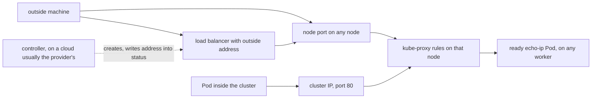

## Before you start

- [[k8s.l3.kube-proxy]] — kube-proxy on every node writes rules that send connections for a cluster IP to a ready Pod; this lesson adds rules for a port on the node itself.
- [[k8s.l2.ingress]] — a Service without a `type` is reachable only inside the cluster, and Traefik reached your machine through ports the staging node publishes; here you meet the Service types that open one Service to the outside.

## The situation

`echo-ip` is a Service in the namespace `network-lessons` whose two Pods answer each request with their own Pod name. A teammate calls it from a machine next to the cluster and gets no answer. On `donhang`, its cluster IP exists only as the destination of kube-proxy's rules on each node, so an outside machine has nowhere to send a packet for it. You want one setting that makes the Service answer where that machine can reach: a node's own address, on every node. On a cloud, a Service can also ask for an outside address of its own. How does a Service accept connections that arrive at a node, and what does asking for an outside address need?

## Core concepts

- **NodePort Service** — a Service with `type: NodePort`: a Service of the default type, `ClusterIP`, which is what you get without a `type`, that also opens the same port on every node and forwards connections arriving there to one of the Service's Pods.
- node port — the port number a NodePort Service opens on every node, kept in the Service's `spec.ports[].nodePort`.
- **LoadBalancer Service** — a Service with `type: LoadBalancer`: by default a NodePort Service that also asks a controller that not every cluster runs, on a cloud usually one the provider supplies, for a load balancer with an outside address.
- controller — here, a program that watches Kubernetes objects and acts on them in a control loop, as an Ingress controller does for Ingresses.
- cloud — a provider that rents out machines for your cluster and runs services such as load balancers next to them.
- load balancer — here, something outside the cluster with its own address that spreads incoming connections over several targets, the nodes.

## How it works



In the situation above, adding `type: NodePort` keeps everything a Service without a `type` has: the cluster IP, the selector and the ports. A Pod inside still calls the cluster IP on port 80. On top of that, Kubernetes reserves one port number for the Service, the node port, and opens it on every node. Unless the manifest sets `nodePort`, Kubernetes picks a free number from a range, 30000–32767 by default. kube-proxy on each node writes rules for that port next to the rules for the cluster IP. With the default settings, which `echo-nodeport` uses, a connection to any node's address on the node port goes to one ready Pod of the Service, which may run on another node.

A LoadBalancer Service adds one step. It gets a cluster IP and, by default, a node port (a setting can turn it off; this lesson keeps the default), and it asks for a load balancer with an outside address. Kubernetes itself does not create that load balancer. A controller that not every cluster runs, on a cloud usually one the provider supplies, watches for such Services, sets up a load balancer that sends traffic to the nodes, and writes the outside address into the Service's status. `kubectl get service` shows it under `EXTERNAL-IP`.

kind, the tool that runs `donhang`'s nodes as Docker containers on your machine, runs no such controller. On `donhang` nobody answers the request, and `EXTERNAL-IP` stays `<pending>` while the cluster IP and node port work as before. A cluster outside a cloud needs its own component to hand out outside addresses. Đơn Hàng's lab does without one: it reaches its Gateway through ports the staging node publishes to your machine, `127.0.0.1:18080` and `127.0.0.1:18443`.

## In the Đơn Hàng system

`service-types.sh` runs on your machine against the cluster `donhang`, which has one control-plane node, `donhang-control-plane`, and two worker nodes that run the application Pods. Earlier lines, outside the excerpts, start the two `echo-ip` Pods and `client`, a Pod that is only there to send requests. They also remove what a later module installs to hand out outside addresses, so that, as on a fresh kind cluster, nothing answers a LoadBalancer Service's request.

```bash file=scripts/k8s/service-types.sh tag=stage-3 lines=16-31
# lesson: k8s.l3.service-types
# A NodePort Service: Kubernetes picked the node port, shown after the
# colon in PORT(S).
kubectl delete service echo-nodeport echo-loadbalancer -n network-lessons --ignore-not-found >/dev/null
show kubectl apply -f deploy/k8s/lessons/echo-nodeport.yaml
show kubectl get service echo-nodeport -n network-lessons
node_port=$(kubectl get service echo-nodeport -n network-lessons -o jsonpath='{.spec.ports[0].nodePort}')
echo

# lesson: k8s.l3.service-types
# Both echo-ip Pods run on the workers; the control-plane node runs none,
# yet its node port answers: kube-proxy there forwards to a Pod elsewhere.
show kubectl get pods -n network-lessons -l app=echo-ip -o custom-columns=POD:.metadata.name,NODE:.spec.nodeName
cp_ip=$(kubectl get node donhang-control-plane -o jsonpath='{.status.addresses[0].address}')
echo "\$ kubectl exec client -n network-lessons -- wget -qO- http://<donhang-control-plane's address>:<node port>"
kubectl exec client -n network-lessons -- wget -qO- "http://$cp_ip:$node_port"
```

```text output=true
$ kubectl apply -f deploy/k8s/lessons/echo-nodeport.yaml
service/echo-nodeport created
$ kubectl get service echo-nodeport -n network-lessons
NAME            TYPE       CLUSTER-IP   EXTERNAL-IP   PORT(S)      AGE
echo-nodeport   NodePort   ...          <none>        80:.../TCP   ...

$ kubectl get pods -n network-lessons -l app=echo-ip -o custom-columns=POD:.metadata.name,NODE:.spec.nodeName
POD               NODE
echo-ip-...-...   donhang-worker...
echo-ip-...-...   donhang-worker...
$ kubectl exec client -n network-lessons -- wget -qO- http://<donhang-control-plane's address>:<node port>
echo-ip-...-... saw 172.22.0.2
...
```

`show`, a helper from `scripts/lib/network-lessons.sh`, prints a command after `$` and then runs it. The first line deletes both Services if an earlier run left them, so the script starts clean. `echo-nodeport.yaml`, outside the excerpts, is the `echo-ip` Service's selector and ports with `type: NodePort` and no `nodePort`.

`PORT(S)` reads `80:.../TCP`: port 80 on the cluster IP, then the node port Kubernetes picked, hidden as `...` in the captured output. The script reads that number into `node_port`.

Both Pods run on workers, so `cp_ip`, the address of the node `donhang-control-plane`, belongs to a node with no `echo-ip` Pod. `wget -qO- <url>`, run inside `client`, sends a `GET` request to the URL and prints only the response body. The call goes to that node's address and node port. It starts in `client` because a Pod reaches the nodes' addresses; whether your own machine can depends on how Docker runs kind's nodes, and staging does not rely on it: it publishes ports to `127.0.0.1`. The answer names an `echo-ip` Pod on a worker: the rules on the control-plane node sent the connection there. This lesson does not use the address after `saw`.

```bash file=scripts/k8s/service-types.sh tag=stage-3 lines=34-45
# lesson: k8s.l3.service-types
# A LoadBalancer Service asks for an outside address. kind has no controller
# to hand one out, so EXTERNAL-IP stays <pending>; the cluster IP and the
# node port work all the same.
show kubectl apply -f deploy/k8s/lessons/echo-loadbalancer.yaml
sleep 10
show kubectl get service echo-loadbalancer -n network-lessons
lb_port=$(kubectl get service echo-loadbalancer -n network-lessons -o jsonpath='{.spec.ports[0].nodePort}')
echo "\$ kubectl exec client -n network-lessons -- wget -qO- http://echo-loadbalancer"
kubectl exec client -n network-lessons -- wget -qO- http://echo-loadbalancer
echo "\$ kubectl exec client -n network-lessons -- wget -qO- http://<donhang-control-plane's address>:<its node port>"
kubectl exec client -n network-lessons -- wget -qO- "http://$cp_ip:$lb_port"
```

```text output=true
...
$ kubectl apply -f deploy/k8s/lessons/echo-loadbalancer.yaml
service/echo-loadbalancer created
$ kubectl get service echo-loadbalancer -n network-lessons
NAME                TYPE           CLUSTER-IP   EXTERNAL-IP   PORT(S)      AGE
echo-loadbalancer   LoadBalancer   ...          <pending>     80:.../TCP   ...
$ kubectl exec client -n network-lessons -- wget -qO- http://echo-loadbalancer
echo-ip-...-... saw ...
$ kubectl exec client -n network-lessons -- wget -qO- http://<donhang-control-plane's address>:<its node port>
echo-ip-...-... saw 172.22.0.2
```

`echo-loadbalancer.yaml`, also outside the excerpts, has the same selector and ports with `type: LoadBalancer`. Ten seconds later `EXTERNAL-IP` is still `<pending>`, yet `CLUSTER-IP` and `PORT(S)` are filled in just as for `echo-nodeport`. The call by name goes through the cluster IP; the call to the control-plane node goes through this Service's own node port, `lb_port`. Both reach an `echo-ip` Pod. Nothing was replaced: the LoadBalancer Service has everything the NodePort Service has, plus a request that nothing on kind answers.

## Seniors often assume…

- **"A node port is opened only on the nodes where the Service's Pods run."** → Actually it is opened on every node, and by default the rules there forward the connection to a Pod wherever it runs. You notice this when the control-plane node, which runs no `echo-ip` Pod, answers on the node port in `service-types.sh`.
- **"Creating a LoadBalancer Service gets an outside address on any cluster."** → Actually the address comes from a controller that not every cluster runs, which clouds usually provide and kind does not. You notice this when `EXTERNAL-IP` stays `<pending>` on a cluster you built yourself.
- **"A LoadBalancer Service replaces the cluster IP and node port."** → Actually it adds to them: by default it gets both, and both work whether or not an outside address ever arrives. You notice this when `echo-loadbalancer` shows a `CLUSTER-IP` and `80:.../TCP` under `PORT(S)` while `EXTERNAL-IP` is `<pending>`, and calls through either still answer.

## Try it (3 minutes)

From the root of the Đơn Hàng repository, with Docker Desktop, the program that runs Docker containers and so kind's nodes, running:

1. Run `scripts/k8s/service-types.sh`. If the cluster `donhang` is gone, the script builds it first, which takes longer.
2. In your own output, read the number after `80:` under `PORT(S)` for each of the two Services.

Expected result: the two Services show two different numbers, both between 30000 and 32767; `echo-loadbalancer` shows `<pending>` under `EXTERNAL-IP`; each of the three `wget` calls prints one line starting with an `echo-ip` Pod's name.

## Connections

- [[k8s.l3.kube-proxy]] — the layer below: a node port is one more set of rules kube-proxy writes on every node, next to the cluster IP's.
- [[k8s.l2.ingress]] — a different job: an Ingress routes HTTP requests to Services by host and path, while these types only open a port or ask for an address for one Service.
- [[k8s.l2.gateway-api]] — where outside requests go on staging: Đơn Hàng reaches the Gateway through ports the staging node publishes, not through a LoadBalancer address.
- [[k8s.l3.clusters-without-a-cloud]] — the problem this lesson leaves open: what hands out outside addresses when no cloud does.

## Five-line summary

1. A NodePort Service is a default (`ClusterIP`) Service plus one port opened on every node and forwarded by kube-proxy to a ready Pod.
2. Unless `nodePort` is set, Kubernetes picks that port from 30000–32767 by default; by default any node answers on it, even one without Pods.
3. A LoadBalancer Service is, by default, a NodePort Service that also asks a controller not every cluster runs, usually the cloud's, for an outside address.
4. kind has no such controller, so `EXTERNAL-IP` stays `<pending>` while the cluster IP and node port still work.
5. A cluster outside a cloud needs its own component for those addresses; Đơn Hàng reaches its Gateway through ports the staging node publishes.
