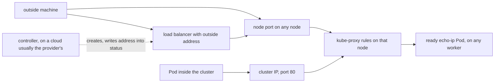

## Bạn cần biết trước

- [[k8s.l3.kube-proxy]] — kube-proxy trên mọi node ghi luật gửi các kết nối tới một cluster IP sang một Pod đang ready. Bài này thêm các luật cho một port trên chính node.
- [[k8s.l2.ingress]] — Service không có `type` chỉ gọi được từ bên trong cluster, và Traefik tới được máy bạn qua các port mà node staging publish. Ở đây bạn gặp các type Service mở một Service ra bên ngoài.

## Tình huống

`echo-ip` là một Service trong namespace `network-lessons`. Hai Pod của nó trả lời mỗi request bằng chính tên Pod. Một đồng nghiệp gọi nó từ một máy nằm cạnh cluster và không nhận được gì. Trên `donhang`, cluster IP của Service chỉ tồn tại như địa chỉ đích trong các luật kube-proxy trên từng node, nên máy bên ngoài không có chỗ nào để gửi gói tin tới. Bạn muốn một thiết lập duy nhất khiến Service trả lời ở nơi máy đó tới được: địa chỉ của chính node, trên mọi node. Trên cloud, Service còn có thể xin một địa chỉ ngoài cho riêng nó. Service nhận kết nối đến node bằng cách nào, và muốn xin địa chỉ ngoài thì cần những gì?

## Khái niệm cốt lõi

- **NodePort Service** (Service mở cùng một port trên mọi node và chuyển kết nối tới port đó vào một Pod của Service) — Service có `type: NodePort`: một Service thuộc type mặc định, `ClusterIP`, tức thứ bạn nhận được khi không ghi `type`, nhưng mở thêm cùng một port trên mọi node và chuyển kết nối đến đó tới một trong các Pod của Service.
- node port — số port mà NodePort Service mở trên mọi node, ghi trong `spec.ports[].nodePort` của Service.
- **LoadBalancer Service** (NodePort Service còn xin một controller bên ngoài, thường của cloud, cấp load balancer có địa chỉ ngoài) — Service có `type: LoadBalancer`: mặc định là một NodePort Service, kèm yêu cầu xin load balancer có địa chỉ ngoài từ một controller mà không phải cluster nào cũng chạy, trên cloud thường do nhà cung cấp lo.
- controller — ở đây là chương trình theo dõi các object Kubernetes và xử lý chúng trong một vòng điều khiển, giống Ingress controller làm với Ingress.
- cloud — nhà cung cấp cho thuê máy để chạy cluster và vận hành các dịch vụ như load balancer ngay cạnh đó.
- load balancer — ở đây là một thứ nằm ngoài cluster, có địa chỉ riêng, rải các kết nối đến lên nhiều đích, tức các node.

## Cơ chế hoạt động



Trong tình huống trên, thêm `type: NodePort` vẫn giữ mọi thứ mà Service không có `type` đã có: cluster IP, selector và các port. Pod bên trong vẫn gọi cluster IP ở port 80. Ngoài ra, Kubernetes giữ riêng một số port cho Service, gọi là node port, và mở nó trên mọi node. Nếu manifest không đặt `nodePort`, Kubernetes chọn một số còn trống trong một dải, mặc định 30000–32767. kube-proxy trên mỗi node ghi luật cho port đó bên cạnh luật cho cluster IP. Với thiết lập mặc định, cũng là thiết lập `echo-nodeport` dùng, kết nối tới địa chỉ của bất kỳ node nào ở node port sẽ tới một Pod đang ready của Service, và Pod đó có thể chạy trên node khác.

LoadBalancer Service thêm một bước. Nó có cluster IP và, theo mặc định, một node port (có thiết lập để tắt node port, bài này giữ mặc định), rồi xin một load balancer có địa chỉ ngoài. Bản thân Kubernetes không tạo load balancer đó. Một controller mà không phải cluster nào cũng chạy, trên cloud thường do nhà cung cấp lo, theo dõi các Service như vậy, dựng load balancer gửi traffic tới các node, rồi ghi địa chỉ ngoài vào status của Service. `kubectl get service` hiện địa chỉ đó ở cột `EXTERNAL-IP`.

kind, công cụ chạy các node của `donhang` thành container Docker trên máy bạn, không chạy controller nào như vậy. Trên `donhang`, không ai trả lời yêu cầu đó, và `EXTERNAL-IP` cứ ở `<pending>` trong khi cluster IP và node port vẫn chạy như trước. Cluster ngoài cloud cần một thành phần riêng để cấp địa chỉ ngoài. Lab của Đơn Hàng không dùng thành phần nào như thế: nó tới Gateway qua các port mà node staging publish ra máy bạn, `127.0.0.1:18080` và `127.0.0.1:18443`.

## Trong hệ thống Đơn Hàng

`service-types.sh` chạy trên máy bạn, nhắm vào cluster `donhang`. Cluster này có một node control plane, `donhang-control-plane`, và hai worker node chạy các Pod ứng dụng. Các dòng phía trước, nằm ngoài đoạn trích, khởi động hai Pod `echo-ip` và `client`, một Pod chỉ dùng để gửi request. Chúng cũng gỡ thứ mà một module sau cài để cấp địa chỉ ngoài, để giống một cluster kind mới tinh: không gì trả lời yêu cầu của LoadBalancer Service.

```bash file=scripts/k8s/service-types.sh tag=stage-3 lines=16-31
# lesson: k8s.l3.service-types
# A NodePort Service: Kubernetes picked the node port, shown after the
# colon in PORT(S).
kubectl delete service echo-nodeport echo-loadbalancer -n network-lessons --ignore-not-found >/dev/null
show kubectl apply -f deploy/k8s/lessons/echo-nodeport.yaml
show kubectl get service echo-nodeport -n network-lessons
node_port=$(kubectl get service echo-nodeport -n network-lessons -o jsonpath='{.spec.ports[0].nodePort}')
echo

# lesson: k8s.l3.service-types
# Both echo-ip Pods run on the workers; the control-plane node runs none,
# yet its node port answers: kube-proxy there forwards to a Pod elsewhere.
show kubectl get pods -n network-lessons -l app=echo-ip -o custom-columns=POD:.metadata.name,NODE:.spec.nodeName
cp_ip=$(kubectl get node donhang-control-plane -o jsonpath='{.status.addresses[0].address}')
echo "\$ kubectl exec client -n network-lessons -- wget -qO- http://<donhang-control-plane's address>:<node port>"
kubectl exec client -n network-lessons -- wget -qO- "http://$cp_ip:$node_port"
```

```text output=true
$ kubectl apply -f deploy/k8s/lessons/echo-nodeport.yaml
service/echo-nodeport created
$ kubectl get service echo-nodeport -n network-lessons
NAME            TYPE       CLUSTER-IP   EXTERNAL-IP   PORT(S)      AGE
echo-nodeport   NodePort   ...          <none>        80:.../TCP   ...

$ kubectl get pods -n network-lessons -l app=echo-ip -o custom-columns=POD:.metadata.name,NODE:.spec.nodeName
POD               NODE
echo-ip-...-...   donhang-worker...
echo-ip-...-...   donhang-worker...
$ kubectl exec client -n network-lessons -- wget -qO- http://<donhang-control-plane's address>:<node port>
echo-ip-...-... saw 172.22.0.2
...
```

`show` là hàm trợ giúp trong `scripts/lib/network-lessons.sh`: nó in lệnh sau dấu `$` rồi chạy lệnh đó. Dòng đầu xóa cả hai Service nếu lần chạy trước còn để lại, để script bắt đầu sạch. `echo-nodeport.yaml`, nằm ngoài đoạn trích, chứa selector và các port của Service `echo-ip`, thêm `type: NodePort` và không có `nodePort`.

`PORT(S)` ghi `80:.../TCP`: port 80 trên cluster IP, rồi tới node port Kubernetes đã chọn, bị giấu thành `...` trong output ghi lại. Script đọc số đó vào `node_port`.

Cả hai Pod chạy trên worker, nên `cp_ip`, địa chỉ của node `donhang-control-plane`, thuộc về một node không có Pod `echo-ip` nào. `wget -qO- <url>`, chạy bên trong `client`, gửi request `GET` tới URL và chỉ in body của response. Lời gọi nhắm vào địa chỉ của node đó, ở node port. Nó xuất phát từ `client` vì Pod tới được địa chỉ của các node. Máy của bạn có tới được hay không thì tùy cách Docker chạy các node của kind, và staging không dựa vào điều đó: nó publish port ra `127.0.0.1`. Câu trả lời mang tên một Pod `echo-ip` trên worker: luật trên node control plane đã gửi kết nối sang đó. Bài này không dùng địa chỉ sau `saw`.

```bash file=scripts/k8s/service-types.sh tag=stage-3 lines=34-45
# lesson: k8s.l3.service-types
# A LoadBalancer Service asks for an outside address. kind has no controller
# to hand one out, so EXTERNAL-IP stays <pending>; the cluster IP and the
# node port work all the same.
show kubectl apply -f deploy/k8s/lessons/echo-loadbalancer.yaml
sleep 10
show kubectl get service echo-loadbalancer -n network-lessons
lb_port=$(kubectl get service echo-loadbalancer -n network-lessons -o jsonpath='{.spec.ports[0].nodePort}')
echo "\$ kubectl exec client -n network-lessons -- wget -qO- http://echo-loadbalancer"
kubectl exec client -n network-lessons -- wget -qO- http://echo-loadbalancer
echo "\$ kubectl exec client -n network-lessons -- wget -qO- http://<donhang-control-plane's address>:<its node port>"
kubectl exec client -n network-lessons -- wget -qO- "http://$cp_ip:$lb_port"
```

```text output=true
...
$ kubectl apply -f deploy/k8s/lessons/echo-loadbalancer.yaml
service/echo-loadbalancer created
$ kubectl get service echo-loadbalancer -n network-lessons
NAME                TYPE           CLUSTER-IP   EXTERNAL-IP   PORT(S)      AGE
echo-loadbalancer   LoadBalancer   ...          <pending>     80:.../TCP   ...
$ kubectl exec client -n network-lessons -- wget -qO- http://echo-loadbalancer
echo-ip-...-... saw ...
$ kubectl exec client -n network-lessons -- wget -qO- http://<donhang-control-plane's address>:<its node port>
echo-ip-...-... saw 172.22.0.2
```

`echo-loadbalancer.yaml`, cũng nằm ngoài đoạn trích, có cùng selector và các port, với `type: LoadBalancer`. Mười giây sau, `EXTERNAL-IP` vẫn là `<pending>`, nhưng `CLUSTER-IP` và `PORT(S)` đã có giá trị y như với `echo-nodeport`. Lời gọi theo tên đi qua cluster IP. Lời gọi tới node control plane đi qua node port riêng của Service này, `lb_port`. Cả hai đều tới một Pod `echo-ip`. Không có gì bị thay thế: LoadBalancer Service có mọi thứ NodePort Service có, cộng thêm một yêu cầu mà trên kind không ai trả lời.

## Senior hay nhầm rằng…

- **"Node port chỉ được mở trên những node có Pod của Service."** → Thực ra nó được mở trên mọi node, và theo mặc định luật ở đó chuyển kết nối tới một Pod dù Pod chạy ở đâu. Bạn sẽ nhận ra khi node control plane, nơi không chạy Pod `echo-ip` nào, vẫn trả lời ở node port trong `service-types.sh`.
- **"Tạo LoadBalancer Service là có địa chỉ ngoài trên mọi cluster."** → Thực ra địa chỉ đến từ một controller mà không phải cluster nào cũng chạy: cloud thường cung cấp, kind thì không. Bạn sẽ nhận ra khi `EXTERNAL-IP` cứ ở `<pending>` trên một cluster bạn tự dựng.
- **"LoadBalancer Service thay thế cluster IP và node port."** → Thực ra nó cộng thêm vào: theo mặc định nó có cả hai, và cả hai đều chạy dù địa chỉ ngoài có bao giờ tới hay không. Bạn sẽ nhận ra khi `echo-loadbalancer` hiện `CLUSTER-IP` và `80:.../TCP` ở `PORT(S)` trong khi `EXTERNAL-IP` là `<pending>`, và lời gọi qua đường nào cũng có trả lời.

## Thử ngay (3 phút)

Ở thư mục gốc của repo Đơn Hàng, khi Docker Desktop, chương trình chạy container Docker và do đó chạy các node của kind, đang chạy:

1. Chạy `scripts/k8s/service-types.sh`. Nếu cluster `donhang` không còn, script dựng lại nó trước, nên sẽ lâu hơn.
2. Trong output của bạn, đọc số sau `80:` ở cột `PORT(S)` của từng Service.

Kết quả mong đợi: hai Service hiện hai số khác nhau, cả hai đều nằm trong khoảng 30000 đến 32767. `echo-loadbalancer` hiện `<pending>` ở cột `EXTERNAL-IP`. Mỗi lời gọi trong ba lời gọi `wget` in một dòng bắt đầu bằng tên một Pod `echo-ip`.

## Liên hệ

- [[k8s.l3.kube-proxy]] — tầng bên dưới: node port chỉ là thêm một bộ luật kube-proxy ghi trên mọi node, bên cạnh luật của cluster IP.
- [[k8s.l2.ingress]] — một việc khác hẳn: Ingress định tuyến HTTP request tới các Service theo host và path, còn các type này chỉ mở một port hoặc xin một địa chỉ cho một Service.
- [[k8s.l2.gateway-api]] — nơi request từ ngoài đi vào trên staging: Đơn Hàng tới Gateway qua các port mà node staging publish, không qua địa chỉ của LoadBalancer.
- [[k8s.l3.clusters-without-a-cloud]] — vấn đề bài này để ngỏ: khi không có cloud thì cái gì cấp địa chỉ ngoài.

## Tóm tắt 5 dòng

1. NodePort Service là một Service mặc định (`ClusterIP`) cộng thêm một port mở trên mọi node, được kube-proxy chuyển tới một Pod đang ready.
2. Nếu không đặt `nodePort`, Kubernetes chọn port đó trong dải mặc định 30000–32767. Theo mặc định node nào cũng trả lời ở port đó, kể cả node không có Pod.
3. LoadBalancer Service, theo mặc định, là NodePort Service còn xin địa chỉ ngoài từ một controller mà không phải cluster nào cũng chạy, thường là của cloud.
4. kind không có controller như vậy, nên `EXTERNAL-IP` cứ ở `<pending>` trong khi cluster IP và node port vẫn chạy.
5. Cluster ngoài cloud cần thành phần riêng để cấp các địa chỉ đó. Đơn Hàng tới Gateway của nó qua các port mà node staging publish.
