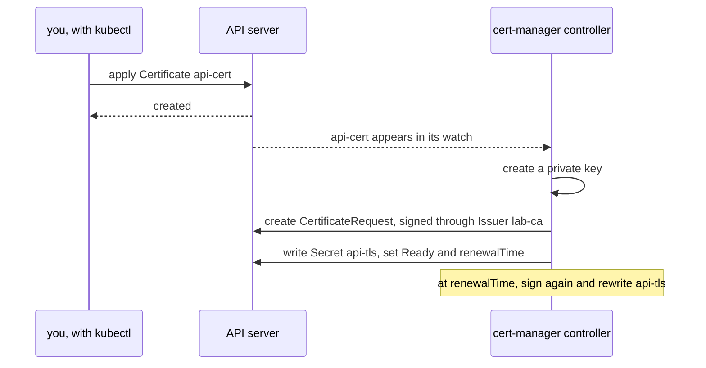

## Before you start

- [[k8s.l3.custom-resources]] — a CRD adds a kind, and nothing happens for its objects until a controller watches that kind.
- [[k8s.l2.tls-at-the-gateway]] — the TLS Secret with `tls.crt` and `tls.key` that a Gateway listener reads, and the lab's certificate authority in `secrets/`.

## The situation

Staging's certificate, `secrets/donhang-tls.crt`, was signed once by `dev-secrets.sh` and expires after 825 days; nothing renews it. The day it expires, every client that checks the certificate refuses the Gateway, though no Pod changed. Someone has to remember the date, sign a new certificate, seal it and commit it, and each new host adds one more date. The last lesson showed that a kind added by a CRD does nothing on its own. A teammate proposes cert-manager, which brings kinds for certificates together with the programs that act on them. What does it take for a certificate to be written as a manifest and renewed with nobody watching the calendar, and where do the certificate and its key end up?

## Core concepts

- **cert-manager** — a set of controllers running inside the cluster that watch their own custom resources, have certificates signed, write them into Secrets and renew them before they expire.
- `Issuer` — a cert-manager custom resource that says how certificates in its namespace get signed; `lab-ca` signs with the lab's certificate authority (CA), the holder of the certificate and key that sign other certificates, here `secrets/lab-ca.crt` and `secrets/lab-ca.key`.
- `Certificate` — a cert-manager custom resource that names an Issuer, the DNS names to cover and the Secret to write; it holds no certificate itself.
- TLS Secret — the Secret a Certificate names, of type `kubernetes.io/tls`, into which cert-manager writes `tls.crt` and `tls.key`, and, for an Issuer like `lab-ca`, `ca.crt`.
- `status.renewalTime` — the moment, recorded in a Certificate's status, at which cert-manager will renew it.

## How it works



In the diagram, the cert-manager controller is one of the three Deployments that `cert-manager-install.sh` starts in the namespace `cert-manager`. It is the program the last lesson's `BackupPolicy` lacked. It watches Issuers and Certificates through the API server and acts on each one.

In the situation above, the Issuer `lab-ca` answers "who signs". It is a `ca` Issuer: it signs with a certificate authority's certificate and key, read from a Secret in its own namespace, and nothing leaves the cluster. An Issuer can also stand for a public certificate authority. Such an authority first checks that you own the name, through an HTTP URL reachable over the internet or a DNS record, so it has no way to check `donhang.localhost`, a name with no public owner.

When a Certificate appears, the controller creates a private key, records the request as a `CertificateRequest` object, has it signed through the Issuer and writes the result into the Secret named in `secretName`. That Secret holds `tls.crt`, `tls.key` and, with a CA Issuer like `lab-ca`, `ca.crt`, the certificate of the authority that signed it. It is the type a Gateway listener reads through `certificateRefs`, the listener field that names the TLS Secret. The Certificate then turns `Ready`, and its status records `notAfter`, the expiry, and `renewalTime`.

At `renewalTime`, the controller has a new certificate signed and rewrites the same Secret. The Secret's name never changes, so a listener that names it needs no edit, and nobody tracks the expiry date.

## In the Đơn Hàng system

`scripts/k8s/cert-manager-install.sh` applies `deploy/cert-manager/cert-manager.yaml`, a pinned copy of the manifest cert-manager's project publishes for version 1.20.4. That one file brings the namespace `cert-manager`, six CRDs and three Deployments: `cert-manager`, the controller; `cert-manager-webhook`; and a third Deployment this lesson does not use. Of the six CRDs, the lab uses two: `issuers.cert-manager.io` and `certificates.cert-manager.io`.

`scripts/k8s/cert-manager.sh` creates `operator-lessons` afresh and puts `secrets/lab-ca.crt` and `secrets/lab-ca.key` into the Secret `lab-ca` with `kubectl create secret tls`. It then applies `deploy/k8s/lessons/lab-ca-issuer.yaml`, not quoted here, whose `spec.ca.secretName: lab-ca` points the Issuer at that Secret. The key comes from `secrets/`, which `dev-secrets.sh` fills, and never reaches Git. Next, the script applies the Certificate:

```yaml file=deploy/k8s/lessons/api-certificate.yaml tag=stage-3 lines=1-18
# lesson: k8s.l3.cert-manager
# A certificate for the api's lab host, signed through the Issuer lab-ca.
# cert-manager creates the private key, has the certificate signed and
# writes tls.crt and tls.key into the Secret api-tls (type
# kubernetes.io/tls, what a Gateway listener reads). Before the certificate
# expires it renews it and rewrites that same Secret.
apiVersion: cert-manager.io/v1
kind: Certificate
metadata:
  name: api-cert
  namespace: operator-lessons
spec:
  secretName: api-tls
  dnsNames:
    - donhang.localhost
  issuerRef:
    kind: Issuer
    name: lab-ca
```

`issuerRef` names the Issuer by kind and name. `dnsNames` lists the one name the certificate must cover, the api's lab host. `secretName` is the Secret cert-manager must write. The file sets no lifetime and no renewal time, so cert-manager's defaults apply. Above the next excerpt, the script's `apply` function retries for up to about a minute, because right after an install the API server may not yet reach `cert-manager-webhook`, the admission webhook that checks cert-manager objects.

`show` prints a command, then runs it.

```bash file=scripts/k8s/cert-manager.sh tag=stage-3 lines=37-61
show kubectl wait --for=condition=Ready certificate/api-cert -n operator-lessons --timeout=120s
show kubectl get certificate api-cert -n operator-lessons
echo

# lesson: k8s.l3.cert-manager
# The Secret api-tls: type kubernetes.io/tls, with tls.crt and tls.key
# (and ca.crt, the CA that signed it). The certificate in it is for
# donhang.localhost, signed by the lab CA.
echo "\$ kubectl get secret api-tls -n operator-lessons -o go-template='{{.type}}:{{range \$key, \$value := .data}} {{\$key}}{{end}}'"
kubectl get secret api-tls -n operator-lessons \
  -o go-template='{{.type}}:{{range $key, $value := .data}} {{$key}}{{end}}{{"\n"}}'
echo "\$ kubectl get secret api-tls -n operator-lessons -o jsonpath='{.data.tls\.crt}' | base64 -d | openssl x509 -noout -issuer -ext subjectAltName"
kubectl get secret api-tls -n operator-lessons -o jsonpath='{.data.tls\.crt}' | base64 -d \
  | openssl x509 -noout -issuer -ext subjectAltName | sed '/^$/d'
echo

# lesson: k8s.l3.cert-manager
# From the Certificate's status: when the certificate expires, and when
# cert-manager will renew it, well before that.
echo "\$ kubectl get certificate api-cert -n operator-lessons -o jsonpath='notBefore: {.status.notBefore}{\"\n\"}notAfter: {.status.notAfter}{\"\n\"}renewalTime: {.status.renewalTime}'"
kubectl get certificate api-cert -n operator-lessons \
  -o jsonpath='notBefore: {.status.notBefore}{"\n"}notAfter: {.status.notAfter}{"\n"}renewalTime: {.status.renewalTime}{"\n"}'
days() { echo $(( ($(date -d "$2" +%s) - $(date -d "$1" +%s)) / 86400 )); }
status() { kubectl get certificate api-cert -n operator-lessons -o jsonpath="{.status.$1}"; }
echo "valid for $(days "$(status notBefore)" "$(status notAfter)") days; renewed $(days "$(status notBefore)" "$(status renewalTime)") days after it was issued"
```

```text output=true
$ kubectl create secret tls lab-ca -n operator-lessons --cert=secrets/lab-ca.crt --key=secrets/lab-ca.key
secret/lab-ca created
$ kubectl apply -f deploy/k8s/lessons/lab-ca-issuer.yaml
issuer.cert-manager.io/lab-ca created
$ kubectl wait --for=condition=Ready issuer/lab-ca -n operator-lessons --timeout=120s
issuer.cert-manager.io/lab-ca condition met

$ kubectl apply -f deploy/k8s/lessons/api-certificate.yaml
certificate.cert-manager.io/api-cert created
$ kubectl wait --for=condition=Ready certificate/api-cert -n operator-lessons --timeout=120s
certificate.cert-manager.io/api-cert condition met
$ kubectl get certificate api-cert -n operator-lessons
NAME       READY   SECRET    AGE
api-cert   True    api-tls   ...

$ kubectl get secret api-tls -n operator-lessons -o go-template='{{.type}}:{{range $key, $value := .data}} {{$key}}{{end}}'
kubernetes.io/tls: ca.crt tls.crt tls.key
$ kubectl get secret api-tls -n operator-lessons -o jsonpath='{.data.tls\.crt}' | base64 -d | openssl x509 -noout -issuer -ext subjectAltName
issuer=CN=Don Hang lab CA, O=donhang-dev
X509v3 Subject Alternative Name: critical
    DNS:donhang.localhost

$ kubectl get certificate api-cert -n operator-lessons -o jsonpath='notBefore: {.status.notBefore}{"\n"}notAfter: {.status.notAfter}{"\n"}renewalTime: {.status.renewalTime}'
notBefore: ...
notAfter: ...
renewalTime: ...
valid for 90 days; renewed 60 days after it was issued
```

The first lines of the output come from above the excerpt: the Secret `lab-ca`, then the Issuer, `Ready` within seconds. In the excerpt, `kubectl wait` returns once the Certificate is `Ready`, and `kubectl get certificate` shows the Secret it filled, `api-tls`. That Secret has type `kubernetes.io/tls` and three keys. Secret data is base64-encoded, so `base64 -d` turns `tls.crt` back into the certificate, and `openssl`, a command-line tool, prints its fields: the lab's authority as issuer and `donhang.localhost` under Subject Alternative Name, the field where the names from `dnsNames` end up.

The dates show as `...` because they change on every run. `notBefore` is when the certificate starts being valid; the script treats it as the moment of issue. Its last line turns the dates into days: the certificate is valid for 90 days, and the renewal is scheduled 60 days after issue, with a third of its life left.

In the lab, no Gateway reads `api-tls`: staging keeps its sealed certificate, and cert-manager runs only on `donhang`. That is a choice of this lab, not a limit of cert-manager: to switch, staging would need cert-manager installed and a Certificate whose Secret its listener names in `certificateRefs`.

## Seniors often assume…

- **"A Certificate object holds the certificate and its private key itself."** → Actually a Certificate only describes what you want: the Issuer, the names and the target Secret. cert-manager writes the certificate and key into the Secret named by `secretName`, and the Certificate's status keeps dates, conditions and bookkeeping such as a revision number, never the certificate or key. You notice this when `kubectl get certificate api-cert` shows `api-tls` in the `SECRET` column, and the `openssl` command has to read `tls.crt` from that Secret.
- **"A renewed certificate lands in a new Secret that every Gateway must be pointed at."** → Actually cert-manager rewrites the Secret named in `secretName`, one fixed name in the Certificate, so a listener's `certificateRefs` never needs an edit. You notice this when you look in `api-certificate.yaml` for somewhere to name a second Secret and find only `secretName: api-tls`.
- **"cert-manager can only get certificates from a public certificate authority over the internet."** → Actually the Issuer decides who signs; `lab-ca` is a `ca` Issuer that signs inside the cluster with a key from a Secret. You notice this when `openssl` prints `issuer=CN=Don Hang lab CA, O=donhang-dev` for `donhang.localhost`, a name no public authority could check.

## Try it (3 minutes)

From the root of the Đơn Hàng repository, with Docker Desktop running, the kind tool and `kubectl` installed, and the `donhang` cluster from the earlier lessons running:

1. Run `scripts/k8s/cert-manager.sh`. If cert-manager is not installed yet, the script runs `cert-manager-install.sh` first, which takes longer; if `secrets/` has no lab key, it runs `dev-secrets.sh` too.
2. Find the line after the `go-template` command and the last line of the output.

Expected result: the line after `go-template` reads `kubernetes.io/tls: ca.crt tls.crt tls.key`, and the last line reads `valid for 90 days; renewed 60 days after it was issued`.

## Connections

- [[k8s.l3.custom-resources]] — the CRD without a controller; cert-manager brings its CRDs together with the controller that acts on them.
- [[k8s.l2.tls-at-the-gateway]] — the certificate nothing renews there, which a Certificate could replace; the lab keeps it sealed for now.
- [[k8s.l3.operator-pattern]] — the general pattern behind cert-manager: custom resources plus a controller that does routine work people did by hand.
- [[devops.l3.sealed-secrets]] — another controller that writes Secrets from custom resources; staging still gets its certificate that way.
- [[foundation.l1.tls-and-https]] — the checks on name, signer and dates that make renewing before expiry necessary.
- [[k8s.l2.gateway-api]] — the Gateway whose listener would name `api-tls` in `certificateRefs`.

## Five-line summary

1. cert-manager is a set of controllers that turn a Certificate object into a signed certificate in a Secret and renew it before expiry.
2. An `Issuer` says who signs; `lab-ca` signs inside the cluster with the lab's certificate authority, kept in a Secret.
3. A `Certificate` names an Issuer, DNS names and a Secret; cert-manager writes `tls.crt` and `tls.key` there, and with `lab-ca` also `ca.crt`.
4. At `status.renewalTime`, cert-manager has the certificate signed again and rewrites the same Secret, so its readers need no change.
5. A public authority first checks, through the internet or DNS, that you own the name; the lab's private name uses its own authority.
