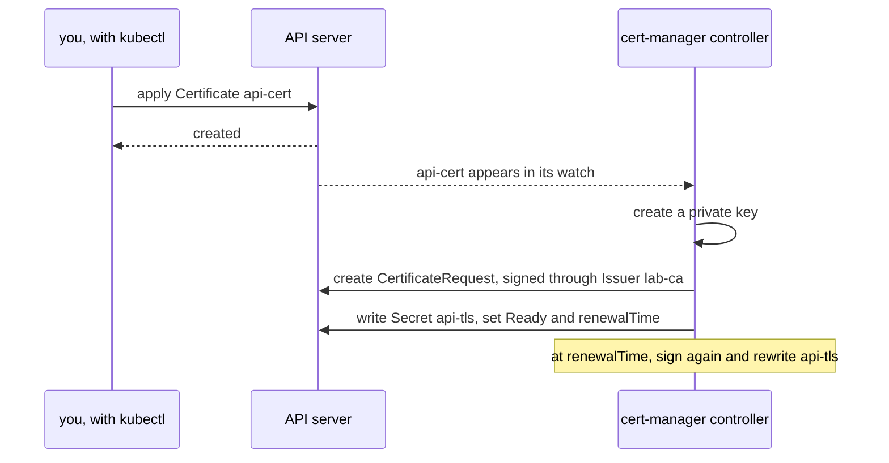

## Bạn cần biết trước

- [[k8s.l3.custom-resources]] — CRD thêm một kind mới, và các object thuộc kind đó chẳng gây ra gì cho tới khi có một controller theo dõi kind ấy.
- [[k8s.l2.tls-at-the-gateway]] — TLS Secret với `tls.crt` và `tls.key` mà listener của Gateway đọc, cùng đơn vị cấp chứng chỉ của lab trong `secrets/`.

## Tình huống

Chứng chỉ của staging, `secrets/donhang-tls.crt`, do `dev-secrets.sh` ký đúng một lần và hết hạn sau 825 ngày. Không gì gia hạn nó. Ngày nó hết hạn, mọi client có kiểm tra chứng chỉ đều từ chối Gateway, dù không Pod nào thay đổi. Phải có người nhớ ngày đó, ký chứng chỉ mới, seal rồi commit nó, và mỗi host mới lại thêm một ngày phải nhớ. Bài trước đã cho thấy một kind do CRD thêm vào tự nó không làm gì. Một đồng nghiệp đề xuất cert-manager, thứ mang theo các kind cho chứng chỉ cùng với chương trình hành động dựa trên chúng. Cần những gì để một chứng chỉ được viết thành manifest và tự gia hạn mà không ai phải canh lịch, và chứng chỉ cùng key của nó rốt cuộc nằm ở đâu?

## Khái niệm cốt lõi

- **cert-manager** (Controller trong cluster cấp chứng chỉ TLS theo object Certificate, ghi vào Secret và tự gia hạn trước khi hết hạn) — bộ controller chạy bên trong cluster, theo dõi các custom resource của riêng nó, cho ký chứng chỉ, ghi chúng vào Secret và gia hạn trước khi hết hạn.
- `Issuer` — custom resource của cert-manager quy định chứng chỉ trong namespace của nó được ký thế nào. `lab-ca` ký bằng đơn vị cấp chứng chỉ (certificate authority, CA) của lab, tức bên giữ chứng chỉ và key dùng để ký các chứng chỉ khác, ở đây là `secrets/lab-ca.crt` và `secrets/lab-ca.key`.
- `Certificate` — custom resource của cert-manager ghi tên một Issuer, các tên DNS cần phủ và Secret cần ghi. Bản thân nó không chứa chứng chỉ nào.
- TLS Secret — Secret mà Certificate chỉ tới, kiểu `kubernetes.io/tls`. cert-manager ghi vào đó `tls.crt` và `tls.key`, và với Issuer như `lab-ca` thì thêm cả `ca.crt`.
- `status.renewalTime` — thời điểm, ghi trong status của Certificate, mà cert-manager sẽ gia hạn nó.

## Cơ chế hoạt động



Trong sơ đồ, controller của cert-manager là một trong ba Deployment mà `cert-manager-install.sh` khởi động trong namespace `cert-manager`. Đây chính là chương trình mà `BackupPolicy` ở bài trước thiếu. Nó theo dõi Issuer và Certificate qua API server và hành động với từng object.

Trong tình huống trên, Issuer `lab-ca` trả lời câu hỏi "ai ký". Đây là Issuer kiểu `ca`: nó ký bằng chứng chỉ và key của một đơn vị cấp chứng chỉ, đọc từ một Secret trong chính namespace của nó, và không gì rời khỏi cluster. Issuer cũng có thể đại diện cho một đơn vị cấp chứng chỉ công khai. Đơn vị đó trước hết kiểm tra bạn có sở hữu tên hay không, qua một URL HTTP truy cập được từ internet hoặc qua một bản ghi DNS. Vì vậy nó không có cách nào kiểm tra `donhang.localhost`, một cái tên không có chủ sở hữu công khai.

Khi một Certificate xuất hiện, controller tạo private key, ghi yêu cầu thành một object `CertificateRequest`, cho ký qua Issuer rồi ghi kết quả vào Secret có tên trong `secretName`. Secret đó chứa `tls.crt`, `tls.key` và, với CA Issuer như `lab-ca`, thêm `ca.crt`, chứng chỉ của đơn vị đã ký nó. Đây đúng là kiểu Secret mà listener của Gateway đọc qua `certificateRefs`, field của listener ghi tên TLS Secret. Sau đó Certificate chuyển sang `Ready`, và status của nó ghi `notAfter`, tức ngày hết hạn, cùng `renewalTime`.

Tới `renewalTime`, controller cho ký một chứng chỉ mới và ghi đè lên đúng Secret đó. Tên Secret không bao giờ đổi, nên listener nào ghi tên nó cũng không cần sửa, và không ai phải theo dõi ngày hết hạn.

## Trong hệ thống Đơn Hàng

`scripts/k8s/cert-manager-install.sh` apply `deploy/cert-manager/cert-manager.yaml`, bản sao được ghim của manifest mà dự án cert-manager phát hành cho version 1.20.4. Một file đó mang theo namespace `cert-manager`, sáu CRD và ba Deployment: `cert-manager`, tức controller; `cert-manager-webhook`; và một Deployment thứ ba bài này không dùng tới. Trong sáu CRD, lab dùng hai: `issuers.cert-manager.io` và `certificates.cert-manager.io`.

`scripts/k8s/cert-manager.sh` tạo mới `operator-lessons` và đưa `secrets/lab-ca.crt` cùng `secrets/lab-ca.key` vào Secret `lab-ca` bằng `kubectl create secret tls`. Sau đó nó apply `deploy/k8s/lessons/lab-ca-issuer.yaml`, file không trích ở đây, trong đó `spec.ca.secretName: lab-ca` trỏ Issuer tới Secret đó. Key lấy từ `secrets/`, thư mục do `dev-secrets.sh` điền, và không bao giờ vào Git. Tiếp theo, script apply Certificate:

```yaml file=deploy/k8s/lessons/api-certificate.yaml tag=stage-3 lines=1-18
# lesson: k8s.l3.cert-manager
# A certificate for the api's lab host, signed through the Issuer lab-ca.
# cert-manager creates the private key, has the certificate signed and
# writes tls.crt and tls.key into the Secret api-tls (type
# kubernetes.io/tls, what a Gateway listener reads). Before the certificate
# expires it renews it and rewrites that same Secret.
apiVersion: cert-manager.io/v1
kind: Certificate
metadata:
  name: api-cert
  namespace: operator-lessons
spec:
  secretName: api-tls
  dnsNames:
    - donhang.localhost
  issuerRef:
    kind: Issuer
    name: lab-ca
```

`issuerRef` chỉ tới Issuer bằng kind và tên. `dnsNames` liệt kê một tên duy nhất mà chứng chỉ phải phủ, host lab của api. `secretName` là Secret cert-manager phải ghi. File không đặt thời hạn hay thời điểm gia hạn nào, nên các giá trị mặc định của cert-manager được áp dụng. Phía trên đoạn trích tiếp theo, hàm `apply` của script thử lại trong khoảng một phút, vì ngay sau khi cài, API server có thể chưa gọi tới được `cert-manager-webhook`, admission webhook kiểm tra các object của cert-manager.

`show` in ra một lệnh rồi chạy nó.

```bash file=scripts/k8s/cert-manager.sh tag=stage-3 lines=37-61
show kubectl wait --for=condition=Ready certificate/api-cert -n operator-lessons --timeout=120s
show kubectl get certificate api-cert -n operator-lessons
echo

# lesson: k8s.l3.cert-manager
# The Secret api-tls: type kubernetes.io/tls, with tls.crt and tls.key
# (and ca.crt, the CA that signed it). The certificate in it is for
# donhang.localhost, signed by the lab CA.
echo "\$ kubectl get secret api-tls -n operator-lessons -o go-template='{{.type}}:{{range \$key, \$value := .data}} {{\$key}}{{end}}'"
kubectl get secret api-tls -n operator-lessons \
  -o go-template='{{.type}}:{{range $key, $value := .data}} {{$key}}{{end}}{{"\n"}}'
echo "\$ kubectl get secret api-tls -n operator-lessons -o jsonpath='{.data.tls\.crt}' | base64 -d | openssl x509 -noout -issuer -ext subjectAltName"
kubectl get secret api-tls -n operator-lessons -o jsonpath='{.data.tls\.crt}' | base64 -d \
  | openssl x509 -noout -issuer -ext subjectAltName | sed '/^$/d'
echo

# lesson: k8s.l3.cert-manager
# From the Certificate's status: when the certificate expires, and when
# cert-manager will renew it, well before that.
echo "\$ kubectl get certificate api-cert -n operator-lessons -o jsonpath='notBefore: {.status.notBefore}{\"\n\"}notAfter: {.status.notAfter}{\"\n\"}renewalTime: {.status.renewalTime}'"
kubectl get certificate api-cert -n operator-lessons \
  -o jsonpath='notBefore: {.status.notBefore}{"\n"}notAfter: {.status.notAfter}{"\n"}renewalTime: {.status.renewalTime}{"\n"}'
days() { echo $(( ($(date -d "$2" +%s) - $(date -d "$1" +%s)) / 86400 )); }
status() { kubectl get certificate api-cert -n operator-lessons -o jsonpath="{.status.$1}"; }
echo "valid for $(days "$(status notBefore)" "$(status notAfter)") days; renewed $(days "$(status notBefore)" "$(status renewalTime)") days after it was issued"
```

```text output=true
$ kubectl create secret tls lab-ca -n operator-lessons --cert=secrets/lab-ca.crt --key=secrets/lab-ca.key
secret/lab-ca created
$ kubectl apply -f deploy/k8s/lessons/lab-ca-issuer.yaml
issuer.cert-manager.io/lab-ca created
$ kubectl wait --for=condition=Ready issuer/lab-ca -n operator-lessons --timeout=120s
issuer.cert-manager.io/lab-ca condition met

$ kubectl apply -f deploy/k8s/lessons/api-certificate.yaml
certificate.cert-manager.io/api-cert created
$ kubectl wait --for=condition=Ready certificate/api-cert -n operator-lessons --timeout=120s
certificate.cert-manager.io/api-cert condition met
$ kubectl get certificate api-cert -n operator-lessons
NAME       READY   SECRET    AGE
api-cert   True    api-tls   ...

$ kubectl get secret api-tls -n operator-lessons -o go-template='{{.type}}:{{range $key, $value := .data}} {{$key}}{{end}}'
kubernetes.io/tls: ca.crt tls.crt tls.key
$ kubectl get secret api-tls -n operator-lessons -o jsonpath='{.data.tls\.crt}' | base64 -d | openssl x509 -noout -issuer -ext subjectAltName
issuer=CN=Don Hang lab CA, O=donhang-dev
X509v3 Subject Alternative Name: critical
    DNS:donhang.localhost

$ kubectl get certificate api-cert -n operator-lessons -o jsonpath='notBefore: {.status.notBefore}{"\n"}notAfter: {.status.notAfter}{"\n"}renewalTime: {.status.renewalTime}'
notBefore: ...
notAfter: ...
renewalTime: ...
valid for 90 days; renewed 60 days after it was issued
```

Những dòng output đầu tiên đến từ phần phía trên đoạn trích: Secret `lab-ca`, rồi Issuer, `Ready` chỉ sau vài giây. Trong đoạn trích, `kubectl wait` trả về khi Certificate đã `Ready`, và `kubectl get certificate` cho thấy Secret nó đã điền, `api-tls`. Secret đó có kiểu `kubernetes.io/tls` và ba key. Dữ liệu của Secret được mã hóa base64, nên `base64 -d` đổi `tls.crt` về lại chứng chỉ, và `openssl`, một công cụ dòng lệnh, in ra các trường của nó: đơn vị cấp chứng chỉ của lab là issuer, và `donhang.localhost` nằm dưới Subject Alternative Name, trường chứa các tên lấy từ `dnsNames`.

Các mốc ngày hiện thành `...` vì mỗi lần chạy chúng lại khác. `notBefore` là lúc chứng chỉ bắt đầu có hiệu lực, và script coi đó là thời điểm cấp. Dòng cuối của script đổi các mốc ngày thành số ngày: chứng chỉ có hiệu lực 90 ngày, và lần gia hạn được hẹn 60 ngày sau khi cấp, khi còn một phần ba thời hạn.

Trong lab, không Gateway nào đọc `api-tls`: staging vẫn giữ chứng chỉ đã seal, và cert-manager chỉ chạy trên `donhang`. Đó là lựa chọn của lab này, không phải giới hạn của cert-manager. Muốn chuyển, staging cần cài cert-manager và có một Certificate mà Secret của nó được listener ghi tên trong `certificateRefs`.

## Senior hay nhầm rằng…

- **"Bản thân object Certificate chứa chứng chỉ và private key."** → Thực ra Certificate chỉ mô tả điều bạn muốn: Issuer, các tên và Secret đích. cert-manager ghi chứng chỉ và key vào Secret có tên trong `secretName`, còn status của Certificate chỉ giữ ngày tháng, condition và vài thông tin quản lý như số revision, không bao giờ giữ chứng chỉ hay key. Bạn sẽ nhận ra khi `kubectl get certificate api-cert` hiện `api-tls` ở cột `SECRET`, và lệnh `openssl` phải đọc `tls.crt` từ Secret đó.
- **"Chứng chỉ gia hạn xong sẽ nằm trong một Secret mới, và mọi Gateway phải được trỏ sang đó."** → Thực ra cert-manager ghi đè lên Secret có tên trong `secretName`, một tên cố định trong Certificate, nên `certificateRefs` của listener không bao giờ cần sửa. Bạn sẽ nhận ra khi tìm trong `api-certificate.yaml` một chỗ để ghi tên Secret thứ hai và chỉ thấy `secretName: api-tls`.
- **"cert-manager chỉ lấy được chứng chỉ từ một đơn vị cấp chứng chỉ công khai qua internet."** → Thực ra Issuer quyết định ai ký. `lab-ca` là Issuer kiểu `ca`, ký ngay trong cluster bằng key lấy từ một Secret. Bạn sẽ nhận ra khi `openssl` in `issuer=CN=Don Hang lab CA, O=donhang-dev` cho `donhang.localhost`, một tên mà không đơn vị công khai nào kiểm tra được.

## Thử ngay (3 phút)

Ở thư mục gốc của repo Đơn Hàng, với Docker Desktop đang chạy, đã cài kind và `kubectl`, và cluster `donhang` từ các bài trước đang chạy:

1. Chạy `scripts/k8s/cert-manager.sh`. Nếu cert-manager chưa được cài, script chạy `cert-manager-install.sh` trước, nên lâu hơn. Nếu `secrets/` chưa có key của lab, nó chạy cả `dev-secrets.sh`.
2. Tìm dòng ngay sau lệnh `go-template` và dòng cuối cùng của output.

Kết quả mong đợi: dòng sau `go-template` là `kubernetes.io/tls: ca.crt tls.crt tls.key`, còn dòng cuối là `valid for 90 days; renewed 60 days after it was issued`.

## Liên hệ

- [[k8s.l3.custom-resources]] — CRD không có controller. cert-manager mang CRD của nó đến cùng với controller hành động dựa trên chúng.
- [[k8s.l2.tls-at-the-gateway]] — chứng chỉ mà ở đó không gì gia hạn, thứ một Certificate có thể thay thế. Hiện lab vẫn giữ nó ở dạng đã seal.
- [[k8s.l3.operator-pattern]] — pattern chung đứng sau cert-manager: custom resource cộng với một controller làm những việc thường ngày mà trước đây người làm bằng tay.
- [[devops.l3.sealed-secrets]] — một controller khác ghi Secret từ custom resource. Staging vẫn nhận chứng chỉ của nó theo cách đó.
- [[foundation.l1.tls-and-https]] — các bước kiểm tra tên, bên ký và ngày tháng, lý do phải gia hạn trước khi hết hạn.
- [[k8s.l2.gateway-api]] — Gateway mà listener của nó sẽ ghi tên `api-tls` trong `certificateRefs`.

## Tóm tắt 5 dòng

1. cert-manager là bộ controller biến một object Certificate thành chứng chỉ đã ký trong một Secret và gia hạn nó trước khi hết hạn.
2. `Issuer` quy định ai ký. `lab-ca` ký ngay trong cluster bằng đơn vị cấp chứng chỉ của lab, giữ trong một Secret.
3. `Certificate` ghi tên một Issuer, các tên DNS và một Secret. cert-manager ghi `tls.crt` và `tls.key` vào đó, với `lab-ca` thì thêm `ca.crt`.
4. Tới `status.renewalTime`, cert-manager cho ký lại chứng chỉ và ghi đè đúng Secret đó, nên bên đọc nó không phải đổi gì.
5. Đơn vị cấp chứng chỉ công khai trước hết kiểm tra qua internet hoặc DNS rằng bạn sở hữu tên. Tên riêng của lab dùng đơn vị cấp chứng chỉ của chính lab.
