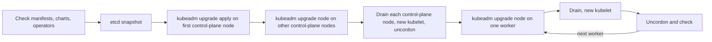

## Before you start

- [[k8s.l3.draining-nodes]] — a drain empties a node within its budgets; an upgrade drains every node in turn.
- [[k8s.l3.kubeadm]] — the control plane runs as static Pods on certificates kubeadm wrote, which is what kubeadm's upgrade commands change.
- [[k8s.l3.etcd-snapshots]] — a snapshot rewinds every object, which makes it the way back from a failed upgrade.
- [[k8s.l3.custom-resources]] — CRDs and the operators behind them use the API like any client, so they are checked before an upgrade.

## The situation

The team can drain nodes; now the cluster itself is due for a newer Kubernetes version. On `donhang`, kubectl reports an API server at `v1.34.11`, and every node's kubelet reports `v1.34.11` too; a teammate proposes jumping two minor versions in one go, to save a second planned outage. Another wants to start with the workers, because they carry the applications and are the easiest to replace. A third wants all three nodes done at once. Each plan changes the API server's and the kubelets' versions in a different order. In what order and in what steps can you move a cluster to a newer Kubernetes version without breaking it?

## Core concepts

- Minor version — the middle number of a Kubernetes version: in `v1.34.11` it is `34`, and `11` is the patch version, which fixes bugs within that minor version.
- **version skew** — the gap between the versions of the cluster's parts that Kubernetes supports, such as a kubelet up to three minor versions older than the API server and never newer.
- `kubeadm upgrade apply` — the command run on the first control-plane node: it moves that node's control-plane static Pods to the new version and renews the certificates kubeadm manages there.
- `kubeadm upgrade node` — the command run on every other node: on a control-plane node it moves the static Pods too, on a worker it updates the kubelet's configuration.
- `Ready` — the status a node reports when it is healthy and can accept Pods.
- Served API version — the versions in which the API server offers a kind, such as `policy/v1` for a PodDisruptionBudget; a newer release can stop serving an old one, and then refuses requests for it.

## How it works



The first plan breaks the rule that comes before every other one: Kubernetes supports moving a cluster by one minor version at a time. Skipping one is not supported, so a cluster two versions behind needs two upgrades in a row, each running the whole flow above.

Version skew sets the order inside one upgrade. A kubelet may be up to three minor versions older than the API server but never newer. Upgrading a worker first would put its kubelet ahead of the API server, so the control plane goes first.

The flow starts before any command runs. Each release lists the API versions it stops serving; you compare that list with the `apiVersion` every manifest, chart and operator asks for. Then an etcd snapshot is taken.

`kubeadm upgrade apply` checks the skew rules and that every node is `Ready`, then upgrades the first control-plane node. Further control-plane nodes follow one at a time with `kubeadm upgrade node`. Then each control-plane node is drained, gets its new kubelet and is uncordoned, like a worker.

Workers go one at a time, or a few at a time when spare room allows: `kubeadm upgrade node`, drain, new kubelet, uncordon (clear the cordon), check the node is `Ready`. kubeadm does not install the kubelet: you install the new one on the machine the way the first was installed, then restart it. Budgets and the room left on the other nodes keep the applications running. That is why the third plan fails: with all three nodes drained at once, evicted Pods have nowhere to go, so budgets stall the drains, and without budgets the applications stop.

## In the Đơn Hàng system

kind, the tool that built `donhang`, sets each node's Kubernetes version from its node image when the cluster is created and offers no upgrade command, so the lab prints the numbers the skew rules compare and changes nothing:

```bash file=scripts/k8s/version-skew.sh tag=stage-3 lines=9-25
# lesson: k8s.l3.cluster-upgrades
# kubectl (the client) and the API server (the server).
echo "\$ kubectl version"
kubectl version 2>/dev/null | grep -v '^Kustomize'
echo

# lesson: k8s.l3.cluster-upgrades
# The kubelet of every node: none may be newer than the API server, nor more
# than three minor versions older. An upgrade does the control-plane node
# first, then the workers one at a time.
show kubectl get nodes -o custom-columns=NODE:.metadata.name,KUBELET:.status.nodeInfo.kubeletVersion,RUNTIME:.status.nodeInfo.containerRuntimeVersion
echo

# The node image every node of deploy/k8s/kind-config.yaml runs: kind
# replaces nodes from a new image instead of upgrading them in place.
echo "\$ grep -m 1 image: deploy/k8s/kind-config.yaml"
grep -m 1 'image:' deploy/k8s/kind-config.yaml | sed 's/^ *//'
```

`show` prints a command before running it. Each node reports its kubelet's version in its status, under `nodeInfo.kubeletVersion`, which is where the `KUBELET` column comes from.

```text output=true
$ kubectl version
Client Version: v1.34.3
Server Version: v1.34.11

$ kubectl get nodes -o custom-columns=NODE:.metadata.name,KUBELET:.status.nodeInfo.kubeletVersion,RUNTIME:.status.nodeInfo.containerRuntimeVersion
NODE                    KUBELET    RUNTIME
donhang-control-plane   v1.34.11   containerd://2.3.4
donhang-worker          v1.34.11   containerd://2.3.4
donhang-worker2         v1.34.11   containerd://2.3.4

$ grep -m 1 image: deploy/k8s/kind-config.yaml
image: kindest/node:v1.34.11@sha256:44e222ee2132dab25ff87301682f89eb82c7880ea3a1bf543bfe9708fd08d67d
```

All three kubelets match the API server, so no skew exists yet. kubectl's client differs only in its patch number, and kubectl is supported within one minor version, older or newer, of the API server. The upgrade guides install the new kubectl after the control plane. The `RUNTIME` column and the `Kustomize` line the `grep` drops play no part in the skew rules. On a kubeadm cluster, midway through an upgrade, this table would show the control-plane node one minor version ahead of the workers, which the skew rules allow.

The version comes from one place, the node image in the cluster's configuration:

```yaml file=deploy/k8s/kind-config.yaml tag=stage-3 lines=6-14
kind: Cluster
apiVersion: kind.x-k8s.io/v1alpha4
nodes:
  - role: control-plane
    image: kindest/node:v1.34.11@sha256:44e222ee2132dab25ff87301682f89eb82c7880ea3a1bf543bfe9708fd08d67d
  - role: worker
    image: kindest/node:v1.34.11@sha256:44e222ee2132dab25ff87301682f89eb82c7880ea3a1bf543bfe9708fd08d67d
  - role: worker
    image: kindest/node:v1.34.11@sha256:44e222ee2132dab25ff87301682f89eb82c7880ea3a1bf543bfe9708fd08d67d
```

Every node runs the same image, pinned by its digest. A newer version for kind means nodes built from a newer image, not the steps above; on `donhang` you read those steps here, without running them.

## Seniors often assume…

- **"A careful upgrade can jump straight to the newest version."** → Actually skipping a minor version is not supported, however carefully it is done, so a cluster left behind pays with several upgrades in a row. You notice this in the kubeadm upgrade guide, which covers one minor step at a time and calls skipping minor versions unsupported.
- **"Worker nodes can be upgraded before the control plane."** → Actually a kubelet must never be newer than the API server it talks to, so a worker upgraded first runs outside the supported skew. You notice this when the kubelet versions in `version-skew.sh`'s table would show a worker ahead of `Server Version`.
- **"An upgrade changes only Kubernetes, so the applications' manifests need no review."** → Actually a new minor version can stop serving an API version your manifests, charts or operators still ask for, and the API server then refuses those requests. You notice this when a sync that worked before the upgrade fails on a kind the API server no longer offers in that version.

## Try it (3 minutes)

From the root of the Đơn Hàng repository, with Docker Desktop running and `kubectl` and kind installed:

1. Run `scripts/k8s/version-skew.sh`. It creates `donhang` if it is missing, which takes longer than this exercise.
2. Compare `Server Version` with the `KUBELET` column, then answer: if the API server were one minor version newer and the kubelets stayed as they are, would the skew rules allow it?

Expected result: `Server Version: v1.34.11`, and `v1.34.11` for `donhang-control-plane`, `donhang-worker` and `donhang-worker2`.

<details><summary>Suggested answer</summary>

Yes. The kubelets would be one minor version older than the API server, inside the three allowed, and none would be newer. That is the state between upgrading the control plane and upgrading the workers.

</details>

## Connections

- [[k8s.l3.draining-nodes]] — the step repeated on every node: each one is upgraded, drained and uncordoned in turn.
- [[k8s.l3.kubeadm]] — the tool whose `upgrade` commands rewrite the static Pods and renew the certificates it created.
- [[k8s.l3.etcd-snapshots]] — the way back taken before the first command: a snapshot rewinds every object if the upgrade fails.
- [[k8s.l3.custom-resources]] — CRDs and charts are part of the check before an upgrade, like any other manifest.
- [[k8s.l3.control-plane-ha]] — with several control-plane nodes, they are upgraded one at a time so the rest keep serving.
- [[k8s.l3.operator-pattern]] — an operator is a client of the API too, so it is checked against the target version.
- [[devops.l3.automated-dependency-updates]] — the same idea for code: small, regular updates instead of one big jump.

## Five-line summary

1. Upgrade a cluster one minor version at a time, because skipping a minor version is not supported, and upgrade the control plane first.
2. A kubelet may be up to three minor versions older than the API server but never newer, which sets the order.
3. `kubeadm upgrade apply` upgrades the first control-plane node and renews its certificates; other nodes run `kubeadm upgrade node`.
4. Workers go one, or a few, at a time: upgrade, drain, new kubelet, uncordon, check, so budgets and spare room keep applications running.
5. Check manifests, charts and operators against the target version and take an etcd snapshot before starting.
