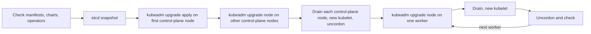

## Bạn cần biết trước

- [[k8s.l3.draining-nodes]] — drain làm trống một node trong giới hạn budget cho phép. Một lần nâng cấp drain lần lượt từng node.
- [[k8s.l3.kubeadm]] — control plane chạy dưới dạng static Pod, trên các chứng chỉ do kubeadm ghi ra. Đó chính là thứ các lệnh upgrade của kubeadm thay đổi.
- [[k8s.l3.etcd-snapshots]] — snapshot đưa mọi object về lại thời điểm chụp, nên nó là đường lui khi nâng cấp thất bại.
- [[k8s.l3.custom-resources]] — CRD và các operator đứng sau chúng dùng API như mọi client khác, nên chúng được kiểm tra trước khi nâng cấp.

## Tình huống

Team đã biết drain node. Giờ tới lượt chính cluster cần lên một phiên bản Kubernetes mới hơn. Trên `donhang`, kubectl báo API server ở `v1.34.11`, và kubelet của mọi node cũng báo `v1.34.11`. Một đồng nghiệp đề xuất nhảy hai minor version một lần, để đỡ phải lên lịch ngừng dịch vụ lần thứ hai. Người khác muốn bắt đầu từ các worker, vì chúng chạy ứng dụng và dễ thay nhất. Người thứ ba muốn làm cả ba node cùng lúc. Mỗi kế hoạch đổi phiên bản của API server và của các kubelet theo một thứ tự khác nhau. Phải đi theo thứ tự nào, qua những bước nào, để đưa cluster lên phiên bản Kubernetes mới hơn mà không làm hỏng nó?

## Khái niệm cốt lõi

- Minor version — số ở giữa của một phiên bản Kubernetes: trong `v1.34.11` thì đó là `34`, còn `11` là patch version, bản sửa lỗi bên trong minor version đó.
- **độ lệch phiên bản** (version skew) — khoảng cách giữa phiên bản các thành phần của cluster mà Kubernetes hỗ trợ, chẳng hạn kubelet được cũ hơn API server tối đa ba minor version và không bao giờ được mới hơn.
- `kubeadm upgrade apply` — lệnh chạy trên control-plane node đầu tiên: nó đưa các static Pod của control plane trên node đó lên phiên bản mới và gia hạn các chứng chỉ kubeadm quản lý ở đó.
- `kubeadm upgrade node` — lệnh chạy trên mọi node còn lại: trên control-plane node, nó cũng nâng các static Pod, còn trên worker, nó cập nhật cấu hình của kubelet.
- `Ready` — trạng thái một node báo khi nó khỏe và nhận được Pod.
- Served API version — các phiên bản mà API server cung cấp cho một kind, như `policy/v1` cho PodDisruptionBudget. Một bản phát hành mới hơn có thể ngừng cung cấp phiên bản cũ, và khi đó từ chối mọi request tới phiên bản ấy.

## Cơ chế hoạt động



Kế hoạch thứ nhất phá quy tắc đứng trước mọi quy tắc khác: Kubernetes hỗ trợ nâng cluster mỗi lần một minor version. Bỏ qua một bản là không được hỗ trợ, nên cluster chậm hai bản cần hai lần nâng cấp liên tiếp, lần nào cũng chạy trọn luồng trên.

Độ lệch phiên bản quyết định thứ tự bên trong một lần nâng cấp. Kubelet được cũ hơn API server tối đa ba minor version, nhưng không bao giờ được mới hơn. Nâng một worker trước sẽ đặt kubelet của nó lên trước API server, vì vậy control plane phải đi trước.

Luồng bắt đầu từ trước khi chạy lệnh nào. Mỗi bản phát hành liệt kê các phiên bản API nó ngừng cung cấp. Bạn so danh sách đó với `apiVersion` mà mọi manifest, chart và operator yêu cầu. Sau đó chụp một snapshot etcd.

`kubeadm upgrade apply` kiểm tra các quy tắc độ lệch phiên bản và kiểm tra mọi node đều `Ready`, rồi nâng control-plane node đầu tiên. Các control-plane node còn lại lần lượt theo sau bằng `kubeadm upgrade node`. Tiếp đó, từng control-plane node được drain, nhận kubelet mới rồi được uncordon, giống một worker.

Worker đi từng node một, hoặc vài node một lúc nếu còn dư chỗ: `kubeadm upgrade node`, drain, kubelet mới, uncordon (gỡ cordon), kiểm tra node đã `Ready`. kubeadm không cài kubelet: bạn tự cài bản mới lên máy theo đúng cách đã cài bản đầu, rồi khởi động lại nó. Budget và chỗ còn trống trên các node khác giữ cho ứng dụng tiếp tục chạy. Đó là lý do kế hoạch thứ ba thất bại: drain cả ba node cùng lúc thì các Pod bị evict không còn chỗ nào để đi, nên budget làm các lần drain đứng lại, còn nếu không có budget thì ứng dụng dừng.

## Trong hệ thống Đơn Hàng

kind, công cụ đã dựng `donhang`, đặt phiên bản Kubernetes của mỗi node theo node image lúc tạo cluster và không có lệnh nâng cấp nào. Vì vậy bài lab chỉ in ra các con số mà quy tắc độ lệch phiên bản so sánh, không thay đổi gì:

```bash file=scripts/k8s/version-skew.sh tag=stage-3 lines=9-25
# lesson: k8s.l3.cluster-upgrades
# kubectl (the client) and the API server (the server).
echo "\$ kubectl version"
kubectl version 2>/dev/null | grep -v '^Kustomize'
echo

# lesson: k8s.l3.cluster-upgrades
# The kubelet of every node: none may be newer than the API server, nor more
# than three minor versions older. An upgrade does the control-plane node
# first, then the workers one at a time.
show kubectl get nodes -o custom-columns=NODE:.metadata.name,KUBELET:.status.nodeInfo.kubeletVersion,RUNTIME:.status.nodeInfo.containerRuntimeVersion
echo

# The node image every node of deploy/k8s/kind-config.yaml runs: kind
# replaces nodes from a new image instead of upgrading them in place.
echo "\$ grep -m 1 image: deploy/k8s/kind-config.yaml"
grep -m 1 'image:' deploy/k8s/kind-config.yaml | sed 's/^ *//'
```

`show` in một lệnh trước khi chạy nó. Mỗi node báo phiên bản kubelet trong status của nó, ở `nodeInfo.kubeletVersion`, và cột `KUBELET` lấy từ đó.

```text output=true
$ kubectl version
Client Version: v1.34.3
Server Version: v1.34.11

$ kubectl get nodes -o custom-columns=NODE:.metadata.name,KUBELET:.status.nodeInfo.kubeletVersion,RUNTIME:.status.nodeInfo.containerRuntimeVersion
NODE                    KUBELET    RUNTIME
donhang-control-plane   v1.34.11   containerd://2.3.4
donhang-worker          v1.34.11   containerd://2.3.4
donhang-worker2         v1.34.11   containerd://2.3.4

$ grep -m 1 image: deploy/k8s/kind-config.yaml
image: kindest/node:v1.34.11@sha256:44e222ee2132dab25ff87301682f89eb82c7880ea3a1bf543bfe9708fd08d67d
```

Cả ba kubelet khớp với API server, nên chưa có độ lệch nào. Client của kubectl chỉ khác ở số patch, và kubectl được hỗ trợ trong phạm vi một minor version, cũ hơn hay mới hơn, so với API server. Các hướng dẫn nâng cấp cài kubectl mới sau control plane. Cột `RUNTIME` và dòng `Kustomize` mà `grep` bỏ đi không liên quan tới quy tắc độ lệch phiên bản. Trên một cluster kubeadm, giữa chừng một lần nâng cấp, bảng này sẽ cho thấy control-plane node đi trước các worker một minor version, điều mà quy tắc độ lệch phiên bản cho phép.

Phiên bản đến từ một chỗ duy nhất, node image trong cấu hình của cluster:

```yaml file=deploy/k8s/kind-config.yaml tag=stage-3 lines=6-14
kind: Cluster
apiVersion: kind.x-k8s.io/v1alpha4
nodes:
  - role: control-plane
    image: kindest/node:v1.34.11@sha256:44e222ee2132dab25ff87301682f89eb82c7880ea3a1bf543bfe9708fd08d67d
  - role: worker
    image: kindest/node:v1.34.11@sha256:44e222ee2132dab25ff87301682f89eb82c7880ea3a1bf543bfe9708fd08d67d
  - role: worker
    image: kindest/node:v1.34.11@sha256:44e222ee2132dab25ff87301682f89eb82c7880ea3a1bf543bfe9708fd08d67d
```

Mọi node chạy cùng một image, được ghim theo digest. Với kind, phiên bản mới hơn nghĩa là các node dựng từ một image mới hơn, không phải các bước ở trên. Trên `donhang`, bạn đọc các bước đó ở đây chứ không chạy chúng.

## Senior hay nhầm rằng…

- **"Nâng cấp cẩn thận thì nhảy thẳng lên phiên bản mới nhất được."** → Thực ra bỏ qua một minor version là không được hỗ trợ, dù làm cẩn thận tới đâu, nên cluster bị bỏ lại phía sau sẽ phải trả giá bằng nhiều lần nâng cấp liên tiếp. Bạn sẽ nhận ra khi đọc hướng dẫn nâng cấp của kubeadm: nó chỉ đi từng bước một minor version và ghi rõ bỏ qua minor version là không được hỗ trợ.
- **"Worker node có thể nâng cấp trước control plane."** → Thực ra kubelet không bao giờ được mới hơn API server mà nó nói chuyện cùng, nên worker được nâng trước sẽ chạy ngoài độ lệch phiên bản được hỗ trợ. Bạn sẽ nhận ra khi cột phiên bản kubelet trong bảng của `version-skew.sh` cho thấy một worker đi trước `Server Version`.
- **"Nâng cấp chỉ đổi Kubernetes, nên không cần xem lại manifest của ứng dụng."** → Thực ra một minor version mới có thể ngừng cung cấp một phiên bản API mà manifest, chart hay operator của bạn vẫn yêu cầu, và khi đó API server từ chối các request ấy. Bạn sẽ nhận ra khi một lần sync chạy tốt trước nâng cấp lại thất bại ở một kind mà API server không còn cung cấp ở phiên bản đó.

## Thử ngay (3 phút)

Ở thư mục gốc của repo Đơn Hàng, khi Docker Desktop đang chạy và đã cài `kubectl` cùng kind:

1. Chạy `scripts/k8s/version-skew.sh`. Script tạo `donhang` nếu chưa có, bước này lâu hơn thời gian của bài tập.
2. So `Server Version` với cột `KUBELET`, rồi trả lời: nếu API server mới hơn một minor version còn các kubelet giữ nguyên, quy tắc độ lệch phiên bản có cho phép không?

Kết quả mong đợi: `Server Version: v1.34.11`, và `v1.34.11` cho `donhang-control-plane`, `donhang-worker` và `donhang-worker2`.

<details><summary>Gợi ý đáp án</summary>

Có. Các kubelet sẽ cũ hơn API server một minor version, nằm trong giới hạn ba bản cho phép, và không kubelet nào mới hơn. Đó chính là trạng thái giữa lúc đã nâng control plane và lúc nâng các worker.

</details>

## Liên hệ

- [[k8s.l3.draining-nodes]] — bước lặp lại trên mọi node: lần lượt từng node được nâng cấp, drain rồi uncordon.
- [[k8s.l3.kubeadm]] — công cụ có các lệnh `upgrade` viết lại static Pod và gia hạn các chứng chỉ do nó tạo.
- [[k8s.l3.etcd-snapshots]] — đường lui chuẩn bị trước lệnh đầu tiên: snapshot đưa mọi object về lại nếu nâng cấp thất bại.
- [[k8s.l3.custom-resources]] — CRD và chart cũng nằm trong bước kiểm tra trước nâng cấp, như mọi manifest khác.
- [[k8s.l3.control-plane-ha]] — khi có nhiều control-plane node, chúng được nâng từng node một để các node còn lại tiếp tục phục vụ.
- [[k8s.l3.operator-pattern]] — operator cũng là một client của API, nên nó được kiểm tra với phiên bản đích.
- [[devops.l3.automated-dependency-updates]] — cùng ý tưởng cho code: cập nhật nhỏ và đều đặn thay vì một cú nhảy lớn.

## Tóm tắt 5 dòng

1. Nâng cấp cluster mỗi lần một minor version, vì bỏ qua minor version là không được hỗ trợ, và nâng control plane trước.
2. Kubelet được cũ hơn API server tối đa ba minor version nhưng không bao giờ được mới hơn, và điều đó quyết định thứ tự.
3. `kubeadm upgrade apply` nâng control-plane node đầu tiên và gia hạn chứng chỉ của nó. Các node khác chạy `kubeadm upgrade node`.
4. Worker đi từng node, hoặc vài node, một lúc: nâng cấp, drain, kubelet mới, uncordon, kiểm tra, để budget và chỗ còn trống giữ ứng dụng chạy.
5. Kiểm tra manifest, chart và operator với phiên bản đích, và chụp snapshot etcd trước khi bắt đầu.
