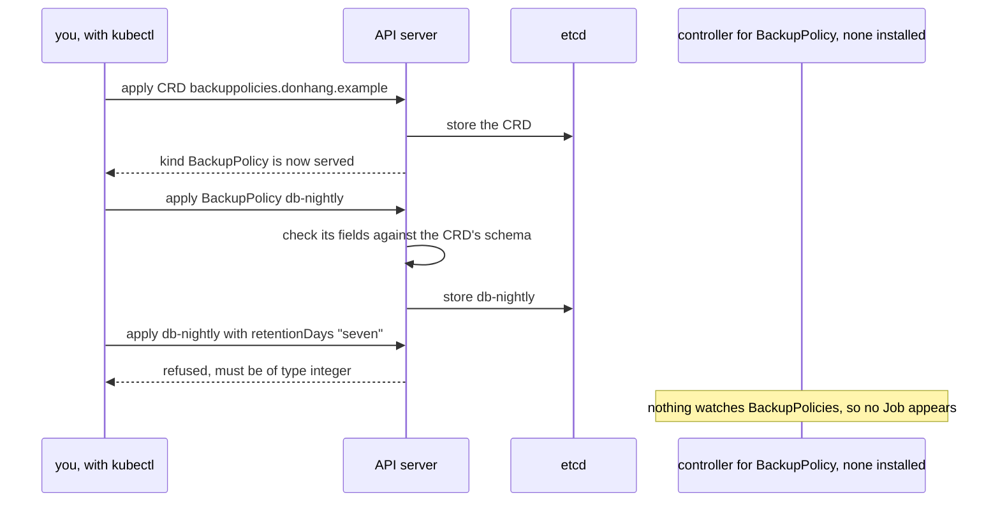

## Before you start

- [[k8s.l1.manifests-and-kubectl-apply]] — `apiVersion` and `kind` in a manifest name the type of an object, and `kubectl apply` returns once the API server has stored it.
- [[k8s.l1.control-plane-components]] — the API server keeps the cluster's objects in etcd, and other components act on them only through it.
- [[k8s.l3.metallb-address-pools]] — MetalLB's install manifest added kinds such as `IPAddressPool` that the cluster did not have before.
- [[k8s.l2.charts-through-argo-cd]] — Argo CD renders a chart itself and syncs the plain manifests, so a chart change arrives as a commit to `targetRevision`.

## The situation

The database keeps its data on the claim `data-db-0`, and the team wants its backup rule written as YAML in Git, next to everything else: which claim, when, and how many days to keep each copy. No kind the API server knows says that. Yet a new cluster did not know `Application`, `SealedSecret` or `IPAddressPool` either, and you have applied all three. Each came with its project's install manifest. A teammate suggests adding a kind `BackupPolicy` the same way and writing one object for `data-db-0`. What does such a manifest add to the API server, and would a `BackupPolicy` object back anything up?

## Core concepts

- **CustomResourceDefinition (CRD)** — an object that adds a new kind to the API server: the kind's name, its API group, its versions and a schema for its objects.
- **custom resource** — an object of a kind that a CRD added; the API server stores it in etcd and serves it to `kubectl` like a Deployment.
- API group — the part of `apiVersion` before the slash, such as `donhang.example` in `donhang.example/v1alpha1`; a CRD puts its kind in a group.
- The CRD's schema — an OpenAPI description of which fields an object of the kind may have and of which type; the API server checks every object against it.
- A controller for a kind — a program that watches objects of that kind through the API server and acts on them; a CRD brings none.

## How it works



In the situation above, each project's install manifest contained CRDs, and `Application`, `SealedSecret` and `IPAddressPool` are custom resources. On `donhang`, `kubectl get crds` lists nine CRDs whose names end in `metallb.io`; `ipaddresspools.metallb.io` is the one behind `IPAddressPool`.

A CRD is itself an object. You apply it like any manifest, and the API server stores it in etcd. The API server then records conditions on the CRD, named statuses; `Established` turns true once the new kind is served, and `kubectl apply`, `get` and `delete` work on its objects. Nothing in the API server is rebuilt or restarted; the CRD is data the API server reads.

When you apply a custom resource, the API server first checks its fields against the CRD's schema. An object that breaks the schema is refused with an error and not stored. One that passes is kept in etcd and listed like a Deployment.

That is everything the API server does with it. A Deployment leads to Pods only because a control loop in the control plane watches Deployments and creates ReplicaSets for them. Kubernetes has no control loop for a kind it has never heard of, and a CRD contains no program. Whatever a custom resource should cause, a separate controller has to watch for it and do; for `BackupPolicy`, that would mean creating a Job at each scheduled time.

## In the Đơn Hàng system

`scripts/k8s/custom-resources.sh` runs on your machine against `donhang`, in the namespace `operator-lessons`, and applies `deploy/k8s/lessons/backup-policy-crd.yaml`. Lines 6–20 of that file, above the excerpt, name the CRD `backuppolicies.donhang.example`, the plural and the group joined by a dot, as the API server requires. `backuppolicies` is the lowercase plural of the kind, the name the commands below use. The lines put the kind `BackupPolicy` in the group `donhang.example` with one version, `v1alpha1`, which follows the slash in `apiVersion`. They set `scope: Namespaced`, so each `BackupPolicy` lives in a namespace. The CRD itself has no namespace: it is cluster-wide, and `scope` is about its objects.

```yaml file=deploy/k8s/lessons/backup-policy-crd.yaml tag=stage-3 lines=21-44
      schema:
        openAPIV3Schema:
          type: object
          properties:
            apiVersion:
              type: string
            kind:
              type: string
            metadata:
              type: object
            # lesson: k8s.l3.custom-resources
            # What a BackupPolicy says: which claim, when (cron syntax) and
            # how many days to keep each copy.
            spec:
              type: object
              required: ["claimName", "schedule", "retentionDays"]
              properties:
                claimName:
                  type: string
                schedule:
                  type: string
                retentionDays:
                  type: integer
                  minimum: 1
```

`openAPIV3Schema` describes a whole object. Under `spec`, all three fields are `required`. `claimName` and `schedule` are strings; the schema has no rule for cron syntax, so the API server checks only that `schedule` is a string. `retentionDays` is an `integer` of at least 1; in YAML, a value in quotes, such as `"7"`, is a string, so it fails too. The object in `deploy/k8s/lessons/backup-policy.yaml` fills them in: `db-nightly` in `operator-lessons`, for `data-db-0`, at `0 2 * * *` (every day at 02:00), kept seven days.

`show` prints a command, then runs it; `2>&1 || true` keeps an error's text in the output and lets the script go on.

```bash file=scripts/k8s/custom-resources.sh tag=stage-3 lines=25-49
show kubectl apply -f deploy/k8s/lessons/backup-policy.yaml
show kubectl get backuppolicies -n operator-lessons \
  -o custom-columns=NAME:.metadata.name,CLAIM:.spec.claimName,SCHEDULE:.spec.schedule,DAYS:.spec.retentionDays
echo

# lesson: k8s.l3.custom-resources
# The same object with "seven" for a number: the schema says integer, and
# the API server refuses to store it.
echo "\$ sed 's/retentionDays: 7/retentionDays: seven/' deploy/k8s/lessons/backup-policy.yaml | kubectl apply -f -"
sed 's/retentionDays: 7/retentionDays: seven/' deploy/k8s/lessons/backup-policy.yaml | kubectl apply -f - 2>&1 || true
echo

# lesson: k8s.l3.custom-resources
# Stored, and nothing more: no controller watches BackupPolicies, so no
# Job or Pod ever appears for db-nightly.
sleep 10
show kubectl get jobs,pods -n operator-lessons
echo

# lesson: k8s.l3.custom-resources
# A CRD is cluster-wide, and its objects go with it: once it is deleted,
# the kind is gone from the API, and db-nightly with it.
show kubectl delete -f deploy/k8s/lessons/backup-policy-crd.yaml
echo "\$ kubectl get backuppolicies -n operator-lessons"
kubectl get backuppolicies -n operator-lessons 2>&1 || true
```

```text output=true
$ kubectl get crds | grep metallb.io
bfdprofiles.metallb.io
bgpadvertisements.metallb.io
bgppeers.metallb.io
communities.metallb.io
configurationstates.metallb.io
ipaddresspools.metallb.io
l2advertisements.metallb.io
servicebgpstatuses.metallb.io
servicel2statuses.metallb.io

$ kubectl apply -f deploy/k8s/lessons/backup-policy-crd.yaml
customresourcedefinition.apiextensions.k8s.io/backuppolicies.donhang.example created
$ kubectl api-resources --api-group=donhang.example
NAME   SHORTNAMES   APIVERSION   NAMESPACED   KIND
backuppolicies   donhang.example/v1alpha1   true   BackupPolicy
$ kubectl apply -f deploy/k8s/lessons/backup-policy.yaml
backuppolicy.donhang.example/db-nightly created
$ kubectl get backuppolicies -n operator-lessons -o custom-columns=NAME:.metadata.name,CLAIM:.spec.claimName,SCHEDULE:.spec.schedule,DAYS:.spec.retentionDays
NAME         CLAIM       SCHEDULE    DAYS
db-nightly   data-db-0   0 2 * * *   7

$ sed 's/retentionDays: 7/retentionDays: seven/' deploy/k8s/lessons/backup-policy.yaml | kubectl apply -f -
The BackupPolicy "db-nightly" is invalid: spec.retentionDays: Invalid value: "string": spec.retentionDays in body must be of type integer: "string"

$ kubectl get jobs,pods -n operator-lessons
No resources found in operator-lessons namespace.

$ kubectl delete -f deploy/k8s/lessons/backup-policy-crd.yaml
customresourcedefinition.apiextensions.k8s.io "backuppolicies.donhang.example" deleted
$ kubectl get backuppolicies -n operator-lessons
Error from server (NotFound): Unable to list "donhang.example/v1alpha1, Resource=backuppolicies": the server could not find the requested resource (get backuppolicies.donhang.example)
```

The lines above the excerpt list MetalLB's CRDs (the script asks for the names only, so a plain `kubectl get crds` prints more than this), apply the CRD, wait until it is `Established` and list the new kind with `kubectl api-resources`.

In the excerpt, `db-nightly` is stored and read back in four columns. The `sed` line swaps `7` for `seven`, and the API server refuses the change with `must be of type integer`. Ten seconds later, `operator-lessons` has no Job and no Pod: `db-nightly` is stored, and nothing more.

Deleting the CRD takes the kind out of the API, and `db-nightly` with it. The last `kubectl get` does not print an empty list; it gets `NotFound`, because the resource itself no longer exists. A chart can keep its CRDs in a `crds/` folder, apart from its templates, and Helm treats that folder differently. Helm installs those CRDs on `helm install`, skipping any that already exist, and does not upgrade or delete them: Helm's docs name the risk of unintended data loss, since a deleted CRD takes every object of its kind along.

Argo CD renders a chart itself with `helm template`, Helm's command that only renders the manifests and installs nothing, and by default includes the chart's CRDs in the manifests it compares and syncs, unlike `helm upgrade`. Traefik's chart, pinned in `apps/traefik.yaml`, brings kinds such as `IngressRoute`, Traefik's own kind for routing rules. So a new chart version's CRD changes show up in the Application's diff, and the API server checks every later create or update of those objects against the changed schema. When objects of those kinds exist, read the CRD changes in that diff first.

## Seniors often assume…

- **"Creating a custom resource makes something happen in the cluster by itself."** → Actually the API server only checks and stores it, because a CRD brings no program; something happens only if a controller watches that kind. You notice this when `kubectl get backuppolicies` lists `db-nightly` but `kubectl get jobs,pods` in `operator-lessons` finds nothing, and no error says why.
- **"A CRD is a plugin that changes the API server's own code."** → Actually a CRD is an object the API server stores and reads, and the new kind is served without a rebuild or a restart. You notice this when `kubectl api-resources` lists `backuppolicies` right after the CRD is applied and `Established`.
- **"Deleting a CRD leaves the objects of its kind in place."** → Actually deleting a CRD deletes every object of its kind, in every namespace, and removes the kind from the API. You notice this when `kubectl get backuppolicies` answers `NotFound` after the CRD is deleted, instead of listing `db-nightly`.

## Try it (3 minutes)

From the root of the Đơn Hàng repository, with Docker Desktop running, kind and `kubectl` installed, and the `donhang` cluster from the earlier lessons running:

1. Run `scripts/k8s/custom-resources.sh`. If MetalLB is not installed yet, the script installs it first, which takes longer.
2. Find the line after the `sed` command and the last line of the output.

Expected result: the line after `sed` starts with `The BackupPolicy "db-nightly" is invalid` and names `spec.retentionDays`. `kubectl get jobs,pods` prints `No resources found in operator-lessons namespace.`, and the last line starts with `Error from server (NotFound)`.

## Connections

- [[k8s.l3.cert-manager]] — the next step: a controller that watches its own custom resources and issues certificates from them.
- [[k8s.l3.operator-pattern]] — the pattern this lesson stops short of: custom resources together with a controller that acts on them.
- [[devops.l3.argo-cd-applications]] — where you first applied a custom resource, `Application`.
- [[devops.l3.sealed-secrets]] — another custom resource, `SealedSecret`, with a controller that turns each one into a Kubernetes Secret.
- [[k8s.l2.ingress]] — the same split for a built-in kind: an Ingress object does nothing until an Ingress controller watches it.
- [[k8s.l3.admission-policies]] — another check the API server runs before storing an object, written as rules across kinds instead of a schema for one kind.
- [[k8s.l2.charts-through-argo-cd]] — the chart pin whose diff now has CRDs in it to read first.

## Five-line summary

1. A CustomResourceDefinition adds a new kind to the API server; its objects, custom resources, are stored in etcd and used with kubectl.
2. Argo CD, Sealed Secrets and MetalLB brought CRDs in their install manifests; `kubectl get crds` on `donhang` lists MetalLB's nine.
3. The API server checks every custom resource against the CRD's schema and refuses one whose fields break it, such as `retentionDays: seven`.
4. A CRD only stores objects: no controller watches `BackupPolicy`, so `db-nightly` causes no Job and no Pod.
5. Deleting a CRD deletes all its objects, so Helm does not upgrade or delete `crds/`; Argo CD puts chart CRDs in its diff.
