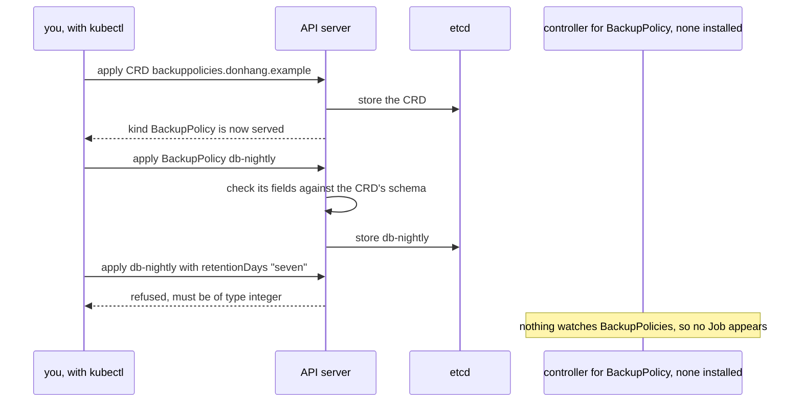

## Bạn cần biết trước

- [[k8s.l1.manifests-and-kubectl-apply]] — `apiVersion` và `kind` trong manifest cho biết loại của một object, và `kubectl apply` trả về ngay khi API server đã lưu nó.
- [[k8s.l1.control-plane-components]] — API server giữ các object của cluster trong etcd, và các thành phần khác chỉ tác động lên chúng thông qua API server.
- [[k8s.l3.metallb-address-pools]] — manifest cài đặt của MetalLB đã thêm những kind như `IPAddressPool` mà trước đó cluster chưa có.
- [[k8s.l2.charts-through-argo-cd]] — Argo CD tự render chart rồi sync các manifest thường, nên một thay đổi của chart tới nơi dưới dạng một commit vào `targetRevision`.

## Tình huống

Database giữ dữ liệu trên claim `data-db-0`, và nhóm muốn viết luật backup của nó thành YAML trong Git, cạnh mọi thứ khác: claim nào, lúc nào, và giữ mỗi bản sao bao nhiêu ngày. Không kind nào API server biết diễn đạt được điều đó. Nhưng một cluster mới cũng đâu biết `Application`, `SealedSecret` hay `IPAddressPool`, vậy mà bạn đã apply cả ba. Mỗi kind đi kèm manifest cài đặt của dự án tương ứng. Một đồng nghiệp đề xuất thêm kind `BackupPolicy` theo cùng cách đó, rồi viết một object cho `data-db-0`. Một manifest như thế thêm gì vào API server, và một object `BackupPolicy` có backup được gì không?

## Khái niệm cốt lõi

- **CustomResourceDefinition (CRD)** (Object khai báo một kind mới cho API server: tên, nhóm API và schema của object thuộc kind đó) — object thêm một kind mới vào API server: tên của kind, nhóm API của nó, các version và một schema cho các object thuộc kind đó.
- **custom resource** (Object thuộc một kind do CRD thêm vào; API server lưu và trả nó như object có sẵn) — object thuộc một kind do CRD thêm vào. API server lưu nó trong etcd và trả nó cho `kubectl` giống như một Deployment.
- Nhóm API (API group) — phần đứng trước dấu gạch chéo trong `apiVersion`, chẳng hạn `donhang.example` trong `donhang.example/v1alpha1`. CRD đặt kind của nó vào một nhóm.
- Schema của CRD — bản mô tả OpenAPI cho biết object thuộc kind đó được có những field nào, mỗi field kiểu gì. API server kiểm tra mọi object theo nó.
- Controller cho một kind — chương trình theo dõi các object thuộc kind đó qua API server và hành động dựa trên chúng. CRD không mang theo controller nào.

## Cơ chế hoạt động



Trong tình huống trên, manifest cài đặt của mỗi dự án đều chứa CRD, và `Application`, `SealedSecret`, `IPAddressPool` đều là custom resource. Trên `donhang`, `kubectl get crds` liệt kê chín CRD có tên kết thúc bằng `metallb.io`. `ipaddresspools.metallb.io` là CRD đứng sau `IPAddressPool`.

Bản thân CRD cũng là một object. Bạn apply nó như mọi manifest, và API server lưu nó trong etcd. Sau đó API server ghi các condition lên CRD, tức những trạng thái có tên. `Established` chuyển sang true khi kind mới đã được phục vụ, và `kubectl apply`, `get`, `delete` dùng được với các object của nó. Không có gì trong API server được build lại hay khởi động lại: CRD là dữ liệu mà API server đọc.

Khi bạn apply một custom resource, trước hết API server kiểm tra các field của nó theo schema của CRD. Object vi phạm schema bị từ chối kèm lỗi và không được lưu. Object hợp lệ được giữ trong etcd và liệt kê ra giống như một Deployment.

API server chỉ làm với nó đến thế. Một Deployment sinh ra Pod chỉ vì trong control plane có một vòng điều khiển theo dõi Deployment và tạo ReplicaSet cho chúng. Kubernetes không có vòng điều khiển nào cho một kind nó chưa từng nghe tới, và CRD không chứa chương trình nào. Một custom resource cần gây ra điều gì thì phải có một controller riêng theo dõi nó và làm điều đó. Với `BackupPolicy`, nghĩa là tạo một Job vào mỗi thời điểm đã hẹn.

## Trong hệ thống Đơn Hàng

`scripts/k8s/custom-resources.sh` chạy trên máy bạn, nhắm vào `donhang`, trong namespace `operator-lessons`, và apply `deploy/k8s/lessons/backup-policy-crd.yaml`. Dòng 6–20 của file đó, phía trên đoạn trích, đặt tên CRD là `backuppolicies.donhang.example`: dạng số nhiều và nhóm nối nhau bằng dấu chấm, đúng như API server yêu cầu. `backuppolicies` là dạng số nhiều viết thường của kind, cái tên các lệnh bên dưới dùng. Các dòng đó đặt kind `BackupPolicy` vào nhóm `donhang.example` với một version duy nhất, `v1alpha1`, phần đứng sau dấu gạch chéo trong `apiVersion`. Chúng đặt `scope: Namespaced`, nên mỗi `BackupPolicy` nằm trong một namespace. Bản thân CRD không có namespace: nó áp cho cả cluster, còn `scope` nói về các object của nó.

```yaml file=deploy/k8s/lessons/backup-policy-crd.yaml tag=stage-3 lines=21-44
      schema:
        openAPIV3Schema:
          type: object
          properties:
            apiVersion:
              type: string
            kind:
              type: string
            metadata:
              type: object
            # lesson: k8s.l3.custom-resources
            # What a BackupPolicy says: which claim, when (cron syntax) and
            # how many days to keep each copy.
            spec:
              type: object
              required: ["claimName", "schedule", "retentionDays"]
              properties:
                claimName:
                  type: string
                schedule:
                  type: string
                retentionDays:
                  type: integer
                  minimum: 1
```

`openAPIV3Schema` mô tả toàn bộ một object. Dưới `spec`, cả ba field đều `required`. `claimName` và `schedule` là chuỗi. Schema không có luật nào cho cú pháp cron, nên API server chỉ kiểm tra `schedule` có phải chuỗi hay không. `retentionDays` là `integer` tối thiểu bằng 1. Trong YAML, giá trị nằm trong dấu nháy, như `"7"`, là chuỗi, nên nó cũng trượt. Object trong `deploy/k8s/lessons/backup-policy.yaml` điền các field này: `db-nightly` trong `operator-lessons`, cho `data-db-0`, lúc `0 2 * * *` (mỗi ngày lúc 02:00), giữ bảy ngày.

`show` in ra một lệnh rồi chạy nó. `2>&1 || true` giữ nội dung lỗi trong output và cho script chạy tiếp.

```bash file=scripts/k8s/custom-resources.sh tag=stage-3 lines=25-49
show kubectl apply -f deploy/k8s/lessons/backup-policy.yaml
show kubectl get backuppolicies -n operator-lessons \
  -o custom-columns=NAME:.metadata.name,CLAIM:.spec.claimName,SCHEDULE:.spec.schedule,DAYS:.spec.retentionDays
echo

# lesson: k8s.l3.custom-resources
# The same object with "seven" for a number: the schema says integer, and
# the API server refuses to store it.
echo "\$ sed 's/retentionDays: 7/retentionDays: seven/' deploy/k8s/lessons/backup-policy.yaml | kubectl apply -f -"
sed 's/retentionDays: 7/retentionDays: seven/' deploy/k8s/lessons/backup-policy.yaml | kubectl apply -f - 2>&1 || true
echo

# lesson: k8s.l3.custom-resources
# Stored, and nothing more: no controller watches BackupPolicies, so no
# Job or Pod ever appears for db-nightly.
sleep 10
show kubectl get jobs,pods -n operator-lessons
echo

# lesson: k8s.l3.custom-resources
# A CRD is cluster-wide, and its objects go with it: once it is deleted,
# the kind is gone from the API, and db-nightly with it.
show kubectl delete -f deploy/k8s/lessons/backup-policy-crd.yaml
echo "\$ kubectl get backuppolicies -n operator-lessons"
kubectl get backuppolicies -n operator-lessons 2>&1 || true
```

```text output=true
$ kubectl get crds | grep metallb.io
bfdprofiles.metallb.io
bgpadvertisements.metallb.io
bgppeers.metallb.io
communities.metallb.io
configurationstates.metallb.io
ipaddresspools.metallb.io
l2advertisements.metallb.io
servicebgpstatuses.metallb.io
servicel2statuses.metallb.io

$ kubectl apply -f deploy/k8s/lessons/backup-policy-crd.yaml
customresourcedefinition.apiextensions.k8s.io/backuppolicies.donhang.example created
$ kubectl api-resources --api-group=donhang.example
NAME   SHORTNAMES   APIVERSION   NAMESPACED   KIND
backuppolicies   donhang.example/v1alpha1   true   BackupPolicy
$ kubectl apply -f deploy/k8s/lessons/backup-policy.yaml
backuppolicy.donhang.example/db-nightly created
$ kubectl get backuppolicies -n operator-lessons -o custom-columns=NAME:.metadata.name,CLAIM:.spec.claimName,SCHEDULE:.spec.schedule,DAYS:.spec.retentionDays
NAME         CLAIM       SCHEDULE    DAYS
db-nightly   data-db-0   0 2 * * *   7

$ sed 's/retentionDays: 7/retentionDays: seven/' deploy/k8s/lessons/backup-policy.yaml | kubectl apply -f -
The BackupPolicy "db-nightly" is invalid: spec.retentionDays: Invalid value: "string": spec.retentionDays in body must be of type integer: "string"

$ kubectl get jobs,pods -n operator-lessons
No resources found in operator-lessons namespace.

$ kubectl delete -f deploy/k8s/lessons/backup-policy-crd.yaml
customresourcedefinition.apiextensions.k8s.io "backuppolicies.donhang.example" deleted
$ kubectl get backuppolicies -n operator-lessons
Error from server (NotFound): Unable to list "donhang.example/v1alpha1, Resource=backuppolicies": the server could not find the requested resource (get backuppolicies.donhang.example)
```

Các dòng phía trên đoạn trích liệt kê CRD của MetalLB (script chỉ lấy tên, nên `kubectl get crds` không kèm gì sẽ in nhiều hơn thế này), apply CRD, chờ tới khi nó `Established` rồi liệt kê kind mới bằng `kubectl api-resources`.

Trong đoạn trích, `db-nightly` được lưu rồi đọc lại thành bốn cột. Dòng `sed` đổi `7` thành `seven`, và API server từ chối thay đổi đó với `must be of type integer`. Mười giây sau, `operator-lessons` không có Job nào, cũng không có Pod nào: `db-nightly` được lưu, và chỉ có thế.

Xóa CRD sẽ đưa kind ra khỏi API, kéo theo cả `db-nightly`. Lệnh `kubectl get` cuối cùng không in ra danh sách rỗng mà nhận `NotFound`, vì chính resource đó không còn tồn tại. Một chart có thể để CRD của nó trong thư mục `crds/`, tách khỏi các template, và Helm xử lý thư mục này theo cách khác. Helm cài các CRD đó khi `helm install`, bỏ qua CRD nào đã có, và không bao giờ upgrade hay xóa chúng. Tài liệu của Helm nêu rõ rủi ro mất dữ liệu ngoài ý muốn, vì xóa một CRD là xóa theo mọi object thuộc kind của nó.

Argo CD tự render chart bằng `helm template`, lệnh của Helm chỉ render manifest và không cài gì. Khác với `helm upgrade`, theo mặc định Argo CD đưa CRD của chart vào các manifest mà nó so sánh và sync. Chart của Traefik, được ghim trong `apps/traefik.yaml`, mang theo những kind như `IngressRoute`, kind riêng của Traefik cho luật định tuyến. Vì vậy thay đổi CRD trong một version chart mới hiện ra trong diff của Application, và API server kiểm tra mọi lần tạo hay cập nhật object thuộc các kind đó về sau theo schema đã đổi. Khi đã có object thuộc các kind đó, hãy đọc phần thay đổi CRD trong diff trước tiên.

## Senior hay nhầm rằng…

- **"Tạo một custom resource là tự nó làm cluster thay đổi gì đó."** → Thực ra API server chỉ kiểm tra và lưu nó, vì CRD không mang theo chương trình nào. Điều gì đó chỉ xảy ra nếu có controller theo dõi kind này. Bạn sẽ nhận ra khi `kubectl get backuppolicies` liệt kê `db-nightly` mà `kubectl get jobs,pods` trong `operator-lessons` không thấy gì, và chẳng có lỗi nào giải thích tại sao.
- **"CRD là một plugin sửa code của chính API server."** → Thực ra CRD là một object mà API server lưu và đọc, và kind mới được phục vụ mà không cần build lại hay khởi động lại. Bạn sẽ nhận ra khi `kubectl api-resources` liệt kê `backuppolicies` ngay sau khi CRD được apply và `Established`.
- **"Xóa CRD thì các object thuộc kind của nó vẫn còn nguyên."** → Thực ra xóa CRD là xóa mọi object thuộc kind đó, ở mọi namespace, và gỡ kind khỏi API. Bạn sẽ nhận ra khi `kubectl get backuppolicies` trả về `NotFound` sau khi CRD bị xóa, thay vì liệt kê `db-nightly`.

## Thử ngay (3 phút)

Ở thư mục gốc của repo Đơn Hàng, với Docker Desktop đang chạy, đã cài kind và `kubectl`, và cluster `donhang` từ các bài trước đang chạy:

1. Chạy `scripts/k8s/custom-resources.sh`. Nếu MetalLB chưa được cài, script sẽ cài nó trước, nên chạy lâu hơn.
2. Tìm dòng ngay sau lệnh `sed` và dòng cuối cùng của output.

Kết quả mong đợi: dòng sau `sed` bắt đầu bằng `The BackupPolicy "db-nightly" is invalid` và nêu tên `spec.retentionDays`. `kubectl get jobs,pods` in ra `No resources found in operator-lessons namespace.`, còn dòng cuối bắt đầu bằng `Error from server (NotFound)`.

## Liên hệ

- [[k8s.l3.cert-manager]] — bước tiếp theo: một controller theo dõi các custom resource của riêng nó và cấp certificate từ chúng.
- [[k8s.l3.operator-pattern]] — pattern mà bài này dừng lại ngay trước: custom resource đi cùng một controller hành động dựa trên chúng.
- [[devops.l3.argo-cd-applications]] — nơi bạn apply custom resource đầu tiên, `Application`.
- [[devops.l3.sealed-secrets]] — một custom resource khác, `SealedSecret`, có controller biến mỗi object thành một Secret của Kubernetes.
- [[k8s.l2.ingress]] — cùng sự tách bạch đó ở một kind có sẵn: object Ingress không làm gì cho tới khi có Ingress controller theo dõi nó.
- [[k8s.l3.admission-policies]] — một kiểm tra khác API server chạy trước khi lưu object, viết thành luật áp cho nhiều kind thay vì một schema cho một kind.
- [[k8s.l2.charts-through-argo-cd]] — chỗ ghim chart mà giờ diff của nó có CRD cần đọc trước.

## Tóm tắt 5 dòng

1. CustomResourceDefinition thêm một kind mới vào API server. Các object của nó, gọi là custom resource, được lưu trong etcd và dùng được với kubectl.
2. Argo CD, Sealed Secrets và MetalLB mang CRD theo manifest cài đặt. `kubectl get crds` trên `donhang` liệt kê chín CRD của MetalLB.
3. API server kiểm tra mọi custom resource theo schema của CRD và từ chối object có field vi phạm, chẳng hạn `retentionDays: seven`.
4. CRD chỉ lưu object: không controller nào theo dõi `BackupPolicy`, nên `db-nightly` không sinh ra Job hay Pod nào.
5. Xóa CRD là xóa mọi object của nó, nên Helm không upgrade hay xóa `crds/`. Argo CD đưa CRD của chart vào diff.
